[← Зміст довідки](../)


# Універсальна автоматична обробка

## Універсальна автоматична обробка

_Шлях у довідці: Допоміжні сервіси › Універсальна автоматична обробка_

Сервіс призначений для автоматизації ручної обробки великої кількості документів для всіх або обраних підприємств, доданих в програмний комплекс.

Сервіс доступний за наявності ліцензії Держава. Облік ПДВ або Обмін документами з контрагентами.

За допомогою сервісу Ви можете організувати автоматичне виконання операцій:

- [імпорт документів](#ap-uao_imp_z_disc), створених в інших бухгалтерських системах (Зверніть увагу!  У сервісі виконується імпорт тільки первинних документів в форматі ДПС та форматі обміну);
- [накладання підпису печатки та подача звітності](#ap-uao_podannya)  (до ДПСУ, Державної статистичної служби тощо);
- [реєстрація документів у Єдиному реєстрі податкових накладних (ЄРПН)](#ap-uao_vidpravka_dfs);
- [відправка первинних документів контрагентам](#ap-uao_vidpravka_kontr);
- відправка запитів щодо [отримання відомостей з Єдиного реєстру](#ap-uao_erpn) податкових накладних;
- збереження вихідних документів, що були [прийняті або відхилені у ДПС](#ap-uao_vidpravka_dfs), або були [затверджені або відхилені контрагентом](#ap-uao_vidpravka_kontr);
- [автоматичне погодження вхідних первинних документів](#ap-uao_erpn);
- [експорт первинних документів у форматі PDF на електронну пошту](#ap-export-doc-mail);
- [збереження вхідних документів, обробку яких завершено](#ap-uao_erpn);
- [імпорт банківських виписок](#ap-uao_bank);
- [автоматична звірка з ЄРПН](#ap-uao_auto_zvirka);
- [автоматичне опрацювання інформаційних запитів до Державних органів](#ap-uao_avto_info).

### Запуск сервісу

_Шлях у довідці: Допоміжні сервіси › Універсальна автоматична обробка › Запуск сервісу_

В цьому розділі:

[Запуск на сервері](#ap-uao_zapusk)

[Запуск на станції](#ap-uao_zapusk)

[Запуск сервісу в роботу](#ap-uao_zapusk)

Для першого запуску сервісу універсальної автоматичної обробки потрібно виконати такі дії:

- відкрити утиліту [Налаштування з'єднання](ConnectionSetup.html#connectionsetup-connectionsetup) (ConnectionSetup.exe) на сервері та налаштувати сервіс універсальної автоматичної обробки на вкладці Сервіс автоматичної обробки;
- для локального збереження секретних ключів між сеансами роботи автообробника, потрібно за допомогою утиліти вказати локальний каталог.
- перезапустити службу M.Е.Doc на сервері. Після перезапуску служби M.Е.Doc автоматично запуститься служба автообробника (APService.exe).

Надалі при кожному запуску служби M.Е.Doc служба автообробника буде запускатись автоматично.

Запуск на сервері

Для запуску автообробника на сервері потрібно запустити файл APMonitor.exe.

Відобразиться вікно авторизації користувача в системі.

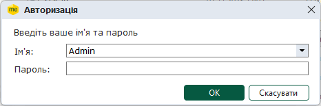

В цьому вікні оберіть ім'я потрібного користувача, введіть пароль та натисніть кнопку ОК. Якщо у обраного користувача [налаштовані права доступу](UCManageRoles.html#ucmanageroles-ucmanageroles), то відобразиться вікно вибору установи.

У вікні Вибір установи представлено перелік всіх [доданих](Connect_org.html#connect_org-connect_org) в програмний комплекс підприємств.

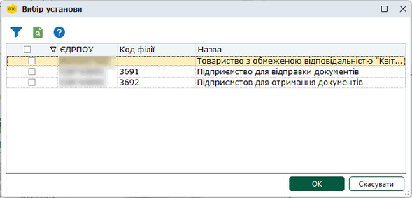

У вікні вибору установи встановіть галочки у рядках підприємств, для яких потрібно запустити сервіс, та натисніть на кнопку ОК. Щоб швидко встановити (видалити) галочки для всіх підприємств, встановіть (видаліть) позначку у заголовку колонки.

Якщо сервіс доступний для всіх обраних підприємств, відкриється вікно Універсальна автоматична обробка.

Кожне обране підприємство відображається на окремій вкладці.

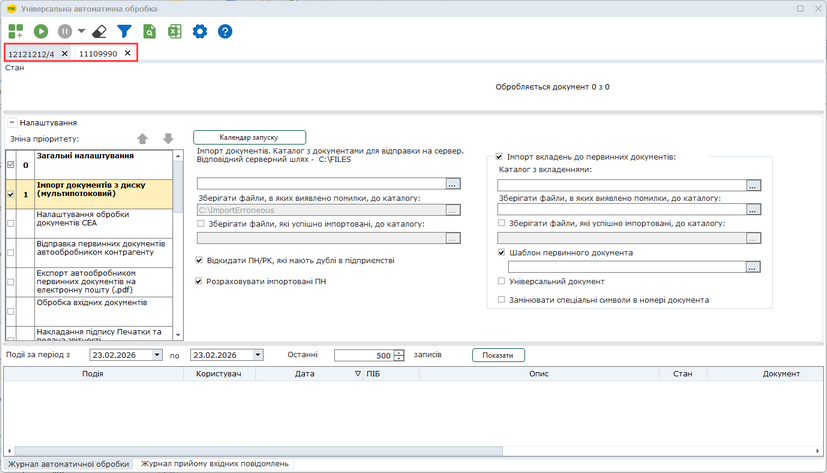

Натисніть, щоб збільшити малюнок

Якщо сервіс доступний не для всіх обраних підприємств, відобразиться повідомлення про відсутність ліцензії.

При натисканні на кнопку Так сервіс буде запущений для підприємств із діючою ліцензією.

При натисканні на кнопку Ні сервіс не запускається.

[До початку](#ap-uao_zapusk)

Запуск на станції

Запустити сервіс можна одним із способів:

- Для запуску автообробника на станції скопіюйте у будь-яке місце на станції папку «AP» з папки, куди встановлений M.Е.Doc на сервері. В цій папці міститься мінімальний набір файлів для запуску монітора автообробника. Не потрібно виконувати жодних налаштувань.

З папки «AP» запустіть файл APStart.exe, який завантажує та оновлює бібліотеки, необхідні для запуску монітора, та відкриває монітор автообробника (починаючи з авторизації).

- За допомогою файлу apnet.exe.

Для каталогу, в якому встановлено програмний комплекс на сервері, відкрийте доступ для читання користувачами.

З робочого місця користувача відкрийте мережевий каталог на серверному комп'ютері, в якому встановлена серверна частина програми.

На робочому столі користувача створіть ярлик файлу apnet.exe. Для запуску Сервісу універсальної автоматичної обробки натисніть двічі лівою клавішею миші по створеному ярлику.

Під час запуску виконується копіювання необхідних файлів Сервісу універсальної автоматичної обробки, після чого здійснюється запуск APMonitor.exe (з каталогу профіля користувача C:\Users\<Ім’я користувача>\AppData\Roaming\MEDOC\<ID каталогу>\).

[До початку](#ap-uao_zapusk)

Запуск та робота сервісу

Зверніть увагу! До моменту зупинення сервісу або виходу із програмного комплексу сервіс буде безперервно виконувати обрані операції. Інтервал часу, із яким виконуються операції, вказується в налаштуваннях сервісу.
Для того, щоб змінити налаштування роботи, необхідно зупинити сервіс. Увімкнення-вимкнення операцій під час виконання автоматичної обробки неможливе.

Щоб запустити автоматичну обробку, натисніть на кнопку  на панелі інструментів.

Після запуску сервісу в роботу відобразиться вікно вибору секретних ключів підприємств, для яких можливо запустити автообробник.

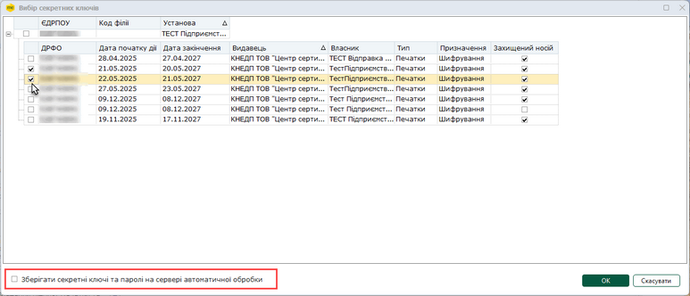

Натисніть, щоб збільшити малюнок

1.  Для підприємств, у яких необхідно здійснювати автоматичну обробку, встановіть відмітку для потрібного ключа.

2.  У разі потреби, встановіть ознаку Зберігати секретні ключі та паролі на сервері автоматичної обробки.

3. Натисніть на кнопку ОК.

Відкриється вікно Підпис.

Якщо було встановлено ознаку Зберігати секретні ключі та паролі на сервері автоматичної обробки, то відобразиться повідомлення про збереження ключів.

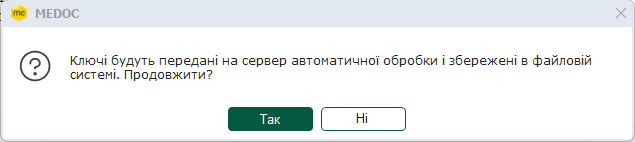

При натисканні на кнопку Так відкриється вікно Підпис.

Секретні ключі та паролі зберігаються на сервері у каталозі, вказаному в полі Розташування каталогу секретних ключів в утиліті [Налаштування з'єднання](ConnectionSetup.html#connectionsetup-connectionsetup).

У вікні Підпис оберіть каталог з секретними ключами, зазначте пароль до ключа та натисніть на кнопку ОК.

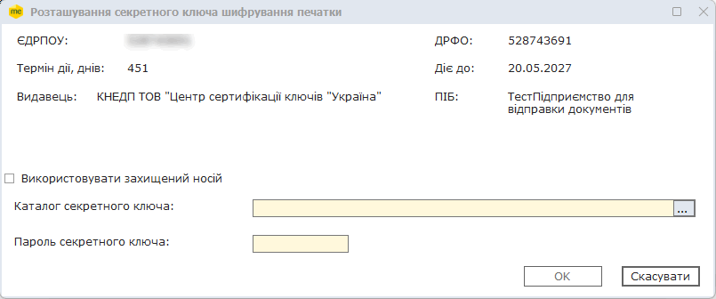

Почергово повторіть процедуру для кожного із обраних секретних ключів підприємств.

Після зазначення пароля для останнього ключа універсальний автообробник почне роботу.

Можливо додавати підприємства у роботу без зупинки автоматичної обробки документів у інших підприємствах.

Після запуску в першу чергу перевіряється поштова скринька на наявність вхідних повідомлень, відкриється стандартне вікно підписання документа, де потрібно ввести пароль доступу до секретних ключів. Натисніть ОК. Розпочнеться процес завантаження надісланих повідомлень.

Після перевірки пошти сервіс розпочне виконувати задані операції, у встановленій при налаштуванні послідовності.

Весь процес роботи сервісу відображається у хронологічному порядку у протоколі виконаних операцій.

До моменту зупинення сервісу або виходу із програмного комплексу, сервіс буде безперервно виконувати оброку документів із вказаним проміжком часу, а також перевіряти поштову скриньку на наявність нових вхідних повідомлень.

- Якщо не налаштовано жодних дій, автообробник виконує приймання вхідних повідомлень.
- УВАГА! Логування роботи універсального автообробника відбувається, якщо встановлено параметр Виконувати записи про запуск та зупинку в журнал APService.log в утиліті [Налаштування з'єднання](ConnectionSetup.html#connectionsetup-connectionsetup).

Щоб зупинити автоматичну обробку, натисніть на кнопку  на панелі інструментів.

Якщо у обробці знаходиться декілька підприємств, можливо зупинити обробку у всіх підприємствах або лише у поточному (вкладка якого є активною). Для цього у списку, що відкриється, оберіть потрібний пункт: Поточне підприємство чи Всі підприємства.

[До початку](#ap-uao_zapusk)

### Опис структури сервісу

_Шлях у довідці: Допоміжні сервіси › Універсальна автоматична обробка › Опис структури сервісу_

Інтерфейс сервісу складається із 5 функціональних частин.

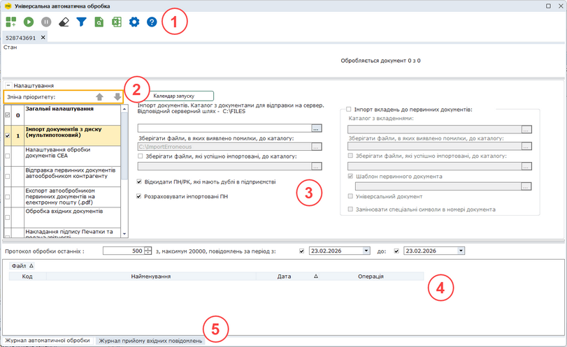

Натисніть, щоб збільшити малюнок

1. Панель інструментів

На панелі розташовані кнопки:

|  |  |  |
| --- | --- | --- |
|  | Додати установу | Вибір додаткових установ, для яких потрібно запустити автоматичну обробку |
|  | Старт | Запуск автоматичної обробки (для всіх відкритих закладок підприємств) |
|  | Стоп | Зупинка автоматичної обробки (для всіх відкритих закладок підприємств) |

|  |  |  |
| --- | --- | --- |
|  | Очистити журнал | Очищення журналу автоматичної обробки поточної установи |
|  | Увімкнути фільтр | Встановлення фільтру за колонками для журналу автоматичної обробки поточної установи |
|  | Пошук | Пошук в журналі автоматичної обробки поточної установи |
|  | Експорт Журналу подій | Збереження даних журналу автоматичної обробки у файл формату Excel |
|  | Параметри системи | Виклик [вікна налаштування параметрів системи](FormCompanyParams.html#formcompanyparams-admcompanyparams) |
|  | Виклик довідки | Довідка по роботі з сервісом |

Експорт Журналу подій

1. На панелі інструментів натисніть кнопку .

2. Відкриється вікно Експорт журналу подій:

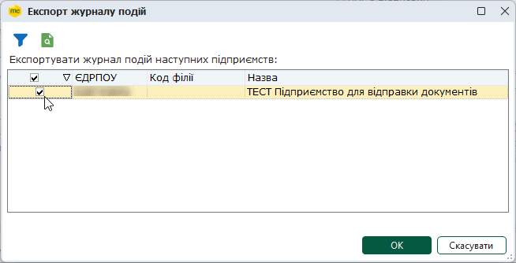

3. Оберіть підприємства, для яких потрібно зберегти дані журналу, встановіть позначки у відповідних рядках. (Вікно містить список всіх підприємств, відкритих у сервісі Універсальної обробки документів.) Щоб швидко обрати всі підприємства, встановіть позначку у заголовку таблиці.

4. Для виконання експорту натисніть ОК. У вікні, що відкриється введіть ім'я файлу. Журнал подій буде збережено у форматі Excel, дані для кожного підприємства зберігаються на окремому аркуші.

2. Панель зміни пріоритету виконання операції

Містить засоби для налаштування порядку виконання автоматичних операцій. Пріоритет операцій визначає послідовність, у якій будуть виконуватись операції.

Номер пріоритету операції відповідає порядковому номеру операції у черзі на виконання та відображається на панелі з переліком автоматичних операції. Так операція з пріоритетом "1" буде виконуватись першою, "2" - другою і так далі.

Зверніть увагу! Налаштування розділу Загальні налаштування маються найвищий пріоритет "0". Пріоритет цього розділу змінити неможливо.

Щоб змінити пріоритет, оберіть назву автоматичної операції на панелі з переліком автоматичних операції та натисніть кнопку:

|  |  |
| --- | --- |
|  | Збільшити пріоритет операції та перемістити її на один крок вище у черзі |
|  | Зменшити пріоритет операції та перемістити її на один крок нижче |

Змінювати пріоритет операцій можливо, якщо для виконання обрано хоча б дві автоматичні операції. За замовчуванням кожна новообрана операція отримає найнижчий пріоритет, тобто буде виконуватись останньою.

3. Панель налаштування сервісу

Містить засоби для налаштування автоматичної обробки.

Зверніть увагу! Перед запуском сервісу обов'язково потрібно обрати операції, що будуть виконуватись, та задати параметри функціонування.

Детальніше про налаштування див. розділ [Налаштування автоматичної обробки](#ap-uao_func)

4. Протокол виконання операцій автоматичної обробки

У протоколі в хронологічному порядку відображається інформація про виконані операції. Протокол допомагає користувачу слідкувати за ходом автоматичної обробки.

У відповідних полях протоколу міститься інформація:

- Подія - дія, що була виконана сервісом автоматичної обробки.
- Користувач - ім'я облікового запису користувача в сиcтемі, який запустив сервіс автоматичної обробки.
- Дата - дата та час виконання події.
- ПІБ - прізвище ім'я та по батькові користувача, який запустив сервіс автоматичної обробки.
- Опис - детальніший опис події.
- Період - період події.
- Документ - назва, номер та дата документа, який був оброблений сервісом.

Для того, щоб переглянути всі поля, скористайтеся смугою прокрутки у нижній частині вікна.

5. Панель відображення

Містить вкладки відображення даних:

- Журнал автоматичної обробки - історія подій, які відбувалися під час автоматичної обробки документів. За замовчуванням відображається історія операції за поточну дату. Можна відібрати записи Журналу для перегляду, вказавши дату початку та закінчення періоду у полі Події за період з \_\_ по \_\_. У полі Останні \_\_\_ записів можна встановити кількість останніх записів для відображення у обраному періоді. За замовчуванням відображаються 500 останніх записів. Для відображення записів у журналі встановіть потрібні параметри та натисніть кнопку Показати;
- Журнал прийому вхідних повідомлень - відображає перелік опрацьованих документів, можливо відібрати записи Журналу, вказавши дату початку та закінчення періоду, а також, задавши кількість останніх записів для відображення.

В журналах відображаються події та документи поточного підприємства.

В Журналі автоматичної обробки відображаються 500 останніх подій. Всі події можна побачити в [Журналі подій M.Е.Doc](UCLogs.html#uclogs-admlogs).

[До початку](#ap-uao_opys)

### Налаштування автоматичної обробки

_Шлях у довідці: Допоміжні сервіси › Універсальна автоматична обробка › Налаштування автоматичної обробки_

В цьому розділі:

[Налаштування автоматичної обробки](#ap-uao_func)

[Імпорт документів](#ap-uao_imp_z_disc)

[Реєстрація документів у ЄРПН](#ap-uao_vidpravka_dfs)

[Відправка первинних документів контрагентам](#ap-uao_vidpravka_kontr)

[Обробка вхідних документів](#ap-uao_erpn)

[Накладання підпису печатки та подача звітності](#ap-uao_podannya)

[Експорт первинних документів у форматі PDF на електронну пошту](#ap-export-doc-mail)

[Імпорт банківських виписок](#ap-uao_bank)

[Автоматична звірка з ЄРПН](#ap-uao_auto_zvirka)

[Автоматичне опрацювання інформаційних запитів до Державних органів](#ap-uao_avto_info)

Налаштування автоматичної обробки

Налаштування автоматичної обробки виконується на панелі Налаштування. Панель Налаштування можна згорнути натисканням символу . Відповідно, натискання символу  розгортає панель.

Панель Налаштування розділена на дві частини: ліворуч міститься список доступних операцій автоматичної обробки, праворуч - налаштування операції, обраної для виконання сервісом.

Оберіть операцію Загальні налаштування та встановіть значення параметрів, що є загальними для всіх автоматичних операцій:

- Автоматична обробка кожні \_\_ хвилин - вкажіть проміжок часу в хвилинах, через який сервіс буде циклічно виконувати задані дії.
- Множник потоків обробки на ядро ЦП - задайте кількість потоків обробки. Максимальне можливе значення параметру – 8. Параметр застосовується для всіх підприємств у поточній базі.
- Проставляти ознаку «Включено до ЄРПН» - якщо позначка встановлена, у документ автоматично додається ознака реєстрації у Єдиному реєстрі податкових накладних.
- Виконувати прийом повідомлень - якщо позначка встановлена, сервіс приймає повідомлення (через пряме з'єднання з платформою ПТАХ чи електронною поштою). Якщо позначка не встановлена, прийом повідомлень не виконується. Опцію можна відключити, якщо присутні активні налаштування для будь-якої операції автоматичної обробки. Якщо позначка Виконувати прийом повідомлень встановлена, доступні опції:
- Сертифікати з поточного комплекту підписів – (встановлено за замовчуванням) при автоматичному прийомі вхідних повідомлень використовується сертифікат шифрування з [комплекту підписів](FormCompanyParams.html#formcompanyparams-admcomanyparams_pen) типу Звітність;
- Всі наявні сертифікати шифрування – при автоматичному прийомі вхідних повідомлень використовуються всі наявні сертифікати шифрування, які [завантажені у програму](UCAsignCert.html#ucasigncert-admcert_cert) для поточного підприємства.

Зверніть увагу, обрані сертифікати шифрування використовуються виключно для розшифрування вхідних повідомлень.

- Не відправляти не звірені з ЄДК документи - якщо позначка встановлена, документи, дані в яких не звірені з ЄДК, не будуть відправлятися. За замовчуванням, позначка не встановлена.
- Заміна даних контрагента даними з ЄДК - якщо позначка встановлена, у податкових накладних та розрахунках коригування будуть автоматично замінені дані контрагентів даними з ЄДК, якщо у процесі звірки виявлена їх відмінність.

За замовчуванням, встановлена заміна даних контрагента даними з ЄДК.

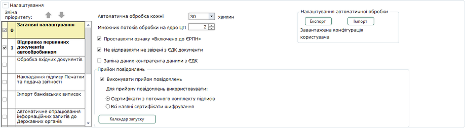

Натисніть, щоб збільшити малюнок

В блоці Налаштування автоматичної обробки можна зберегти або завантажити налаштування автоматичної обробки. Якщо завантажена певна конфігурація, то в цьому блоці буде відображена назва завантаженого файлу конфігурації.

- кнопка Експорт - призначена для збереження поточного налаштування автообробки у файл конфігурації (\*.acf).
При натисканні на кнопку відкриється стандартне вікно вибору папки для збереження файлу.

- кнопка Імпорт - призначена для завантаження налаштування автообробки з файлу конфігурації
При натисканні на кнопку відкриється стандартне вікно вибору файлу (\*.acf).
Після завантаження файлу конфігурації буде встановлено налаштування операцій автообробника з цього файлу.

Для виконання операції потрібно відмітити її у полі  праворуч від назви операції.

Сервіс буде виконувати обрані автоматичні операції послідовно згідно з встановленим для них пріоритетом. За замовчуванням кожна новообрана операція отримає найнижчий пріоритет, тобто буде виконуватись останньою.

Зверніть увагу! До моменту зупинення сервісу або виходу із програмного комплексу сервіс буде безперервно виконувати обрані операції. Інтервал часу, із яким виконуються операції, вказується в налаштуваннях сервісу.
Для того, щоб змінити налаштування роботи, необхідно зупинити сервіс. Увімкнення-вимкнення операцій під час виконання автоматичної обробки неможливе.

#### Імпорт документів з диску

_Шлях у довідці: Допоміжні сервіси › Універсальна автоматична обробка › Налаштування автоматичної обробки › Імпорт документів з диску_

Зверніть увагу!  У сервісі виконується імпорт тільки первинних документів в форматі ДПС та форматі обміну

Налаштування Імпорт документів:

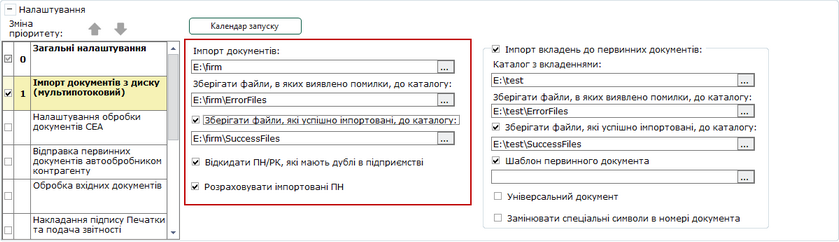

Натисніть, щоб збільшити малюнок

- Імпорт документів
Вкажіть шлях до каталогу для відправки на сервер. З цього каталогу сервіс виконає копіювання документів до основного каталогу на сервері, з якого буде виконаний подальший імпорт.

- Універсальний автообробник працює тільки із серверними каталогами, які знаходяться на сервері програми та налаштовані в утиліті [Налаштування з'єднання](ConnectionSetup.html#connectionsetup-connectionsetup).
- Після закінчення циклу обробки служба автообробника кожну хвилину перевіряє вказаний локальний каталог та копіює наявні в ньому документи в серверний каталог, звідки вони будуть проімпортовані.
- Зберігати файли, в яких виявлено помилки, до каталогу
Вкажіть шлях для збереження документів, які не вдалося імпортувати. За замовчуванням програма пропонує папку ErrorFiles. Папку буде створено у каталозі, який Ви вказали у полі Каталог для імпорту документів.

- Зберігати файли, які успішно імпортовані, до каталогу
Встановіть позначку, якщо необхідно зберігати документи, що вдало пройшли імпорт. Після встановлення позначки поле стає доступним для введення інформації.

- Вкажіть шлях для збереження успішно імпортованих документів. За замовчуванням, програма пропонує папку SuccessFiles. Папку буде створено у каталозі, який Ви вказали у полі Каталог для імпорту документів.
- Відкидати ПН/РК, які мають дублі в підприємстві
Якщо позначку встановлено, виконується перевірка на наявність у ПК "M.E.Doc" документа з таким самим номером, датою, контрагентом та сумою. Якщо такий документ існує, новий документ буде вважатися помилковим.

- Розрахувати імпортовані ПН
Наявність галочки у цьому полі включає функцію перерахунку розрахункових полів документів.

Налаштування "Імпорт вкладень до первинних документів":

У розділі налаштовується автоматичний імпорт вкладень до первинних документів, які створюються за шаблоном типу Документ з вкладенням.

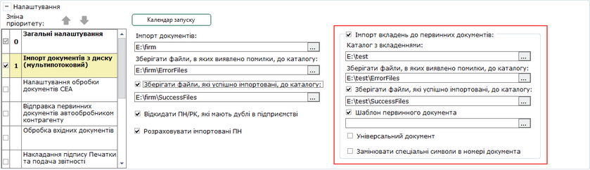

Натисніть, щоб збільшити малюнок

- Каталог з вкладеннями
Вкажіть шлях до каталогу, у якому зберігаються файли вкладень, що повинні бути додані у документ.

- Зберігати файли, в яких виявлено помилки, до каталогу
Вкажіть шлях для збереження документів, які не вдалося імпортувати. За замовчуванням програма пропонує папку ErrorAttach. Папку буде створено у каталозі, який Ви вказали у полі Каталог з вкладеннями.

- Зберігати файли, які успішно імпортовані, до каталогу
Встановіть позначку, якщо необхідно зберігати документи, що вдало пройшли імпорт. Після встановлення позначки поле стає доступним для введення інформації.

Вкажіть шлях для збереження успішно імпортованих вкладень. За замовчуванням, програма пропонує папку SuccessAttach. Папку буде створено у каталозі, який Ви вказали у полі Каталог з вкладеннями.

- Шаблон первинного документа
Встановіть опцію та оберіть шаблон первинного документа типу Документ з вкладенням, на основі якого буде створюватися первинний документ, та у який додаватиметься вкладення. При натисканні кнопки  відкривається список усіх доступних шаблонів з типом Документ з вкладенням.

- Універсальний документ
Якщо опцію встановлено, автоматичний імпорт вкладень буде здійснюватися у документи, які створюються за шаблоном типу Універсальний документ. У разі вибору імпорту вкладень в Універсальний документ, поле Шаблон первинного документа недоступне.

- Змінювати спеціальні символи в номері документа
Якщо позначку встановлено, здійснюється заміна заборонених символів у імені файлу на відповідний дозволений символ у полі номера первинного документа.

Переглянути відповідність символів

|  |  |
| --- | --- |
| Символ у імені файлу | Символ у номері документа |
| { | " |
| [ | \* |
| } | : |
| ] | < |
| & | > |
| ^ | ? |
| $ | / |
| @ | \ |
| ! | | |

Наприклад, для файлу вкладення з іменем Test\_03032025\_12345$45\_63636363\_6\_2.pdf буде створено первинний документ по шаблону Test з номером 12345/45.

У якості вкладень можуть бути імпортовані файли формату: pdf, txt, doc, docx, xls, xlsx, rtf.

Ім’я файлу вкладення повинно мати формат: <код первинного документа>\_<дата документа (у форматі ддммрррр)>\_<номер документа>\_<ЄДРПОУ контрагента>\_<код філії контрагента>\_<порядковий номер вкладення>. У якості роздільника використовується символ «нижнє підкреслення».

Код, дата документа, номер документа та ЄДРПОУ контрагента – обов’язкові параметри, ці дані обов’язково повинні бути присутніми у назві файлу. Код філії контрагента та порядковий номер вкладення – необов’язкові параметри, можуть бути відсутні у імені файлу.

Приклад назви файлу: Test\_21082025\_12345\_63636363\_6\_1.pdf.

При імпорті вкладень в Універсальні документи Ім’я файлу вкладення повинно мати формат: <найменування документа у реєстрі>\_<дата документа (в форматі ддммрррр)>\_<номер документа>\_<сума документа>\_<ЄДРПОУ контрагента>\_<код філії контрагента>\_<порядковий номер вкладення>. Будь-яке з полів імені файлу вкладення може бути пустим, у такому випадку кількість та порядок роздільників зберігаються. Наприклад, Test\_23122025\_\_120,12\_99000115\_6\_2.pdf.

Ім'я файлу не повинно містити більш ніж 100 символів. Розмір файлу не повинен перевищувати 20 МБ.

З усіх файлів, які будуть розміщені у каталозі, що вказаний у полі Каталог з вкладеннями, будуть імпортовані лише ті файли, назва та розширення яких відповідає вимогам, описаним вище.

Під час виконання імпорту вкладень здійснюється створення первинного документа за обраним шаблоном, заповнення полів документа даними з назви файлу вкладення та прикріплення файлу вкладення до створеного документа.

- Щоб додати кілька вкладень до одного й того самого документа, усі вкладення повинні мати однакове ім'я файлу, за винятком порядкового номера вкладення.
- Якщо у імені файла вкладення не зазначено його порядковий номер, для кожного файлу вкладення створюється окремий первинний документ. Якщо порядковий номер не зазначається, у імені файлу можна не вказувати кінцевий роздільник «нижнє підкреслення», наприклад: Test\_23122025\_\_120,12\_99000115\_6.pdf.

Кнопка "Календар запуску"

При натисканні на кнопку відкривається вікно календаря, в якому можна призначити певні дні місяця та час запуску операції.

Якщо календар не призначений, то операція буде виконуватись під час кожного циклу обробки.

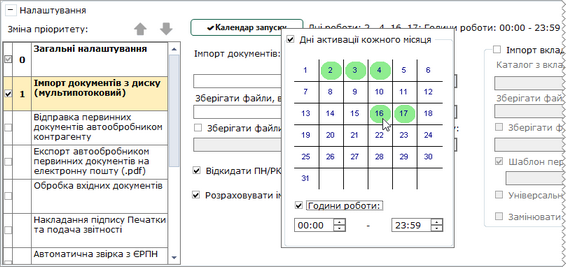

Натисніть, щоб збільшити малюнок

Для призначення днів потрібно встановити ознаку "Дні активації кожного місяця" та мишею відмітити потрібні дні. Призначені дні виділяються зеленим кольором.

Для призначення годин потрібно встановити ознаку "Години роботи" та вказати потрібні години.

Якщо для операції призначений календар запуску, то кнопка змінить свій вигляд і праворуч неї відобразяться обрані дні та години.

Для місяців, в яких немає 31 числа (для лютого - 29 та 30 числа), відображається попередження про те, що автообробник не буде запущений.

Після призначення календаря надалі при запуску сервісу в роботу операція буде запускатись лише в обрані дні та години.

#### Налаштування обробки документів СЕА

_Шлях у довідці: Допоміжні сервіси › Універсальна автоматична обробка › Налаштування автоматичної обробки › Налаштування обробки документів СЕА_

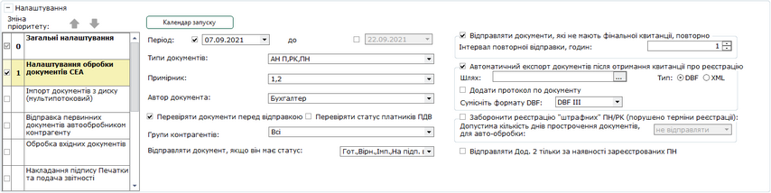

Натисніть, щоб збільшити малюнок

- Кнопка Календар запуску
При натисканні на кнопку відкривається [вікно календаря](#ap-uao_imp_z_disc), в якому можна призначити певні дні місяця та час запуску операції.

- Період
Вкажіть дати з початку до закінчення періоду. На реєстрацію у ЄРПН будуть відправлятися документи, що створені у вказаний період часу.
Встановіть дати початку та закінчення періоду, у який були створені документи. За замовчуванням, якщо період не обраний, для початку періоду встановлюється дата за 15 днів до поточної дати, для закінчення періоду встановлюється поточна дата.

- Типи документів
У списку, що випадає, відмітьте галочками потрібні типи, що будуть відправлятися на реєстрацію.

- Примірник
У списку, що випадає, оберіть примірник (примірники) акцизних документів для відправки на реєстрацію у ДПС: 1- Перший примірник та/або 2 - Другий примірник. Поле Примірник доступне для вибору значення, якщо у полі Типи документів обрано хоча б один із типів документів:

- АН П – Акцизна накладна форми «П»;
- АН С – Акцизна накладна форми «С»;
- РК П – Розрахунок коригування форми «П»;
- РК С – Розрахунок коригування форми «С».

Зверніть увагу, відправка на реєстрацію 2-го примірника доступна тільки для виданих АН/РК.

- Автор документа
У списку, що випадає, відмітьте галочками потрібних користувачів. Система буде відправляти документи, що створені зазначеними користувачами.

- Перевіряти документи перед відправкою
Якщо буде знайдено помилки, документ на реєстрацію не відправляється.

- Перевіряти статус платника ПДВ
Буде виконуватись перевірка, чи є контрагент платником ПДВ. Відправка документів буде здійснюватися контрагентам - платникам ПДВ.

- Групи контрагентів
У списку, що випадає, відмітьте галочками групи контрагентів, для яких необхідно відправляти документи на реєстрацію. Попередньо групи контрагентів повинні бути створені у розділі головного меню [Довідники](UCPartnerRst.html#ucpartnerrst-sprpartner).

- Відправляти документ, якщо він має статус
Оберіть статус документа із списку:
- Готується;
- Імпортований;
- Вірний;
- На підпис відповідальній особі;

тощо.

Під час автоматичної обробки буде виконуватись перевірка, статусу документів. Документи з вказаним статусом будуть відправлятися на реєстрацію, інші - ні.
Якщо перевіряти статуси документів не потрібно, оберіть значення «Не використовується».

- Відправляти документи, які не мають фінальної квитанції, повторно
Якщо позначка встановлена, через вказаний інтервал будуть повторно відправлені документи, що не мають фінальної квитанції.
Після встановлення цієї опції стає доступним для налаштування поле Інтервал повторної відправки, годин

(Повторна відправка ПН/РК також може виконуватись вручну у модулі Реєстр податкових документів за допомогою команди меню [Сервіс - Повторна відправка ПН/РК без фінальної квитанції](PDocs_reestr_funkc.html#pdocs_reestr_funkc-pdocs_reestr_funkc_vidp))

- Заборонити реєстрацію "штрафних ПН/РК" (порушено термін реєстрації)

Налаштування відправки на реєстрацію прострочених документи, за які передбачено штраф. Після встановлення опції стає доступним для налаштування поле Допустима кількість днів прострочення документів для автообробки, у якому встановіть термін прострочки, для якого можлива відправка документів на реєстрацію, або ж оберіть значення не відправляти.

Відправлятимуться лише ті документи, у яких кількість днів прострочки не перевищує вказаного значення.

- Відправляти Дод.2 тільки за наявності зареєстрованих ПН
Якщо позначка встановлена, то Додатки 2 будуть відправлятися тільки за умови наявності для них ПН, зареєстрованих в ДПС.

Налаштування автоматичного експорту вихідних документів, що були прийняті або відхилені у ДПС.

У полі Період встановіть дати з початку до закінчення періоду, в межах якого створені документи.

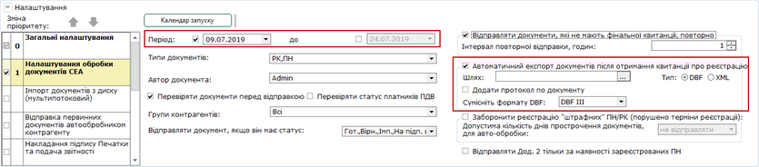

Натисніть, щоб збільшити малюнок

Встановіть опцію Автоматичний експорт документів після отримання квитанції про реєстрацію.

Стануть доступними поля для налаштування експорту:

- Шлях - шлях для зберігання експортованих документів;
- Тип - формат, у якому буде збережено документи XML або DBF;
- Сумісність формату DBF - DBF III або DBF VII;
- Додати протокол по документу - якщо опцію встановлено, при експорті документів у обраному у полі Шлях каталозі буде збережено протокол по документу (за умови, якщо дані для формування протоколу можуть бути отримані). Протокол зберігається у форматі PDF та містить інформацію про назву документа, ЄДРПОУ відправника та отримувача документа, підписи накладені на документ, дані про позначку часу, ім’я xml-файлу документа, тощо.

Всі експортовані документи зберігаються в одному файлі. Приклад імені файлу, що створюється при експорті у DBF: 30056789\_KVT-LIST\_1\_2014-12-30.DBF, де "1" - унікальний номер файлу за добу.
Приклад імені файлу при експорті у XML: 2014-12-30-11-22-11\_30056789.XML, де "2014-12-30-11-22-11" - час створення файлу з точністю до секунди.
Максимальна кількість документів у файлі - 500. Якщо кількість документів перевищує 500, створюється новий файл.

Зверніть увагу!

В ДПС повинен відправлятися документ, що підписаний встановленим комплектом підписів.

Для того, щоб "допідписати" документ печаткою, потрібно у полі "Відправляти документ, якщо він має статус" обрати статус "На підпис печаткою".

Для того, аби відправити документ, який підписаний всім комплектом підписів, потрібно обрати статус "Підписаний, очікує відправки".

#### Відправка первинних документів контрагенту

_Шлях у довідці: Допоміжні сервіси › Універсальна автоматична обробка › Налаштування автоматичної обробки › Відправка первинних документів контрагенту_

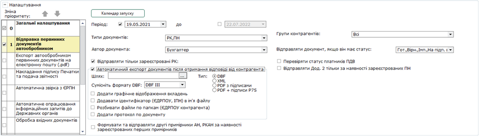

Натисніть, щоб збільшити малюнок

- Кнопка Календар запуску
При натисканні на кнопку відкривається [вікно календаря](#ap-uao_imp_z_disc), в якому можна призначити певні дні місяця та час запуску операції.

- Період
Вкажіть дати початку та закінчення періоду. Будуть відправлятися документи, що створені у вказаний період часу.
Встановіть дати початку та закінчення періоду, у який були створені документи. За замовчуванням, якщо період не обраний, для початку періоду встановлюється дата за 15 днів до поточної дати, для закінчення періоду встановлюється поточна дата.

- Типи документів
У списку, що випадає, відмітьте галочками типи документів, що будуть відправлятися контрагентам.

Для відправки банківських виписок контрагентам потрібно обрати тип Банківська виписка.

- Автор документа
У списку, що випадає, відмітьте галочками потрібних користувачів. Система буде відправляти документи, створені зазначеними користувачами.

- Відправляти тільки зареєстровані РК
Встановлена опція визначає, що контрагентам будуть відправлятися тільки ті документи, що були зареєстровані у ЄРПН.

- Групи контрагентів
У списку, що випадає, відмітьте галочками потрібні групи контрагентів, для яких документи будуть відправлятися на реєстрацію у ЄРПН. Попередньо групи контрагентів повинні бути створені у розділі головного меню [Довідники](UCPartnerRst.html#ucpartnerrst-sprpartner).

- Відправляти документ, якщо він має статус
Оберіть статус документа зі списку, що відкривається:
- Готується;
- Імпортований;
- Вірний, тощо.
Під час автоматичної обробки буде виконуватись перевірка статусу документів. Документи з обраним статусом будуть відправлятися контрагенту.
Якщо перевіряти статуси документів не потрібно, оберіть значення «Не використовується». Це значення встановлено за замовчуванням.

- Перевіряти статус платника ПДВ
Встановлена опція визначає, що буде виконуватись перевірка, чи є контрагент платником ПДВ. Відправка документів буде здійснюватися контрагентам - платникам ПДВ.

- Відправляти Дод.2 тільки за наявності зареєстрованих ПН
Якщо позначка встановлена, то Додатки 2 будуть відправлятися тільки за умови наявності для них ПН, зареєстрованих в ДПС.

- Формувати та відправляти другі примірники АН, РКАН за наявності зареєстрованих перших примірників
Якщо опцію встановлено, на основі зареєстрованих перших примірників АН/РК виконується автоматичне формування їх других примірників, за умови, що для АН/РК відсутні зареєстровані або відправлені контрагентам другі примірники.

- Якщо у розділі [Довідники – Контрагенти – Картка контрагента](UCPartnerRst.html#ucpartnerrst-sprpartner) збережено дані контактних осіб контрагента та встановлено опцію Відправляти посилання на документ, разом з первинними документами на адреси контактних осіб будуть відправлятися посилання на первинні документи.
- Якщо контрагенти, не є користувачами наших рішень з електронного документообігу, при автоматичній обробці документів, що призначаються таким контрагентам, виконуватиметься автоматична відправка посилання на документ (за умови встановленого налаштування Відправляти посилання на документ у Картці контрагента). У разі якщо відправка посилання на документ контрагенту не налаштована, відправка документа не виконуватиметься, у Журналі автоматичної обробки зберігатиметься відповідне повідомлення.
- Після активації розділу налаштувань Відправка первинних документів автообробником виконуватиметься автоматичне візування вихідних первинних документів, відповідно до попередньо налаштованого у розділі [Первинні документи – Сценарії підписання первинних документів](UCPDocSignSettings.html#ucpdocsignsettings-ucpdocsignsettings) комплекту підписів з типом Візування.
- У комплекті підписів [Візування](UCPDocSignSettings.html#ucpdocsignsettings-ucpdocsignsettings) повинен бути обраний напрямок документа, для якого застосовується комплект підписів: вихідні документи або всі документи та встановлено опцію Використовувати у автоматичній обробці документів - Використовувати візування в автоматичній обробці документів.
- Якщо у комплекті підписів [Візування](UCPDocSignSettings.html#ucpdocsignsettings-ucpdocsignsettings) налаштовано візування документів за посиланням, електронні адреси співробітників, на які автоматично будуть відправлятися посилання, повинні бути попередньо налаштовані у розділі Довідники – Співробітники – Картка співробітника.

Налаштування автоматичного експорту вихідних документів, що були прийняті або відхилені контрагентом.

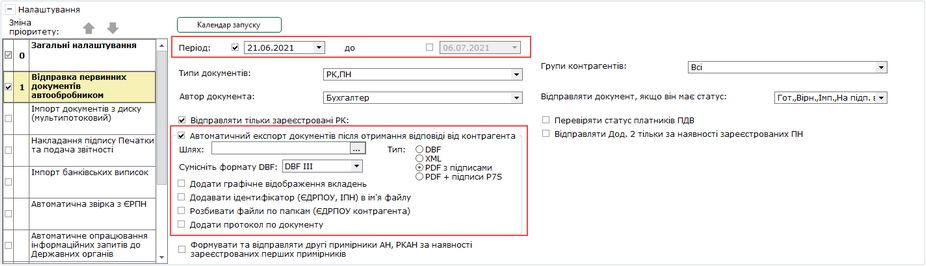

Натисніть, щоб збільшити малюнок

У полі Період встановіть дати з початку до закінчення періоду, в межах якого створені документи.

Встановіть опцію Автоматичний експорт документів після отримання відповіді від контрагента

Стануть доступними поля для налаштування експорту:

- Шлях - вкажіть шлях до каталогу, у якому будуть збережені експортовані документи;
- Тип - встановіть позначку, що відповідає формату, у якому буде збережено дані: DBF, XML, PDF з підписами, PDF + підписи P7S.
- Якщо обрано тип DBF або XML, всі експортовані документи зберігаються в одному файлі. Приклад імені файлу при експорті у DBF: 30056789\_KVT-LIST\_1\_2014-12-30.DBF, де "1" - унікальний номер файлу за добу.

Приклад імені файлу при експорті документів у XML: 2014-12-30-11-22-11\_30056789.XML, де "2014-12-30-11-22-11" - час створення файлу з точністю до секунди.
Максимальна кількість документів у файлі - 500. Якщо кількість документів перевищує 500, створюється новий файл.

- Якщо обрано тип PDF з підписами - зберігається документ у форматі PDF, комплект підписів буде накладено безпосередньо на PDF-документ. Кожен документ зберігається у окремому файлі.
- Якщо обрано опцію PDF + підписи P7S - буде експортовано архів, який міститиме документ у файлі формату PDF та кожен підпис комплекту в окремому файлі в з розширенням .P7S. Для кожного документа створюється окремий архів.

При виборі типу експорту PDF з підписами або PDF + підписи P7S стають доступними налаштування:

- Додавати ідентифікатор (ЄДРПОУ, ІПН) контрагента в ім'я файлу – якщо опція встановлена, на початку імені файлу, що експортується, додаватиметься код ЄДРПОУ та, у разі наявності, ІПН контрагента. У випадку експорту типу PDF + підписи P7S, ЄДРПОУ та ІПН контрагента додається до імені кожного файлу у архіві та до імені архіву, що експортується.
- Розбивати файли по папкам (ЄДРПОУ контрагента) – у каталозі, який обраний у полі Шлях, створюватимуться підкаталоги з іменем, що є кодом ЄДРПОУ контрагента, файли, що експортуються, розміщуватимуться у цих підкаталогах згідно з ЄДРПОУ контрагентів.
- Додати графічне відображення вкладень - якщо опцію встановлено, вкладення до Первинних документів/Універсальних документів зберігатимуться у окремих файлах формату PDF у підкаталозі, ім’я якого відповідає імені Первинного/Універсального документа. У файлах PDF відображається факсиміле підписів, що накладені на вкладення, та інформація про підписантів (за наявності відмітки у розділі [Адміністрування – Параметри системи – Документообіг – Накладати інформацію про підписантів](FormCompanyParams.html#formcompanyparams-admcompanyparams_sdo)).

Зверніть увагу, файли самих Первинних документів/Універсальних документів зберігаються відповідно до налаштувань області Тип, що визначають формат, у якому необхідно зберегти документи: XML, XML в форматі обміну & PDF або PDF з підписами, PDF + підписи P7S (див. вище).

Опція Додати графічне відображення вкладень доступна також при виборі типу експорту XML.

- Сумісність формату у DBF - оберіть значення зі списку;
- Додати протокол по документу - якщо опцію встановлено, при експорті документів у обраному у полі Шлях каталозі буде збережено протокол по документу (за умови, якщо дані для формування протоколу можуть бути отримані). Протокол зберігається у форматі PDF та містить інформацію про назву документа, ЄДРПОУ відправника та отримувача документа, підписи накладені на документ, дані про позначку часу, ім’я xml-файлу документа, тощо.

#### Обробка вхідних документів

_Шлях у довідці: Допоміжні сервіси › Універсальна автоматична обробка › Налаштування автоматичної обробки › Обробка вхідних документів_

У розділі налаштовується автоматичне виконання операцій:

- Відправка запитів щодо отримання відомостей з Єдиного реєстру податкових накладних.
- Збереження вхідних документів, що набули фінального статусу обробки. Передбачено збереження документів у форматі DBF або XML.
- Відправка на реєстрацію в ДПС отриманих других примірників Акцизних накладних та Розрахунків коригування Акцизних накладних.

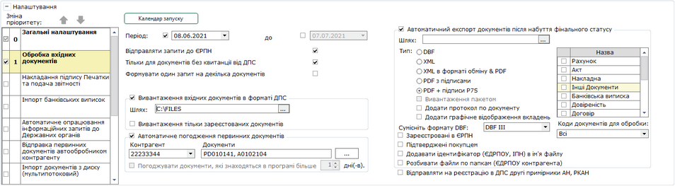

Натисніть, щоб збільшити малюнок

Відправлення запитів до Єдиного реєстру податкових накладних.

- Кнопка Календар запуску
При натисканні на кнопку відкривається [вікно календаря](#ap-uao_imp_z_disc), в якому можна призначити певні дні місяця та час запуску операції.

- Період
Вкажіть дати початку та закінчення періоду. На реєстрацію у ЄРПН будуть відправлятися документи, що створені у вказаний період часу. Встановіть дати початку та закінчення періоду, у який були створені документи. За замовчуванням, якщо період не обраний, для початку періоду встановлюється дата за 15 днів до поточної дати, для закінчення періоду встановлюється поточна дата.

- Відправляти запити до ЄРПН
Опція встановлена за замовчуванням. Якщо опцію не встановлено, запити до ЄРПН не відправляються. Якщо не встановлено опцію Формувати один запит на декілька документів, запити формуються для кожного документа окремо.

- Тільки для документів без квитанції від ДПС
Якщо позначку встановлено, запити до ЄРПН створюються тільки для «Вхідних» Податкових накладних та Додатків 2, у яких нема квитанцій про реєстрацію від ДПС.

- Формувати один запит на декілька документів
Якщо опція обрана, для групи документів формується один «Запит до ЄРПН», повторне відправлення запиту блокується.

- Вивантаження вхідних документів в форматі ДПС
Стануть доступними поля для налаштування:

- Шлях - вкажіть шлях до каталогу, у якому будуть збережені вхідні документи.
- Вивантаження тільки зареєстрованих документів - встановіть позначку, якщо потрібно вивантажувати тільки документи із квитанцією (тобто, зареєстровані). Вивантажуватись будуть документи, отримані від контрагента або завантажені згідно Витягу з ЄРПН.

Після відправлення запиту до ЄРПН у Реєстрі податкових документів на вкладці Протокол відображається повідомлення «Відправлено запит до ЄРПН». Якщо після відправки запиту стан документа не оновився протягом 4 годин, надається можливість відправити запит до ЄРПН повторно. Після отримання витягу з ЄРПН статус документа змінитися згідно отриманої відповіді (документ зареєстровано або ні).

Налаштування автоматичного експорту вхідних документів, що завершили маршрут обробки.

У полі Період встановіть дати початку та закінчення періоду, в межах якого створені документи.

Встановіть опцію Автоматичний експорт документів після набуття фінального статусу.

Стануть доступними поля для налаштування експорту:

- Шлях - шлях до каталогу, у якому будуть збережені експортовані документи.
- Тип - встановіть опцію, що відповідає формату, у якому необхідно зберегти дані: DBF, XML, XML в форматі обміну & PDF або PDF з підписами, PDF + підписи P7S.
- Сумісність формату у DBF - оберіть значення зі списку.
- Експортувати у форматі DBF можливо лише документи Податкова накладна та Додаток 2.
- Експортувати у форматі PDF з підписами та PDF + підписи P7S можливо лише первинні документи. Якщо обрано тип PDF з підписами - зберігається документ у форматі PDF, комплект підписів буде накладено безпосередньо на PDF-документ. Кожен документ зберігається у окремому файлі. Якщо обрано опцію PDF + підписи P7S - буде експортовано архів, який міститиме документ у файлі формату PDF та кожен підпис комплекту в окремому файлі в з розширенням .P7S. Для кожного документа створюється окремий архів.
- Вивантаження пакетом - якщо опцію встановлено, всі вивантажені документи зберігатимуться у одному файлі XML та одному файлі PDF, якщо опція відключена - кожен документ зберігається у окремому файлі відповідного формату. Опція доступна при експорті документів у форматі XML в форматі обміну & PDF (опція XML в форматі обміну & PDF встановлена).
- Додати протокол по документу - якщо опцію встановлено, при експорті документів у обраному у полі Шлях каталозі буде збережено протокол по документу (за умови, якщо дані для формування протоколу можуть бути отримані). Протокол зберігається у форматі PDF та містить інформацію про назву документа, ЄДРПОУ відправника та отримувача документа, підписи накладені на документ, дані про позначку часу, ім’я xml-файлу документа, тощо.
- Назва - встановіть позначки біля типів документів, які необхідно експортувати;
- Встановлена опція Зареєстровані в ЄРПН означає, що будуть експортуватись лише ті документи, що були зареєстровані у ЄРПН;
- Встановлена опція Підтверджені покупцем - будуть експортуватись лише ті документи, що були вами погоджені.

При виборі типу експорту PDF з підписами або PDF + підписи P7S стають доступними налаштування:

- Додавати ідентифікатор (ЄДРПОУ, ІПН) контрагента в ім'я файлу – якщо опція встановлена, на початку імені файлу, що експортується, додаватиметься код ЄДРПОУ та, у разі наявності, ІПН контрагента. У випадку експорту типу PDF + підписи P7S, ЄДРПОУ та ІПН контрагента додається до імені кожного файлу у архіві та до імені архіву, що експортується.
- Розбивати файли по папкам (ЄДРПОУ контрагента) – у каталозі, який обраний у полі Шлях, створюватимуться підкаталоги з іменем, що є кодом ЄДРПОУ контрагента, файли, що експортуються, розміщуватимуться у цих підкаталогах згідно з ЄДРПОУ контрагентів.
- Додати графічне відображення вкладень - якщо опцію встановлено, вкладення до Первинних документів/Універсальних документів зберігатимуться у окремих файлах формату PDF у підкаталозі, ім’я якого відповідає імені Первинного/Універсального документа. У файлах PDF відображається факсиміле підписів, що накладені на вкладення, та інформація про підписантів (за наявності відмітки у розділі [Адміністрування – Параметри системи – Документообіг – Накладати інформацію про підписантів](FormCompanyParams.html#formcompanyparams-admcompanyparams_sdo)).

Зверніть увагу, файли самих Первинних документів/Універсальних документів зберігаються відповідно до налаштувань області Тип, що визначають формат, у якому необхідно зберегти документи: XML, XML в форматі обміну & PDF або PDF з підписами, PDF + підписи P7S (див. вище).

Опція Додати графічне відображення вкладень доступна також при виборі типу експорту XML або XML в форматі обміну & PDF.

- Коди документів для обробки - у списку, що відкривається, встановіть позначки для кодів документів, які необхідно експортувати. За замовчуванням експортуються всі документи обраного типу (встановлені у області Назва).

Налаштування автоматичного погодження вхідних первинних документів.

У полі Період встановіть дати початку та закінчення періоду, в межах якого створені документи.

Встановіть опцію Автоматичне погодження первинних документів.

У полі Контрагент оберіть зі списку ЄДРПОУ контрагента, документи якого потрібно погоджувати автоматично. У полі Документи буде відображено список кодів документів даного контрагента, що підлягають автоматичному погодженню:

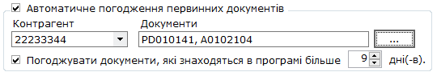

При виконанні Автоматичного погодження первинних документів, програма перевіряє всі вхідні первинні документи та порівнює їх з налаштованим списком. Якщо був отриманий документ, код та відправник якого відповідають налаштованому списку, виконується автоматичне погодження такого документа.

Якщо встановлено опцію Погоджувати документи, які знаходяться в програмі більше … дні(в) автоматичне погодження для обраних контрагентів та документів буде виконуватись через вказану кількість днів після отримання документів. Опція активна, якщо обраний хоча б один контрагент та відповідний йому шаблон для погодження. Можливо встановлювати період часу від 1 до 30 днів.

У разі, якщо список контрагентів не визначений, погодження вхідних первинних документів виконується для всіх документів, незалежно від контрагента (у полі Контрагент та Документи за замовчуванням встановлено значення Всі).

Для візування/погодження певного типу документів застосовується підпис, налаштований у розділі [Первинні документи – Сценарії підписання первинних документів](UCPDocSignSettings.html#ucpdocsignsettings-ucpdocsignsettings). Якщо користувацький підпис не налаштовано, за замовчуванням для погодження документів використовується підпис, зазначений у розділі [Адміністрування - Параметри системи - Підпис - Первинні документи](FormCompanyParams.html#formcompanyparams-admcomanyparams_pen).

Щоб налаштувати список контрагентів та відповідних документів:

1. Встановіть опцію Автоматичне погодження первинних документів та натисніть кнопку .

2. У вікні, що відкриється, додайте контрагента та вкажіть документ, для якого буде виконуватись автоматичне погодження.

Натисніть кнопку , відкриється вікно Додати роль для автоматичного погодження.

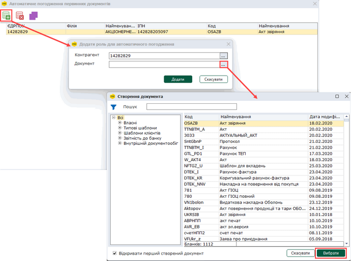

Натисніть, щоб збільшити малюнок

У полі Контрагент натисніть  та у вікні довідника Контрагенти оберіть назву потрібного контрагента. У полі Контрагент буде відображено ЄДРПОУ обраного контрагента.

У полі Обраний документ натисніть  та у вікні довідника Створення звіту оберіть документ для якого буде виконуватись автоматичне погодження.

3. Натисніть кнопку ОК, щоб додати обраний документ у список налаштувань автоматичного погодження. Щоб додати наступний документ, повторіть описані вище дії.

Всі додані документи будуть відображені у вікні Автоматичне погодження первинних документів:

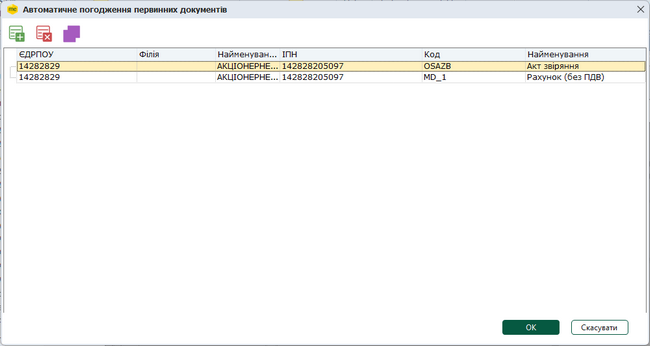

Натисніть, щоб збільшити малюнок

Можна вказати значення тільки у полі Контрагент або Документи.

У разі, якщо вказано тільки значення ЄДРПОУ у полі Контрагент, виконується автоматичне погодження всіх первинних документів, що надходять від вказаного контрагента (контрагентів).

Якщо зазначено лише код (коди) документів у полі Документи, виконується автоматичне погодження всіх первинних документів з вказаним кодом (кодами), що отримані від будь-яких контрагентів.

У разі заповнення тільки поля Контрагент або Документ у відповідних полях області налаштувань Обробка вхідних документів для іншого поля автоматично проставляється значення Всі:

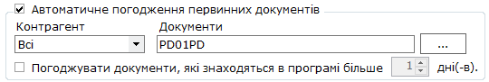

Щоб видалити документ з налаштувань автоматичного погодження, оберіть документ у списку та натисніть кнопку .

Ви можете налаштувати відображення інформації у вікні Автоматичне погодження первинних документів, згрупувавши дані за назвою або ЄДРПОУ контрагента, назвою чи кодом документа тощо.

Для цього натисніть кнопку . У верхній частині вікна з'явиться додаткова панель, на яку перетягніть назву колонки, за якою потрібно згрупувати дані:

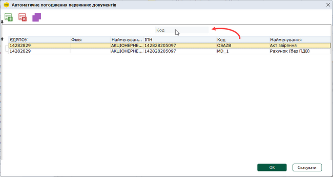

Натисніть, щоб збільшити малюнок

Дані у вікні будуть відображені згідно з обраною колонкою, у нашому прикладі - за назвою контрагента:

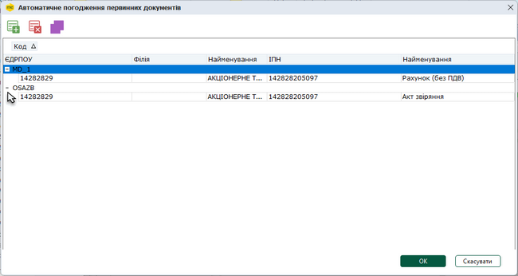

Натисніть, щоб збільшити малюнок

Щоб повернутись до відображення даних за замовчуванням, перетягніть назву колонки з панелі назад у таблицю.

Відправка на реєстрацію в ДПС отриманих других примірників АН та РКАН

- Відправляти на реєстрацію в ДПС другі примірники АН, РКАН
Якщо опція встановлена, здійснюється відправка на реєстрацію отриманих других примірників Акцизних накладних та Розрахунків коригування акцизних накладних. За замовчуванням опція вимкнена.

#### Накладання підпису печатки та подача звітності

_Шлях у довідці: Допоміжні сервіси › Універсальна автоматична обробка › Налаштування автоматичної обробки › Накладання підпису печатки та подача звітності_

У цьому розділі на вже підписані бухгалтером та директором звітні документи накладається ЕП печатки. Таким чином, документи будуть підписані всім необхідним комплектом підписів та готові до подання.

Система ідентифікує документи та відправляє їх до контролюючого органу за призначенням. Можлива автоматична відправка звітності:

- Державна податкова служба;
- Державна служба статистики;
- Єдине вікно;
- Звітність державних підприємств;
- Українські розподільчі мережі;
- Державна митна служба України;
- Автомобільні дороги;
- Електронне повідомлення про відкриття/закриття рахунків у банках.

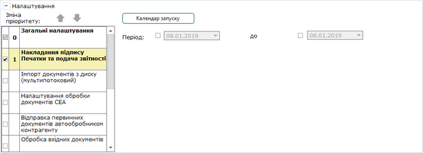

Натисніть, щоб збільшити малюнок

- Кнопка Календар запуску
При натисканні на кнопку відкривається [вікно календаря](#ap-uao_imp_z_disc), в якому можна призначити певні дні місяця та час запуску операції.

- Період
Вкажіть дати з початку до закінчення періоду. До контролюючих органів будуть відправлятися документи, що створені у вказаний період часу.

#### Експорт первинних документів у форматі PDF на електронну пошту

_Шлях у довідці: Допоміжні сервіси › Універсальна автоматична обробка › Налаштування автоматичної обробки › Експорт первинних документів у форматі PDF на електронну пошту_

У цьому розділі первинні документи (як вхідні, так і вихідні), на які був накладений хоча б один підпис поточного підприємства, відправляються у форматі PDF на вказану електронну пошту. Відправлені на електронну пошту первинні документи можуть використовуватися для контролю документообігу, а також, у разі потреби, можуть бути передані у зовнішню систему документообігу користувача.

- На електронну пошту відправляються первинні документи, на які було накладено хоча б один підпис поточного підприємства. Тип підпису (підписів) обирається у налаштуваннях у полі Тип підпису документів відібраних для відправки.
- Для успішної відправки документів на електронну пошту у розділі [Адміністрування  Параметри системи - Електронна пошта](FormCompanyParams.html#formcompanyparams-admcompanyparams_emaile) необхідно виконати налаштування поштового з'єднання.

Первинні документи, що відповідають параметрам, встановленим у розділі, додаються у електронний лист у вигляді файлу з іменем у форматі: <ЄДРПОУ контрагента>\_<номер документа>\_<дата та час документа>.pdf. Якщо документ містить вкладення, файли вкладень також додаються до листа. Ім'я файлу первинного документа зазначається у темі електронного листа.

Кожен первинний документ (з вкладеннями, за наявності) відправляється окремим електронним листом. Для успішної відправки розмір кожного вкладення не повинен перевищувати 20 МБ.

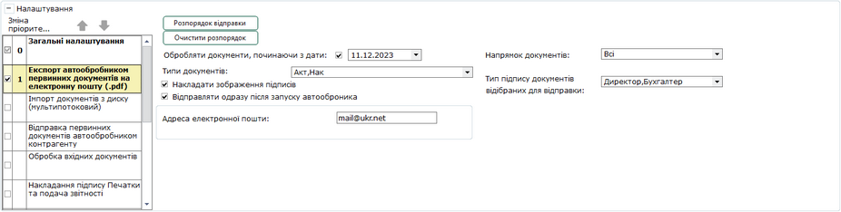

Натисніть, щоб збільшити малюнок

- Розпорядок відправки - відкриває панель, на якій можна обрати години, о яких буде виконуватися автоматична відправка документів. Щоб швидко очистити налаштування області Розпорядок відправки, натисніть на кнопку Очистити розпорядок.
- Відправляти відразу після запуску автообробника

Якщо позначка встановлена, відправка виконуватиметься з періодичністю, налаштованою у розділі [Загальні налаштування](#ap-uao_func) - Автоматична обробка кожні \_\_ хвилин (за наявності документів, що відповідають встановленим налаштуванням).

Якщо опція не встановлена, відправка здійснюється згідно з розкладом, налаштованим у розділі Розпорядок відправки.

У разі якщо не було вказано години відправки у області налаштувань Розпорядок відправки та не встановлено опцію Відправляти одразу після запуску автообробника, відправка документів буде виконуватися кожну годину.

- Обробляти документ, починаючи з дати

Встановіть позначку та оберіть дату створення документів, при першому сеансі відправки документів на електронну пошту відправлятимуться документи, дата створення яких дорівнює або більша обраної дати. За замовчуванням встановлюється поточна дата. При наступних запусках відправлятимуться документи, дата створення яких дорівнює або більша дати виконання останньої автоматичної відправки.

- Типи документів
У списку, що випадає, відмітьте галочками типи документів, що будуть відправлятися на електронну пошту.

- Накладати зображення підписів
Якщо опцію встановлено у pdf-документах, що відправляються на електронну пошту, відображаються зображення підписів (факсиміле). Якщо опція деактивована, pdf-файли не містять зображення підписів. За замовчуванням опція активована.

- Напрямок документів
У списку, що випадає, відмітьте галочками напрямок документів, що будуть відправлятися на електронну пошту: Всі, Вхідні, Вихідні.

- Тип підпису документів відібраних для відправки
У списку, що випадає, відмітьте галочками типи підписів документів, що будуть відправлятися на електронну пошту: Всі, Директор, Бухгалтер, Співробітник.

- Адреса електронної пошти

Введіть адресу електронної пошти, на яку потрібно відправляти підписані первинні документи. Важливо - якщо електронну адресу не вказано, відправка документів не виконується.

Первинні документи, які були відправлені у форматі PDF на вказану електронну пошту, у Реєстрі електронних документів позначаються відміткою у колонці Відправлено автообробником на електронну пошту.

У разі потреби, відправити первинні документи у форматі PDF на електронну пошту можна безпосередньо з Реєстру електронних документів. Для цього виділіть рядок документа та оберіть один із способів:

- виконайте команду головного меню Файл - Відправка PDF на електронну пошту;
- виконайте команду контекстного меню Відправка PDF на електронну пошту.

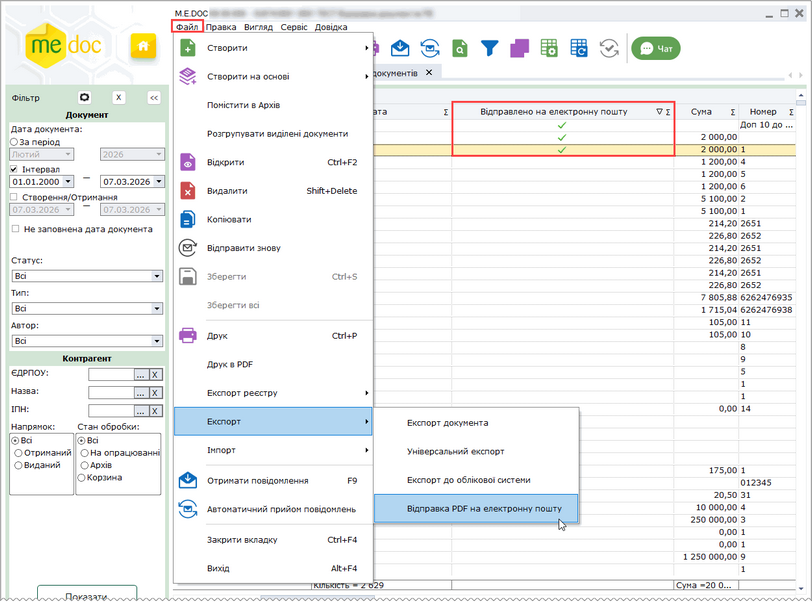

Натисніть, щоб збільшити малюнок

У вікні, що відкриється, введіть адресу електронної пошти, на яку потрібно відправити документ, та натисніть ОК:

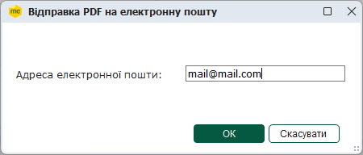

#### Імпорт банківських виписок

_Шлях у довідці: Допоміжні сервіси › Універсальна автоматична обробка › Налаштування автоматичної обробки › Імпорт банківських виписок_

У цьому розділі виконується масовий імпорт банківських виписок.

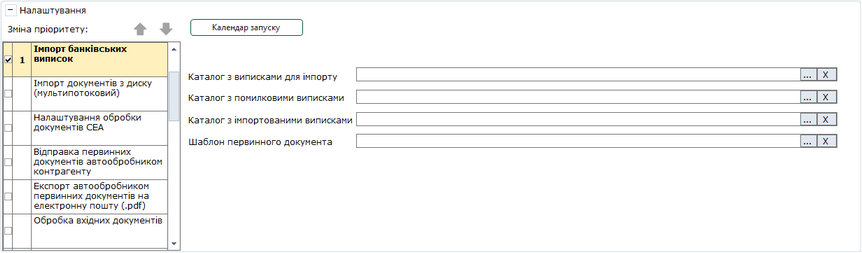

Натисніть, щоб збільшити малюнок

- Кнопка Календар запуску
При натисканні на кнопку відкривається [вікно календаря](#ap-uao_imp_z_disc), в якому можна призначити певні дні місяця та час запуску операції.

Для запуску роботи потрібно обрати такі каталоги:

- Каталог з виписками для імпорту - каталог з файлами, які потрібно проімпортувати;
- Каталог з помилковими виписками - каталог, куди будуть переміщені файли, які не пройшли перевірку;
- Каталог з імпортованими виписками - каталог, куди будуть переміщені файли, які пройшли перевірку та були проімпортовані до програми;
- Шаблон первинного документа - шаблон первинного документа "Банківська виписка", який буде супроводжувати проімпортовані файли.

Для видалення обраного каталогу або шаблона натисніть на кнопку  праворуч від потрібного поля.

Файли для імпорту проходять перевірку на наявність контрагента в Довіднику контрагентів та наявність у контрагента ліцензії на модуль "Банківські виписки". Для документів, що пройшли перевірку, автоматично формується лист за вказаним шаблоном із файлом-вкладенням. Ці листи відображаються в модулі "Банківські виписки". Самі файли переміщуються до папки, вказаної в полі Каталог з імпортованими виписками.

Файли, які не пройшли перевірку на наявність контрагента та наявність у контрагента ліцензії, переміщуються до папки, вказаної в полі Каталог з помилковими виписками.

Результати виконання імпорту записуються в журнал автоматичної обробки.

Файли, що не пройшли перевірку, виділяються в журналі червоним кольором. В таблиці журналу відображаються колонки Перевірка контрагента та Перевірка ліцензії, в яких можна побачити відмітку перевірки за цими параметрами.

В журналі відображаються 500 останніх подій.

Всі події можна побачити в [Журналі подій M.Е.Doc](UCLogs.html#uclogs-admlogs).

#### Автоматична звірка з ЄРПН

_Шлях у довідці: Допоміжні сервіси › Універсальна автоматична обробка › Налаштування автоматичної обробки › Автоматична звірка з ЄРПН_

У цьому розділі виконується автоматичне формування та відправка запитів в ЄРПН, отримання витягів, а також звірка з ЄРПН.

Автоматична звірка виконується, якщо у загальних налаштуваннях встановлений параметр Виконувати прийом повідомлень. Якщо знімається позначка з параметра Виконувати прийом повідомлень, то також автоматично знімається позначка з операції Автоматична звірка з ЄРПН, і далі звірка не буде виконуватись.

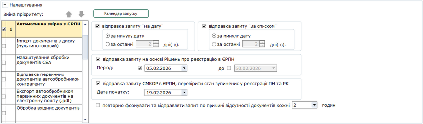

Натисніть, щоб збільшити малюнок

- Кнопка Календар запуску
При натисканні на кнопку відкривається [вікно календаря](#ap-uao_imp_z_disc), в якому можна призначити певні дні місяця та час запуску операції.

- відправка запиту "На дату"
Якщо позначку встановлено, запит створюється за відсутності актуального витягу за дату.
За замовчуванням позначку встановлено.

- за минулу дату
Запит створюється за вчорашній день.

- за останні ... дні (-в)
Кількість останніх днів (максимум 30), за які відправляються запити (не включаючи поточну дату).

- відправка запиту "За списком"
Якщо позначку встановлено, за наявності актуального витягу «На дату» та не рівній кількості документів по звірці
створюється запит за списком  для завантаження у програму відсутніх документів із ЄРПН.
За замовчуванням позначку встановлено.

- за минулу дату
Запит створюється за вчорашній день.

- за останні ... дні (-в)
Кількість останніх днів (максимум 30), за які відправляються запити (не включаючи поточну дату).

- відправка запиту на основі Рішень про реєстрацію в ЄРПН
Якщо позначку встановлено, виконується створення та відправка у ЄРПН Запитів на основі «РІШЕННЬ про реєстрацію або відмову в реєстрації ПН/РК в ЄРПН» для отримання розблокованих ПН\РК.
Для створення Запиту виконується пошук Рішень за обраний період. Далі виконується перевірка наявності ПН\РК, що зазначені у Рішеннях, для ПН\РК, що відсутні у базі програми, формується Запит та відправляється у ЄРПН. У сформованому Запиті встановлюються опції За списком та Імпорт документу з квитанцією.

Період
Вкажіть дати початку та закінчення періоду, у який були отримані Рішення, на основі яких потрібно сформувати Запит.
Якщо період не встановлено, виконується пошук всіх Рішень, що наявні для поточного підприємства.

- повторно формувати та відправляти запит по причині відсутності документів кожні ... години
Якщо позначку встановлено, то у разі наявності запитів та відсутності витягів (На дату та/або За списком) будуть формуватися та відправлятися нові запити.

Повторна відправка виконується, якщо встановлено позначки На дату та/або За списком.

Для організацій, у яких у Картці підприємства заповнено поле Код філії та не заповнено поле Організація від імені якої буде здійснюватись реєстрація податкових накладних в ЄРПН, формуються 2 окремі Запити:

- запит щодо отримання відомостей про ПН/РК, що отримані філією;
- запит щодо отримання відомостей про ПН/РК, що відправлені філією.
- відправка запиту СМКОР в ЄРПН, перевірити стан зупинених у реєстрації ПН та РК
Якщо позначку встановлено, виконується створення та відправка у ЄРПН «Запитів щодо отримання відомостей з ЄРПН стосовно ПН та РК, реєстрацію яких зупинено».
У полі Дата початку вкажіть дату початку інтервалу для формування Запитів.
Запити формуються за період від дати, вказаної у полі Дата початку, до дня, що передує поточному.

Для повторного формування та відправки запитів про стан реєстрації Податкових накладних та Розрахунків коригування, які були зупинені Системою моніторингу критеріїв оцінки ризиків (СМКОР) увімкніть опції:

- відправка запиту СМКОР в ЄРПН, перевірити стан зупинених у реєстрації ПН та РК;
- повторно формувати та відправляти запит по причині відсутності документів кожні ... годин та задайте інтервал повторної відправки.

Програма формуватиме та відправлятиме «Запит щодо отримання відомостей з ЄРПН стосовно ПН та РК, реєстрацію яких зупинено» через вказаний проміжок часу (у разі наявності запитів та відсутності витягів).

Результати виконання автоматичної звірки записуються в журнал автоматичної обробки.

В журналі відображаються 500 останніх подій.

Всі події можна побачити в [Журналі подій M.Е.Doc](UCLogs.html#uclogs-admlogs).

#### Автоматичне опрацювання інформаційних запитів до Державних органів

_Шлях у довідці: Допоміжні сервіси › Універсальна автоматична обробка › Налаштування автоматичної обробки › Автоматичне опрацювання інформаційних запитів до Державних органів_

У цьому розділі налаштовується автоматичне отримання інформації за документами: J1302301 Запит щодо отримання реквізитів електронного рахунку та інформації, з можливістю зазначити рахунки поточної організації, за якими необхідно отримати інформацію, та J1301206 Запит щодо суми податку, на яку платник податку на додану вартість має право зареєструвати податкові накладні. Запити та отримані результати можуть бути збережені у форматі XML.

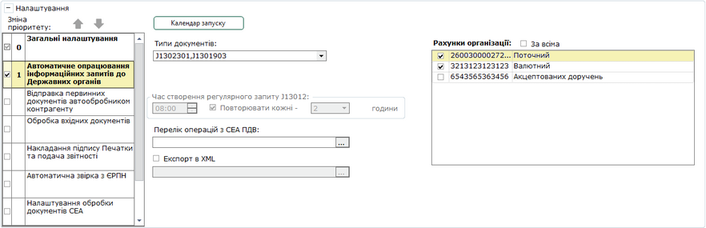

Натисніть, щоб збільшити малюнок

- Тип документів

Оберіть документ (або документи) за яким буде формуватися запит. Щоб обрати документ, натисніть на поле Типи документів, та у списку що відкрився, встановіть позначку у рядку документа (документів):

- J1301206, F1301206 Сума податку, дозволеної до реєстрації (якщо обраний тільки цей документ, область для вибору рахунків неактивна);
- J1301903, F1301903 Інформація в розрізі операцій з СЕА ПДВ (якщо обраний цей документ, стає доступним поле Перелік операцій з СЕА ПДВ);
- J1302301, F1302301 Реквізити та залишок за рахунком - у області праворуч оберіть рахунки для яких буде формуватися запит:

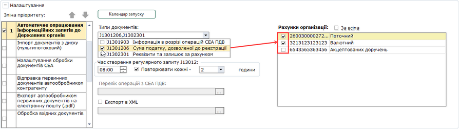

Натисніть, щоб збільшити малюнок

Встановіть відмітку За всіма для формування запиту по всім рахункам організації.

- Час створення регулярного запиту J1301206

Область доступна, якщо у полі Типи документів був обраний запит Сума податку, дозволеної до реєстрації.

Оберіть годину, о котрій повинно відбуватися автоматичне формування та відправлення запиту Сума податку, дозволеної до реєстрації.

Зверніть увагу! Автоматичне формування запиту відбувається лише у разі, якщо до вказаної години запит не був створений вручну.

- Перелік операцій з СЕА ПДВ

Поле Перелік операцій з СЕА ПДВ доступне, якщо у полі Типи документів обрано запит Інформація в розрізі операцій з СЕА ПДВ (J1301903, F1301903).

Оберіть перелік операцій для формування запиту. Щоб обрати операції, натисніть кнопку . У довіднику Назви операції з СЕА ПДВ, що відкриється, встановіть позначку у рядках потрібних операцій. Можливо обрати декілька операцій. Коди обраних операцій відображаються у полі Перелік операцій з СЕА ПДВ:

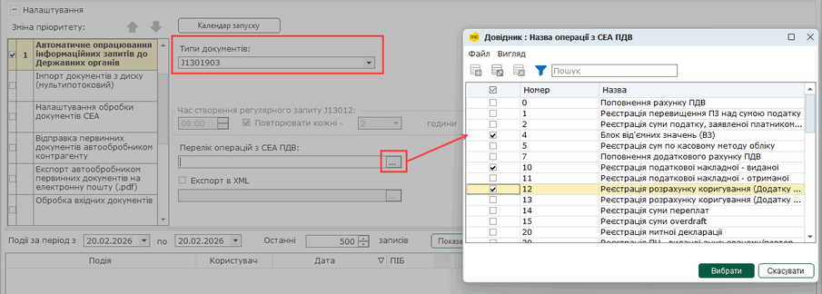

Натисніть, щоб збільшити малюнок

Виконуватиметься автоматичне формування запиту на поточну дату, коди обраних операцій зазначаються у окремих рядках запиту. Якщо поле Перелік операцій з СЕА ПДВ не заповнено, формування Запиту (J1301903, F1301903) не виконується.

- У полі Повторювати кожні \_\_ годин оберіть інтервал часу, через який необхідно повторювати формування та відправку запиту. Якщо упродовж вказаного часу відповідь на попередній запит не отримана, він видаляється, замість нього автоматично формується і відправляється новий запит. За замовчуванням встановлено значення - 2 години.
- Експорт в XML

Оберіть шлях для збереження запиту та отриманої за ним інформації на диску комп'ютера. Дані запиту та отримана за ним відповідь зберігаються у одному XML файлі.

Зверніть увагу:

Після запуску обробки буде виконано:

1. Якщо запитів "Запит щодо отримання реквізитів електронного рахунку та інформації щодо залишку коштів на такому рахунку" раніше організацією не виконувалось, вони будуть автоматично одноразово створені та оброблені, при наявності рахунку(ів) в картці підприємства та відміток навпроти них в даному розділі автоматичної обробки.

2. Запит "Запит що до суми податку, на яку платник податку на додану вартість має право зареєструвати податкові накладні" також буде одноразово створений та відправлений автоматично (згідно налаштувань області Час створення регулярного запиту J1301206 та за умови, що раніше запит не був виконаний). Якщо на запит не отримана відповідь упродовж часу, вказаного у полі Повторювати кожні \_\_ годин, створення та відправка запиту буде повторюватись до отримання відповіді на нього, але не довше ніж вказано в загальних налаштуваннях автоматичної обробки або у календарі запуску операції.

3. Автообробник переходить до стану моніторингу, у випадку створення чи імпорту запитів в реєстрі модуля [інформаційної довідки](UCGovQry.html#ucgovqry-ucgovqry_info), документ, що відповідатиме виконаним налаштуванням, буде взято в роботу:

а) Підписано;

б) Відправлено;

в) Експортовано.

Результати виконання автоматичної звірки записуються в журнал автоматичної обробки.

В журналі відображаються 500 останніх подій.

Всі події можна побачити в [Журналі подій M.Е.Doc](UCLogs.html#uclogs-admlogs).


