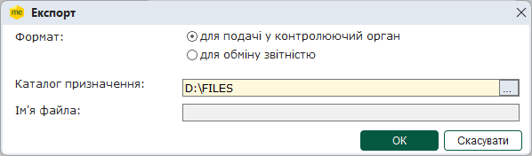
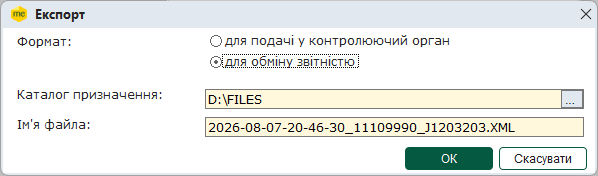
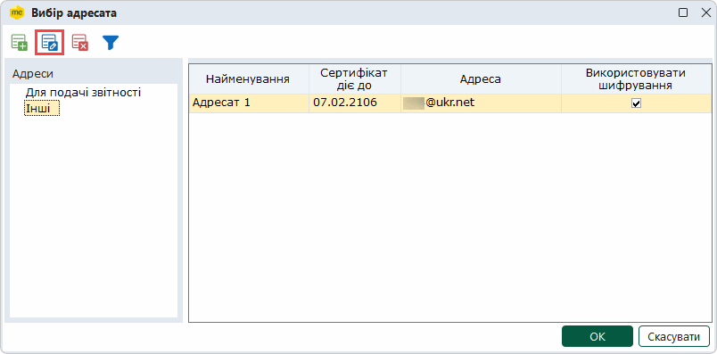
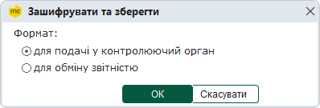
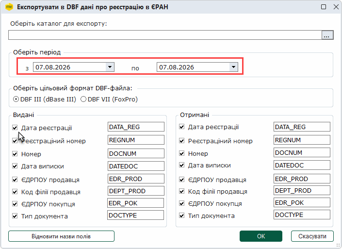

[← Зміст довідки](../)


# Експорт акцизних документів

## Експорт акцизних документів

_Шлях у довідці: Розділи програми › Облік акцизу › Експорт акцизних документів_

В цьому розділі:

[Експорт документів у формат XML для подання у контролюючі органи](#akcizexport-akcizexport)

[Експорт документів у формат XML для обміну звітністю](#akcizexport-akcizexport)

[Шифрування та збереження акцизних документів](#akcizexport-akcizexport)

[Експорт таблиці в Excel](#akcizexport-akcizexport)

[Експорт квитанцій про реєстрацію в ЄРАН](#akcizexport-akcizexport)

[Експорт в DBF даних про реєстрацію в ЄРАН](#akcizexport-akcizexport)

[Експорт підписаних Розрахунків коригувань та Акцизних накладних](#akcizexport-akcizexport)

Експорт акцизних документів призначений для збереження документів у обраному каталозі або електронному носії з метою подачі вивантажених звітів у контролюючі органи.

При експорті звіту із програми його назва та розширення відповідають регламентованим правилам подання звітів до певних контролюючих органів. Звіти перевіряються на заповнюваність обов'язкових реквізитів у документі згідно затверджених схем XSD (тільки для Акцизних накладних та РК). Ці перевірки аналогічні тим, які виконуються при прийманні документів у контролюючих органах.

Експорт документів в каталог чи на електронний носій можливий тільки в повній робочій версії ПК M.E.Doc.

Реалізована можливість експортувати як один файл, так и групу файлів одночасно. Для копіювання групи документів виділіть потрібне курсором миші, утримуючи клавішу <Shift> або <Ctrl>.

Експорт документів для подання у контролюючі органи

Дана функція призначена для збереження документа на електронному носії чи у обраному каталозі.

1. Виділіть потрібний для експорту документ у Реєстрі акцизних документів.

2. Оберіть команду експорту документа одним із наступних способів:

- команда меню Файл - Експорт - Експорт;
- у контекстному меню команда Експорт.

Функція експорту доступна і у відкритому вікні документа: у меню Файл - Експорт - Експорт. Із вікна відкритого документа експортується тільки поточний документ.

3. Відкриється вікно Експорт. Оберіть опцію для подачі у контролюючий орган.

4. Вкажіть каталог, де зберегти експортовані дані, у полі Каталог призначення. Документ зберігається у файлі формату .xml. Ім'я файлу регламентоване правилами подання звітів до контролюючого органу.

5. Натисніть ОК.

6. По закінченні процедури, система виведе протокол експорту документів. Якщо для експорту було обрано групу документів, у разі вдалого виконання операції, у протоколі вказано кількість сформованих звітів та імена файлів, у яких збережено дані.

[До початку](#akcizexport-akcizexport)

Експорт документів для обміну звітністю

Дана функція призначена для збереження звіту на електронному носії чи у обраному каталозі. Експорт документів для подання у Головну установу виконується у форматі «Внутрішній (нотивний) XML». Якщо документи містять підписи та квитанції, також експортуються дані підписів та квитанцій.

1. Виділіть потрібний для експорту документ у Реєстрі акцизних документів.

2. Експорт документа викликається одним із наступних способів:

- команда Файл - Експорт - Експорт;
- із контекстного меню команда Експорт.

Функція експорту доступна і у відкритому вікні документа: у меню Файл - Експорт - Експорт. Із вікна відкритого документа експортується тільки поточний документ.

3. Відкривається вікно Експорт. Оберіть опцію "для обміну звітністю".

4. Вкажіть каталог для збереження експортованих даних у полі Каталог призначення.

Документ зберігається у файлі формату .xml. Ім'я файлу згенерується автоматично. Ім'я містить в собі дату, час створення, код ЕДРПОУ підприємства та код документа.

5. Натисніть ОК.

6. По закінченні процедури, система виведе протокол експорту документів. Якщо для експорту було обрано групу документів, у разі вдалого виконання операції, у протоколі вказано кількість сформованих звітів та імена файлів, у яких збережено дані.

[До початку](#akcizexport-akcizexport)

Шифрування та збереження акцизних документів

Дана функція призначена для збереження підписаних та зашифрованих на одержувача документів. Даний спосіб, наприклад, може використовуватися для відправлення документів електронною поштою контрагентам чи в ДПС у випадку відсутності доступу до мережі Інтернет на даному комп'ютері.

У процесі  вивантаження обирається формат експорту.

Підпис, шифрування та експорт документів виконується у наступній послідовності:

1. У таблиці розділу виділіть документи, які необхідно експортувати підписаними та зашифрованими.

2. Оберіть один із способів:

- команду Файл - Зашифрувати та зберегти;
- із контекстного меню команду Зашифрувати та зберегти;
- на вкладці Наступні дії команду Зашифрувати та зберегти.

Функція доступна також у відкритому вікні документа:

- у меню Файл - Зашифрувати та зберегти;
- на вкладці Наступні дії команду Зашифрувати та зберегти.

В цьому випадку дії виконуються лише з цим відкритим документом.

3. Відкриється вікно Вибір адресата.

Для документів, що призначені контрагентам, оберіть у розділі Інші потрібний запис:

Обов'язково перевірте, чи використовується підпис та шифрування при обміні з цим контрагентом.

Якщо підпис та шифрування не використовуються, Ваші документи будуть незахищені.

4. У наступному вікні оберіть формат файлу:

- для подачі у контролюючий орган,
- для обміну звітністю

5. Вкажіть шлях для збереження файлу.

6. Далі запускається звичайна процедура накладання підписів та шифрування файлу.

7. По закінченні відкривається протокол операції, в якому вказується каталог із збереженими файлами.

[До початку](#akcizexport-akcizexport)

Експорт таблиці в Excel

Дана функція призначена для збереження даних, що відображені на момент експорту у вікні Реєстру акцизних документів.

1. У меню Файл оберіть Експорт - Експорт таблиці  Excel.

2. Відкривається вікно діалогу збереження файлів ОС Windows, у якому вкажіть ім'я файлу для збереження даних.

5. Натисніть кнопку Зберегти.

6. Система повідомить про закінчення процесу експорту.

[До початку](#akcizexport-akcizexport)

Експорт квитанцій про реєстрацію в ЄРАН

Дана функція призначена для збереження даних про квитанції реєстрації документів у Єдиному реєстрі акцизних накладних (ЄРАН). Дані зберігаються у вигляд текстового файлу формату RTF на електронному носії чи у обраному каталозі. Виконати експорт можливо тільки для Акцизних накладних та РК, що зареєстровані у ЄРАН.

1. Виділіть потрібний для експорту документ у Реєстрі акцизних документів.

2. Експорт документа викликається одним із наступних способів:

- команда Файл - Експорт - Експортувати в RTF квитанцію про реєстрацію в ЄРАН;
- із контекстного меню команда Експортувати в RTF квитанцію про реєстрацію в ЄРАН.

3. Відкривається вікно Огляд папок, у якому оберіть шлях до каталогу, в якому буде збережено файл з експортованими даними. Натисніть кнопку ОК.

4. Система повідомить про закінчення процесу експорту.

[До початку](#akcizexport-akcizexport)

Експорт в DBF даних про реєстрацію в ЄРАН

Ця функція призначена для збереження даних реєстрації акцизних накладних в Єдиному реєстрі акцизних накладних (ЄРАН). Дані зберігаються на електронному носії чи у обраному каталозі у форматі DBF. Виконати експорт можливо тільки для Акцизних накладних та РК, що зареєстровані у ЄРАН.

1. Виділіть потрібний для експорту документ у Реєстрі акцизних документів.

2. Експорт документа викликається одним із наступних способів:

- команда Файл - Експорт - Експортувати в DBF дані про реєстрацію в ЄРАН;
- із контекстного меню команда Експортувати в DBF дані про реєстрацію в ЄРАН

3. Відкривається модальне вікно Експортувати в DBF дані про реєстрацію в ЄРАН.

4. Вкажіть каталог, де зберегти створений файл, у полі Оберіть каталог для експорту.

5. У блоці Оберіть період вкажіть дати початку та закінчення періоду, у який були зареєстровані документи.

6. У блоці Видані обираються дані документів, що були видані контрагентам. У області Отримані - дані документів, що були отримані від контрагентів. Встановіть позначки, що відповідають даним, які потрібно експортувати.

8. Обраним даним по замовчуванню пропонується назва колонки, у якій буде збережено дані. Якщо необхідно змінити назву колонки, вкажіть нову назву у полі, розташованому праворуч від типу даних.

  Натиснувши кнопку Відновити назви полів, можливо повернути назву, запропоновану за замовчуванням. Первинна назва буде повернена ВСІМ відредагованим назвам.

9. Натисніть ОК.

10. Система повідомить про закінчення процесу експорту.

[До початку](#akcizexport-akcizexport)

Експорт підписаних Розрахунків коригувань акцизної накладної

Дана функція призначена для збереження на електронні носії підписаних документів, реєстрація яких здійснюється отримувачем (Примірник 2 АН/РК форми "П" і форми "С" та від'ємні РК акцизної накладної форми "П" та форми "С").

Виконати такий експорт можливо тільки для документів, які підписані повним комплектом підписів та готові до відправки або вже були відправлені. Документи, які були відправлені, експортуються з накладеними підписами, не зашифровані на адресата.

1. Виділіть підписаний документ, який необхідно експортувати.

2. У вкладці Наступні дії оберіть функцію Експортувати підписаний документ.

3. Вкажіть каталог, де зберегти файл.

4. Документи зберігаються у файлі формату для подачі у контролюючий орган (.xml).

[До початку](#akcizexport-akcizexport)


