[← Зміст довідки](../)


# Облік акцизу

## Облік акцизу

_Шлях у довідці: Розділи програми › Облік акцизу_

Розділ призначений для роботи з акцизними документами. Розділ дозволяє створювати, редагувати та зберігати акцизні документи, з метою їх реєстрації в ДПС, а також обмінюватися акцизними документами з контрагентами за допомогою електронної пошти.

У даному розділі довідки розглянуто наступне:

- [Реєстр акцизних документів (пальне)](UCExciseRst.html#ucexciserst-ucexciserst)
- [Звірка документів з ЄРАН (пальне)](UCComparisonERAN.html#uccomparisoneran-uccomparisoneran)
- [Реєстр ліцензій (пальне)](UCExciseLicenseFuelRst.html#ucexciselicensefuelrst-ucexciselicensefuelrst)
- [Реєстр акцизних документів (спирт етиловий)](UCExciseAlcoRst.html#ucexcisealcorst-ucexcisealcorst)
- [Звірка документів з ЄРАН (спирт етиловий)](UCComparisonERANAlco.html#uccomparisoneranalco-uccomparisoneranalco)
- [Реєстр ліцензій (спирт, алкоголь, тютюн)](UCExciseLicenseRst.html#ucexciselicenserst-ucexciselicenserst)
- [Реєстр ТТН  (спирт, алкоголь)](UCWaybillRst.html#ucwaybillrst-ucwaybillrst)
- [Реєстр обладнання (тютюнові вироби)](UCExciseEquipRst.html#ucexciseequiprst-ucexciseequiprst)
- [Операції з акцизними документами та ТТН](#akcizmain-akciz_operation)
- [Реєстраційний ліміт СЕАРП та СЕ](#akcizmain-akciz_reestr_limit)
- [Експорт акцизних документів](AkcizExport.html#akcizexport-akcizexport)
- [Підписання ЕП та відправлення акцизних документів](#akcizmain-akciz_reestr_funkc_vidp)
- [Маршрути відправки акцизних документів](AkcizRstMarshrut.html#akcizrstmarshrut-akcizrstmarshrut)
- [Маршрути відправки товарно-транспортних накладних](UCWaybillMarshrut.html#ucwaybillmarshrut-ucwaybillmarshrut)
- [Довідники](Akciz_dovidnyky.html#akciz_dovidnyky-akciz_dovidnyky)
- [Господарські одиниці/Акцизні склади/Земельні ділянки](UCEconomicUnits.html#uceconomicunits-uceconomicunits)

### Сервіс "Ліцензійна справа"

_Шлях у довідці: Розділи програми › Облік акцизу › Сервіс "Ліцензійна справа"_

В цьому розділі:

[Перегляд документів за номером ліцензії](#akcizmain-akciz_license)

[Опрацювання Повідомлень про внесення чергового платежу за ліцензію](#akcizmain-akciz_license)

ДПС України здійснюється автоматизована розсилка повідомлень про сплив терміну чергового платежу за ліцензію, призупинення дії ліцензії або анулювання ліцензії на певний вид діяльності.

Повідомлення про внесення чергового платежу за ліцензію формується ДПС та направляється адресату за 30, 20, 10 та 5 днів до настання терміну оплати ліцензії.

У програмі M.E.Doc перегляд та опрацювання документів щодо ліцензій, а також отриманих від ДПС Повідомлень, можливо здійснювати за допомогою сервісу Ліцензійна справа.

Повідомлення доступні у розділах Облік акцизного податку – Реєстр ліцензій (пальне) та/або Реєстр ліцензій (спирт, алкоголь, тютюн), відповідно до типу ліцензії щодо якої отримано Повідомлення.

Отримані від ДПС Повідомлення за замовчуванням відображаються у Реєстрі червоним кольором для звернення уваги користувачів на необхідність внести платіж за ліцензію:

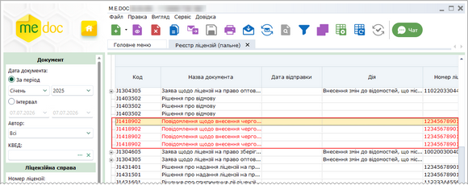

Натисніть, щоб збільшити малюнок
У Реєстрі ліцензій (пальне)

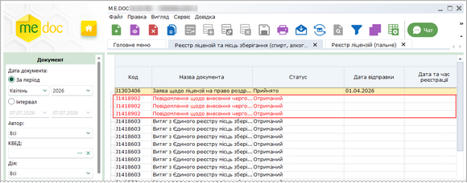

Натисніть, щоб збільшити малюнок
У Реєстрі ліцензій (спирт, алкоголь, тютюн)

Перегляд документів за номером ліцензії

За допомогою сервісу можливо здійснювати відбір документів щодо ліцензії за Номером ліцензії. Для цього:

1. На панелі Фільтр оберіть параметри для відображення документів.

2. У блоці Ліцензійна справа введіть номер ліцензії та натисніть кнопку Показати у нижній частині панелі Фільтр.

3.  У таблиці Реєстру будуть відображені лише записи з документами щодо вказаної ліцензії, за обраний період:

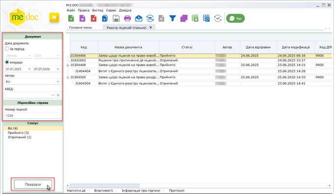

Натисніть, щоб збільшити малюнок
У Реєстрі ліцензій (пальне)

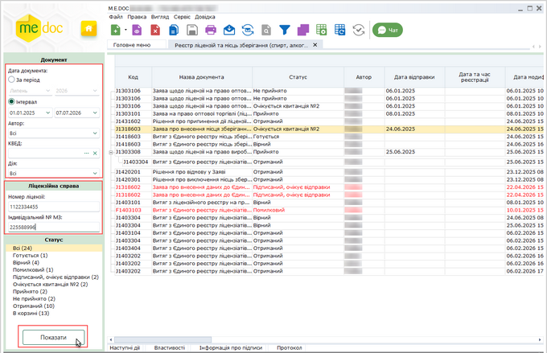

Натисніть, щоб збільшити малюнок
У Реєстрі ліцензій (спирт, алкоголь, тютюн)

У Реєстрі ліцензій (спирт, алкоголь, тютюн) також можна виконувати пошук документів за Індивідуальним № МЗ - унікальним номером місця зберігання.

[До початку](#akcizmain-akciz_license)

Опрацювання Повідомлень про внесення чергового платежу за ліцензію

Для опрацювання повідомлення виконайте наступне:

1. Оберіть Повідомлення, відповідно до якого за ліцензію вже виконано платіж.

2. У пункті головного меню Правка або у контекстному меню оберіть команду Платіж виконано. Команда доступна лише для отриманого та неопрацьованого Повідомлення (позначено червоним кольором), що виділений у відповідному реєстрі:

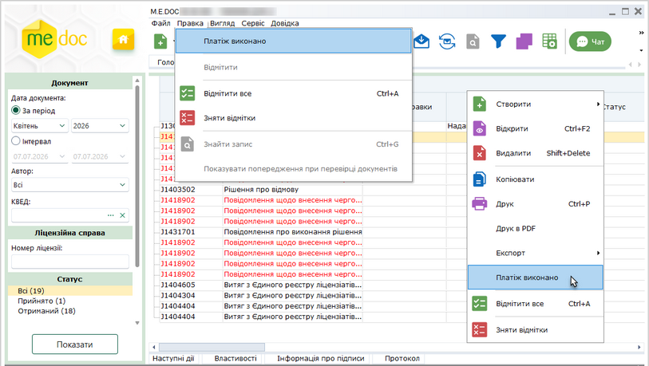

Натисніть, щоб збільшити малюнок

3. Після виконання команди Повідомлення набуває стану Виконано та відображається у реєстрах чорним кольором. У колонці Виконано проставляється позначка.

[До початку](#akcizmain-akciz_license)

### Операції з акцизними документами та ТТН

_Шлях у довідці: Розділи програми › Облік акцизу › Операції з акцизними документами та ТТН_

У даному розділі довідки розглянуто основні операції, що можуть виконуватись при роботі з документами:

- [Друк документів у PDF](#akcizmain-akciz_reestr_print_pdf)
- [Імпорт документів](#akcizmain-imp_perv)
- [Експорт документів](AkcizExport.html#akcizexport-akcizexport)
- [Прийом акцизних документів електронною поштою](#akcizmain-akcizs_reestr_funkc_pryyom)
- [Підписання ЕП та відправлення акцизних документів електронним каналом зв'язку](#akcizmain-akciz_reestr_funkc_vidp)
- [Редагування документа](#akcizmain-akciz_reestr_edit)
- [Копіювання документа](#akcizmain-akciz_reestr_copy)
- [Примітки до документів](#akcizmain-akciz_doc_label)

#### Друк документів у PDF

_Шлях у довідці: Розділи програми › Облік акцизу › Операції з акцизними документами та ТТН › Друк документів у PDF_

Дана функція дозволяє зберегти обрані документи на диску комп’ютера у файлах формату .pdf.

Виділіть документ, який потрібно друкувати. Для виділення групи документів виділіть потрібне курсором миші, утримуючи клавішу <Shift> або <Ctrl>.

1. Оберіть один із способів:

- із контекстного меню команда Друк в PDF;
- команда меню Файл - Друк в PDF.

2. У вікні Огляд папок вкажіть каталог, у якому потрібно зберегти файли .pdf.

3. Система повідомить про закінчення операції друку.

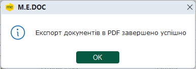

Також функція друку документа  у PDF доступна і у відкритому вікні документа:

- команда меню Файл - Друк в PDF.

#### Імпорт документів

_Шлях у довідці: Розділи програми › Облік акцизу › Операції з акцизними документами та ТТН › Імпорт документів_

Дана функція призначена для імпорту акцизних документів, створених в інших бухгалтерських системах.

1. У меню оберіть команду Файл - Імпорт - Імпорт звітів.

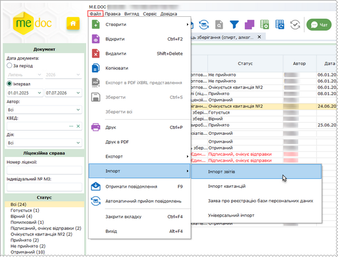

Натисніть, щоб збільшити малюнок

2. На виконання команди відкриється вікно вибору файлів вказаного формату, які імпортуються.

3. Вкажіть шлях до каталогу розміщення файлів. Оберіть файли та натисніть Відкрити для початку процесу імпорту.

4. По закінченні процедури система виведе протокол імпорту даних.

#### Прийом документів електронною поштою

_Шлях у довідці: Розділи програми › Облік акцизу › Операції з акцизними документами та ТТН › Прийом документів електронною поштою_

Зверніть увагу! Для документів, прийнятих електронною поштою, функція видалення заблокована.

Відправлені контрагентом електронною поштою акцизні документи надходять як звичайна вхідна кореспонденція.

Отримані акцизні документи поміщаються у групі Вхідні, стан Отримані. Як тільки документи отримано, відправнику надходить повідомлення про доставку.

Перегляньте отримані документи.

Отриманні документи можна погодити або відхилити. Для цього на панелі вкладок, виберіть закладку Наступні дії і натисніть Погодити документ або Відхилити документ.

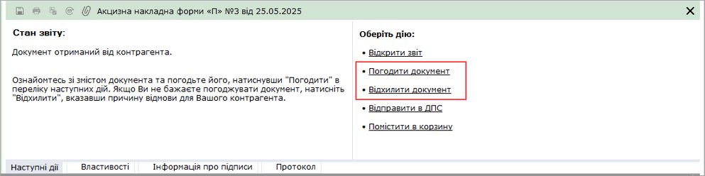

- Погодити документ - обирається за умови, що отриманий документ не містить помилок та повністю влаштовує отримувача.
Відправнику документа буде автоматично надіслано повідомлення про погодження документа.

- Відхилити документ - обирається за умови наявності в документі помилок та/або небажання співпрацювати.
В цьому випадку необхідно вказати причину відхилення документа.

Якщо натиснути на кнопку Можливі відповіді, відкривається перелік можливих відповідей, що збережені у довіднику.

Автору документа буде автоматично надіслано повідомлення про відхилення документа із зазначенням причини відмови.

#### Редагування документа

_Шлях у довідці: Розділи програми › Облік акцизу › Операції з акцизними документами та ТТН › Редагування документа_

Редагування документа доступне для непідписаних невідправлених документів.

Документ відкривається на редагування одним зі способів:

- подвійне натискання мишею на рядку документа в реєстрі;
- кнопка  Відкрити на панелі інструментів;
- пункт головного меню Файл - Відкрити;
- пункт контекстного меню Відкрити;
- комбінація клавіш Ctrl+F2.

#### Копіювання документа

_Шлях у довідці: Розділи програми › Облік акцизу › Операції з акцизними документами та ТТН › Копіювання документа_

Для копіювання акцизного документа виконайте дії в наступній послідовності:

1. Виділіть документ, копію якого потрібно створити. Для копіювання групи документів виділіть потрібне курсором миші, утримуючи клавішу <Shift> або <Ctrl>.

2. Оберіть один із способів виклику функції копіювання:

- на панелі інструментів натисніть кнопку Копіювати - ;
- із контекстного меню команда Копіювати;
- команда Файл - Копіювати.

Із вікна відкритого документа копіюється тільки поточний документ.

3. На виконання функції копіювання відкривається вікно, у якому оберіть дату виписки копії документа.

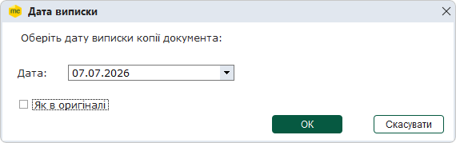

За замовчуванням встановлюється поточна дата. Якщо потрібно зазначити дату виписки документа, що копіюється, встановіть позначку Як в оригіналі.

Для того, щоб обрати іншу дату, натисніть кнопку .

4. Після вибору дати натисніть кнопку ОК. Відкриється вікно копії документа.

Скопійовані документи можна редагувати.

#### Примітки до документів

_Шлях у довідці: Розділи програми › Облік акцизу › Операції з акцизними документами та ТТН › Примітки до документів_

Примітки надають можливість внесення будь-якої додаткової інформації стосовно документа та пришвидшити пошук документів за їх додатковими ознаками.

Докладно про додавання приміток дивіться розділ довідки [Ярлики та примітки до документів](UCDFDocsRstNew.html#ucdfdocsrstnew-doc_label).

### Реєстраційний ліміт СЕАРП та СЕ

_Шлях у довідці: Розділи програми › Облік акцизу › Реєстраційний ліміт СЕАРП та СЕ_

Відображення реєстраційного ліміту в Реєстрі акцизних документів налаштовується в параметрах системи [Адміністрування - Параметри системи - Документообіг](FormCompanyParams.html#formcompanyparams-admcompanyparams_sdo), параметр Відображати реєстраційний ліміт СЕАРП та СЕ.

За замовчуванням параметр відмічено та відображення ліміту увімкнено.

У модулях Реєстр акцизних документів (пальне) та Реєстр акцизних документів (спирт етиловий) на панелі інструментів відображається кнопка Реєстраційний ліміт СЕАРП та СЕ.

При натисканні на кнопку Реєстраційний ліміт СЕАРП та СЕ, за наявності в програмі Витягів з СЕАРП та СЕ, відкривається вікно із відображенням лімітів:

Оновлення відображення реєстраційних лімітів  виконується автоматично при отриманні нових Витягів:

- Витяг щодо суми податку, на яку платник акцизного податку має право зареєструвати Заявку на поповнення обсягу залишку пального або спирту етилового в СЕАРП та СЕ;
- Витяг щодо обсягу пального або спирту етилового, на який платник має право зареєструвати акцизні накладні/розрахунки коригування до акцизних накладних в ЄРАН.

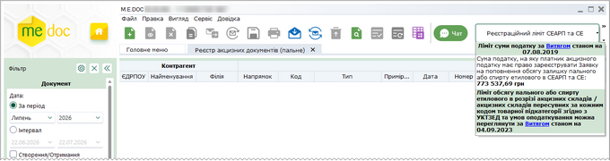

Натисніть, щоб збільшити малюнок
У Реєстрі акцизних документів (пальне)

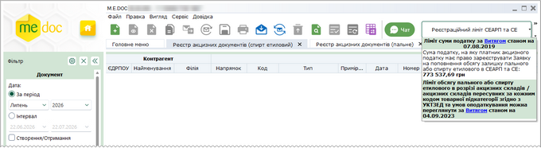

Натисніть, щоб збільшити малюнок
У Реєстрі акцизних документів (спирт етиловий)

При натисканні посилання Витягом відкривається відповідний Витяг у окремій вкладці.

Якщо в програмі нема Витягів з СЕАРП та СЕ, то замість реєстраційних лімітів буде відображено повідомлення про необхідність відправити Запити.

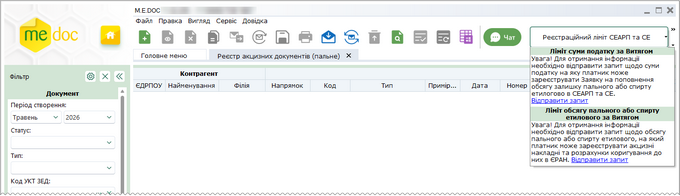

Натисніть, щоб збільшити малюнок
У Реєстрі акцизних документів (пальне)

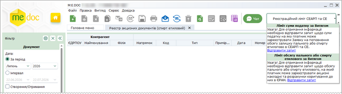

Натисніть, щоб збільшити малюнок
У Реєстрі акцизних документів (спирт етиловий)

При натисканні посилання Відправити запит відкривається відповідний Запит у окремій вкладці:

- Запит щодо суми податку, на яку платник акцизного податку має право зареєструвати Заявку на поповнення обсягу залишку пального або спирту етилового в СЕАРП та СЕ;
- Запит щодо обсягу пального або спирту етилового, на який платник має право зареєструвати акцизні накладні/розрахунки коригування до акцизних накладних в ЄРАН.

### Підписання ЕП та відправлення акцизних документів

_Шлях у довідці: Розділи програми › Облік акцизу › Підписання ЕП та відправлення акцизних документів_

Вихідні акцизні документи відправляються контрагентам електронним каналом зв'язку. Для відправки документ повинен бути заповненим, перевіреним та збереженим.

Існує декілька способів відправки акцизних документів контрагентам:

Із вкладки "Наступні дії"

Даний спосіб дозволяє відправити лише один документ - відкритий або виділений в Реєстрі акцизних документів.

В доступних діях з документом передбачено декілька варіантів для зручності користувача:

Передати документ на підпис

На виконання цієї команди документ блокується від редагування та набуває статусу На підпис директору/бухгалтеру (статус залежить від [обраного комплекту підписів](FormCompanyParams.html#formcompanyparams-admcomanyparams_pen) для акцизних документів). Документ знаходиться в стані очікування.
В Наступних діях стає доступним можливість [Підписати документ](UC_ECP.html#uc_ecp-ecp).
Після накладення підписів директора/бухгалтера та печатки установи документ набуває статусу Готовий до відправки, стає доступною функція Відправити документ. Програма повторно запропонує підписати файл сертифікатом печатки установи, таким чином підписується "конверт", в який поміщається файл для відправки.

Підписати документ

На виконання команди відразу розпочнеться стандартний процес [підписання документа](UC_ECP.html#uc_ecp-ecp) ЕП.
Після накладення підписів директора/бухгалтера та печатки установи документ набуває статусу Готовий до відправки, стає доступною функція Відправити. Програма повторно запропонує підписати файл сертифікатом печатки установи, таким чином підписується "конверт", в який поміщається файл для відправки.

Відправити в ДПС / Відправити контрагенту

На виконання команди розпочнеться [підписання документа](UC_ECP.html#uc_ecp-ecp) ЕП та одразу відправка документа адресату.

З Реєстру акцизних документів

Даний спосіб дозволяє відправляти як один документ, так и групу документів одночасно.

У реєстрі виберіть потрібний акцизний документ або групу акцизних документів та оберіть один із варіантів:

- на панелі інструментів натисніть кнопку Відправити - ;
- виберіть команду Файл/Відправити;
- у контекстному меню оберіть команду Відправити.

Оберіть потрібного адресата з доступних: ДПС або контрагент.

На виконання команди розпочнеться [підписання документа](UC_ECP.html#uc_ecp-ecp) ЕП та одразу відправка документа адресату. По закінченню процедури, система виведе протокол відправки документів.

Також зверніть увагу:

- Після підписання документів комплектом електронних підписів, у відповідних місцях бланка документів встановлюється позначка ЕП, що свідчить про накладений підпис/печатку. Якщо в Картці підприємства [налаштовані зразки підписів](UCOrg.html#ucorg-sprorg_podp) директора/бухгалтера та печатки підприємства, то після підписання документа у відповідних місцях бланка відображаються завантажені у програму сканкопії зразків для більшої наочності.
Контрагент, що отримав документ, також бачить зображення підпису та печатки установи.

- Для того, щоб документ роздруковувався разом із зображеннями підпису та печатки, необхідно встановити позначку в полі Накладати графічні зображення підписів та печатки під час друку в [Параметрах системи](FormCompanyParams.html#formcompanyparams-admcompanyparams_zv).
- В акцизному документі обов'язково заповнюється ЄДРПОУ контрагента, та, якщо є, - код філії. Виходячи з цих реквізитів безпосередньо перед відправленням акцизного документа відбувається перевірка актуальності та наявність сертифікатів ЕП контрагентів. За умови наявності застарілих сертифікатів або їх відсутності система автоматично завантажує нові актуальні сертифікати із сайту кваліфікованого надавача електронних довірчих послуг. Якщо з будь-якої причини завантаження сертифікату неможливе, система повідомить про це користувача.
- Для акцизних документів реалізовано функцію мультишифрування, яка полягає в одночасному шифруванні документа сертифікатами контрагента "директор" та "печатка установи". Таким чином, при отриманні документа, контрагент може розшифрувати його будь-яким з цих сертифікатів.
- Якщо відправляється документ новому контрагенту, який відсутній в адресній книзі та/або в довіднику Контрагенти, система пропонує створити їх записи.
Аналогічно при отриманні документа від нового контрагента, автоматично створюється запис в адресній книзі та картка в довіднику Контрагенти.

- Документи, які були відправлені, неможливо видалити з Реєстру акцизних документів, функція видалення заблокована. Такі документи можливо лише перемістити в Архів.
- Після отримання контрагентом документів надійде повідомлення про доставку.


