[← Зміст довідки](../)


# Робота з акцизними документами (пальне)

## Робота з акцизними документами (пальне)

_Шлях у довідці: Розділи програми › Облік акцизу › Реєстр акцизних документів (пальне) › Робота з акцизними документами (пальне)_

У даному розділі довідки розглянуто наступне:

- [Як створити акцизний документ](#akcizrstfunkc-akciz_reestr_funkc_stvor)
- [Створення документів на основі існуючих](#akcizrstfunkc-akciz_reest_create_oil)
- [Створення Довідки про зведені за добу дані](#akcizrstfunkc-akciz_reestr_funkc_stvor_vytratomir)

### Як створити акцизний документ

_Шлях у довідці: Розділи програми › Облік акцизу › Реєстр акцизних документів (пальне) › Робота з акцизними документами (пальне) › Як створити акцизний документ_

Для створення нового акцизного документа виконайте дії в наступній послідовності:

1. Скористайтесь одним із способів:

- на панелі інструментів натисніть кнопку Створити;
- виберіть команду Файл - Створити;
- у контекстному меню оберіть команду Створити;
- натисніть комбінацію клавіш <Ctrl+N>.

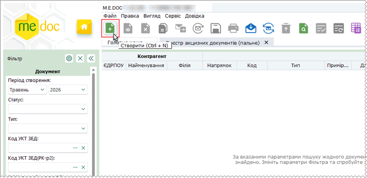

Натисніть, щоб збільшити малюнок

2. У вікні, що відкриється, оберіть потрібний тип акцизного документа та натисніть Створити:

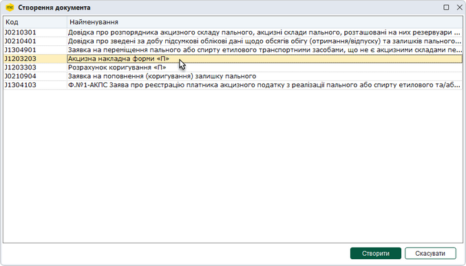

Натисніть, щоб збільшити малюнок

3. У окремому вікні відкриється бланк документа, який потрібно заповнити.

Поля, що підсвічені жовтим кольором, доступні для заповнення та редагування.

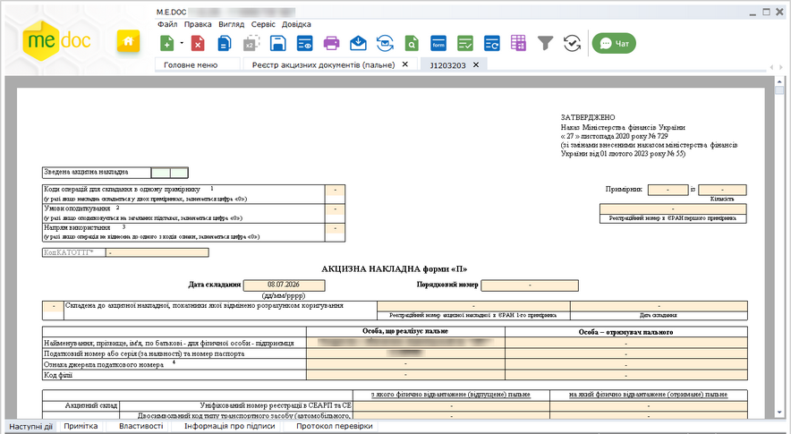

Натисніть, щоб збільшити малюнок

4. Внесіть дані в поля, які потребують заповнення із клавіатури.

5. Оберіть команду Правка - Перевірити документ або F4 для перевірки звіту.

Перевіряється правильність заповнення полів і у випадку помилок, система підсвітить червоним кольором поля, що необхідно виправити. Виправте помилки та знову виконайте перевірку.

6. Збережіть документ, натиснувши кнопку  або комбінацію клавіш Ctrl+S.

### Створення документів на основі існуючих

_Шлях у довідці: Розділи програми › Облік акцизу › Реєстр акцизних документів (пальне) › Робота з акцизними документами (пальне) › Створення документів на основі існуючих_

В цьому розділі:

[Створення Розрахунку коригування на основі Акцизної накладної](#akcizrstfunkc-akciz_reest_create_oil)

[Створення другого примірника Розрахунку коригування "П" на основі першого примірника](#akcizrstfunkc-akciz_reest_create_oil)

[Створення другого примірника Акцизної накладної форми "П" на основі першого примірника](#akcizrstfunkc-akciz_reest_create_oil)

[Створення виданої Акцизної накладної форми "П" на основі отриманої](#akcizrstfunkc-akciz_reest_create_oil)

[Створення Коригуючої довідки](#akcizrstfunkc-akciz_reest_create_oil)

[Створення документів за власними налаштуваннями](#akcizrstfunkc-akciz_reest_create_oil)

Створення Розрахунку коригування на основі Акцизної накладної

Створення РК можливо на основі виданої АН.

Для створення РК на основі виданої АН виконайте наступне:

1. У реєстрі оберіть видану Акцизну накладну (або кілька виданих АН), на підставі якої необхідно створити розрахунок коригування.

2. Оберіть один із способів:

- виберіть команду меню Файл - Створити на основі - Розрахунок коригування;
- у контекстному меню оберіть команду Створити на основі - Розрахунок коригування:

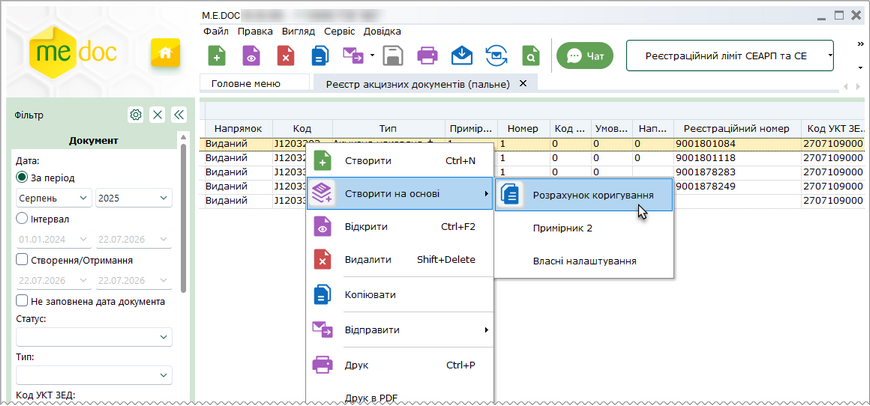

Натисніть, щоб збільшити малюнок

3. Відкриється вкладка нового РК: Розрахунок коригування «П»:

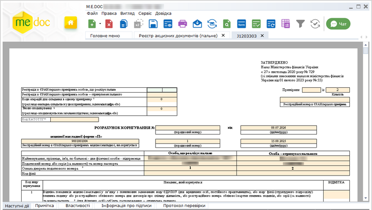

Натисніть, щоб збільшити малюнок

Поля створеного документа автоматично заповнюються даними з АН.

4. Для збереження створеного документа натисніть на кнопку  на панелі інструментів.

[До початку](#akcizrstfunkc-akciz_reest_create_oil)

Створення другого примірника Розрахунку коригування "П" на основі першого примірника

Функція доступна для перших примірників виданих РК, для яких в установленому законодавством порядку передбачається складання 2-го примірника (у полі Примірник встановлено значення «1», у полі Кількість встановлено значення «2»).

Функція доступна як для одного обраного у реєстрі документа , так і для групи виділених документів.

1. У реєстрі оберіть перший виданий примірник Розрахунку коригування акцизної накладної форми «П» (або кілька перших примірників РК), на підставі якої необхідно створити другий примірник.

2. Оберіть один із способів:

- виберіть команду меню Файл - Створити на основі - Примірник 2;
- у контекстному меню оберіть команду Створити на основі -  Примірник 2:

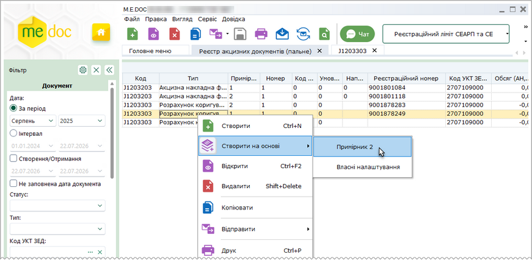

Натисніть, щоб збільшити малюнок

3. Відкриється вкладка другого примірника Розрахунку коригування акцизної накладної форми «П»:

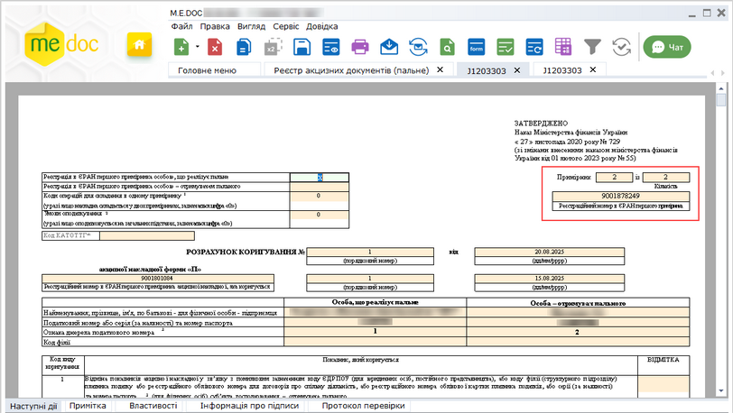

Натисніть, щоб збільшити малюнок

Поля другого примірника РК автоматично заповнюються значеннями з першого примірника. У поле Реєстраційний номер в ЄРАН заноситься значення реєстраційного номера першого примірника РК (якщо такий наявний). У полях Примірник та Кількість встановлюється значення «2».

4. Перевірте коректність заповнення документа. Для збереження створеного документа натисніть на кнопку  на панелі інструментів.

[До початку](#akcizrstfunkc-akciz_reest_create_oil)

Створення другого примірника Акцизної накладної форми "П" на основі першого примірника

Функція доступна для перших примірників виданих АН, для яких в установленому законодавством порядку передбачається складання 2-го примірника (у полі Примірник встановлено значення «1», у полі Кількість встановлено значення «2»).

Функція доступна як для одного обраного у реєстрі документа , так і для групи виділених документів.

1. У реєстрі оберіть перший виданий примірник Акцизної накладної форми «П» (або кілька перших примірників АН), на підставі якої необхідно створити другий примірник.

2. Оберіть один із способів:

- виберіть команду меню Файл - Створити на основі - Примірник 2;
- у контекстному меню оберіть команду Створити на основі -  Примірник 2:

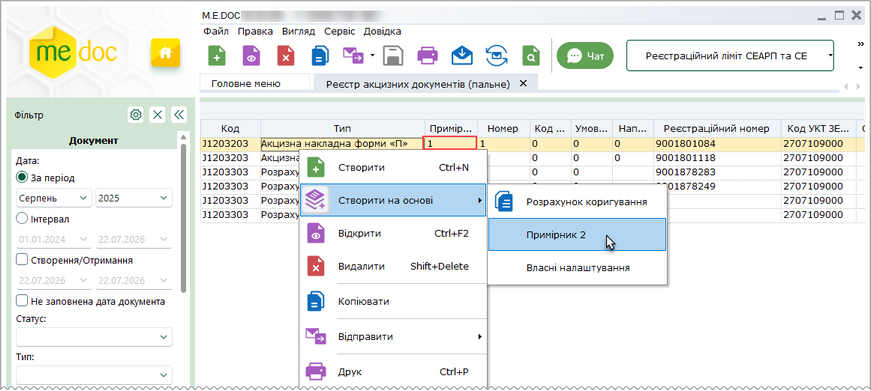

Натисніть, щоб збільшити малюнок

3. Відкриється вкладка другого примірника Акцизної накладної форми «П»:

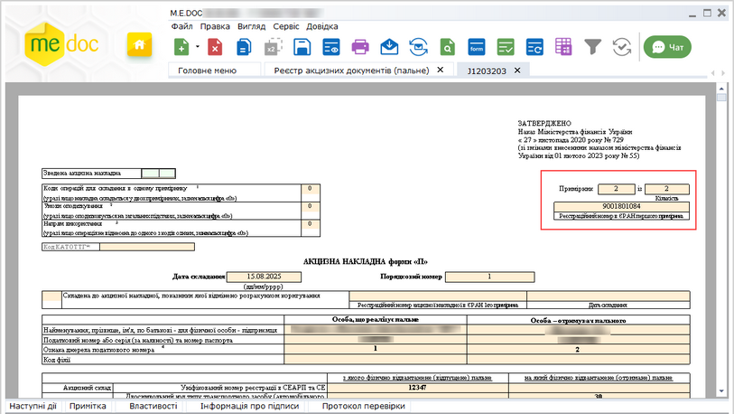

Натисніть, щоб збільшити малюнок

Поля другого примірника АН автоматично заповнюються значеннями з першого примірника. У поле Реєстраційний номер в ЄРАН заноситься значення реєстраційного номера першого примірника АН (якщо такий наявний). У полях Примірник та Кількість встановлюється значення «2».

4. Перевірте коректність заповнення документа. Для збереження створеного документа натисніть на кнопку  на панелі інструментів.

[До початку](#akcizrstfunkc-akciz_reest_create_oil)

Створення виданої Акцизної накладної форми "П" на основі отриманої

Для створення виданої АН на основі отриманої:

1. У вікні реєстру оберіть отриману Акцизну накладну форми "П", на підставі якої необхідно створити видану АН.

2. Оберіть один із способів:

- виберіть команду меню Файл - Створити на основі - Створити видану АН на основі отриманої;
- у контекстному меню оберіть команду Створити на основі - Створити видану АН на основі отриманої:

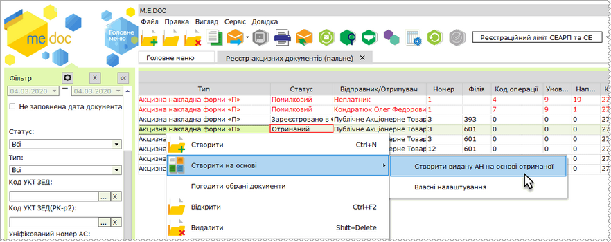

Натисніть, щоб збільшити малюнок

3. Відкриється вкладка, що відповідає створюваній АН. Поля створеного документа автоматично заповнюються даними вихідного документа ("отриманої" АН). Заповніть область з даними про отримувача.

4. Для збереження створеного документа натисніть на кнопку  на панелі інструментів.

[До початку](#akcizrstfunkc-akciz_reest_create_oil)

Створення Коригуючої довідки

Створення Коригуючої довідки виконується на основі виданих основних документів (встановлена ознака у полі основна):

- Довідка про розпорядника акцизного складу пального, акцизні склади пального, розташовані на них резервуари пального, витратоміри та рівнеміри;
- Довідка про зведені за добу підсумкові облікові дані щодо обсягів обігу (отримання/відпуску) та залишків пального на акцизному складі пального.

Функція доступна як для одного документа, так і для групи документів, обраних у реєстрі.

Для створення Коригуючої довідки виконайте наступне:

1. У вікні Реєстру акцизних документів (пальне) оберіть видану основну Довідку, на підставі якої необхідно створити Коригуючу довідку.

2. Оберіть один із способів:

- виберіть команду меню Файл – Створити на основі – Коригуючу довідку;
- у контекстному меню оберіть команду Створити на основі – Коригуючу довідку:

3. Відкриється вкладка Коригуючої довідки, у створеному документі автоматично встановлюється ознака у полі коригуюча. Поля створеного документа автоматично заповнюються даними з основної Довідки.

4. Для збереження створеного документа натисніть на кнопку  на панелі інструментів.

[До початку](#akcizrstfunkc-akciz_reest_create_oil)

Створення документів за власними налаштуваннями

Для створення первинних документів за власними налаштуваннями:

1. У вікні реєстру оберіть документ, для якого [налаштовано](UCRtfFromDocSettings.html#ucrtffromdocsettings-ucrtffromdocsettings) створення документів за власними налаштуваннями:

- Акцизна накладна форми "П";
- Розрахунок коригування форми "П".

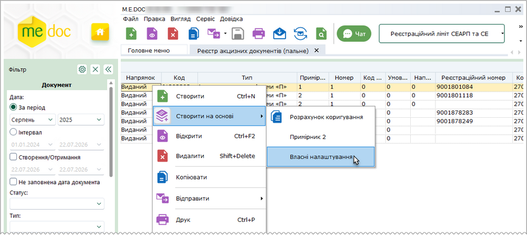

Натисніть, щоб збільшити малюнок

2. Оберіть один із способів:

- виберіть команду меню Файл - Створити на основі - Власні налаштування;
- у контекстному меню оберіть команду Створити на основі - Власні налаштування.

3. Відкриється вікно Довідник.

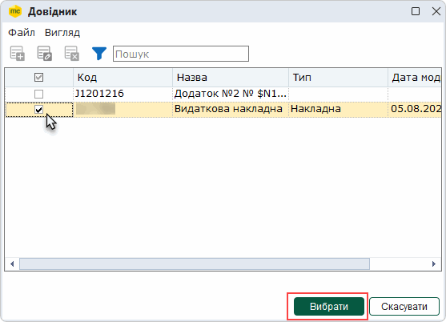

4. Якщо для обраного документа [налаштовано](UCRtfFromDocSettings.html#ucrtffromdocsettings-ucrtffromdocsettings) створення кількох дочірніх документів, у вікні Довідники будуть відображені всі доступні шаблони дочірніх документів. Щоб обрати потрібний шаблон (шаблони), встановіть позначку у відповідному рядку. Натисніть кнопку Вибрати.

5. Відкриється вкладка, що відповідає створюваному документу. Поля створеного документа автоматично заповнюються даними головного документа, відповідність полів документів налаштовується у розділі [Налаштування переносу полів для функції Створити на основі](UCRtfFromDocSettings.html#ucrtffromdocsettings-ucrtffromdocsettings).

Документи, створені на основі існуючих, зберігаються у відповідних реєстрах: Податкова накладна та Додаток 2 - у Реєстрі податкових документів, інші первинні документи - у Реєстрі електронних документів.

У модулі Реєстр первинних документів можна створювати АН/РК до АН на основі первинних документів за допомогою команди Створити на основі - Власні налаштування. Відповідно, для первинних документів повинно бути [налаштовано](UCRtfFromDocSettings.html#ucrtffromdocsettings-ucrtffromdocsettings) створення АН/РК до АН як дочірніх документів.

[До початку](#akcizrstfunkc-akciz_reest_create_oil)

### Групова обробка полів

_Шлях у довідці: Розділи програми › Облік акцизу › Реєстр акцизних документів (пальне) › Робота з акцизними документами (пальне) › Групова обробка полів_

Групова обробка пустих полів надає можливість автоматизувати заповнення граф документів Акцизна накладна форми "П" та Розрахунок коригування до акцизної накладної форми "П" .

Групове заповнення граф здійснюється у непідписаних виданих документах.

При груповому заповненні граф виконується заміна вмісту відповідних граф АН/РК обраним значенням.

Для внесення даних у документи виконайте дії в наступній послідовності:

1. Якщо заміну потрібно виконати для вибіркових документів, виділіть записи цих документів у таблиці реєстру. Для заповнення даних у всіх документах записи виділяти не потрібно.

2. У меню Правка оберіть функцію Групова обробка полів АН/РК.

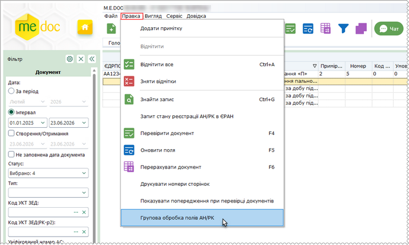

Натисніть, щоб збільшити малюнок

3. Відкриється вікно Групова обробка полів АН/РК.

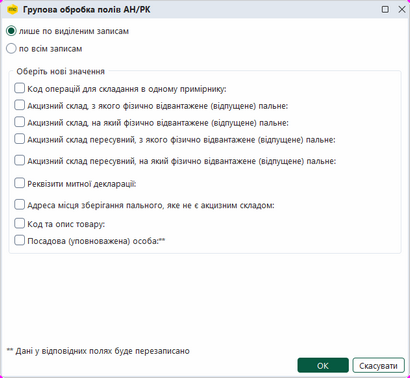

Натисніть, щоб збільшити малюнок

4. Оберіть необхідні параметри:

- якщо потрібно виконати заповнення даних в обраних записах, встановіть позначку в полі лише по виділеним записам, інакше оберіть значення по всім записам;
- для вибору значень із довідників, встановіть позначки у відповідних полях. У вікні з'являться додаткові поля для вибору значень. Натисніть кнопку . Оберіть у довіднику потрібне значення:

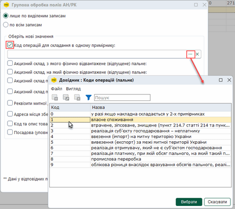

Натисніть, щоб збільшити малюнок

- якщо потрібно видалити дані, обрані з довідника, у відповідному полі натисніть кнопку ;
- При виборі параметрів Акцизний склад пересувний, з якого фізично відвантажене (відпущене) пальне, Акцизний склад пересувний, на який фізично відвантажене (відпущене) пальне та Реквізити митної декларації заповніть значення додаткових параметрів, що з'являться у вікні:

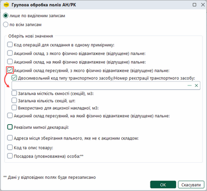

Натисніть, щоб збільшити малюнок

5. Після внесення потрібних параметрів у вікні Групова обробка полів АН/РК натисніть кнопку ОК.

6. Система повідомить про закінчення процедури.

### Створення Довідки про зведені за добу дані

_Шлях у довідці: Розділи програми › Облік акцизу › Реєстр акцизних документів (пальне) › Робота з акцизними документами (пальне) › Створення Довідки про зведені за добу дані_

В цьому розділі:

[Автоматичне створення Довідки про зведені за добу дані](#akcizrstfunkc-akciz_reestr_funkc_stvor_vytratomir)

[Cамостійне заповнення Довідки про зведені за добу дані](#akcizrstfunkc-akciz_reestr_funkc_stvor_vytratomir)

[Перенесення показників обсягів пального за попередній звітний період](#akcizrstfunkc-akciz_reestr_funkc_stvor_vytratomir)

Заповнення Довідки про зведені за добу підсумкові облікові дані щодо обсягів обігу (отримання/відпуску) та залишків пального на акцизному складі пального може виконуватись двома способами:

- заповнення даних у формі Довідки самостійно, з клавіатури;
- автоматичне заповнення Довідки показниками системи моніторингу рівнемірів і витратомірів.

Автоматичне створення Довідки про зведені за добу дані

Автозаповнення Довідки буде корисним для платників акцизного податку – розпорядників акцизних складів. Автоматичне створення довідки забезпечує:

- заповнення Довідки показниками, знятими рівнемірами/витратомірами;
- одночасне створення Довідок по кожному акцизному складу;
- скорочення часу на заповнення Довідки.

Щоб скористатися можливістю автоматичного заповнення Довідки на основі показників системи моніторингу рівнемірів і витратомірів, необхідно виконати підготовчі дії:

- з’ясувати у свого постачальника рівнемірів/витратомірів, чи підключені або чи здатні до підключення наявні прилади до системи моніторингу палива, та забезпечити обмін даними між системою моніторингу та програмою M.E.Doc (за детальною інформацією зверніться до представника розробника);
- придбати ліцензію Облік акцизного податку з доступом до API та ліцензію M.E.Doc.Облік акцизного податку; для автоматичного заповнення Довідки користувачам необхідно володіти ліцензіями двох типів;
- виконати підключення системи моніторингу у розділі [Адміністрування - Параметри системи - Налаштування API акциз](FormCompanyParams.html#formcompanyparams-admcompanyparams_rivnemir).

Після підключення до системи моніторингу рівнемірів і витратомірів користувачі також отримують можливість переглядати показники рівнемірів/витратомірів у модулі [Показники рівнемірів/витратомірів](UCSIURSpr.html#ucsiurspr-ucsiurspr).

Для автоматичного заповнення Довідки про зведені за добу дані:

1. Скористайтесь одним із способів:

- на панелі інструментів натисніть кнопку Створити - Новий звіт;
- виберіть команду Файл - Створити - Новий звіт;
- у контекстному меню оберіть команду Створити - Новий звіт;
- натисніть комбінацію клавіш <Ctrl+N>.

Натисніть, щоб збільшити малюнок

2. У вікні, що відкриється, оберіть тип документа Довідка про зведені за добу дані та натисніть Створити:

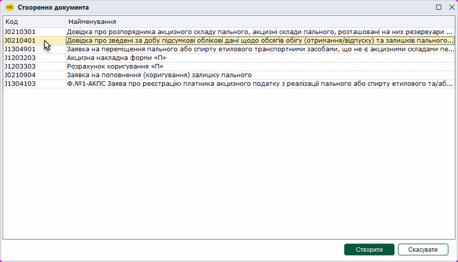

Натисніть, щоб збільшити малюнок

3. У вікні Автозаповнення даних, що відкриється, оберіть тип формування Довідки, встановивши опцію Звітна доба (встановлена за замовчуванням) або Звітний місяць.

При формування Довідки за Звітну добу, оберіть дату у вікні календаря.

При формування Довідки за Звітний місяць, оберіть місяць та рік.

4. Оберіть потрібні склади, встановивши відмітки у відповідних рядках. Щоб обрати всі склади, встановіть відмітку у заголовку таблиці.

5. У окремому вікні відкриється бланк документа, що містить дані рівнемірів/витратомірів на обраний звітний період (звітну добу або звітний місяць, залежно від обраного типу формування довідки) та за вказаним складом:

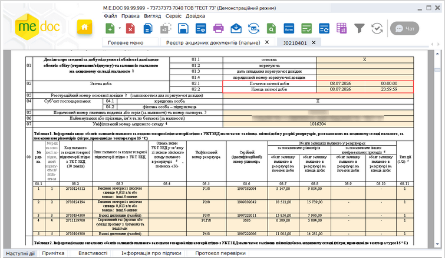

Натисніть, щоб збільшити малюнок

У разі формування Довідки за Звітний місяць у полях Початок звітної доби та Кінець звітної доби вказується перше та останнє число обраного місяця.

Оновлення показників рівнемірів/витратомірів відбувається при кожному вході у модуль [Показники рівнемірів/витратомірів](UCSIURSpr.html#ucsiurspr-ucsiurspr) та/або у автоматичному режимі при встановленій опції Автоматичне отримання даних рівнеміра щодоби у розділі [Адміністрування - Параметри системи - Налаштування рівнеміра](FormCompanyParams.html#formcompanyparams-admcompanyparams_rivnemir).

Перевірте коректність заповнення форми даними рівнемірів/витратомірів, у разі потреби, відкоригуйте інформацію, заповніть дані, яких бракує.

6. Внесіть дані в поля, які потребують заповнення із клавіатури.

Поля, що підсвічені жовтим кольором, доступні для заповнення.

7. Оберіть команду Правка - Перевірити документ або F4 для перевірки звіту.

Перевіряється правильність заповнення полів і у випадку помилок, система підсвітить червоним кольором поля, що необхідно виправити. Виправте помилки та знову виконайте перевірку.

8. Збережіть документ, натиснувши кнопку  або комбінацію клавіш Ctrl+S.

[До початку](#akcizrstfunkc-akciz_reestr_funkc_stvor_vytratomir)

Cамостійне заповнення Довідки про зведені за добу дані

1. Скористайтесь одним із способів:

- на панелі інструментів натисніть кнопку Створити - Новий звіт;
- виберіть команду Файл - Створити - Новий звіт;
- у контекстному меню оберіть команду Створити - Новий звіт;
- натисніть комбінацію клавіш <Ctrl+N>.

Натисніть, щоб збільшити малюнок

2. У вікні, що відкриється, оберіть тип документа Довідка про зведені за добу дані та натисніть Створити:

Натисніть, щоб збільшити малюнок

3. У вікні Автозаповнення даних, що відкриється, встановіть відмітку у рядку періоду, за якай створюється довідка: Звітна доба або Звітний місяць, введіть необхідні дані.

Обов'язково встановіть опцію З самостійним заповненням.

Натисніть кнопку ОК:

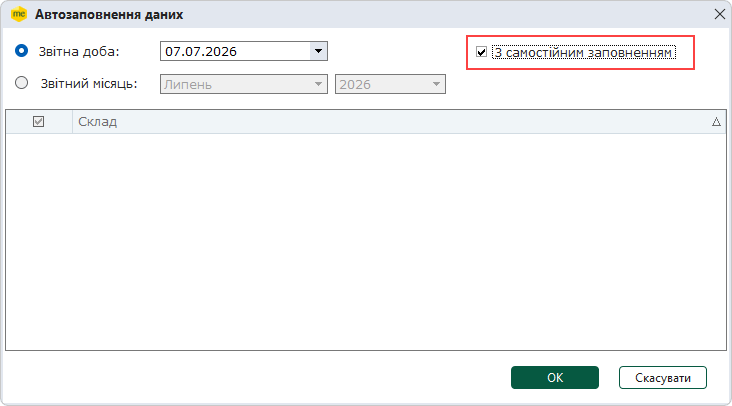

Кнопка ОК стає доступною після встановлення опції З самостійним заповненням.

4. У окремому вікні відкриється бланк документа:

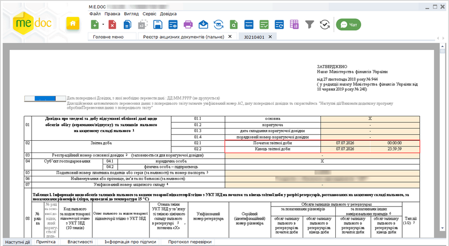

Натисніть, щоб збільшити малюнок

У графах Початок звітної доби та Кінець звітної доби автоматично проставляється дата, обрана у полі Звітна доба вікна Автозаповнення даних. Відповідно час початку та закінчення Звітної доби встановлюється з 00:00:00 до 23:59:59.

5. Внесіть дані в поля, які потребують заповнення із клавіатури.

6. Оберіть команду Правка - Перевірити документ або F4 для перевірки звіту.

У випадку помилок, система підсвітить червоним кольором поля, що необхідно виправити. Виправте помилки та знову виконайте перевірку.

7. Збережіть документ, натиснувши кнопку  або комбінацію клавіш Ctrl+S.

Зверніть увагу! Якщо ви створюєте документ шляхом копіювання вже існуючої довідки, після виклику функції копіювання:

- на панелі інструментів натисніть кнопку Копіювати - ;
- із контекстного меню команда Копіювати;
- команда Файл - Копіювати.

відкривається вікно Дата виписки, де запропоновано обрати дату виписки копії документа.

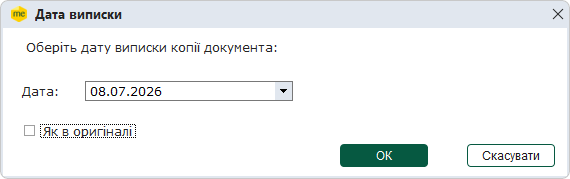

Будьте уважні! За замовчуванням встановлюється дата виписки документа, що копіюється!

Для того, щоб обрати іншу дату виписки, натисніть кнопку  у полі Дата. Відкриється вікно календаря, у якому оберіть потрібну дату.

Якщо у копії необхідно зберегти дату виписки акцизного документа, встановіть позначку Як в оригіналі.

Після вибору дати натисніть кнопку ОК.

Відкриється вікно копії документа. Скопійовані документи можна редагувати.

[До початку](#akcizrstfunkc-akciz_reestr_funkc_stvor_vytratomir)

Перенесення показників обсягів пального за попередній звітний період

При створенні Довідки із [самостійним способом заповнення](#akcizrstfunkc-akciz_reestr_funkc_stvor_vytratomir) (не використовується автоматичне заповнення Довідки показниками, знятими рівнемірами/витратомірами) можна автоматично перенести показники обсягів пального на кінець звітної доби за попередній звітний період у поточний звіт на початок звітної доби.

Для перенесення даних:

1. Скористайтесь одним із способів:

- на панелі інструментів натисніть кнопку Створити - Новий звіт;
- виберіть команду Файл - Створити - Новий звіт;
- у контекстному меню оберіть команду Створити - Новий звіт;
- натисніть комбінацію клавіш <Ctrl+N>.

Натисніть, щоб збільшити малюнок

2. У вікні, що відкриється, оберіть тип документа Довідка про зведені за добу дані та натисніть Створити:

Натисніть, щоб збільшити малюнок

3. У вікні Автозаповнення даних, що відкриється, оберіть значення у полі Звітна доба та встановіть опцію З самостійним заповненням.

У графах Початок звітної доби та Кінець звітної доби автоматично проставляється дата, обрана у полі Звітна доба вікна Автозаповнення даних. Відповідно час початку та закінчення Звітної доби встановлюється з 00:00:00 до 23:59:59.

4. У бланку документа, у полі Дата попередньої Довідки, з якої необхідно перенести дані: ДД.ММ.РРРР, введіть дату попереднього звіту, з якого необхідно виконати перенесення даних:

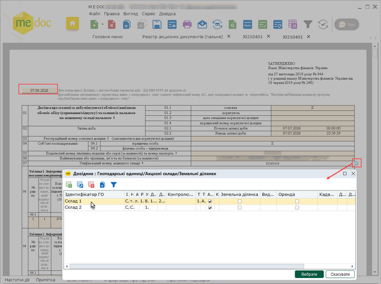

Натисніть, щоб збільшити малюнок

5. У полі звіту Уніфікований номер акцизного складу зазначте акцизний склад, для якого виконуватиметься перенесення даних.

6. Перейдіть на вкладку Наступні дії та виконайте додаткову програму обробки Виконати додаткову програму обробки – Перенесення даних з попереднього звіту:

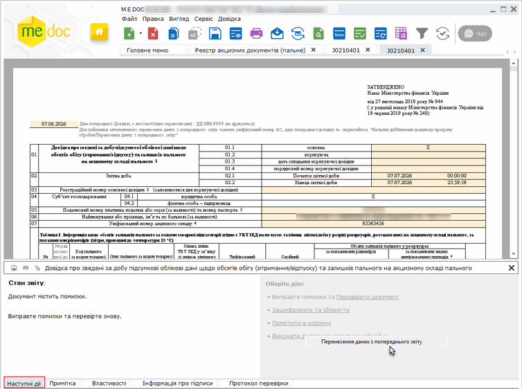

Натисніть, щоб збільшити малюнок

7. Після успішного виконання операції відкриється вікно повідомлення:

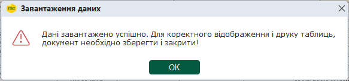

Для продовження натисніть ОК.

8. Перенесені дані будуть відображені у таблиці звіту:

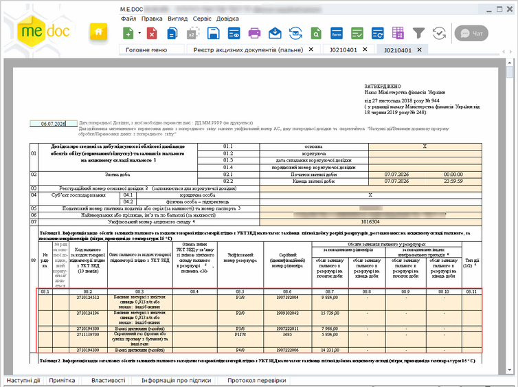

Натисніть, щоб збільшити малюнок

9. Внесіть дані в поля, які потребують заповнення, із клавіатури.

10. Оберіть команду Правка - Перевірити документ або F4 для перевірки звіту.

У випадку помилок, система підсвітить червоним кольором поля, що необхідно виправити. Виправте помилки та знову виконайте перевірку.

11. Збережіть документ, натиснувши кнопку  або комбінацію клавіш Ctrl+S.

[До початку](#akcizrstfunkc-akciz_reestr_funkc_stvor_vytratomir)


