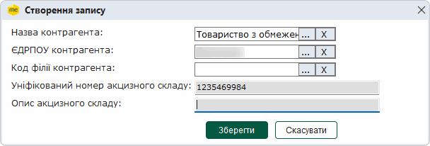
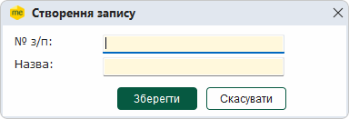
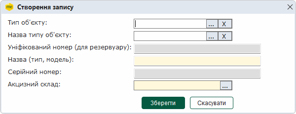
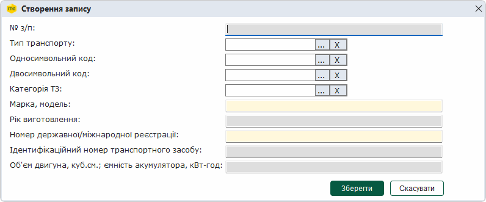
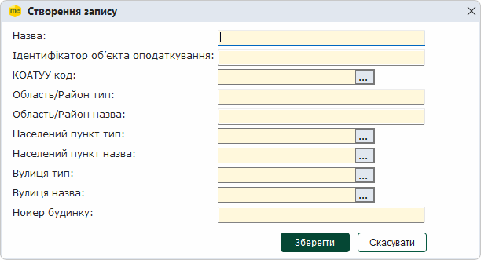

[← Зміст довідки](../)


# Довідники - Акциз

## Довідники - Акциз

_Шлях у довідці: Розділи програми › Облік акцизу › Довідники - Акциз_

Розділ призначений для створення та редагування довідників, які використовуються при заповненні [акцизних документів](UCExciseRst.html#ucexciserst-ucexciserst). Довідники розділу призначені полегшити та прискорити заповнення відповідних форм. При виборі розділу здійснюється перехід до розділу програми Довідники – Загальні – Акциз.

Всі довідники є довідниками з можливістю редагування та додавання записів. Користувачі мають можливість змінювати та доповнювати довідники за власними потребами. При першому відкритті довідники не містять записів!

- Категорія ТЗ - у довіднику зберігається інформація щодо категорій транспортних засобів, використовується при заповненні довідника Транспортні засоби.
- Об'єкти на акцизному складі - перелік об'єктів акцизного складі (витратоміри, резервуари, рівнеміри), що використовуються у господарських одиницях, які мають статус акцизного складу.
- Транспортні засоби - перелік транспортних засобів, що використовуються у господарських одиницях користувача для транспортування пального або спирту етилового.
- Акцизні склади контрагентів - перелік акцизних складів контрагентів, довідник підключений до форм Акцизних накладних форм «C» та «П», а також до форм Розрахунків коригування акцизної накладної форми «C» та форми «П».
- Пункти навантаження/розвантаження - містить інформацію, що використовується при заповненні Заявки на переміщення пального або спирту етилового ТЗ, що не є акцизними складами пересувними.

Зверніть увагу

Дані господарських одиниць, що мають статус акцизного складу, зберігаються у довіднику Господарські одиниці/Акцизні склади/Земельні ділянки. Довідник заповнюється користувачем та підключений до форм акцизних документів. При виборі цього пункту відриється вікно довідника Господарські одиниці/Акцизні склади/Земельні ділянки модуля програми Довідники.

Докладно про заповнення довідника дивіться розділ [Довідники - Господарські одиниці/Акцизні склади/Земельні ділянки](UCEconomicUnits.html#uceconomicunits-uceconomicunits).

Для додавання записів у довідник:

1. На панелі ліворуч оберіть довідник, до якого необхідно додати інформацію.

2. Додавання даних записів у довідник виконується одним із способів:

- на панелі інструментів модуля натисніть на кнопку  ,
- оберіть команду в меню Файл - Створити запис;
- оберіть із контекстного меню  Створити запис;
- сполученням клавіш <Ctrl+I>.

Можна додати новий запис, скопіювавши існуючий запис. Для копіювання оберіть запис довідника та натисніть кнопку  на панелі інструментів або оберіть команду в меню Файл - Копіювати. Буде відкрито вікно створення нового запису, що містить скопійовані значення.

3. У вікні, що відкриється, введіть необхідні параметри та натисніть кнопку Зберегти. Поля, підсвічені жовтим, обов'язкові для заповнення. Вигляд вікна, та дані, що необхідно заповнити, залежать від довідника, який редагується:

- Акцизні склади контрагентів

Введіть дані щодо акцизних складів, що використовуються контрагентами:

- Назва контрагента - найменування контрагента, для введення значення натисніть кнопку  та оберіть потрібний запис з довідника Контрагенти.
- ЄДРПОУ контрагента - код контрагента за Єдиним державним реєстром підприємств та організацій України. Оберіть значення з довідника Контрагенти. Для вибору значення з довідника натисніть кнопку  .
- Код філії контрагента - якщо контрагент є філією, оберіть код цієї філії, натиснувши .

Заповнення полів з довідника Контрагенти здійснюється одночасно при виборі значення у будь-якому з полів, до якого підключено цей довідник.

- Уніфікований номер акцизного складу - введіть уніфікований номер акцизного складу контрагента в системі електронного адміністрування реалізації пального та спирту етилового.
- Опис акцизного складу - введіть короткий опис складу, що допоможе вам швидше знайти потрібний склад під час заповнення документів.
- Категорія ТЗ

Введіть дані категорій транспортних засобів:

- № з/п – порядковий номер категорії транспортного засобу у довіднику;
- Назва - назва категорії транспортного засобу.

Всі дані вводяться безпосередньо користувачем з клавіатури. (Використовується при заповненні довідника Транспортні засоби)

- Об'єкти на акцизному складі

Введіть дані категорій транспортних засобів:

- Тип об'єкту - тип об'єкту на акцизному складі, оберіть значення з системного довідника Тип об'єкту на акцизному складі. Для вибору значення з довідника натисніть кнопку ;
- Назва типу об'єкту - назва тип об'єкту на акцизному складі, оберіть значення з системного довідника Тип об'єкту на акцизному складі. Для вибору значення з довідника натисніть кнопку ;

Заповнення полів з довідника Тип об'єкту на акцизному складі здійснюється одночасно при виборі значення у будь-якому з полів, до якого підключено цей довідник.

- Уніфікований номер (для резервуару) - уніфікований номер резервуару;
- Назва (тип, модель) - назва, тип або модель об'єкту, поле обов'язкове для заповнення;
- Серійний номер - серійний номер об'єкту;
- Акцизний склад - ідентифікатор господарської одиниці, що має статус акцизного складу, поле обов'язкове для заповнення. Можливо обрати значення з довідника Господарські одиниці/Акцизні склади (якщо такий заповнено). Для вибору значення з довідника натисніть кнопку .

Всі дані вводяться безпосередньо користувачем з клавіатури. (Використовується при заповненні довідника Транспортні засоби)

- Транспортні засоби

Введіть дані щодо транспортного засобу:

- Тип транспорту - тип транспорту, оберіть значення з системного Класифікатора видів транспорту. Для вибору значення з довідника натисніть кнопку ;
- Односимвольний код - односимвольний код типу транспорту, оберіть значення з Класифікатора видів транспорту, натиснувши ;
- Двосимвольний код - двосимвольний код типу транспорту, оберіть значення з Класифікатора видів транспорту, натиснувши ;
- Категорія ТЗ - категорія транспортного засобу, оберіть значення з довідника Категорія ТЗ, натиснувши ;

Заповнення полів з Класифікатора видів транспорту здійснюється одночасно при виборі значення у будь-якому з полів, до якого підключено цей довідник.

- Марка, модель - марка та модель транспортного засобу, поле обов'язкове для заповнення;
- Рік виготовлення - рік виготовлення транспортного засобу;
- Номер державної/міжнародної реєстрації - реєстраційний номер транспортного засобу, поле обов'язкове для заповнення;
- Ідентифікаційний номер транспортного засобу – унікальний 17-значний номер (може містити літери та цифри);
- Об'єм двигуна, куб.см.; ємність акумулятора, кВт-год – об'єм двигуна транспортного засобу, поле містить числове значення (можливо вказати до 6 знаків після коми).

Дані можуть буті введені вручну, у такому випадку переконайтеся у коректності введеної інформації.

- Пункти навантаження/розвантаження

Введіть дані:

- Назва - назва пункту навантаження/розвантаження (об’єкта оподаткування) може містити до 250 символів;
- Ідентифікатор об'єкта оподаткування - унікальний 8-ми значний код, згідно з направленим у ДПС повідомленням (формою № 20-ОПП);
- КОАТУУ код - код згідно з класифікатором об'єктів адміністративно-територіального устрою України, оберіть значення з довідника Коди території (КОАТУУ), натиснувши ;
- Область/Район тип - введіть тип області / району, у якій зареєстровано об'єкт оподаткування;
- Область/Район назва - введіть назву області / району, у якій зареєстровано об'єкт оподаткування;
- Населений пункт тип - оберіть значення з довідника Населений пункт (тип). Для вибору значення з довідника натисніть кнопку  ;
- Населений пункт назва - оберіть значення з довідника Населені пункти. Для вибору значення з довідника натисніть кнопку ;
- Вулиця тип – оберіть значення з довідника Типи вулиць. Для вибору значення з довідника натисніть кнопку ;
- Вулиця назва  – оберіть значення з довідника Вулиці населених пунктів. Для вибору значення з довідника натисніть кнопку .
- Номер будинку  – введіть номер будинку.

Дані можуть буті введені вручну, у такому випадку переконайтеся у коректності введеної інформації.

4.  Доданий запис буде відображено у таблиці довідника.

Запис довідника можна змінити одним із способів:

- натисканням кнопки панелі інструментів ;
- командою в меню Файл - Редагувати запис;
- із контекстного меню Редагувати запис;
- клавіша F2.

або видалити одним із способів:

- натисканням кнопки панелі інструментів ;
- командою в меню Файл - Видалити запис;
- із контекстного меню Видалити запис;
- комбінацією клавіш <Ctrl+Y>.

### Довідники - Акциз

_Шлях у довідці: Розділи програми › Довідники › Загальні довідники › Довідники - Акциз_

_Див. [Довідники - Акциз](Akciz_dovidnyky.html#akciz_dovidnyky-akciz_dovidnyky)_


