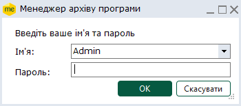
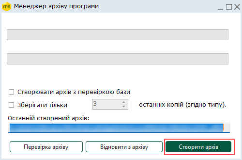
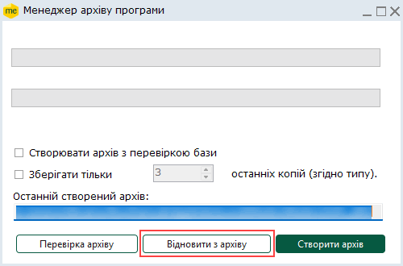
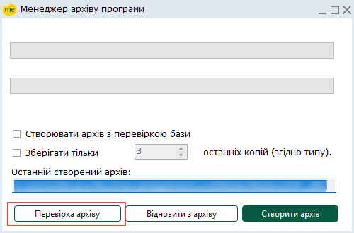

[← Зміст довідки](../)


# Менеджер архіву програми

## Менеджер архіву програми

_Шлях у довідці: Розділи програми › Адміністрування › Менеджер архіву програми_

В цьому розділі:

[Створення архіву програми](#backupmanager-backupmanager)

[Відновлення із архіву програми](#backupmanager-backupmanager)

[Перевірка архіву](#backupmanager-backupmanager)

У програмі можна створювати архів програми - повну резервну копію всіх бібліотек і бази ПК M.E.Doc - та в будь-який час відновлювати програму з архіву без використання [Планувальник завдань](UCPlanner.html#ucplanner-ucplanner).

Для мережевої версії програмного комплексу Менеджер архіву програми запускається лише з серверної частини!

Створення архіву програми

З  метою коректного копіювання даних перед початком створення архіву програма автоматично закривається.

Для мережевої версії програми радимо переконатися, що на всіх робочих станціях завершено роботу з програмою.

Для того, щоб створити архів програмного комплексу, виконайте дії в наступній послідовності:

1. Відкрийте Менеджер архіву програми. Вкажіть ім'я та пароль.

2. Натисніть на кнопку Створити архів.

Передбачена можливість зберігати не всі архіви, а обмежену задану кількість архівів.

Для цього встановіть галочку в полі Зберігати тільки та вкажіть кількість останніх створених архівів, що потрібно зберігати.
Попередні архіви, що перевищують кількість заданих, безповоротно видаляються.

Якщо встановлена галочка Створювати архів з перевіркою бази, перед створенням архіву Менеджер архіву програми виконає перевірку бази Firebird програмного комплексу. Виконується окреме логування операцій перевірки бази та створення архіву програми.

Результати перевірки зберігаються у текстовому файлі checkFB.log, результат створення архіву - у файлі createFB.log. В загальний файл Planner.log записуються всі виконані операції. Log-файли додаються у папку LOG кореневого каталогу програми.

Якщо під час перевірки виявлено помилки, архів програми не створюється.

При Створенні архіву програми з перевіркою бази перевірена БД буде додана у створений архів. Існуюча база даних програми не замінюється.

3. Відкриється вікно Збереження файлу. Оберіть каталог, в якому бажаєте зберегти архів. Натисніть кнопку Зберегти.

4. Перед початком створення архіву програми закриється програмний комплекс, при цьому Менеджер зупиняє службу ZvitGrp.

Розпочнеться процес створення архіву програми. Дочекайтесь закінчення процедури.

5. Система повідомить у окремому вікні про результат створення архіву.

[До початку](#backupmanager-backupmanager)

Відновлення із архіву програми

Для того, щоб відновити програмний комплекс із архіву, виконайте дії в наступній послідовності:

1. Відкрийте Менеджер архіву програми.

2. Натисніть кнопку Відновити з архіву.

3. Відкриється вікно Відкриття файлу. Оберіть каталог, в якому збережено створені архіви програми. Оберіть потрібний та натисніть кнопку Відкрити.

4. Перед початком відновлення даних із архіву програмний комплекс закриється, при цьому Менеджер зупиняє службу ZvitGrp.

Розпочнеться процес відновлення даних, дочекайтесь закінчення процедури.

5. Система у окремому вікні повідомить про результат виконання операції.

[До початку](#backupmanager-backupmanager)

Перевірка архіву

Щоб перевірити створений архів програмного комплексу, виконайте дії в наступній послідовності:

1. Відкрийте Менеджер архіву програми.

2. Натисніть кнопку Перевірка архіву.

3. Відкриється вікно Оберіть архів для перевірки бази даних. Оберіть каталог, в якому збережено архіви. Оберіть потрібний та натисніть кнопку Відкрити.

4. Перед початком перевірки даних програмний комплекс закриється, при цьому Менеджер зупиняє службу ZvitGrp.

Розпочнеться процес перевірки. Дочекайтесь закінчення процедури.

5. Система повідомить про результати перевірки.

[До початку](#backupmanager-backupmanager)


