[← Зміст довідки](../)


# Розрахунковий лист

## Розрахунковий лист

_Шлях у довідці: Розділи програми › Зарплата › Розрахунковий лист_

В цьому розділі:

[Як відкрити розрахунковий лист?](#calcpapermng-reestrstatement_calcpapermng)

[Короткий опис основних функціональних елементів інтерфейсу](#calcpapermng-reestrstatement_calcpapermng)

[Коригування даних по заробітній платі](#calcpapermng-reestrstatement_calcpapermng)

[Роз'яснення розрахунку](#calcpapermng-reestrstatement_calcpapermng)

[Проведення зворотного розрахунку](#calcpapermng-reestrstatement_calcpapermng)

[Перерахунок утримань до фондів](#calcpapermng-reestrstatement_calcpapermng)

[Утримання податків із авансу](#calcpapermng-reestrstatement_calcpapermng)

На підставі заповнених особистих карток співробітників автоматично розраховується заробітна плата працівника. Для внесення будь-яких  коригувань використовуються розрахункові листи, при цьому заробітна плата перераховується автоматично.

Розрахунковий лист співробітника також служить для отримання більш детальної інформації, щодо проведених розрахунків.

У розрахунковому листі працівника можна додавати нарахування та утримання, які присутні у розділі Зарплата - Адміністрування - Налаштування – Види оплат.

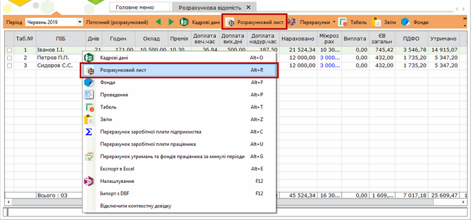

Натисніть, щоб збільшити малюнок

Нарахування деяких видів оплат, наприклад, лікарняного, відпустки, відрядження призведе до корекції відпрацьованого часу в розрахунковому листі і [табелі робочого часу](PayBoards.html#payboards-reestrstatement_payboards). Якщо час відпустки, лікарняного або відрядження стосується попередніх періодів, то при розрахунку заробітної плати відбувається автоматичне сторнування (віднімання) сум та перерахунку податків. У розрахунковому листі за поточний період в цьому випадку інформація по сторнованих видах оплат підсвічується червоним кольором.

При сторнування відпустки лікарняним є можливість автоматичного подовження відпустки. Для цього необхідно перейти у розділ Зарплата - Адміністрування - Налаштування – Види оплат – Відпустка та встановити відмітку Визначення того, що оплата при сторнуванні продовжується:

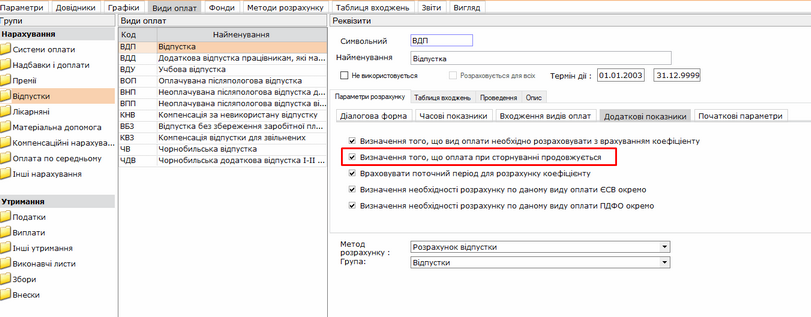

Натисніть, щоб збільшити малюнок

Для тих сум оплат, які були розраховані автоматично, можна подивитися [роз'яснення розрахунку](#calcpapermng-reestrstatement_calcpapermng)  у вигляді детального протоколу.

1. Відкрийте модуль Розрахункова відомість.

2. Виділіть запис працівника, дані якого потрібно змінити.

3. Скористайтесь одним із наступних способів:

- на панелі інструментів натисніть кнопку Розрахунковий лист;
- у контекстному меню оберіть команду Розрахунковий лист;
- натисніть комбінацію клавіш Alt+R;
- натисніть двічі лівою кнопкою миші по потрібному записі відомості.

Натисніть, щоб збільшити малюнок

[До початку](#calcpapermng-reestrstatement_calcpapermng)

На виконання команди відкриється розрахунковий лист у окремій вкладці.

Розрахунковий лист складається з 3-х вкладок: Нарахування/утримання, Фонди, Проведення.

1. Вкладка Нарахування/утримання.

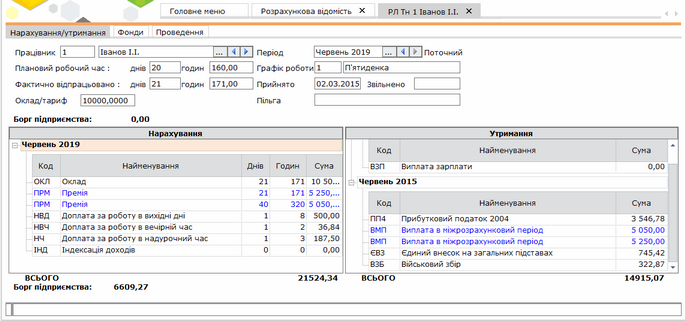

Натисніть, щоб збільшити малюнок

В назві вкладки розміщена основна допоміжна інформація по працівнику, розрахунковий листок якого відкрито. Дана інформація підтягується з особової картки працівника та табелю робочого часу.

Вся інформація представлена тільки для перегляду, окрім полів "Фактично відпрацьовано: днів" та "Фактично відпрацьовано: годин". За потреби, дані в цих полях можна змінити вручну.

Нижче в робочій області розрахункового листа відображається таблиця нарахувань та утримань. За замовчанням відображаються основні статті заробітної плати. Є можливість додати до розрахунку заробітної плати працівника неосновні види нарахувань чи утримань. При цьому додані/відкориговані дані підсвічуються блакитним кольором. У випадку наявності інформації по сторнованим видам оплат - дані підсвічується червоним кольором.

При будь-якому коригуванні нарахувань або утримань відбувається автоматичний перерахунок заробітної плати.

2. Вкладка Фонди.

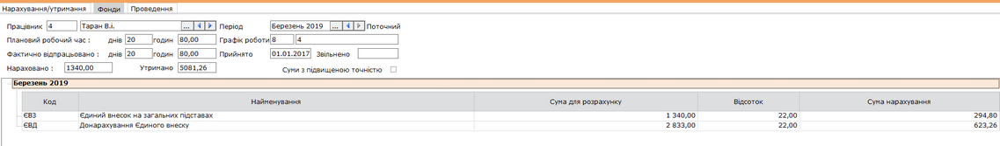

Натисніть, щоб збільшити малюнок

На вкладці відображається інформація по фондам, у які здійснюються відрахування із заробітної плати працівника, а саме: найменування фонду, відсоток відрахування та сума відрахування.

Дані підлягають коригуванню та доповненню. Передбачена можливість перегляду архівного періоду.

3. Вкладка Проведення.

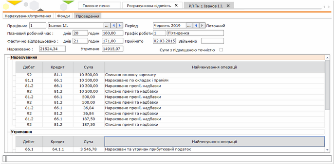

Натисніть, щоб збільшити малюнок

Відображаються дані по бухгалтерським проводкам: нарахуванням, утриманням та фондам.

Всі дані представлені виключно для перегляду, коригуванню та доповненню не підлягають. Передбачена можливість перегляду архівного періоду.

[До початку](#calcpapermng-reestrstatement_calcpapermng)

Для того, щоб додати нарахування або утримання до заробітної плати, виконайте дії у наступній послідовності:

1. У розрахунковому листі оберіть потрібне: табличку Нарахування або табличку Утримання.

2. Скористайтесь одним із наступних способів:

- на панелі інструментів натисніть кнопку Створити запис;
- у контекстному меню оберіть команду Додати вид оплати;
- натисніть комбінацію клавіш Ctrl+I;
- виберіть команду Правка/Створити запис.

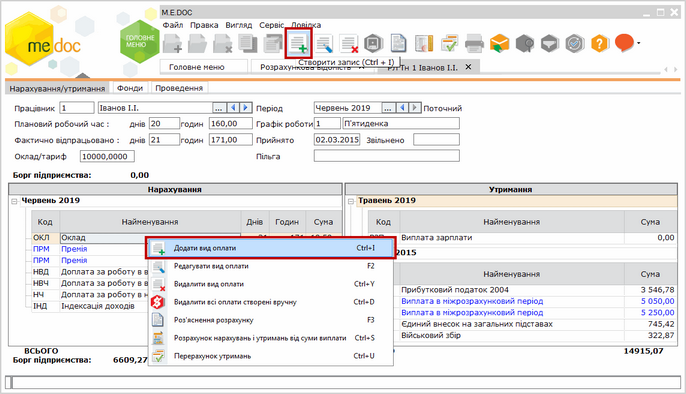

Натисніть, щоб збільшити малюнок

Відкриється окреме вікно Додавання нарахування/утримання.

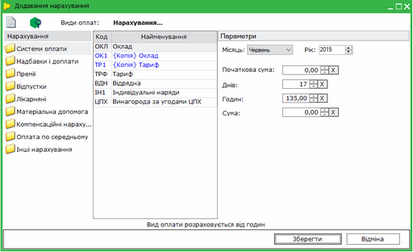

Натисніть, щоб збільшити малюнок

3. Оберіть зліва у вікні групу нарахувань/утримань, у центрі вікна відобразиться перелік доступних нарахувань/утримань, що входять в групу. Оберіть потрібне значення та налаштуйте відповідні параметри.

4. Натисніть кнопку Зберегти.

Приклад 1.

Для додання Премії за покращення результатів у виді оплат "Нарахування" оберіть групу "Премії", далі "ППК Премії за покращення результатів".

Оберіть місяць та рік, в якому нараховується дана премія. Оберіть параметр нарахування: відсоток чи сума, та встановіть відповідне значення.

Натисніть кнопку "Зберегти".

Приклад 2.

Для додання Лікарняного у виді оплат "Нарахування" оберіть групу "Лікарняні", далі "ЛКР Лікарняний лист".

Введіть дату початку, дату закінчення та номер лікарняного листа. Інші значення розрахуються автоматично.

Натисніть кнопку "Зберегти".

Приклад 3.

Для додання Авансу у виді оплат "Утримання" оберіть групу "Виплати", далі "АВН Аванс".

Вкажіть кількість днів або годин , за які необхідно нарахувати аванс, відсоток або суму авансу. Натисніть кнопку Зберегти, після збереження сума буде розрахована автоматично.

Нагадуємо, якщо система оплати оклад - розрахунок проводиться за робочі дні ("на календарний день"), якщо система оплати тариф - розрахунок проводиться за робочі дні в годинах ("за календарні години").

При додаванні інформації про відпустки чи лікарняні листи, відпрацьований час робітника коригується автоматично. Якщо при цьому час відпустки чи лікарняного листа  стосується попередніх періодів, то при розрахунку заробітної платні відбувається автоматичне сторнування нарахованих в тих періодах сум та перерахунок податків. В розрахунковому листі за поточний період в цьому випадку інформація про вказані види оплат буде підсвічена червоним кольором.

---

Якщо ви відкрили вікно "Додавання утримання", а потрібно було "Додавання нарахування" (або навпаки), натисніть на кнопку Утримання або Нарахування і види оплати зміняться на потрібне.

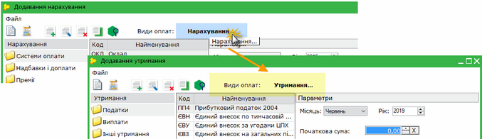

Натисніть, щоб збільшити малюнок

---

Також доступні такі функції:

|  |  |  |  |
| --- | --- | --- | --- |
|  | Видалити | Ctrl+Y | Дозволяє безповоротно вилучити вид оплати з розрахунку заробітної плати. |
|  | Редагувати | F2 | Редагування даних по видам оплат. |

[До початку](#calcpapermng-reestrstatement_calcpapermng)

Для виклику функції роз'яснення розрахунку виконайте дії у наступній послідовності:

1. Виділіть рядок з розрахованою сумою оплат (основні види оплат, відпустки, лікарняні листи, відсоткові премії тощо)

2. Скористайтесь одним із наступних способів:

- на панелі інструментів натисніть кнопку Роз’яснення розрахунку;
- у контекстному меню оберіть команду Роз’яснення розрахунку;
- натисніть клавішу F3.

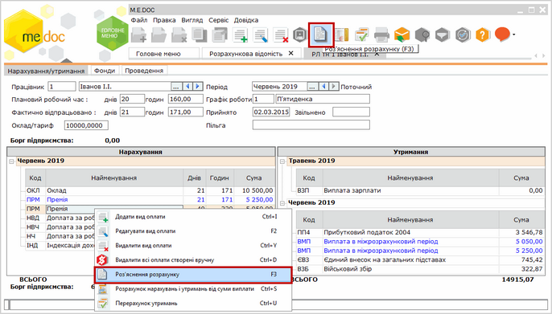

Натисніть, щоб збільшити малюнок

Відкриється окреме вікно Роз'яснення розрахунку, яке містить повний опис проведеного розрахунку виду оплат.

Всі дані представлені виключно для перегляду, коригуванню чи доповненню не підлягають.

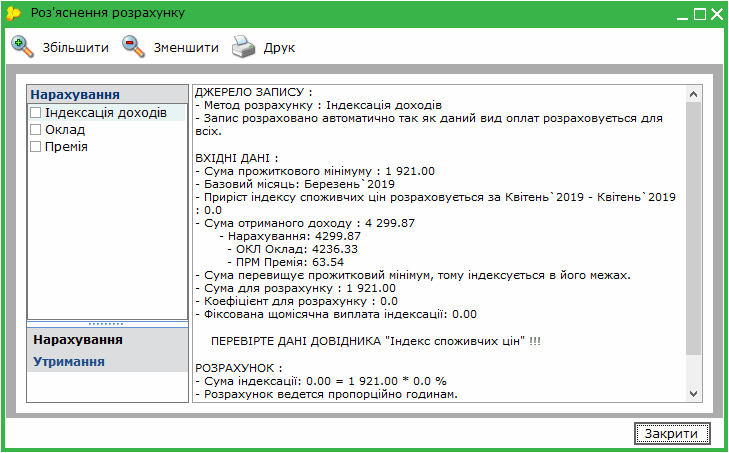

[До початку](#calcpapermng-reestrstatement_calcpapermng)

Для виклику функції зворотного розрахунку заробітної плати скористайтесь одним із наступних способів:

- на панелі інструментів натисніть кнопку Розрахунок від суми виплати;
- у контекстному меню оберіть команду Розрахунок від суми виплати;
- натисніть клавішу Ctrl+S.

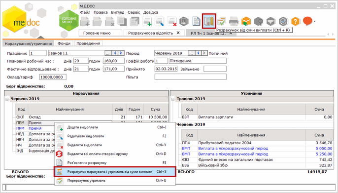

Натисніть, щоб збільшити малюнок

Відкриється вікно Розрахунок нарахувань і утримань від суми виплати, в якому потрібно виконати такі дії:

1. Внесіть потрібну суму виплати у поле Сума, яку необхідно виплатити працівнику "на руки".

Перерахунок заробітної плати працівнику в цьому випадку провадиться з огляду на внесену суму, яка буде виплачена робітнику за поточний місяць.

2. У блоці Утримання, які включаються до виплати зазначених суми оберіть види виплат, які не будуть перераховуватися.

3. У блоці Нарахування, за рахунок яких буде виконано корегування додайте або видаліть вид оплат, по яким буде враховуватися перерахунок.

4. Натисніть кнопку Виконати.

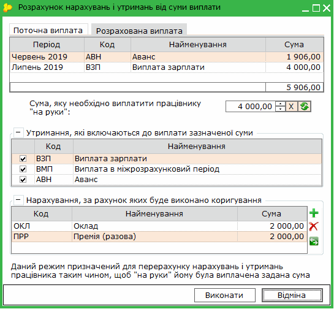

[До початку](#calcpapermng-reestrstatement_calcpapermng)

#### Перерахунок утримань до фондів

Якщо при розрахунку утримань до фондів була допущена помилка або було змінено відсоток утримань до фондів, передбачена функція автоматичного перерахунку сум утримань до фондів за вказаний період.

Перед початком виконання перерахунку утримань до фондів, необхідно внести відповідні зміни у довідник "Єдиний внесок". Відкрийте розділ Адміністрування - Налаштування та оберіть вкладку  Довідники - Ставки нарахувань в фонди - Єдиний внесок.

- Наприклад, з 1 червня 2012 р. змінили ставку нарахувань Єдиного внеску з 38% на 40%.
- Додайте нове значення, натиснувши на кнопку Створити запис (Ctrl+I).
- Заповніть пусті поля:
- Номер - 1
- Найменування - Найманий працівник на загальних підставах
- Коефіцієнт нарахування - 40
- Дата початку ставки - 01.06.2012
- Натисніть кнопку Зберегти.

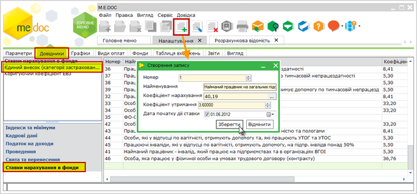

Натисніть, щоб збільшити малюнок

Для виклику функції перерахунку утримань до фондів у розрахунковому листі працівника перейдіть на вкладку Фонди.

1. Скористайтесь одним із наступних способів:

- оберіть команду Файл/Перерахунок відрахувань до фондів;
- у контекстному меню оберіть команду Перерахунок відрахувань до фондів;
- на панелі інструментів натисніть кнопку Перерахунок відрахувань до фондів;
- натисніть клавішу Ctrl+F.

Відкриється вікно Перерахунок утримань.

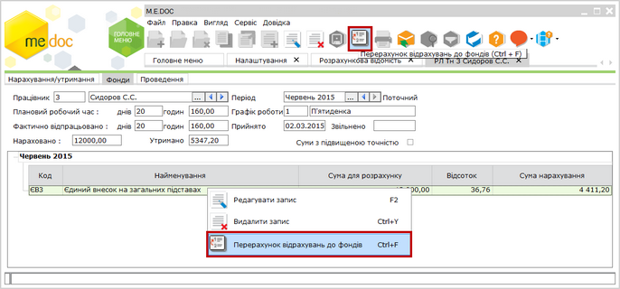

Натисніть, щоб збільшити малюнок

2. Із списку, що випадає, оберіть період, починаючи з якого виконати перерахунок утримань до фондів.

3. Натисніть кнопку Виконати.

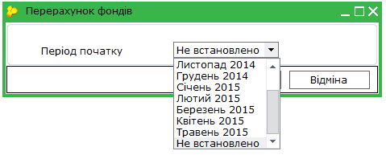

Виконається автоматичний перерахунок сум відрахувань до фондів, який відобразиться в робочому полі вкладки Фонди.

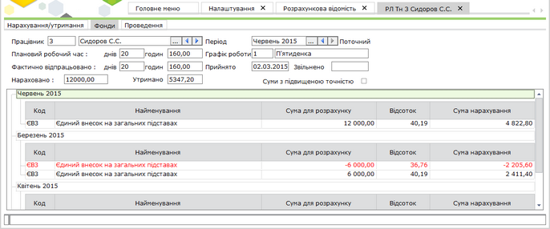

Натисніть, щоб збільшити малюнок

[До початку](#calcpapermng-reestrstatement_calcpapermng)

Утримання податків із авансу

При розрахунку авансу додана можливість відображення сум податків окремо з заробітку за першу частину місяця (АВН Аванс) та за другу (остаточний розрахунок) по кожному співробітнику в Розрахунковому листку.

1. Для активації даної можливості необхідно виконати додаткові налаштування в групі Адміністрування:

у розділі Налаштування - Види оплат - Утримання - Аванс - Додаткові показники встановити відмітку у пунктах:

- Визначення необхідності розрахунку по даному виду оплат ПДФО окремо
- Визначення необхідності розрахунку по даному виду оплат ЄСВ окремо

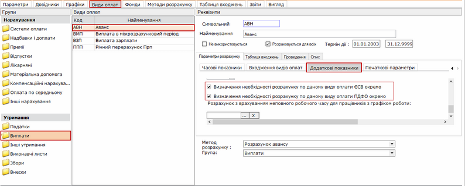

Натисніть, щоб збільшити малюнок

2. У Розрахунковому листку будуть відображені утримання:

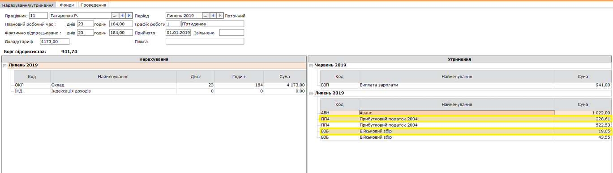

Натисніть, щоб збільшити малюнок

3. Пояснення щодо сум утримань можна переглянути в вікні Роз'яснення розрахунку (F3):

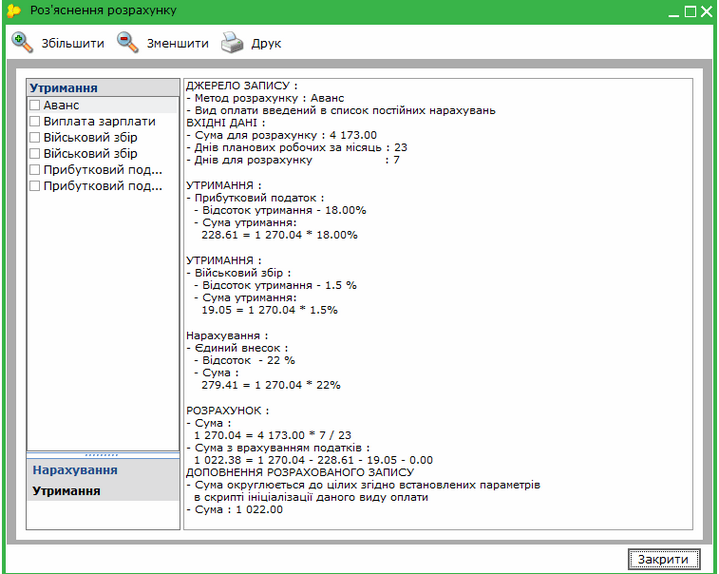

Натисніть, щоб збільшити малюнок

[До початку](#calcpapermng-reestrstatement_calcpapermng)


