[← Зміст довідки](../)


# Пов'язані документи

## Пов'язані документи

_Шлях у довідці: Розділи програми › Первинні документи › Робота з первинними документами › Пов'язані документи_

В цьому розділі:

[Автоматичне встановлення зв'язку](#conn_doc-conn_doc)

[Встановлення зв'язку вручну](#conn_doc-conn_doc)

[Скасування зв'язку](#conn_doc-conn_doc)

[Відображення зв'язаних документів](#conn_doc-conn_doc)

[Групування пов'язаних документів](#conn_doc-conn_doc)

[Визначення структури пакета пов'язаних документів](#conn_doc-conn_doc)

[Експорт пакетів пов'язаних документів, для яких визначено структуру](#conn_doc-conn_doc)

Зверніть увагу!

Зв'язок між документами встановлюється за значенням номеру та дати Договору, що вказані у документах.

Зв'язані документи зберігаються у відповідних реєстрах: Податкова накладна та Додаток 2 - у Реєстрі податкових документів, інші первинні документи - у Реєстрі електронних документів.

Автоматичне встановлення зв'язку

- Для імпортованих документів зв’язок встановлюється автоматично за значенням номеру та дати Договору. Пошук документів для встановлення зв’язку під час імпорту відбувається у періоді 30 днів до дати імпортованого документа.
- Якщо документи [створюються на основі існуючого](Creat_doc_.html#creat_doc_-creat_doc_), вони автоматично прив'язуються до вихідного документа.
- При копіюванні зв'язаного документа, скопійований документ також отримує ознаку "пов'язаний".

Для того щоб скасувати зв'язок між документами, скористайтеся командою [Розгрупувати](#conn_doc-conn_doc).

[До початку](#conn_doc-conn_doc)

Встановлення зв'язку вручну

Для встановлення зв'язку між документами, виконайте дії:

1. Оберіть за допомогою миші документи, між якими необхідно встановити зв’язок. (Натисніть та утримуйте клавішу <Ctrl>, лівою кнопкою миші обирайте документи у списку).

2. Натисніть праву кнопку миші та у контекстному меню оберіть команду Згрупувати виділені документи. Або оберіть команду меню Файл - Згрупувати виділені документи.

Команда Згрупувати виділені документи доступна, якщо було обрано 2 і більше зв’язаних документа.

При зв'язуванні документів вручну програма не контролює значення номеру та дати Договору, що зазначені у документах, що пов'язуються.

[До початку](#conn_doc-conn_doc)

Скасування зв'язку

Для скасування зв'язку між всіма документами у групі:

1. Оберіть за допомогою миші документ, що належить до групи, яку потрібно розгрупувати.

2. Натисніть кнопку Розгрупувати на вкладці Пов’язані документи:

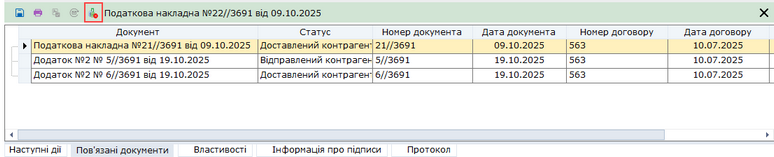

Натисніть, щоб збільшити малюнок

Скасування зв'язку для обраних документів:

1. Оберіть за допомогою миші документ або декілька документів, для яких необхідно скасувати зв’язок.

2. Оберіть один із способів:

- Натисніть праву кнопку миші та оберіть команду контекстного меню Розгрупувати виділені документи.
- Оберіть команду меню Файл - Розгрупувати виділені документи.

Вилучення документа з групи у вікні відкритого документа:

Відкрійте документ, якій потрібно вилучити з групи, та у вікні відкритого документа, на вкладці Пов’язані документи, натисніть кнопку .

[До початку](#conn_doc-conn_doc)

Відображення пов'язаних документів

Якщо для документа існують пов'язані документи, колонка Пов'язані документи містить позначку .

Щоб переглянути які саме документи пов'язані між собою, оберіть у вікні реєстру документ, що містить ознаку у полі Пов'язані документи. Відкриється вкладка Пов'язані документи, що містить перелік документів, пов'язаних з обраним документом.

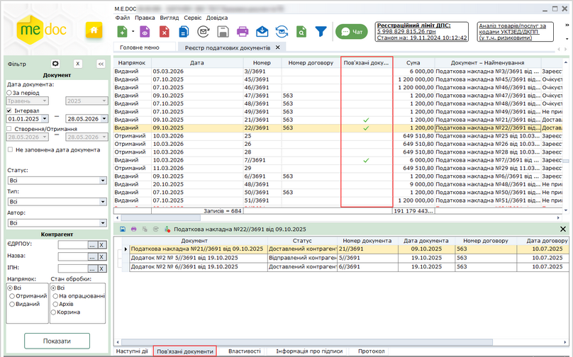

Натисніть, щоб збільшити малюнок

Якщо у реєстрі обрано документ, що має зв'язок з іншими документами, за замовчуванням вкладка Пов’язані документи відкривається автоматично.

Щоб вимкнути автоматичне відображення вкладки Пов’язані документи, оберіть пункт меню Вигляд, та зніміть відмітку Відображати пов'язані документи.

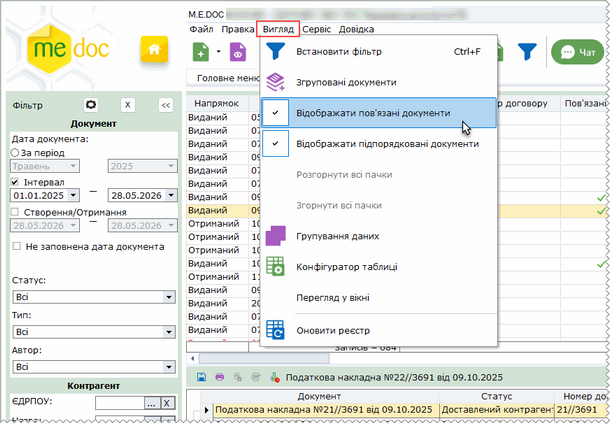

Натисніть, щоб збільшити малюнок

[До початку](#conn_doc-conn_doc)

Групування пов'язаних документів

Можливо змінити відображення пов'язаних документів у вікні реєстру. Для цього оберіть команду меню Вигляд - Згруповані документи:

Команда доступна у меню, якщо у фільтрі Тип обрано значення – Всі.

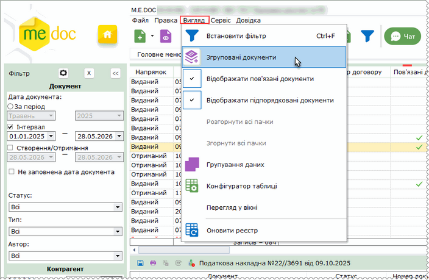

Натисніть, щоб збільшити малюнок

Згруповані документи у таблиці реєстру будуть відображені по групах:

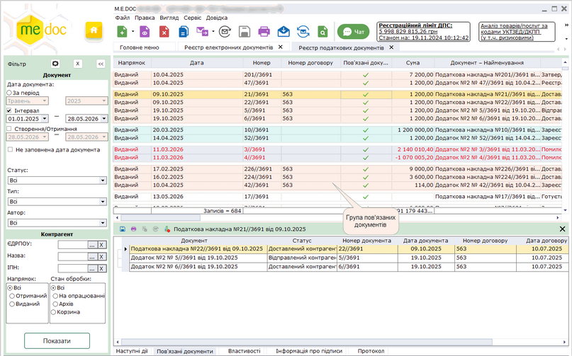

Натисніть, щоб збільшити малюнок

Для того, щоб повернутись до звичайного відображення даних у вікні реєстру, ще раз оберіть команду Вигляд - Відображати пов'язані документи.

[До початку](#conn_doc-conn_doc)

Визначення структури пакета пов'язаних документів

Для зв’язаних документів можна визначити ієрархію документів у пакеті - обирати головний документ пакета. Після визначення головного документа інші документи пакета автоматично набуваються статусу підпорядкованих документів.

Визначити головний документ пакета можна як у таблиці реєстру, так і на вкладці Пов'язані документи.

Визначення головного документа у пакеті пов'язаних документів із таблиці реєстру:

1. Виділіть за допомогою миші документ, який належить пакету пов'язаних документів, у якому необхідно визначити структуру.

2. Оберіть один із способів:

- натисніть праву кнопку миші та оберіть команду контекстного меню Визначити головний документ;
- оберіть команду меню Файл - Визначити головний документ.

Команда Визначити головний документ недоступна, якщо у реєстрі виділено кілька документів, що належать різним пакетам зв’язаних документів.

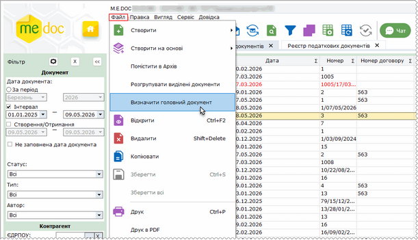

Натисніть, щоб збільшити малюнок

3. У вікні, що відкриється, оберіть документ, який потрібно визначити як головний документ пакета. Для цього встановіть позначку у рядку, що відповідає документу. Натисніть кнопку Підтвердити:

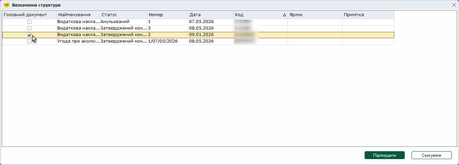

Натисніть, щоб збільшити малюнок

4. Буде змінено ієрархію пов'язаних документів у пакеті. У таблиці реєстру у колонці Пов’язані документи буде відображено ярлики Головний та Підпорядкований для відповідних документів пакета:

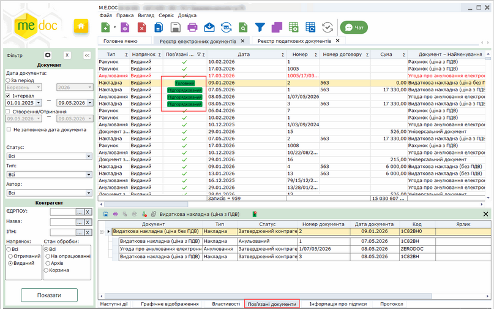

Натисніть, щоб збільшити малюнок

На вкладці Пов’язані документи пакет документів з визначеною структурою буде відображений у вигляді дерева. За замовчуванням на вкладці відображається тільки головний документ пакета. Щоб переглянути підпорядковані документи, натисніть кнопку . Відповідно, щоб згорнути дерево, натисніть .

Визначення головного документа у пакеті на вкладці Пов'язані документи:

1. Відкрийте вкладку Пов'язані документи.

2. Виділіть документ, який необхідно визначити як головний документ пакета та натисніть іконку Визначити головний документ :

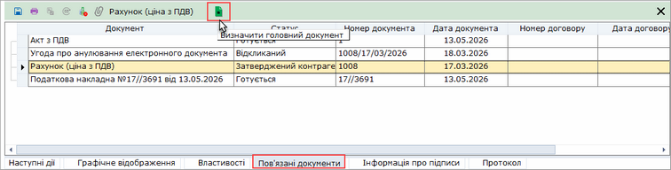

Натисніть, щоб збільшити малюнок

3. На вкладці Пов’язані документи пакет документів з визначеною структурою буде відображений у вигляді дерева. За замовчуванням на вкладці відображається тільки головний документ пакета. Щоб переглянути підпорядковані документи, натисніть кнопку . Відповідно, щоб згорнути дерево, натисніть . У таблиці реєстру у колонці Пов’язані документи буде відображено ярлики Головний та Підпорядкований для відповідних документів пакета.

Щоб змінити головний документ, виконайте команду Визначити головний документ та оберіть інший документ пакета.

Скасування ієрархії зв’язаних документів у пакеті:

Щоб скасувати призначення головного документа у пакеті зв’язаних документів скористайтеся одним із способів:

- виділити будь-який пов'язаний документ пакета та виконайте команду Визначити головний документ, у вікні, що відкриється, видалити позначку у рядку головного документа;
- на вкладці Повʼязані документи натисніть кнопку  Скасувати ієрархію на панелі інструментів вкладки.

Якщо у пакеті пов'язаних документів не визначено ієрархію, пов'язані документи позначаються у колонці Пов’язані документи позначкою :

Натисніть, щоб збільшити малюнок

Скасування ієрархії зв’язаних документів у пакеті не скасовує встановлені зв'язки між документами.

[До початку](#conn_doc-conn_doc)

Експорт пакетів пов'язаних документів, для яких визначено структуру

Пакет зв’язаних документів, у якому [визначено головний документ](#conn_doc-conn_doc), можна зберегти у форматі pdf. Разом з пакетом документів зберігається історія створення та змінення ярликів та приміток до документів (за наявності).

Зверніть увагу, виконується експорт лише первинних документів, які зберігаються у модулі Реєстр електронних документів. Експорт ПН/РК не виконується.

Для експорту пакета пов'язаних документів:

1. Виділіть за допомогою миші документ, який належить пакету пов'язаних документів. Для одночасного експорту кількох пакетів зв’язаних документів у таблиці реєстру виділіть хоча б по одному документу з кожного пакета.

2. Оберіть один із способів:

- натисніть праву кнопку миші та оберіть команду контекстного меню Експорт зв’язаних документів;
- оберіть команду меню Файл - Експорт - Експорт зв’язаних документів.

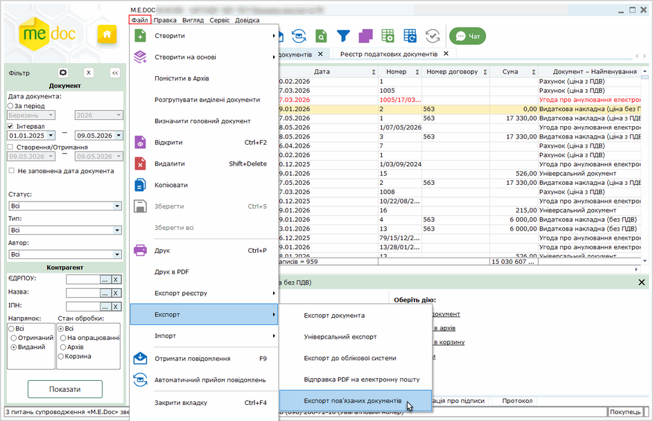

Натисніть, щоб збільшити малюнок

3. У вікні, що відкриється, оберіть каталог для збереження документів та натисніть ОК:

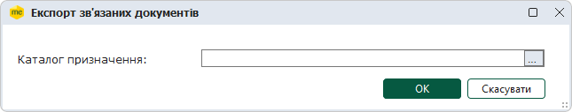

4. Буде виконано збереження обраного пакета (пакетів) пов'язаних документів.

Головний та підпорядковані документи зберігаються у одній підпапці у вигляді окремих pdf-файлів. Історія приміток та ярликів (за наявності) зберігається на окремій сторінці pdf-файлу кожного документа.

При виконанні експорту Універсальних документів із вкладеннями історія приміток і ярликів зберігається у окремому файлі .pdf, назва якого містить номер та дату Універсального документа.

[До початку](#conn_doc-conn_doc)


