[← Зміст довідки](../)


# Додавання підприємства

## Додавання підприємства

_Шлях у довідці: Початок роботи в системі › Додавання підприємства_

Додавання нового підприємства відбувається з вікна, що відкривається при запуску програми.

1. На панелі інструментів виберіть команду Створити підприємство.

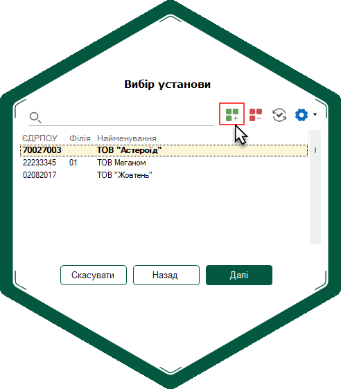

2. Відкриється вікно Майстер заповнення даних про підприємство.

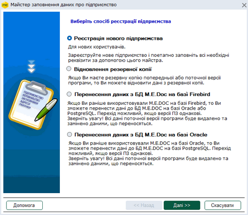

Натисніть, щоб збільшити малюнок

3. Виберіть спосіб реєстрації підприємства серед запропонованих:

|  |  |
| --- | --- |
| [Реєстрація нового підприємства](#connect_org-connect_org_1_1) | призначено для нових користувачів, яким потрібно створити підприємство у програмному комплексі |
| [Відновлення резервної копії](#connect_org-connect_org_3) | призначено для відновлення даних з резервної копії з ПК M.E.Doc.  Пункти доступні користувачу за наявності відповідних налаштувань у розділі програми [Адміністрування - Управління ролями – Доступ до підсистем - Адміністрування](UCManageRoles.html#ucmanageroles-ucmanageroles). |
| [Перенесення даних з БД M.E.Doc на базі Firebird](Help.html#help-setup_installation_program_perehod-postgresql) | призначено для перенесення даних з програми M.E.Doc на базі Firebird в програму M.E.Doc на базі Oracle або PostgreSQL, спосіб доступний, якщо на комп'ютері встановлений серверний екземпляр програми, що працює на на базі Firebird. |
| [Перенесення даних з БД M.E.Doc на базі Oracle](Help.html#help-setup_installation_program_perehod-postgresql) | призначено для перенесення даних з програми M.E.Doc на базі Oracle в програму M.E.Doc на базі PostgreSQL, спосіб доступний, якщо на комп'ютері встановлений серверний екземпляр програми, що працює на на базі Oracle. |

### Реєстрація нового підприємства

_Шлях у довідці: Початок роботи в системі › Додавання підприємства › Реєстрація нового підприємства_

Для створення нового підприємства у програмному комплексі необхідно виконати наступні дії:

- Вибрати спосіб реєстрації - [створення нового підприємства](#connect_org-connect_org_1_1)
- Якщо в наявності є сертифікати ЕП:

завантажити дані [з диска](#connect_org-connect_org_1_2_1_1_1) або [через Інтернет](#connect_org-connect_org_1_2_1_1_2)

[вибрати сертифікати, які будуть завантажені у програму](#connect_org-connect_org_1_2_1_2)

[налаштувати електронну пошту](#connect_org-connect_org_1_2_1_3)

[налаштувати комплект підписів](#connect_org-connect_org_1_2_1_4)

- Якщо сертифікатів немає, [вказати про їх відсутність](#connect_org-connect_org_1_2_2) та [вибрати тип установи](#connect_org-connect_org_1_2_2_1), що створюється
- Заповнити [загальні відомості про організацію](#connect_org-connect_org_1_3_1_1) та [відповідальних осіб](#connect_org-connect_org_1_3_1_2) для юридичних осіб або ж заповнити [загальних відомостей про фізичну особу](#connect_org-connect_org_1_3_2)
- [Заповнити дані податкової інспекції](#connect_org-connect_org_1_4)
- [Заповнити дані реєстрації в Пенсійному фонді](#connect_org-connect_org_1_5)
- [Заповнити додаткові дані](#connect_org-connect_org_1_6), що стосуються реєстрації установи в фонді соціального страхування, фонді по безробіттю, в територіальному органі ДКЦПФР, тощо.
- [Налаштувати ліцензії](#connect_org-connect_org_1_7)
- Налаштувати комплектності форм шляхом вибору [типу комплектності бланків](#connect_org-connect_org_1_8_1) та вибору [складу обраного комплекту бланків](#connect_org-connect_org_1_8_2)

#### Вибір способу реєстрації

_Шлях у довідці: Початок роботи в системі › Додавання підприємства › Реєстрація нового підприємства › Вибір способу реєстрації_

1. У відкритому вікні Майстер заповнення даних про підприємство виберіть Реєстрація нового підприємства.

2. Натисніть на кнопку Далі.

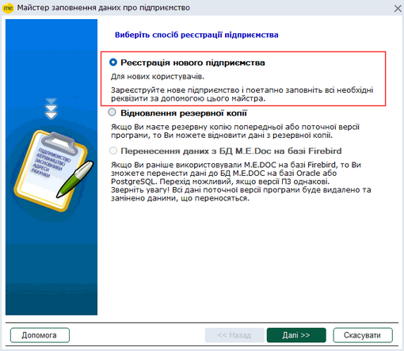

Натисніть, щоб збільшити малюнок

У наступному вікні, що відкриється, Майстер запропонує Вам [завантажити сертифікати](#connect_org-connect_org_1_2) ЕП, за умови, що вони у Вас є.
Це дозволяє суттєво економити час на заповнення реквізитів підприємства - вони автоматично заповнюються із сертифікатів.

Якщо сертифікати відсутні, картка підприємства заповнюється вручну.

#### Завантаження сертифікатів

_Шлях у довідці: Початок роботи в системі › Додавання підприємства › Реєстрація нового підприємства › Завантаження сертифікатів_

При створенні нової установи обов'язково заповнюється Картка підприємства. Такі реквізити як: ПІБ та ІПН фізичних осіб, код ЄДРПОУ (для юридичних осіб), посади осіб в установі, адреси, - містяться в кожному сертифікаті.

Тож, якщо у Вас є сертифікати ЕП, на даному етапі Ви можете завантажити у програму реквізити підприємства даними з сертифіката.

Це суттєво скорочує час на створення картки установи та дає можливість позбавитись граматичних помилок при внесенні даних.

Зі скороченим переліком КНЕДП, сертифікати яких підтримуються, ви можете ознайомитись на нашому сайті за посиланням: [https://www.medoc.ua/uk/faq/jak-resursi-neobhdn-dlja-roboti-medoc](https://www.medoc.ua/uk/faq/jak-resursi-neobhdn-dlja-roboti-medoc).

[Якщо у Вас є сертифікати ЕП](#connect_org-connect_org_1_2_1)

[Якщо у Вас немає сертифікатів ЕП](#connect_org-connect_org_1_2_2)

##### Якщо у Вас є сертифікати ЕП

_Шлях у довідці: Початок роботи в системі › Додавання підприємства › Реєстрація нового підприємства › Завантаження сертифікатів › Якщо у Вас є сертифікати ЕП_

Якщо у Вас є сертифікати ЕП, виконайте наступні дії:

- Завантаження сертифікатів [з диска](#connect_org-connect_org_1_2_1_1_1) або [через Інтернет](#connect_org-connect_org_1_2_1_1_2)
- [Вибір сертифікатів, які будуть завантажені у програму](#connect_org-connect_org_1_2_1_2)
- [Налаштування електронної пошти](#connect_org-connect_org_1_2_1_3)
- [Налаштування комплекту підписів](#connect_org-connect_org_1_2_1_4)

###### Способи завантаження сертифікатів

_Шлях у довідці: Початок роботи в системі › Додавання підприємства › Реєстрація нового підприємства › Завантаження сертифікатів › Якщо у Вас є сертифікати ЕП › Способи завантаження сертифікатів_

###### Завантаження сертифікатів з диска

_Шлях у довідці: Початок роботи в системі › Додавання підприємства › Реєстрація нового підприємства › Завантаження сертифікатів › Якщо у Вас є сертифікати ЕП › Способи завантаження сертифікатів › Завантаження сертифікатів з диска_

1. Виберіть Завантажити сертифікат з диска.

2. У полі Папка вкажіть шлях до каталогу, де збережені сертифікати.

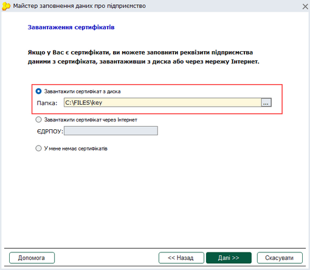

Натисніть, щоб збільшити малюнок

3. Натисніть на кнопку Далі.

Для повернення до попереднього кроку натисніть Назад. Для скасування операції і повернення до вікна Вибір установи натисніть Скасувати.

###### Завантаження сертифікатів через Інтернет

_Шлях у довідці: Початок роботи в системі › Додавання підприємства › Реєстрація нового підприємства › Завантаження сертифікатів › Якщо у Вас є сертифікати ЕП › Способи завантаження сертифікатів › Завантаження сертифікатів через Інтернет_

Якщо Ви є клієнтом КНЕДП "Україна", то для Вас доступна можливість завантаження сертифікатів через Інтернет безпосередньо із сайту КНЕДП "Україна".

1. Виберіть Завантажити сертифікат через Інтернет.

2. У полі ЕДРПОУ вкажіть номер ЕДРПОУ свого підприємства (для фізичних осіб - ІПН або номер паспорта)

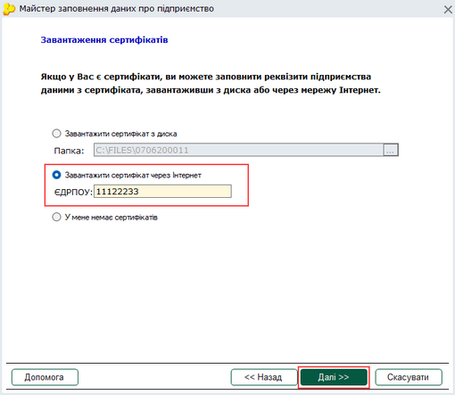

Натисніть, щоб збільшити малюнок

3. Натисніть на кнопку Далі.

За кодом ЄДРПОУ установи відбуватиметься пошук наявних сертифікатів на сайтах КНЕДП "Україна" та КНЕДП ІДД ДПС.

Для повернення до попереднього кроку натисніть Назад. Для скасування і повернення до вікна Вибір установи натисніть Скасувати.

###### Перелік сертифікатів, які будуть завантажені у програму

_Шлях у довідці: Початок роботи в системі › Додавання підприємства › Реєстрація нового підприємства › Завантаження сертифікатів › Якщо у Вас є сертифікати ЕП › Перелік сертифікатів, які будуть завантажені у програму_

У даному вікні відображаються обрані для завантаження в систему сертифікати.

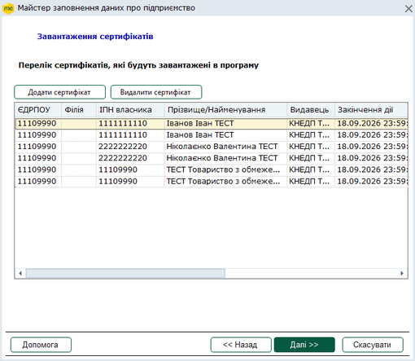

Натисніть, щоб збільшити малюнок

Доступні дії:

|  |  |
| --- | --- |
| Додавання сертифіката | 1. Натисніть на кнопку Додати сертифікат.  2. У вікні, що відкриється, вкажіть шлях до каталогу, де зберігаються сертифікати. |
| Видалення сертифіката | 1. Виділіть потрібний сертифікат за допомогою миші (щоб виділити декілька рядків, утримуйте клавіші Ctrl або Shift).  2. Натисніть на кнопку Видалити сертифікат. |

Для переходу до наступного кроку, натисніть на кнопку Далі.

При завантажені сертифікатів, виданих на основі ID-картки, (або для суб'єктів договору СД) наступним кроком буде [Вибір типу установи](#connect_org-connect_org_1_2_2_1). Після чого, програма запропонує [налаштувати електронну пошту](#connect_org-connect_org_1_2_1_3) та [налаштувати комплект підписів](#connect_org-connect_org_1_2_1_4).

Для повернення до попереднього кроку натисніть Назад. Для скасування і повернення до вікна Вибір установи натисніть Скасувати.

###### Вибір типу установи

_Шлях у довідці: Початок роботи в системі › Додавання підприємства › Реєстрація нового підприємства › Завантаження сертифікатів › Якщо у Вас є сертифікати ЕП › Вибір типу установи_

За умови заповнення картки підприємства вручну (або при завантажені сертифікатів, виданих на основі ID-картки, та для суб'єктів договору СД), потрібно обрати тип установи, що реєструється: Юридична особа або Фізична особа - підприємець. Від вибраного типу установи залежить комплект даних, який буде запропоновано налаштувати далі.

1. Встановіть відмітку напроти потрібного типу установи.

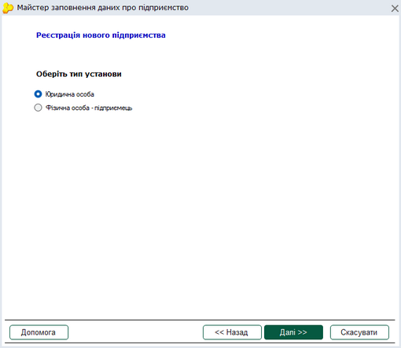

Натисніть, щоб збільшити малюнок

2. Натисніть на кнопку Далі для продовження реєстрації підприємства.

Для повернення до попереднього кроку натисніть Назад. Для скасування і повернення до вікна Вибір установи натисніть Скасувати.

###### Налаштування електронної пошти

_Шлях у довідці: Початок роботи в системі › Додавання підприємства › Реєстрація нового підприємства › Завантаження сертифікатів › Якщо у Вас є сертифікати ЕП › Налаштування електронної пошти_

Наявність сертифікатів ЕП підприємства передбачає використання електронного документообігу: обмін звітністю між філіями та головною установою, відправлення звітності до контролюючих органів тощо. Даний обіг здійснюється за допомогою електронної пошти.

На даному кроці Майстер пропонує налаштувати електронну пошту, щоб після закінчення реєстрації підприємства програма була максимально готовою до експлуатації. Змінити налаштування електронної пошти можна пізніше у розділі програми [Адміністрування - Параметри системи - Електронна пошта](FormCompanyParams.html#formcompanyparams-admcompanyparams_emaile).

Рекомендується створити окрему електронну скриньку на одному з надійних УКРАЇНСЬКИХ поштових серверів, яка буде використовуватись лише для відправлення звітності та отримання електронних квитанцій.

1. Введіть адресу електронної пошти у поле Адреса E-mail.

2. Введіть пароль доступу до електронної скриньки у поле Пароль.

3. За необхідності відмітьте поле Використовується виключно програмою M.E.Doc.
     Якщо поле відмічено, система буде автоматично видаляти з поштового сервера ті повідомлення, що не стосуються електронної звітності підприємства.

4. Натисніть на кнопку Додаткові налаштування.

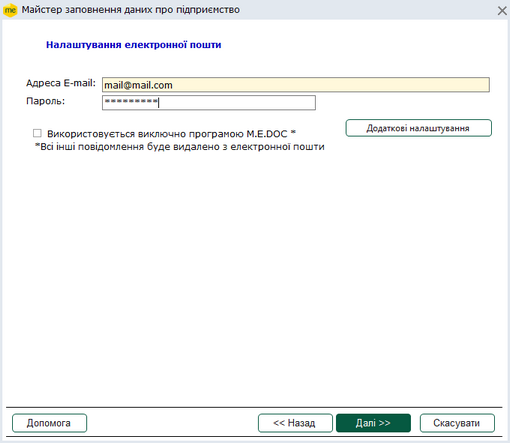

Натисніть, щоб збільшити малюнок

5. Відкриється вікно налаштування серверів вхідної та вихідної пошти. Докладний опис налаштувань у даному вікні див. у розділі [Адміністрування - Параметри системи - Електронна пошта](FormCompanyParams.html#formcompanyparams-admcompanyparams_emaile). Натисніть ОК для збереження або Скасувати для скасування внесених параметрів.

6. Для переходу до наступного кроку натисніть на кнопку Далі.

###### Налаштування комплекту підписів

_Шлях у довідці: Початок роботи в системі › Додавання підприємства › Реєстрація нового підприємства › Завантаження сертифікатів › Якщо у Вас є сертифікати ЕП › Налаштування комплекту підписів_

У даному вікні представлена можливість надання права підпису відповідальним особам (співробітникам), за умови наявності у них сертифікатів ЕП.

1. Налаштуйте комплект підписів згідно з вимогами вашого підприємства. Докладний опис налаштувань у даному вікні див. у розділі [Адміністрування - Параметри системи - Підпис](FormCompanyParams.html#formcompanyparams-admcomanyparams_pen) та [Сценарії підписання первинних документів](UCPDocSignSettings.html#ucpdocsignsettings-ucpdocsignsettings).

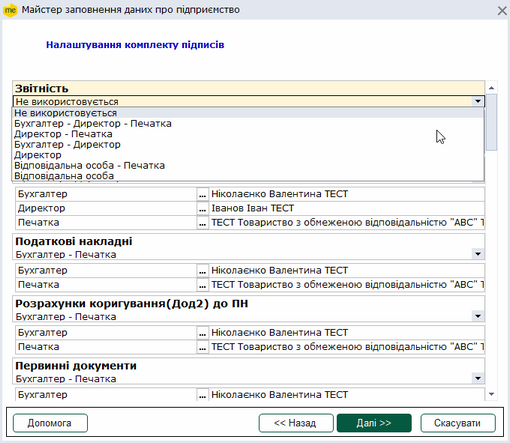

Натисніть, щоб збільшити малюнок

При створенні підприємства на основі [завантажених сертифікатів](#connect_org-connect_org_1_2) Майстер заповнення даних про підприємство автоматично сформує комплекти підписів. Перевірте правильність автоматичних налаштувань підписів.

Для підпису типу Відповідальна особа можна обрати кілька осіб.

2. Натисніть на кнопку Далі.

Для повернення до попереднього кроку натисніть Назад. Для скасування і повернення до вікна Вибір установи натисніть Скасувати.

#### Якщо у Вас немає сертифікатів ЕП

_Шлях у довідці: Початок роботи в системі › Додавання підприємства › Реєстрація нового підприємства › Якщо у Вас немає сертифікатів ЕП_

Якщо Ви не працювали раніше із програмою і не маєте сертифікатів ЕП, для створення підприємства Вам потрібно послідовно заповнити всі реквізити в Картці підприємства.

Виберіть У мене немає сертифікатів та натисніть на кнопку Далі.

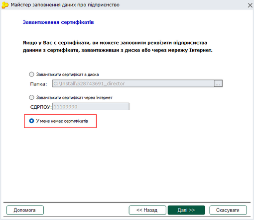

Натисніть, щоб збільшити малюнок

##### Вибір типу установи

_Шлях у довідці: Початок роботи в системі › Додавання підприємства › Реєстрація нового підприємства › Якщо у Вас немає сертифікатів ЕП › Вибір типу установи_

За умови заповнення картки підприємства вручну (або при завантажені сертифікатів, виданих на основі ID-картки, та для суб'єктів договору СД), потрібно обрати тип установи, що реєструється: Юридична особа або Фізична особа - підприємець. Від вибраного типу установи залежить комплект даних, який буде запропоновано налаштувати далі.

1. Встановіть відмітку напроти потрібного типу установи.

Натисніть, щоб збільшити малюнок

2. Натисніть на кнопку Далі для продовження реєстрації підприємства.

Для повернення до попереднього кроку натисніть Назад. Для скасування і повернення до вікна Вибір установи натисніть Скасувати.

#### Загальні відомості про організацію / про СПД

_Шлях у довідці: Початок роботи в системі › Додавання підприємства › Реєстрація нового підприємства › Загальні відомості про організацію / про СПД_

На даному етапі Майстер пропонує заповнити основні дані підприємства, що реєструється, а саме: назва підприємства, код ЄДРПОУ (ІПН), адреси.
Даними із основних полів цієї форми заповнюються всі звітні документи.

Примітка:

Якщо попередньо були завантажені сертифікати, то поля буду заповнені даними із сертифікатів.

Доступні дії:

|  |  |
| --- | --- |
| Для юридичних осіб |  |
| [Заповнення загальних відомостей про організацію](#connect_org-connect_org_1_3_1_1) | |
| Для фізичних осіб - підприємців |  |
| [Заповнення загальних відомостей про фізичну особу/суб'єкт підприємницької діяльності](#connect_org-connect_org_1_3_2) | |

[Вибір відповідальних осіб](#connect_org-connect_org_1_3_1_2)

##### Для юридичних осіб

_Шлях у довідці: Початок роботи в системі › Додавання підприємства › Реєстрація нового підприємства › Загальні відомості про організацію / про СПД › Для юридичних осіб_

###### Загальні відомості про організацію

_Шлях у довідці: Початок роботи в системі › Додавання підприємства › Реєстрація нового підприємства › Загальні відомості про організацію / про СПД › Для юридичних осіб › Загальні відомості про організацію_

1. Заповніть запропоновану форму даними свого підприємства.

Поля, що підсвічені жовтим кольором, обов'язкові для заповнення.

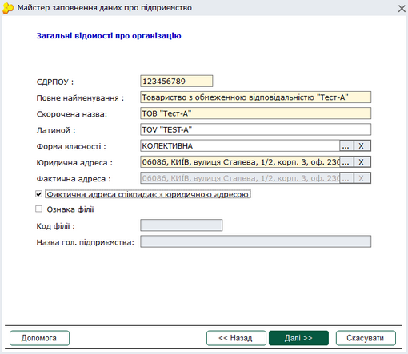

Натисніть, щоб збільшити малюнок

|  |  |
| --- | --- |
| ЄДРПОУ | код установи за ЄДРПОУ, числовий запис у це поле вводиться із клавіатури починаючи з першої позиції поля вводу. |
| Повне найменування | вказується повне найменування підприємства. Запис вноситься із клавіатури. Зверніть увагу! У полі необхідно вказати правову форму організації. |
| Скорочена назва | коротка назва установи. Запис вноситься із клавіатури. |
| Латиною | у це поле автоматично додається текст із поля Коротка назва латинськими літерами. |
| Форма власності | натисніть  та виберіть найменування форми власності із підключеного довідника. |
| Юридична адреса | натисніть  та виберіть юридичну адресу із підключеного довідника, якщо адреса відсутня, додайте її безпосередньо у вікні довідника. Докладно про додавання адреcи дивіться розділ [Картка підприємства - Адреси](UCOrg.html#ucorg-sprorg_adr). |
| Фактична адреса | натисніть  та виберіть фактичну адресу із підключеного довідника.  Якщо фактична адреса співпадає з юридичною адресою, встановіть галочку у полі Фактична адреса. Автоматично поле Фактична адреса заповниться даними із поля Юридична адреса. |
| Ознака філії | якщо створюване підприємство є філією, встановіть галочку у полі Ознака філії. Якщо позначка встановлена, поля Код філії та Назва гол. підприємства стануть доступними для введення даних. |
| Код філії | якщо підприємство, що створюється, є філією, у дане поле введіть код, за яким ідентифікується філія. Запис вноситься із клавіатури. |
| Назва гол. підприємства | вкажіть назву головного підприємства, до якого належить філія. |

2. Для переходу до наступного кроку, натисніть на кнопку Далі. Якщо не заповнені поля, необхідні для додавання підприємства, кнопка Далі не активна.

Для повернення до попереднього кроку натисніть Назад. Для скасування і повернення до вікна Вибір установи натисніть Скасувати.

Якщо на кроці [Завантаження сертифікатів](#connect_org-connect_org_1_2_2) ви обрали опцію У мене немає сертифікатів, по натисканню на кнопку Далі Майстер запропонує налаштувати електронну пошту для прийому повідомлень у програмі. Про налаштування пошти докладно дивіться у розділі [Налаштування електронної пошти](#connect_org-connect_org_1_2_1_3).

##### Для фізичних осіб-підприємців

_Шлях у довідці: Початок роботи в системі › Додавання підприємства › Реєстрація нового підприємства › Загальні відомості про організацію / про СПД › Для фізичних осіб-підприємців_

1. Заповніть запропоновану форму даними свого підприємства.

Поля, що підсвічені жовтим кольором, обов'язкові для заповнення.

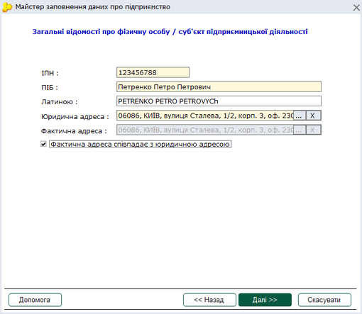

Натисніть, щоб збільшити малюнок

|  |  |
| --- | --- |
| ІПН | індивідуальний податковий номер платника податку, числовий запис у це поле вводиться із клавіатури починаючи з першої позиції поля вводу. |
| ПІБ | прізвище ім'я та по батькові підприємця, вводиться із клавіатури. |
| Латиною | у це поле автоматично додається текст із поля ПІБ латинськими літерами. |
| Юридична адреса | натисніть  та виберіть юридичну адресу із підключеного довідника. |
| Фактична адреса | натисніть  та виберіть фактичну адресу із підключеного довідника.  Якщо фактична адреса співпадає з юридичною адресою, встановіть галочку у полі Фактична адреса. Автоматично поле Фактична адреса заповниться даними з поля Юридична адреса. |

2. Для переходу до наступного кроку, натисніть на кнопку Далі.

Для повернення до попереднього кроку натисніть Назад. Для скасування і повернення до вікна Вибір установи натисніть Скасувати.

Якщо на кроці [Завантаження сертифікатів](#connect_org-connect_org_1_2_2) ви обрали опцію У мене немає сертифікатів, по натисканню на кнопку Далі Майстер запропонує налаштувати електронну пошту для прийому повідомлень у програмі. Про налаштування пошти докладно дивіться у розділі [Налаштування електронної пошти](#connect_org-connect_org_1_2_1_3).

#### Відповідальні особи

_Шлях у довідці: Початок роботи в системі › Додавання підприємства › Реєстрація нового підприємства › Відповідальні особи_

Дані керівника та бухгалтера вносяться у відповідні поля для підпису звітних форм.

1. Заповніть запропоновану форму даними відповідальних осіб.

Поля, що підсвічені жовтим кольором, обов'язкові для заповнення.

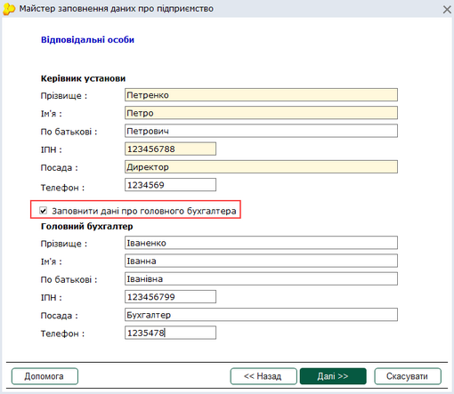

Натисніть, щоб збільшити малюнок

2. Якщо штатним розписом підприємства передбачена посада головного бухгалтера, встановіть галочку. При цьому блок даних Головний бухгалтер стане доступний для заповнення та редагування.

У випадку, якщо керівник установи офіційно виконує обов'язки бухгалтера, даний блок заповнюється даними керівника установи.

При прийманні електронних ПОДАТКОВИХ звітів виконується контроль на заповнення системних полів, в тому числі поля Головний бухгалтер, тому у формах звітності це поле повинно бути обов'язково заповненим.

Якщо бухгалтер в установі відсутній (розділ Головний бухгалтер в картці установи не заповнено), це поле у формах податкової звітності також не заповнюється.

3. Для переходу до наступного кроку, натисніть на кнопку Далі.

Для повернення до попереднього кроку натисніть Назад. Для скасування операції і повернення до вікна Вибір установи натисніть Скасувати.

#### Дані податкової реєстрації

_Шлях у довідці: Початок роботи в системі › Додавання підприємства › Реєстрація нового підприємства › Дані податкової реєстрації_

У цій формі містяться поля, що стосуються Податкової інспекції.

1. Заповніть запропоновану форму даними свого підприємства.

Поля, що підсвічені жовтим кольором, обов'язкові для заповнення.

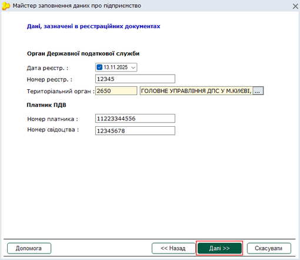

Натисніть, щоб збільшити малюнок

|  |  |
| --- | --- |
| Дата реєстрації | виберіть дату реєстрації вашого підприємства з вбудованого календаря або заповніть поле вручну з клавіатури. |
| Номер реєстрації | числовий запис у це поле вводиться із клавіатури. |
| Територіальний орган | виберіть найменування вашої податкової інспекції із довідника. |
| Номер платника | числовий запис у це поле вводиться із клавіатури. |
| Номер свідоцтва | числовий запис у це поле вводиться із клавіатури. |

2. Для переходу до наступного кроку, натисніть на кнопку Далі.

Для повернення до попереднього кроку натисніть Назад. Для скасування і повернення до вікна Вибір установи натисніть Скасувати.

#### Дані реєстрації в Пенсійному фонді

_Шлях у довідці: Початок роботи в системі › Додавання підприємства › Реєстрація нового підприємства › Дані реєстрації в Пенсійному фонді_

У цій формі містяться поля, що стосуються Пенсійного фонду.

Даними із полів цієї закладки заповнюються документи, що надаються до органу (персоніфікована звітність та звіти про доходи).

1. Заповніть запропоновану форму даними свого підприємства.

Поля, що підсвічені жовтим кольором, обов'язкові для заповнення.

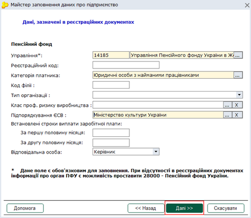

Натисніть, щоб збільшити малюнок

|  |  |
| --- | --- |
| Управління | код і найменування управління ПФУ, виберіть із довідника. |
| Реєстраційний код | числовий запис у це поле вводиться із клавіатури. |
| Категорія платника | виберіть найменування категорії платника із довідника. |
| Код філії | код філії за реєстрацією в ПФУ, вводиться із клавіатури. |
| Тип організації | оберіть значення цього поля із списку:  - Бюджетна установа;  - УТОГ УТОС;  - Громадська організація інвалідів.  Якщо тип установи не відповідає ні одному із наведених варіантів, обирається пустий рядок, тобто може бути незаповненим.  Поле використовується при формуванні та розрахунку Таблиці 1 звіту з єдиного внеску. |
| Клас проф. ризику виробництва | виберіть із довідника значення класу професійного ризику виробництва.   Поле використовується при формуванні Таблиці 1 звіту з єдиного внеску. |
| Підпорядкування ЄСВ | якщо організація недержавна, оберіть «Недержавні підприємства без підпорядкування». |
| Встановлені строки виплати заробітної плати | вкажіть терміни виплати заробітної плати за першу та другу половину місяця, відповідно у полях За першу половину місяця та За другу половину місяця. |
| Відповідальна особа | у цьому полі із списку обирається посадова особа (директор чи бухгалтер), відповідальна за формування документів персоніфікованої звітності.  Також можливий вибір іншої особи, яка відповідальна за подання персоніфікованої звітності.  Для цього потрібно обрати запис: Інша особа.   З’явиться нове поле з назвою ІПН та ПІБ відповідальної особи, в яке вручну із клавіатури потрібно внести відповідні записи. |

2. Для переходу до наступного кроку, натисніть на кнопку Далі.

Для повернення до попереднього кроку натисніть Назад. Для скасування і повернення до вікна Вибір установи натисніть Скасувати.

#### Додаткові реєстраційні дані

_Шлях у довідці: Початок роботи в системі › Додавання підприємства › Реєстрація нового підприємства › Додаткові реєстраційні дані_

Форма містить додаткові дані, що стосуються реєстрації установи.

1. Заповніть запропоновану форму даними свого підприємства.

Поля, що підсвічені жовтим кольором, обов'язкові для заповнення.

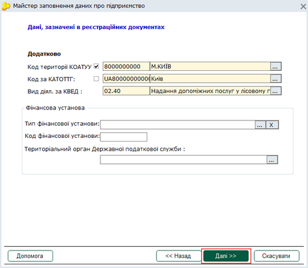

Натисніть, щоб збільшити малюнок

У програмі можливе використання як довідника КОАТУУ, так і довідника КАТОТТГ. Для вибору довідника, значення якого слід використовувати при створенні звітності, встановіть відмітку біля назви потрібного довідника. За замовчуванням використовується довідник КОАТУУ.

Змінити обраний код можна у розділі програми [Довідники - Картка підприємства - Додатково](UCOrg.html#ucorg-sprorg_dop).

При виборі коду у одному з полів Код території КОАТУУ або Код за КАТОТТГ друге поле автоматично заповнюється значенням, що відповідає вже обраному коду.

|  |  |
| --- | --- |
| Код території КОАТУУ | код і найменування території за Державним класифікатором об'єктів адміністративно-територіального устрою України (КОАТУУ)  виберіть найменування з підключеного довідника Коди території (КОАТУУ/КАТОТТГ), при цьому значення коду заповниться автоматично. |
| Код за КАТОТТГ | код і найменування території, де розташована установа за Кодифікатором адміністративно-територіальних одиниць та територій територіальних громад (КАТОТТГ)  виберіть найменування з підключеного довідника Коди території (КОАТУУ/КАТОТТГ), при цьому значення коду заповниться автоматично. |
| Вид діял. за КВЕД | код і найменування виду діяльності за класифікатором видів економічної діяльності виберіть із довідника. |
| Тип фінансової установи | оберіть значення цього поля із списку:  - Державна казначейська служба;  - Небанківська установа;  - Банківська установа.  Якщо тип установи не відповідає ні одному із наведених варіантів, обирається пустий рядок, тобто може бути незаповненим.  Поле використовується при формуванні та розрахунку Таблиці 1 звіту з єдиного внеску. |
| Код фінансової установи | У полі Код фінансової установи введіть код за допомогою клавіатури. |
| Територіальний орган Державної податкової служби | Оберіть територіальний орган ДПС з підключеного довідника. |

Якщо підприємство не має відповідних реєстраційних даних, залиште поля пустими.

2. Для переходу до наступного кроку, натисніть на кнопку Далі.

Для повернення до попереднього кроку натисніть Назад. Для скасування операції та повернення до вікна Вибір установи натисніть Скасувати.

#### Налаштування ліцензії

_Шлях у довідці: Початок роботи в системі › Додавання підприємства › Реєстрація нового підприємства › Налаштування ліцензії_

Після встановлення на комп'ютер, програма запускається в демонстраційному режимі. В цьому режимі система повністю функціональна (створює та розраховує документи, дозволяє добудовувати в них власні програми) за винятком операцій друку, експорту та відправлення електронною поштою.

Для переведення програми в робочий стан необхідно отримати та встановити ліцензійний код доступу.

Якщо у Вас є ліцензійний код, Майстер пропонує ввести його під час реєстрації підприємства, щоб після закінчення реєстрації підприємства програма була максимально готовою до експлуатації. Проте даний крок не є обов'язковим, його можна пропустити, натиснути на кнопку Далі та ввести ліцензійний код пізніше ([Адміністрування - Керування ліцензіями](FormLicInfo.html#formlicinfo-admlic)).

Способи отримання ліцензійного ключа та налаштування ліцензій описано у розділі [Керування ліцензіями](FormLicInfo.html#formlicinfo-admlic)

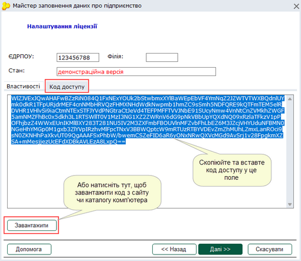

Натисніть, щоб збільшити малюнок

Для переходу до наступного кроку, натисніть на кнопку Далі.
Для повернення до попереднього кроку натисніть Назад.
Для скасування і повернення до вікна Вибір установи натисніть Скасувати.

#### Налаштування комплектності форм

_Шлях у довідці: Початок роботи в системі › Додавання підприємства › Реєстрація нового підприємства › Налаштування комплектності форм_

##### Вибір типу комплектності форм

_Шлях у довідці: Початок роботи в системі › Додавання підприємства › Реєстрація нового підприємства › Налаштування комплектності форм › Вибір типу комплектності форм_

У програмному комплексі міститься близько 3000 різноманітних бланків звітної документації, і цей список постійно поповнюється. Для полегшення та прискорення пошуку розробником програми налаштовано декілька стандартних комплектів, які відповідають певному типу оподаткування підприємства та містять відповідний комплект звітних бланків.

У даному вікні Майстра за замовчуванням вже обраний комплект звітних форм у відповідності з вказаним типом Вашого підприємства (юридична або фізична особа). Але він може бути змінений, якщо не задовольняє Ваших потреб.

Список комплектності форм для юридичних та фізична осіб відрізняється.

1. Встановіть галочку напроти потрібного типу комплекту форм.

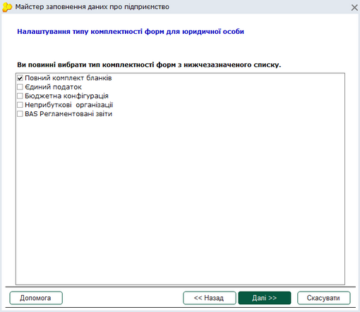

Натисніть, щоб збільшити малюнок

2. Для переходу до наступного кроку, натисніть на кнопку Далі.

Для повернення до попереднього кроку натисніть Назад. Для скасування і повернення до вікна Вибір установи натисніть Скасувати.

##### Вибір складу обраного комплекту бланків

_Шлях у довідці: Початок роботи в системі › Додавання підприємства › Реєстрація нового підприємства › Налаштування комплектності форм › Вибір складу обраного комплекту бланків_

У даному вікні Майстра надається можливість зміни складу обраного комплекту бланків.

У верхній частині вікна відображена назва обраного типу звітних форм.
У полі вікна представлений обраний користувачем комплект звітності у вигляді ієрархічного списку.

Для зручності та прискорення пошуку бланки згруповані за призначенням (одержувачем). При розгортанні певної групи можна побачити бланки, які входять до її складу.

1. Встановіть/зніміть галочку напроти обраної форми, щоб включити або, навпаки, виключити бланк до загального переліку форм, що використовуються.

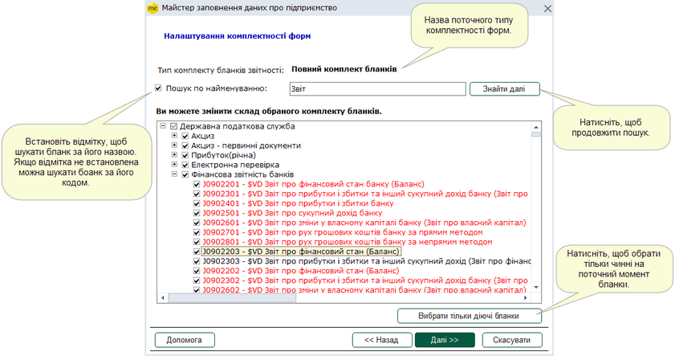

Натисніть, щоб збільшити малюнок

Примітка:

Повний комплект містить всі звітні форми всіх розділів та груп.

У даній формі реалізовано пошук форм по найменуванню або по коду бланка.

За замовчанням система шукає бланки по коду. Щоб здійснити пошук по найменуванню, встановіть галочку у відповідному полі. Введіть значення, яке необхідно знайти. Перший знайдений рядок, що містить вказане значення, буде позначено синім кольором. Для продовження пошуку натисніть кнопку Знайти далі.

2. В нижній частині вікна міститься кнопка Відображати тільки діючі бланки. Після натискання цієї кнопки автоматично встановлюються позначки тільки для діючих на поточний момент бланків. Недіючі бланки позначаються червоним кольором.

3. Для переходу до наступного кроку, натисніть на кнопку Далі.

Для повернення до попереднього кроку натисніть Назад. Для скасування і повернення до вікна Вибір установи натисніть Скасувати.

#### Перевірка електронної звітності

_Шлях у довідці: Початок роботи в системі › Додавання підприємства › Реєстрація нового підприємства › Перевірка електронної звітності_

Є можливість перевірити поштове з'єднання та відправити на шлюзи контролюючих органів тестові повідомлення.
Для цього встановіть відмітку в полі Надіслати тестове повідомлення та натисніть Далі. Перевірка триватиме деякий час.

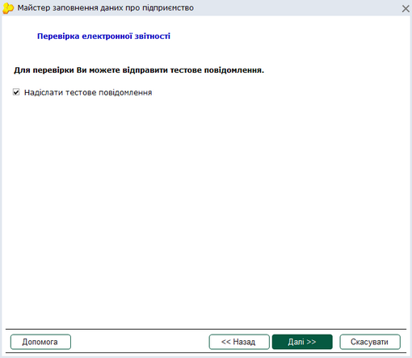

Натисніть, щоб збільшити малюнок

Система відправить тестові повідомлення та виведе протокол з переліком контролюючих органів, на які було відправлено повідомлення.

Через деякий час обов'язково перевірте пошту для отримання відповідей. Для цього натисніть  на панелі інструментів.

#### Перевірка внесених реквізитів установи

_Шлях у довідці: Початок роботи в системі › Додавання підприємства › Реєстрація нового підприємства › Перевірка внесених реквізитів установи_

Майстер надає можливість перевірки правильності внесених у програму даних підприємства.

Якщо Ви задоволені результатами, натисніть Готово для завершення роботи Майстра і початку роботи в системі.

Для повернення до попереднього кроку натисніть Назад. Для скасування і повернення до вікна Вибір установи натисніть Скасувати.

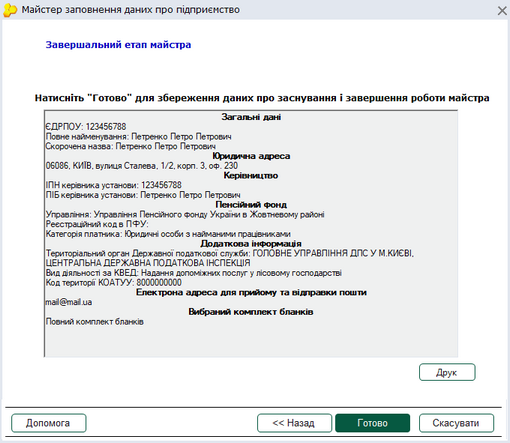

Натисніть, щоб збільшити малюнок

### Відновлення резервної копії

_Шлях у довідці: Початок роботи в системі › Додавання підприємства › Відновлення резервної копії_

Якщо ви раніше працювали з програмами або M.E.Doc, картку установи створювати не обов'язково. За допомогою Майстра можна відновити заздалегідь створену резервну копію установи. З резервної копії відновлюються всі параметри та реквізити організації, а також їх документи, що містяться у базі програми.

1. Під час запуску програми M.E.Doc у вікні вибору установи натисніть кнопку Створити підприємство.

2. Відкриється вікно Майстер заповнення даних про підприємство. Виберіть спосіб реєстрації підприємства Відновлення резервної копії. Натисніть кнопку Далі.

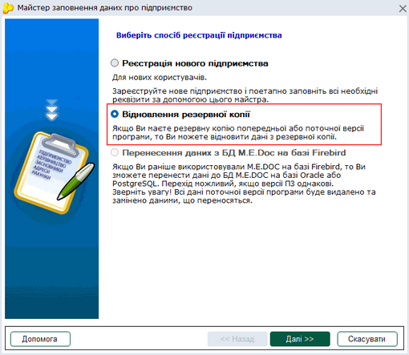

Натисніть, щоб збільшити малюнок

3. Програма перевіряє каталог, у який за замовчанням зберігаються резервні копії програм (...\ZVIT\_ARC) та знаходить розміщені у цих каталогах файли. Список всіх знайдених файлів відображається у вікні, що відкрилось:

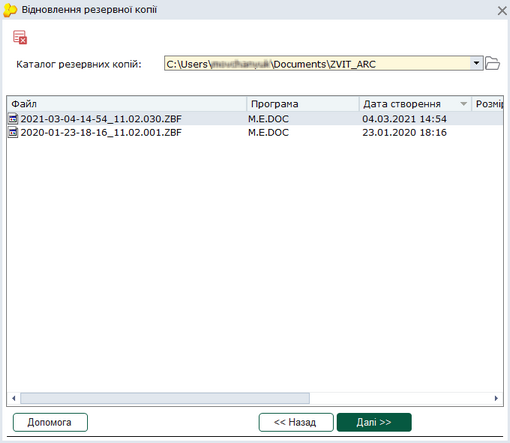

Натисніть, щоб збільшити малюнок

Запис переліку резервних копій містить назву програми, в якій був створений, дату створення та розмір файлу.

Файли резервних копій, створених в M.E.Doc, мають розширення:

.ZBK - копія всіх підприємств або копія поточного підприємства, відновлюються дані лише обраного підприємства (підприємств);

.ZBF - копія всієї бази, УВАГА! При відновленні даних з резервної копії всієї бази (.ZBF) ВИДАЛЯЮТЬСЯ ВСІ дані поточної версії програми ТА ЗАМІЩУЮТЬСЯ даними резервної копії.

Докладно про створення та відновлення резервної копії дивіться у розділі [Резервне копіювання](UCBackup.html#ucbackup-admbackup).

4. Оберіть потрібну резервну копію для відновлення та натисніть на кнопку Далі.

Для повернення до попереднього кроку натисніть Назад.

5. Якщо для відновлення обрано копію .ZBK, що може містити дані декількох установ, у наступному вікні можна обрати, які установи слід відновити. Для цього встановіть відмітку напроти установи, дані якої потрібно відновити.

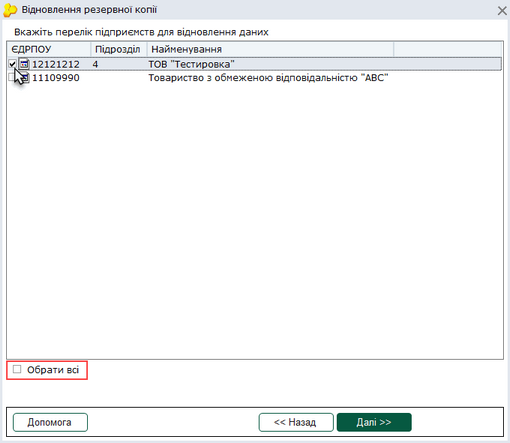

Натисніть, щоб збільшити малюнок

Якщо для відновлення обрано копію .ZBF, що містить копію всієї бази, у наступному вікні наводиться перелік підприємств дані яких буде відновлено.

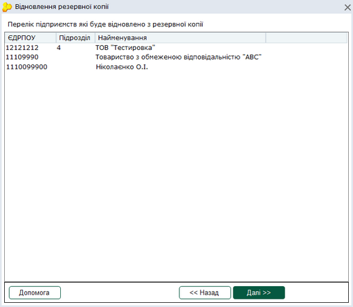

Натисніть, щоб збільшити малюнок

Пам'ятайте, що при відновленні копії .ZBF ВИДАЛЯЮТЬСЯ ВСІ дані поточної версії програми ТА ЗАМІЩУЮТЬСЯ даними резервної копії.

Для початку відновлення резервної копії натисніть на кнопку Далі.

6. Результатом відновлення буде запис у списку вікна вибору установи із назвою та кодом ЄДРПОУ (ДРФО) установи.

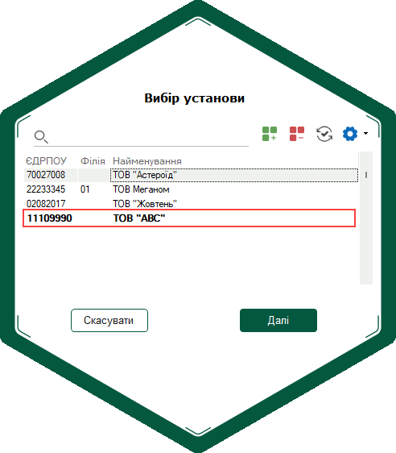

### Перенесення даних з БД Firebird або Oracle на БД PostgreSQL

_Шлях у довідці: Початок роботи в системі › Додавання підприємства › Перенесення даних з БД Firebird або Oracle на БД PostgreSQL_

Якщо раніше Ви працювали з програмою M.E.Doc на базі Firebird або Oracle, то можна перенести базу даних в програму M.E.Doc на базі БД PostgreSQL. Також можна перенести дані програми на базі Firebird до БД Oracle

Можливість використання БД PostgreSQL реалізовано для мережевого варіанту роботи M.E.DOC.

Перенесення даних та робота з БД PostgreSQL можлива за умови, якщо версії екземплярів ПЗ однакові (не нижче 11.02.061).

У відкритому вікні Майстер заповнення даних про підприємство для перенесення існуючої бази даних до нової БД оберіть опцію, залежно від СУБД, що використовується:

- Перенесення даних з БД M.E.Doc на базі Firebird;
- Перенесення даних з БД M.E.Doc на базі Oracle.

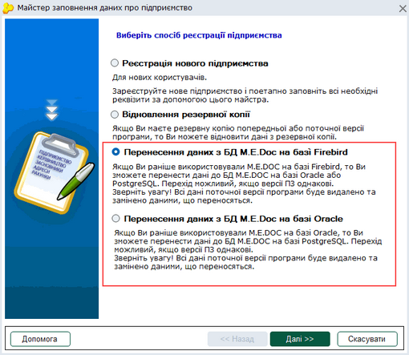

Натисніть, щоб збільшити малюнок

Докладно про перенесення даних давіться розділ [Процедура встановлення програми - Перехід з БД Firebird або Oracle на БД PostgreSQL](Help.html#help-setup_installation_program_perehod-postgresql).


