[← Зміст довідки](../)


# Налаштування підключень до служби серверу

## Налаштування підключень до служби серверу

_Шлях у довідці: Допоміжні сервіси › Налаштування підключень до служби серверу_

В цьому розділі:

[Де знайти утиліту ConnectionSetup.exe?](#connectionsetup-connectionsetup)

[Основні налаштування](#connectionsetup-connectionsetup)

[Налаштування для СКБД Firebird](#connectionsetup-connectionsetup)

[Налаштування для СКБД PostgreSQL](#connectionsetup-connectionsetup)

[Налаштування для СКБД Oracle](#connectionsetup-connectionsetup)

[Налаштування сервісу автоматичної обробки](#connectionsetup-connectionsetup)

[Створення самопідписаного ssl-сертифіката за допомогою утиліти ConnectionSetup](#connectionsetup-connectionsetup)

[Налаштування REST API](#connectionsetup-connectionsetup)

M.E.Doc Налаштування з'єднання – утиліта ConnectionSetup.exe призначена для відображення та зміни поточних налаштувань підключення до служби серверу, налаштування сервісу автоматичної обробки, а також підключення до бази даних FireBird,  PostgreSQL чи Oracle, якщо вони використовуються програмним комплексом.

ConnectionSetup.exe доступна у кореневому каталозі встановленої програми. Для клієнтських робочих місць (робочих станцій) утиліта стає доступною у кореневих каталогах кожної станції після успішного запуску та підключенні до серверної частини.

При запуску утиліти на локальній версії програми, доступна лише вкладка [Налаштування сервісу автоматичної обробки](#connectionsetup-connectionsetup).

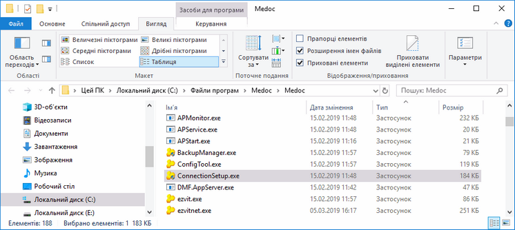

Натисніть, щоб збільшити малюнок

[До початку](#connectionsetup-connectionsetup)

Основні налаштування

Сервер - група атрибутів для налаштування підключення серверу до служби; налаштовується на комп'ютері із встановленою серверною частиною.

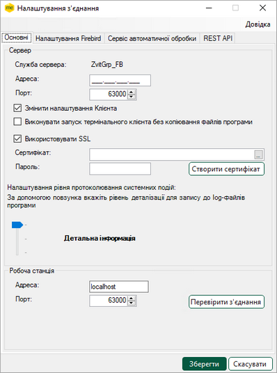

Натисніть, щоб збільшити малюнок

- Служба сервера - відображає назву служби, яку використовує програмний комплекс.
- Адреса - за замовчуванням, поле не заповнюється. За умови, що на комп'ютері зі встановленою серверною частиною програмного комплексу є кілька мережевих інтерфейсів (наприклад, локальна мережа та Wi-Fi), це поле заповнюється значенням IP-адреси поточного серверу, який використовується для підключення користувацьких робочих місць.
- Порт - номер порту, який використовується для з'єднання зі службою серверу.
- Змінити налаштування Клієнта - встановлена позначка в цьому полі дозволяє змінювати конфігураційний файл при наступних встановленнях клієнтських робочих станцій.
- Виконувати запуск термінального клієнта без копіювання файлів програми - запуск програми у термінальному режимі без копіювання системних бібліотек з кореневого каталогу серверної частини.
- Використовувати SSL - використання сертифіката з SSL-шифруванням для передачі даних між сервером і станцією. Для налаштування потрібно встановити опцію Використовувати SSL, в полі Сертифікат вказати шлях до файлу сертифіката у форматі pfx, у полі Пароль ввести пароль сертифіката. (Докладно про створення, додавання та підключення SSL-сертифіката дивіться у файлі інструкції, що знаходиться у каталозі встановлення програми ...\help\Інструкція по підключенню SSL-сертифіката.docx).
- Створити сертифікат - по натисканню кнопки за допомогою утиліти ConnectionSetup можна виконати створення самопідписаного SSL-сертифіката з параметрами вашого сервера. Докладно дивіться розділ [Створення самопідписаного ssl-сертифіката за допомогою утиліти ConnectionSetup](#connectionsetup-connectionsetup) та файл інструкцію, що знаходиться у каталозі встановлення програми ...\help\Інструкція по підключенню SSL-сертифіката.docx).
- Налаштування рівня протоколювання системних подій - налаштування рівня протоколювання системних подій для запису до log-файлів. Щоб змінити рівень збереження подій, натисніть лівою кнопку миші на повзунку та, утримуючи кнопку, перетягніть його догори або вниз. У вікні буде відображено повідомлення про рівень фіксації подій у програмі, що відповідає положенню повзунка. Налаштування доступні лише при запуску утиліти з кореневого каталогу серверної частини.
- Робоча станція - група атрибутів для налаштування підключення робочих станцій до серверу; налаштовується на клієнтських робочих місцях.

При запуску утиліти на клієнтських робочих місцях вкладка Основні матиме вигляд:

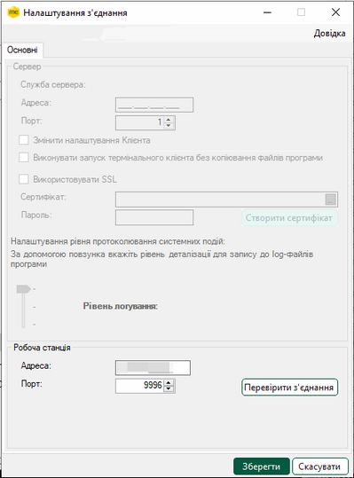

Натисніть, щоб збільшити малюнок

При запуску утиліти на клієнтських робочих місцях на вкладці Основні доступна лише група атрибутів Робоча станція, призначена для налаштування підключення робочої станцій до серверу.

У групі Робоча станція налаштовується адреса та порт підключення до служби серверу програми:

- Адреса - за умови, що на комп'ютері зі встановленою серверною частиною програмного комплексу кілька мережевих інтерфейсів, заповнюється значенням IP адреси серверу підключення користувацьких робочих місць (повинен бути ідентичним з IP-адресою вказаною на сервері), в інших випадках допускається введення доменного імені.
- Порт - номер порту, який використовується для з'єднання із сервером.
- Кнопка Перевірити з'єднання - по натисканню кнопки виконується перевірка роботи утиліти з вказаними параметрами без їх збереження. Якщо параметри вказані некоректно, відкриється вікно повідомлення:

Відкоригуйте налаштування та повторіть перевірку з'єднання. Якщо параметри вказано правильно, відкриється вікно повідомлення:

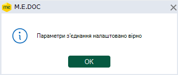

Збережіть правильні параметри, натиснувши кнопку Зберегти.

[До початку](#connectionsetup-connectionsetup)

Якщо програма використовує сервер Firebird

Налаштування Firebird - група атрибутів для налаштування підключення до бази даних Firebird. Доступно для редагування, якщо використовується база даних Firebird.

- Використовувати FB сервер - встановлена позначка в цьому полі вмикає налаштування Firebird.
- Адреса - IP-адреса комп'ютера із встановленою базою Firebird.
- Порт - номер порту, який використовується для з'єднання з базою Firebird. Змінені значення в цьому полі впливають лише на налаштування ПК M.E.Doc.
- Розміщення БД - шлях до розміщення бази Firebird.
- Максимальна кількість одночасних підключень - максимальна кількість одночасних під'єднань до бази даних. За замовчуванням, = 100.
- Користувач та Пароль - ім'я та пароль адміністратора бази даних. При встановленні серверної частини програми (встановлення мережевого варіанту) пропонується використовувати пароль адміністратора бази даних, заданий за замовчуванням.

Ви можете змінити пароль користувача бази даних на власний під час [встановлення серверної частини програми](Help.html#help-setup_installation_program_server) з дистрибутиву, або вже після встановлення за допомогою ConnectionSetup.exe.

- Додаткові налаштування - доступно для налаштування СКБД Firebird 2 та 3,
Для налаштування особистих параметрів Firebird зверніться до вашого Адміністратора.

Зверніть увагу! За замовчуванням разом із встановленням M.E.Doc встановлюється версія Firebird 3 у режимі Classic. Щоб змінити конфігурацію за замовчуванням, у вікні Додаткові налаштування Firebird у полі Архітектура СКБД оберіть потрібну конфігурацію.

Якщо змінювати значення в полі Порт в додаткових налаштуваннях, то зміни виконаються як в Firebird, так і в ПК M.E.Doc.

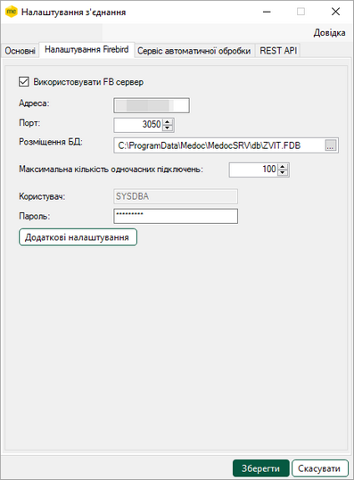

Натисніть, щоб збільшити малюнок

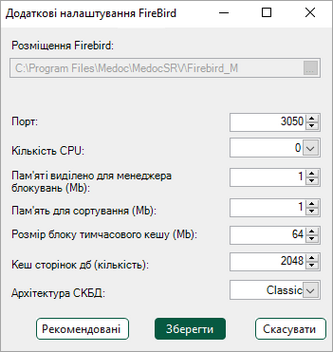

Натисніть, щоб збільшити малюнок

[До початку](#connectionsetup-connectionsetup)

Якщо програма використовує сервер PostgreSQL

Налаштування PostgreSQL - група атрибутів для налаштування підключення до бази даних PostgreSQL. Доступно для редагування, якщо використовується база даних PostgreSQL.

- Адреса - IP-адреса комп'ютера із встановленою базою PostgreSQL.
- Порт - номер порту, який використовується для з'єднання з базою PostgreSQL.
- Ім'я бази даних - ім'я бази даних PostgreSQL.
- Користувач та Пароль - ім'я та пароль адміністратора бази даних. При встановленні серверної частини програми (встановлення мережевого варіанту) пропонується використовувати пароль адміністратора бази даних, заданий за замовчуванням.

Ви можете змінити пароль користувача бази даних на власний під час [встановлення серверної частини програми](Help.html#help-setup_installation_program_server) з дистрибутиву, або вже після встановлення за допомогою ConnectionSetup.exe.

- Максимальна кількість одночасних підключень - максимальна кількість одночасних під'єднань до бази даних. За замовчуванням - 100.
- Додаткові налаштування - якщо опцію встановлено, на вкладці доступні поля для налаштування параметрів:
- Timeout (sec) – час очікування (у секундах) після спроби виконання команди до формування повідомлення про помилку;
- Cancellation Timeout (ms) – час очікування (у мілісекундах) відповіді на скасований запит або запит, час очікування якого збіг, до створення повідомлення про помилку.

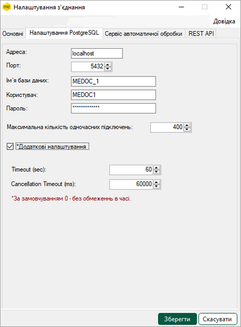

Натисніть, щоб збільшити малюнок

[До початку](#connectionsetup-connectionsetup)

Якщо програма працює під управлінням СКБД Oracle

Зверніть увагу!

У програмі реалізована повноцінна підтримка роботи з 64-х бітною архітектурою операційних систем Windows. Для користувачів з встановленою х64 розрядною ОС, після встановлення оновлення виконується автоматичний перехід у даний режим.

Після оновлення програми буде задіяно роботу з додатковою бібліотекою у режимі Direct, яка дозволить виконувати з’єднання з БД напряму без використання клієнта Oracle. Даний режим буде увімкнено за замовчуванням.

У вкладку Налаштування Oracle додана можливість вибору способу з'єднання з базою даних -  пряме з'єднання чи за допомогою клієнта Oracle.

З поточної версії доступні обидва способи з'єднання з БД - пряме та за допомогою клієнта Oracle.

Клієнт Oracle, який використовується для з'єднання з БД, повинен мати ту ж розрядність, що і ОС Windows.

Тому, для 64х розрядної ОС потрібно встановити 64х розрядний клієнт Oracle.

Вкладка Налаштування Oracle містить групи атрибутів для налаштування підключення до бази даних Oracle. Вкладка доступна, якщо програма працює під управлінням СКБД Oracle.

Група Direct містить параметри, що заповнюються при використанні прямого з'єднання з БД.

Група Client - параметри,  що заповнюються при використанні клієнта Oracle.

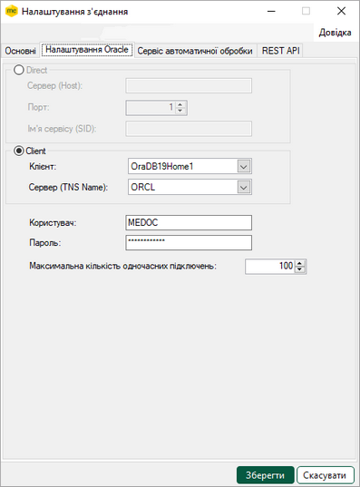

Натисніть, щоб збільшити малюнок

- Direct - встановлена позначка означає, що використовується пряме з'єднання з БД.
- Сервер (Host): IP адреса сервера, де встановлена база даних Oracle,
- Порт - порт, який використовує Oracle,
- Ім'я сервісу (SID) - ідентифікатор БД Oracle.
- Client - встановлена позначка означає, що для з'єднання з БД використовується клієнт Oracle.
- Клієнт - викликається список встановлених клієнтів Oracle відповідної розрядності. Якщо на комп'ютері встановлені декілька клієнтів, у цьому полі можливо обрати із списку бажаний клієнт.
- Сервер (TNS Name) - глобальне ім’я бази даних.
- Користувач - ім’я користувача системи з правами адміністратора.
- Пароль - пароль користувача для підключення до схеми.
- Максимальна кількість одночасних підключень - максимальна кількість одночасних під'єднань до бази даних. За замовчуванням, = 100.

[До початку](#connectionsetup-connectionsetup)

Налаштування сервісу автоматичної обробки

На цій вкладці налаштовується робота служби автоматичного обробника документів по всім організаціям.

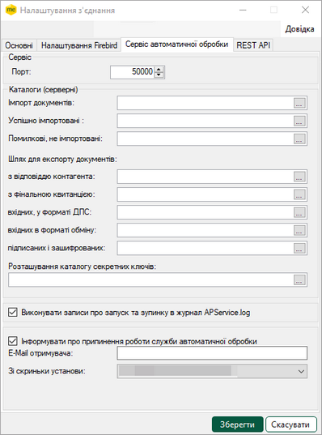

Натисніть, щоб збільшити малюнок

- Каталоги (серверні) - в полях цього блоку вказуються каталоги на сервері для імпорту та експорту документів (Для локального варіанту роботи обираються каталоги комп'ютера, на якому встановлено програму).
- Розташування каталогу секретних ключів - шлях до каталогу для локального збереження секретних ключів.
- Виконувати записи про запуск та зупинку в журнал APService.log - якщо параметр встановлено, то в журнал автообробника APService.log виконуються записи про дату та час запуску; користувача, який запустив; модулі, які були запущені; дату та час зупинки. Також виконуються записи про інші події (наприклад, помилки) в журнал APService.trace.{date}.log.
- Інформувати про припинення роботи служби автоматичної обробки - якщо параметр встановлено, то після припинення роботи служби автоматичної обробки на вказану електронну адресу буде відправлений лист-повідомлення.
- E-Mail отримувача - електронна адреса, на яку відправляються листи-повідомлення про припинення роботи служби.
Поле доступне для заповнення, якщо відмічений параметр "Інформувати про припинення роботи служби автоматичної обробки".

- Зі скриньки установи - обирається електронна адреса, з якої відправляються листи-повідомлення.
Поле доступне для заповнення, якщо відмічений параметр Інформувати про припинення роботи служби автоматичної обробки.

[До початку](#connectionsetup-connectionsetup)

Створення самопідписаного ssl-сертифіката за допомогою утиліти ConnectionSetup

В мережевому варіанті M.E.Doc для шифрування каналу зв'язку між серверною частиною і станцією передбачено можливість підключити SSL-сертифікат.

Створити самопідписаний SSL-сертифікат з параметрами, необхідними для коректної роботи, можна засобами утиліті ConnectionSetup.

Докладно про створення (отримання) SSL-сертифікатів, їх імпорт у сховище та підключення для роботи у мережевому режимі дивіться у файлі інструкції, що знаходиться у каталозі встановлення програми ...\help\Інструкція по підключенню SSL-сертифіката.docx)

Важливо!

- Використовувати самопідписаний SSL-сертифікат можуть досвідчені користувачі, які усвідомлюють ризики самопідписаних сертифікатів.
- Користувачам, що ще не мають досвіду в області ІТ безпеки, для отримання SSL-сертифіката рекомендується звернутися до довіреного видавця сертифікатів.

Для створення самопідписаного SSL-сертифіката, виконайте операцій:

1.  Відкрийте утиліту ConnectionSetup, перейдіть на вкладку Основні.

2.  Встановіть опцію Використовувати SSL. Натисніть кнопку Створити сертифікат.

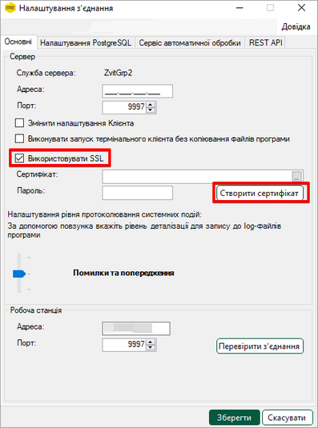

Натисніть, щоб збільшити малюнок

3.  У вікні, що відкриється, перевірте та, у разі потреби, відкоригуйте поле Ім'я сервера. Поле повинно містити ім’я ПК, на якому встановлено сервер.

Якщо сертифікат створюється на сервері, ім'я сервера співпадає з іменем ПК та заповнюється у полі за замовчуванням.

Якщо сертифікат створюється для сервера, що розташований на іншому ПК, у полі Ім'я сервера введіть ім'я ПК, на якому встановлено сервер.

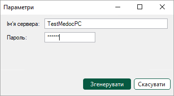

4.  У полі Пароль введіть секретний пароль довжиною до 32 символів.

5.  Натисніть кнопку Згенерувати.

6.  У наступному вікні оберіть папку для збереження файлів сертифіката.

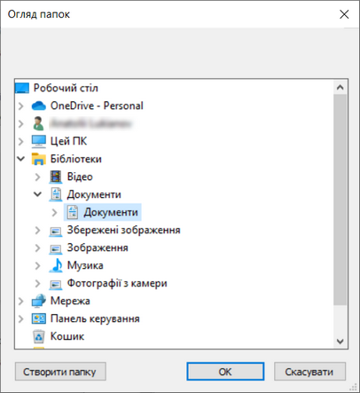

Натисніть, щоб збільшити малюнок

7.  У обрану папку буде збережено сертифікат у форматах \*.crt, \*.pfx. Програма повідомить про результат виконання операції. Для продовження натисніть ОК.

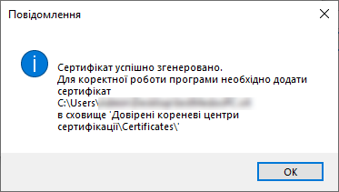

8.  Шлях збереження файлів сертифікату (п. 6) та пароль (п. 3), які були зазначені під час створення сертифіката, будуть відображені у відповідних полях Сертифікат і Пароль на вкладці Основні утиліти ConnectionSetup (якщо поля не були заповнені до створення сертифікату).

У разі, якщо поля Сертифікат і Пароль на вкладці Основні були заповнені до створення сертифіката, їх значення не змінюється. За потреби, значення полів можна змінювати вручну.

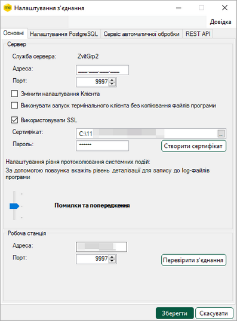

Натисніть, щоб збільшити малюнок

Важливо!

Для коректної роботи M.E.Doc з створеним SSL-сертифікатом його необхідно імпортувати в сховище Довірені кореневі центри сертифікації\Certificates\ серверу і всіх станцій (докладно про імпорт сертифікатів у сховище див. файл інструкції, що знаходиться у каталозі встановлення програми ...\help\Інструкція по підключенню SSL-сертифіката.docx).

[До початку](#connectionsetup-connectionsetup)

Налаштування REST API

Функціонал M.E.Doc REST API доступний при використанні мережевого варіанту роботи програми у клієнт – серверній конфігурації. Для коректної роботи з методами M.E.Doc REST API необхідно мати ліцензію Інтеграція з обліковими системами.

Сервіс REST API необхідно запускати разом зі службою сервера.

Для налаштування підключення сервісу виконайте операції:

1. Відкрийте утиліту ConnectionSetup. Перейдіть на вкладку REST API.

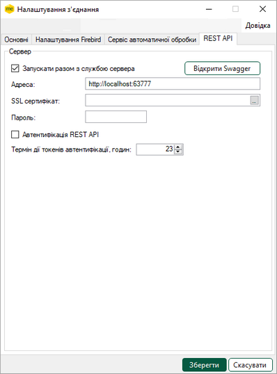

Натисніть, щоб збільшити малюнок

2. Заповніть необхідні значення у полях:

- Адреса – URL, на якому розташована служба M.E.Doc REST API, сервіс може працювати по HTTP або HTTPS протоколу. При роботі по HTTPS протоколу необхідно вказати SSL сертифікат;
- Сертифікат (у разі потреби) – шлях до SSL сертифікату, допускається використання самопідписаного сертифіката, який можна створити у вкладці [Основні](#connectionsetup-connectionsetup). Важливо. При використанні SSL сертифіката в адресі необхідно вказати HTTPS протокол. Наприклад: https://localhost:63777;
- Пароль (у разі потреби) – пароль SSL сертифіката;
- Запускати разом з службою сервера – якщо опція встановлена, служба M.E.Doc REST API запускається автоматично під час запуску сервера.

3. Для покращення контролю над доступом до системи передбачено можливість роботи з використанням токенів автентифікації X-API-Key. Для налаштування використання автентифікації необхідно в утиліті ConnectionSetup.exe увімкнути автентифікацію та, у разі потреби, налаштувати час життя токена автентифікації X-API-Key:

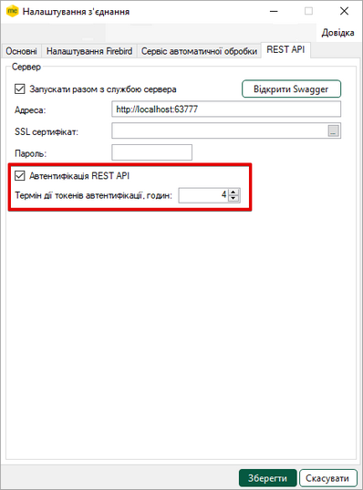

Натисніть, щоб збільшити малюнок

Для автентифікації в системі використовується метод REST API /api/System/login. Під час подальшої роботи з M.E.Doc REST API, всі методи, окрім метода автентифікації /api/System/login будуть вимагати наявності токена автентифікації в транспортному заголовку.

4. Збережіть зміни, натиснувши кнопку Зберегти, та перезавантажте службу.

5. Для тестування рекомендуємо використати підключений інструмент розробника - Swagger. Для переходу до сторінки Swagger необхідно використовувати URL сервісу, що міститься у полі Адреса на вкладці REST API. Щоб швидко відкрити сторінку в браузері з адресою, яка вказана в налаштуваннях в полі Адреса, натисніть кнопку Відкрити Swagger.

Cторінка в браузері має вигляд:

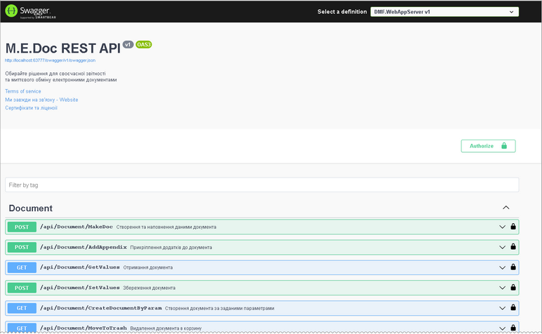

Натисніть, щоб збільшити малюнок

[До початку](#connectionsetup-connectionsetup)


