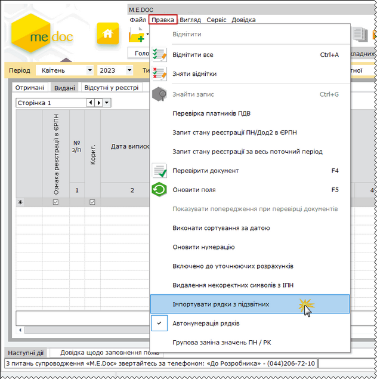
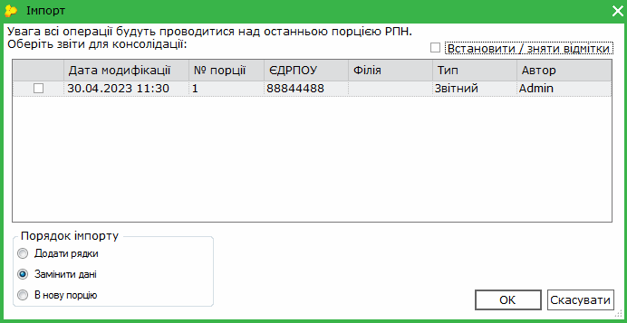
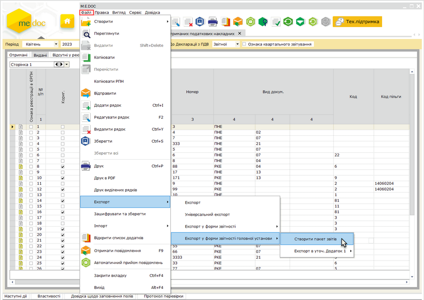
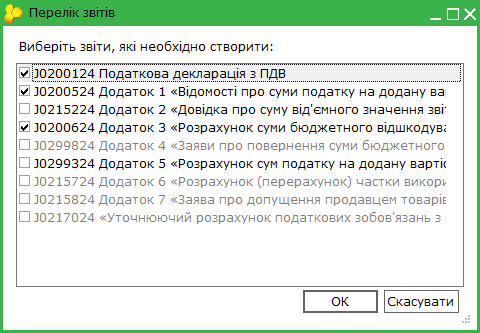
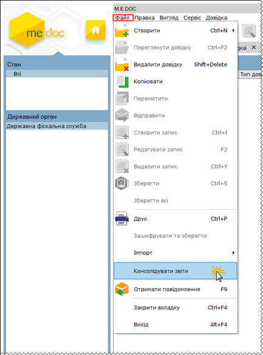

[← Зміст довідки](../)


# Додаткові функції

## Додаткові функції

_Шлях у довідці: Розділи програми › Корпорація › Додаткові функції_

У даному розділі довідки розглянуто наступне:

- [РПН в режимі M.E.Doc.Корпорація](#consrst-m_e_doc-corp_dod_reestr_rnn)
- [Консолідація Запитів щодо відомостей з ЄРПН](#consrst-m_e_doc-corp_dod_reestr_cons)

### РПН в режимі M.E.Doc.Корпорація

_Шлях у довідці: Розділи програми › Корпорація › Додаткові функції › РПН в режимі M.E.Doc.Корпорація_

В цьому розділі:

[Імпорт рядків з підзвітних](#consrst-m_e_doc-corp_dod_reestr_rnn)

[Експорт у форми звітності головної установи](#consrst-m_e_doc-corp_dod_reestr_rnn)

Імпорт рядків з підзвітних установ

У модулі Реєстр отриманих і виданих податкових накладних можливо імпортувати рядки від отриманих підзвітних організацій.

1. У меню Правка оберіть команду Імпортувати рядки з підзвітних.

2. Відкриється вікно Імпорт. У вікні відображається перелік Реєстрів ПН підзвітних підприємств обраного звітного періоду.

3. Встановіть галочки біля Реєстрів, рядки з яких потрібно імпортувати.

4. Оберіть порядок імпорту:

- Додати рядки - використовується для додавання до збереженого в системі реєстру податкових накладних нових рядки із імпортованого реєстру (додається до останньої порції РПН);
- Замінити дані - використовується для повної заміни раніше збереженого в системі реєстру (замінюються данні останньої порції РПН);
- В нову порцію - створиться нова Порція для імпортованих накладних. Якщо кількість податкових перевищить визначену, створиться наступна Порція, куди буде розміщено решта податкових.

5. Натисніть кнопку Ок для початку імпорту рядків

[До початку](#consrst-m_e_doc-corp_dod_reestr_rnn)

Експорт у форми звітності головної установи

У модулі Реєстр отриманих і виданих податкових накладних додана можливість формувати форми звітності головної установи пакетом шляхом експорту даних із Реєстру.

На підставі Реєстру виданих та отриманих податкових накладних в програмі в автоматичному режимі формуються наступні звіти в єдиний пакет:

- Декларація з ПДВ;
- Розрахунок коригування сум ПДВ до податкової декларації з податку на додану вартість;
- Розшифровки до декларації з ПДВ у розрізі контрагентів;
- Уточнюючі розшифровки до декларації з ПДВ у розрізі контрагентів;
- інші додатки до Декларації.

Формування вказаних звітів відбувається за допомогою функції експорту даних із Реєстру.

Для початку експорту в меню Файл оберіть функцію Експорт - Експорт у форми звітності головної установи і далі Створити пакет звітів.

Натисніть на рисунок, щоб збільшити його

Відкриється модальне вікно Перелік звітів. Позначте галочками документи, що потрібно сформувати. Натисніть кнопку ОК.

Зверніть увагу! Вивантажуються записи Реєстру лише Головної установи, тобто тих, у яких незаповнені поля ЄДРПОУ та Філія.

[До початку](#consrst-m_e_doc-corp_dod_reestr_rnn)

### Консолідація Запитів щодо відомостей з ЄРПН

_Шлях у довідці: Розділи програми › Корпорація › Додаткові функції › Консолідація Запитів щодо відомостей з ЄРПН_

У модулі Податкові довідки - Інформаційна довідка реалізовано можливість консолідувати Запити щодо отримання відомостей з Єдиного реєстру податкових накладних.

1. Виділіть Запити, як потрібно об’єднати.

2. Оберіть команду Файл - Консолідувати звіти.

Натисніть на картинку, щоб збільшити її


