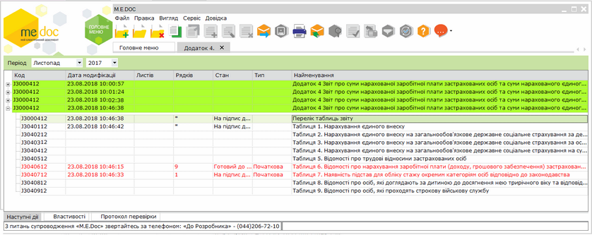
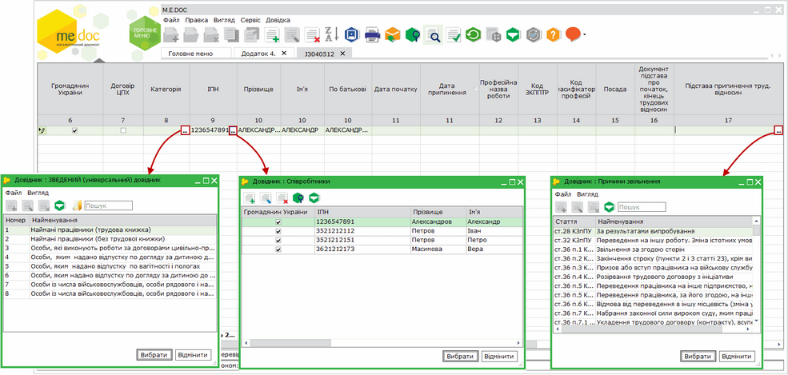
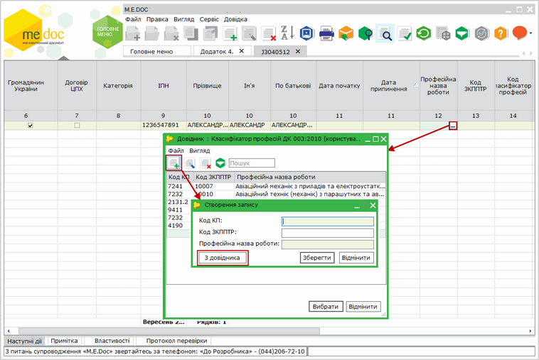
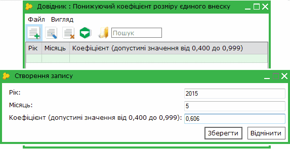
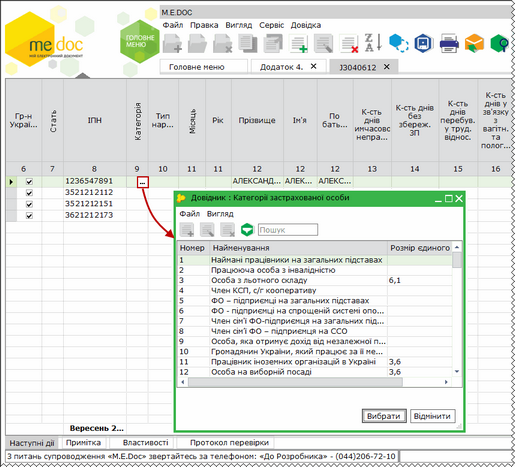
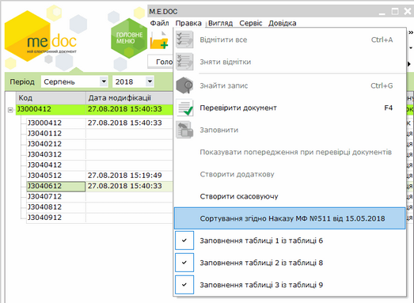
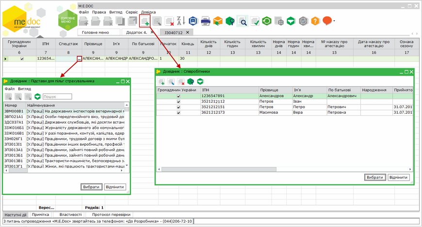
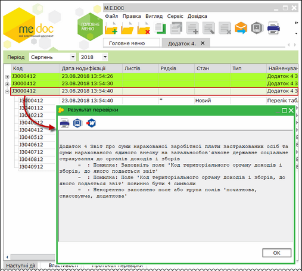

[← Зміст довідки](../)


# Процедура формування звіту з єдиного внеску

## Процедура формування звіту з єдиного внеску

_Шлях у довідці: Розділи програми › Звітність › Єдиний внесок › Додаток 4 " Звіт про суми нарахованої заробітної плати застрахованих осіб та суми нарахованого єдиного внеску на загальнообов’язкове державне соціальне страхування" › Процедура формування звіту з єдиного внеску_

ВАЖЛИВО!

Впроваджено щомісячні звіти за новою формою (версія 13), затверджені наказом Міністерства фінансів України від 05.11.2020 р. № 670.

Підприємства, установи, організації, фізичні особи подають звіти з 01.02.2021 року за новою формою (версія 13) тільки з типом форми ліквідаційна (у разі проведення державної реєстрації припинення до 28 лютого 2021 року) та з типом форми додаткова та скасовуюча за періоди з січня 2016 року по грудень 2020 року включно.

В даній довідці описана процедура створення Додатку 4 попередньої версіі (12) до 1 січня 2021 року.

З періоду за "червень, 2016" змінена версія бланків звіту та код всіх таблиць звіту для всіх додатків з ЄСВ з І на коди J та F:

- J - для юридичних осіб;
- F - для фізичних осіб-підприємців та осіб, що займаються незалежною професійною діяльністю.

Модуль Єдиний внесок викликається із Головного меню - Звітність - Єдиний внесок. Розділ Єдиний внесок містить підрозділи, що відповідають певним Додаткам.

У відкритому вікні Додатку 4 представлені всі документи звітності по єдиному внеску: документи, які входять в Додаток 4 для всіх страхувальників, що повинні подавати такий звіт щомісячно.

Натисніть, щоб збільшити малюнок

Описані нижче звіти подаються всіма юридичними особами, які використовують найману працю, незалежно від системи оподаткування.

Ці страхувальники подають звіт з єдиного внеску щомісячно.

Таблиці з 5 по 9 відкриваються у вигляді Друкованих форм (що представляє документ, який подається в ДПСУ), так їх легше заповнювати та редагувати.

Електронні таблиці звітів відкриваються лише для перегляду із меню Правка/ Електронна форма, а також за допомогою функціональної клавіші F11. Редагування звітів у цьому вигляді неможливе.

Таблиці 5-9 одразу створюються з ознакою "Початкова" (ознаку видно в Електронній таблиці звіту (перегляд по F11) та у таблиці модуля Єдиний внесок в колонці Тип.

Процедура формування документів розпочинається з вибору звітного періоду на панелі інструментів. Всі таблиці та звіти, які Ви відкриватимете далі, будуть створюватися у заданому звітному періоді, наприклад:

Створювати звіти рекомендується в наступному порядку: Таблиця 5, Таблиця 6, Таблиця 7, Таблиця 1 та загальний звіт з переліком таблиць.

Перед початком роботи рекомендуємо ознайомитись з останніми нормативними матеріалами щодо ЄСВ:

- [Наказ Мінфіну № 435 від 14.04.2015 «Про затвердження Порядку формування та подання страхувальниками звіту щодо сум нарахованого єдиного внеску на загальнообов’язкове державне соціальне страхування»](http://zakon4.rada.gov.ua/laws/show/z0460-15)
- [Наказ Мінфіну № 449 від 20.04.2015 «Про затвердження Інструкції про порядок нарахування і сплати єдиного внеску на загальнообов'язкове державне соціальне страхування»](http://zakon2.rada.gov.ua/laws/show/z0508-15)
- [Наказ Мінфіну № 441 від 11.04.2016 «Про внесення змін до Порядку формування та подання страхувальниками звіту щодо сум нарахованого єдиного внеску на загальнообов’язкове державне соціальне страхування»](http://zakon2.rada.gov.ua/laws/show/z0682-16/)
- [Наказ Мінфіну № 511 від 15.05.2018 «Про внесення змін до Порядку формування та подання страхувальниками звіту щодо сум нарахованого єдиного внеску на загальнообов'язкове державне соціальне страхування»](https://zakon.rada.gov.ua/laws/show/z0692-18#Text)
- [Наказ Мінфіну № 469 від 04.05.2018 «Про внесення змін до Інструкції про порядок нарахування і сплати єдиного внеску на загальнообов’язкове державне соціальне страхування»](https://zakon.rada.gov.ua/laws/show/z0645-18#Text)
- [Наказ Мінфіну N 670 від 05.11.2020 «Про затвердження Змін до Порядку формування та подання страхувальниками звіту щодо сум нарахованого єдиного внеску на загальнообов'язкове державне соціальне страхування»](https://zakon.rada.gov.ua/laws/show/z1289-20#Text)

Таблиці 1, 5, 6 та 7 формують та подають роботодавці, які використовують працю фізичних осіб на умовах трудового договору (контракту) або на інших умовах, передбачених законодавством, чи за цивільно-правовими договорами (крім цивільно-правового договору, укладеного з фізичною особою - підприємцем, якщо виконувані роботи (надані послуги) відповідають видам діяльності, зазначеним у свідоцтві про державну реєстрацію його, як підприємця).

Таблиці 2 та 8 формуються та подаються лише районними (міськими) управліннями праці та соціального захисту населення про нарахування сум єдиного внеску (грошового забезпечення) батькам-вихователям дитячих будинків сімейного типу, прийомним батькам, якщо вони отримують грошове забезпечення відповідно до законодавства, та за осіб, які відповідно до закону отримують допомогу по догляду за дитиною до досягнення нею трирічного віку, та за одного непрацюючого працездатного батька, усиновителів, опікунів, піклувальників, які фактично здійснюють догляд за дитиною-інвалідом, а також непрацюючих працездатних осіб, які здійснюють догляд за інвалідом І групи або за престарілим, який за висновком медичного закладу потребує постійного стороннього догляду або досяг 80-річного віку, якщо такі непрацюючі працездатні особи отримують допомогу або компенсацію відповідно до законодавства.

Таблиці 3 та 9 формуються та подаються страхувальниками (військовими частинами), які нараховують та сплачують єдиний внесок за осіб, які проходять строкову військову службу у Збройних Силах України, інших, утворених відповідно до закону, військових формувань, Службі безпеки України, органах Міністерства внутрішніх справ України та службу в органах і підрозділах цивільного захисту.

Таблицю 4 формують та подають страхувальники (органи, які виплачують грошове забезпечення), що нараховують та сплачують єдиний внесок за осіб із числа військовослужбовців (крім військовослужбовців строкової та альтернативної служби), осіб рядового і начальницького складу.

У всіх випадках створення таблиць страхувальниками автоматично створюється звіт з Переліком таблиць звіту, який повинен подаватися разом з таблицями.

Якщо Ви помилково відкрили звіт, який не повинні подавати або ж у поточному періоді звіт не заповнюється через відсутність даних, його потрібно видалити.

Для видалення помилкового звіту необхідно виділити його курсором миші в таблиці та виконати команду Файл/Видалити (аналогічно – кнопка  на панелі інструментів модуля або  клавіша Delete).

Якщо у вас наявна ліцензія на використання модуля M.E.Doc.Зарплата, на панелі інструментів доступна кнопка Заповнити , за допомогою якої можна автоматично заповнити звіт даними, які внесені у модулі M.E.Doc.Зарплата.

### Таблиця 5 "Трудові відносини застрахованих осіб"

_Шлях у довідці: Розділи програми › Звітність › Єдиний внесок › Додаток 4 " Звіт про суми нарахованої заробітної плати застрахованих осіб та суми нарахованого єдиного внеску на загальнообов’язкове державне соціальне страхування" › Процедура формування звіту з єдиного внеску › Таблиця 5 "Трудові відносини застрахованих осіб"_

ВАЖЛИВО!

Впроваджено щомісячні звіти за новою формою (версія 13), затверджені наказом Міністерства фінансів України від 05.11.2020 р. № 670.

Підприємства, установи, організації, фізичні особи подають звіти з 01.02.2021 року за новою формою (версія 13) тільки з типом форми ліквідаційна (у разі проведення державної реєстрації припинення до 28 лютого 2021 року) та з типом форми додаткова та скасовуюча за періоди з січня 2016 року по грудень 2020 року включно.

В даній довідці описана процедура створення Додатку 4 попередньої версіі (12) до 1 січня 2021 року.

Таблиця 5 призначена для реєстрації застрахованих осіб у реєстрі застрахованих осіб.

Таблиця 5 подається страхувальником, якщо протягом звітного періоду:

- було укладено або розірвано трудовий договір (цивільно-правовий договір, крім цивільно-правового договору, укладеного з фізичною особою - підприємцем, якщо виконувані роботи (надавані послуги) відповідають видам діяльності, зазначеним у витягу з Єдиного державного реєстру юридичних осіб та фізичних осіб - підприємців) із застрахованою особою;
- було укладено або розірвано трудовий договір із застрахованою особою, яка працевлаштована на нове робоче місце;
- особі надано відпустку по догляду за дитиною від трирічного віку до досягнення нею шестирічного віку;
- особі надано відпустку по догляду за дитиною до досягнення нею трирічного віку;
- особі надано відпустку по вагітності і пологах.

Якщо у pеєстрі співробітників (довідник Співробітники) заповнені дата прийняття на роботу та дата звільнення з роботи, то Таблиця 5 сформується АВТОМАТИЧНО на підставі внесених у картку Фізичної особи даних.

У Таблиці 5 будуть створені рядки з записами прийнятих та звільнених працівників, та тих, у яких змінились ці дані. У колонки День початку та День припинення будуть перенесені дані із карток Фізичних осіб (відповідно - день, в який працівник прийнятий на роботу, та день звільнення з роботи).

Натисніть, щоб збільшити малюнок

- У цей звіт можна додавати записи за допомогою кнопки  на панелі інструментів або комбінацією клавіш Ctrl+I. Це можуть бути, наприклад, працівники, яким надано відпустки по догляду за дитиною чи пологах.

Записи в Таблицю 5 можуть бути додані лише із довідника Співробітники.

- У полі Категорія підключений довідник Категорії застрахованої особи, із якого потрібно обрати відповідну категорію. Також категорію можна вносити вручну із клавіатури.
- У полі Підстава припинення труд. відносин підключений довідник Причини звільнення. Із довідника обирається стаття КЗпПУ, на підставі якої працівник звільнений з посади.
- У полях Професійна назва роботи, Код класифікатор професій та Код ЗКППТР підключений довідник Класифікатор професій ДК 003:2010 (користувача). Поле Код ЗКППТР необов'язкове для заповнення.
- У довіднику Класифікатор професій ДК 003:2010 (користувача) користувачі мають змогу налаштувати персональний класифікатор професій, що застосовується на підприємстві.
- У вікні довідника можливо самостійно додати код КП та професійну назву роботи, або, натиснувши кнопку З довідника, обрати професію з Класифікатора професій ДК 003:2010:

Натисніть, щоб збільшити малюнок

Будьте уважні при самостійному введенні інформації у довідник, переконайтеся у коректності даних, що вводяться.

- Значення поля Військове звання обирається з однойменного довідника.

У випадку, якщо дані у картці Фізична особа не актуальні, їх можна відредагувати безпосередньо із таблиці. Якщо співробітник новий, і він відсутній у довіднику, існує можливість спочатку додати його в довідник, а потім перенести в таблицю.

Для редагування неактуальних даних співробітника:

- натиснути на кнопку ;
- у відкритому довіднику Співробітники знайти та виділити потрібний запис;
- кнопкою  відкрити картку Фізична особа;
- в картці виправити помилкові дані чи неточності, зберегти внесені зміни та закрити картку Фізична особа;
- далі цей виправлений запис кнопкою Вибрати додається в новий рядок Таблиці 5.

Для додавання нового співробітника у довідник Співробітники:

- натиснути на кнопку  на панелі інструментів відкритої таблиці 5;
- у відкритому довіднику Співробітники кнопкою  додати запис нового співробітника;
- внести та зберегти дані нового працівника. Після закриття заповненої картки у реєстрі співробітників буде створений запис щойно доданої особи;
- для внесення такого працівника у Таблицю 5 потрібно натиснути на кнопку Вибрати у довіднику Співробітники.

Після формування таблиці потрібно оновити поля (команда Правка/Оновити поля або F5), перевірити звіт (на вкладці Наступні дії команда Перевірити звіт) та зберегти (Ctrl+S).

Для зручної роботи з даними є можливість сортувати дані співробітників у Таблиці 5 за ІПН, ПІБ та іншими параметрами. Для сортування натисніть на заголовок відповідної колонки.

Також можна зберегти Таблицю 5 у форматі pdf. Для цього у вкладці відкритої таблиці виконайте команду меню Файл - Друк у pdf.

За замовчуванням, дані, збережені у форматі pdf, відсортовані по алфавіту за прізвищами співробітників. Щоб зберегти сортування співробітників за ІПН або іншими параметрами, перед друком у pdf відсортуйте таблицю за потрібною колонкою та виконайте команду меню Файл – Зберегти сортування таблиці. Після чого оновіть поля (F5) та перерахуйте документ (F6).

### Таблиця 6 "Відомості про нарахування заробітної плати (доходу) застрахованим особам"

_Шлях у довідці: Розділи програми › Звітність › Єдиний внесок › Додаток 4 " Звіт про суми нарахованої заробітної плати застрахованих осіб та суми нарахованого єдиного внеску на загальнообов’язкове державне соціальне страхування" › Процедура формування звіту з єдиного внеску › Таблиця 6 "Відомості про нарахування заробітної плати (доходу) застрахованим особам"_

ВАЖЛИВО!

Впроваджено щомісячні звіти за новою формою (версія 13), затверджені наказом Міністерства фінансів України від 05.11.2020 р. № 670.

Підприємства, установи, організації, фізичні особи подають звіти з 01.02.2021 року за новою формою (версія 13) тільки з типом форми ліквідаційна (у разі проведення державної реєстрації припинення до 28 лютого 2021 року) та з типом форми додаткова та скасовуюча за періоди з січня 2016 року по грудень 2020 року включно.

В даній довідці описана процедура створення Додатку 4 попередньої версіі (12) до 1 січня 2021 року.

---

Зверніть увагу!

У зв'язку зі змінами, внесеними Законом України № 909-VIII від 24.12.2015 р, починаючи зі звітного періоду "Січень, 2016 р." відмінено утримання ЄСВ з доходу працівника, тому в Таблиці 6 не заповнюється реквізит 20 «Сума утриманого єдиного внеску за звітний місяць (із заробітної плати / доходу)».

Ці рядки не заповнюються для звітних даних, починаючи з нарахувань за січень 2016 р.

Але у випадку внесення в Таблицю 6 сум із знаком «-» при перерахунку відпускних, нарахованих у попередніх періодах та у зв’язку з тимчасовою втратою працездатності, такі суми із знаком "-" переносяться у рядки 4 та 5 Таблиці 1.

Скасований контроль на обов'язковість заповнення п.4 і п.5 таблиці.

По нарахуваннях з типом 2 і 3 розрахунок проводиться за тими ставками, які діяли в періоді нарахованого доходу. Тому розрахункові дані в Таблиці 6 будуть заповнюватися вручну, і вноситись в Таблицю 1.

Також відмінене використання понижуючого коефіцієнта розміру єдиного внеску.

---

Під час створення таблиці з версією "І" у періодах за ("Травень, 2015 р. - Грудень, 2015 р.) відображається інформаційне повідомлення:

Якщо понижуючий коефіцієнт не використовується, він не включається у розрахунки в Таблиці 6.

Якщо установа використовує понижуючий коефіцієнт єдиного внеску, [обов'язково потрібно заповнити новий довідник](UCContribution.html#uccontribution-contribution_before) "Понижуючий коефіцієнт розміру єдиного внеску".

Якщо користувач не заповнив цей довідник перед початком створення звіту за звітний період Травень, 2015, програма відкриває його автоматично.

Створіть у довіднику запис, що містить понижуючий коефіцієнт розміру єдиного внеску за Травень 2015 р.

Коефіцієнт автоматично застосовується при розрахунках розміру єдиного внеску у звітних періодах (травень - грудень) 2015 року.

Починаючи із звітного періоду "Січень, 2016 р. коефіцієнт більше не використовується і не включається у розрахунки в таблиці.

Для співробітників, які працюють неповний робочий час, рекомендовано [встановити відповідну позначку в картці](UCContribution.html#uccontribution-contribution_before)[Фізична особа](UCContribution.html#uccontribution-contribution_before).

Можливо встановити відмітку в колонці "Неповний роб. час" безпосередньо у таблиці.

Ознака використовується для контролю сум донарахування до мінімальної заробітної плати.

Звіт створюється по всьому реєстру співробітників, які працювали у відповідному звітному періоді, враховуються дати прийняття та звільнення, а також наявність позначки у полі Ознака фізичної особи СПД у картках Фізичних осіб.

Після відкриття таблиця АВТОМАТИЧНО заповнюється списком із реєстру співробітників.

Якщо в картці співробітника заповнені відповідні поля, дані з них будуть перенесені в поля таблиці:

- Громадянин України ("галочку" можна також проставити вручну),
- Чоловік/Жінка (можна також вибрати у відповідній колонці),
- Ознака наявності трудової книжки ("галочку" можна також проставити вручну),
- Спецстаж - якщо заповнена група Спецстаж ("галочку" можна також проставити вручну).
- Ознака неповного робочого часу

Далі для кожної особи потрібно заповнити дані у рядку.

Натисніть, щоб збільшити малюнок

1. У полі Категорія оберіть для працівника відповідну категорію із підключеного довідника Категорії застрахованої особи. Також категорію можна вносити вручну із клавіатури.

2. Якщо по одному співробітнику у звітному місяці потрібно внести декілька записів (заробітна плата, відпускні, лікарняні…), потрібно додати новий рядок (рядки) з записом такого співробітника (із довідника Співробітники) і в них вказати різні категорії ЗО.

Для цього потрібно:

- натиснути на кнопку ;
- у відкритому довіднику Співробітники вибрати працівника;
- подвійним натисканням лівою кнопкою миші чи кнопкою Вибрати запис із довідника переноситься у таблицю;
- додатковий запис для такого працівника поміщається під вже існуючим.

Нагадуємо, що по кожній застрахованій особі записи потрібно вносити з урахуванням черговості відображення виплат.

Як відсортувати записи - див. у розділі [Сортування записів на одного співробітника](#contribution_creation-contribution_creation_t6_sort).

Сортування виконується, коли таблиця закрита, та викликається у модулі командою Правка - Сортування згідно Наказу МФ № 511.

3. До поля Тип нарахувань підключений довідник, із якого обирається код типу нарахувань. Дані у це поле вносяться тільки в окремих випадках, перелік яких наведений у звіті і переглянути їх можна, відкривши друковану форму за допомогою клавіші F11. Це поле може бути не заповненим.

4. Обов’язково потрібно вручну внести місяць та рік, у яких проводяться нарахування, у відповідні колонки. Варіанти заповнення колонки Місяць та рік перераховані у виносці під таблицею. Переглянути їх можна, якщо переключитись у друковану форму (F11).

Зверніть увагу!

У таблиці реалізована можливість автоматичного групового заповнення даних про співробітників: категорія, місяць, рік, кількість днів перебування у трудових відносинах. Оберіть Правка - Групова заміна полів та заповніть необхідні дані.

Доробка дозволяє пришвидшити та частково автоматизувати заповнення таблиці.

5. Суми нарахувань та суму єдиного внеску потрібно внести вручну у відповідні колонки.

6. Вручну також вносяться дані у колонку 19 - різниця між мінімальною з/п та фактично нарахованою з/п.

7. Якщо на одного співробітника існує декілька записів і загальна сума доходу за ними менша мінімальної, то донарахування до мінімальної з/п відображається окремим рядком з типом 13.

Після формування таблиці потрібно оновити поля (команда Правка/Оновити поля або F5), перевірити звіт (на вкладці Наступні дії команда Перевірити звіт) та зберегти (Ctrl+S).

ДАЛІ В ТАБЛИЦІ ПОТРІБНО [ВІДСОРТУВАТИ ЗАПИСИ ПО СПІВРОБІТНИКАХ](#contribution_creation-contribution_creation_t6_sort). Сортування виконується, якщо послідовність записів у таблиці 6 не відповідає вимогам Наказу № 511. Це може бути після завантаження із DBF чи PFZ файлів або після заповнення таблиці 6 безпосередньо в програмі, коли користувач вносив записи без врахування вимог постанови.

На основі даних про працівників, внесених у Таблицю 6 модуля, за допомогою нової функції [Оновлення реєстру співробітників](Contribution_service.html#contribution_service-contribution_service_upd) у Реєстрі співробітників можна оновити дані. При оновленні даних виконується контроль на дублювання записів – нові записи додаються, існуючі – оновлюються.

Для зручної роботи з даними є можливість сортувати дані співробітників у Таблиці 6 за ІПН, ПІБ та іншими параметрами. Для сортування натисніть на заголовок відповідної колонки.

Також можна зберегти Таблицю 6 у форматі pdf. Для цього у вкладці відкритої таблиці виконайте команду меню Файл - Друк у pdf.

За замовчуванням, дані, збережені у форматі pdf, відсортовані по алфавіту за прізвищами співробітників. Щоб зберегти сортування співробітників за ІПН або іншими параметрами, перед друком у pdf відсортуйте таблицю за потрібною колонкою та виконайте команду меню Файл – Зберегти сортування таблиці. Після чого оновіть поля (F5) та перерахуйте документ (F6).

#### Сортування записів на одного співробітника

_Шлях у довідці: Розділи програми › Звітність › Єдиний внесок › Додаток 4 " Звіт про суми нарахованої заробітної плати застрахованих осіб та суми нарахованого єдиного внеску на загальнообов’язкове державне соціальне страхування" › Процедура формування звіту з єдиного внеску › Таблиця 6 "Відомості про нарахування заробітної плати (доходу) застрахованим особам" › Сортування записів на одного співробітника_

Згідно Наказу № 511 графа «Загальна сума нарахованої заробітної плати (доходу) (усього з початку звітного місяця)» по кожній окремій застрахованій особі формується з урахуванням такої черговості відображення виплат за умови їх нарахування цій особі в одному звітному періоді:

- сума нарахованої заробітної плати за видами виплат, що включають основну та додаткову заробітну плату, інші заохочувальні та компенсаційні виплати, у тому числі в натуральній формі, що визначаються відповідно до Закону України «Про оплату праці»;
- сума винагороди за цивільно-правовими договорами (крім цивільно-правового договору, укладеного з ФО - підприємцем, якщо виконувані роботи (надавані послуги) відповідають видам діяльності, зазначеним у Єдиному державному реєстрі юридичних осіб та фізичних осіб - підприємців, її як підприємця);
- сума допомоги з тимчасової непрацездатності та допомоги у зв’язку з вагітністю та пологами.

Тому після закінчення формування таблиці рекомендується виконати сортування записів у цій таблиці. Сортування виконується, якщо послідовність записів не відповідає вимогам Наказу № 511. Це може бути після завантаження із DBF чи PFZ файлів або після заповнення таблиці 6 безпосередньо в програмі.

При сортуванні записів враховується ідентифікаційний номер, ПІБ та обрані коди в колонці Код категорії ЗО.

Сортування записів виконується за допомогою функції Сортування згідно Наказу МФ № 511 від 15.05.2018 та запускається безпосередньо у модулі для виділеної таблиці 6 одним із способів:

- із контекстного меню - Сортування згідно Наказу МФ № 511 від 15.05.2018;
- із меню Правка - Сортування згідно Наказу МФ № 511 від 15.05.2018.

Натисніть, щоб збільшити малюнок

Примітка:

ТАБЛИЦЯ 6 ПРИ СОРТУВАННІ ЗАПИСІВ ПОВИННА БУТИ ЗАКРИТА

Після сортування у відкритому звіті записи по кожному співробітнику будуть відсортовані у колонках Прізвище та Код категорії ЗО.

Якщо на одну особу є декілька записів у таблиці, то записи в колонці Категорія сортуються з урахуванням вказаної вище черговості відображення.

### Таблиця 7 "Наявність підстав для обліку стажу окремим категоріям осіб відповідно до законодавства"

_Шлях у довідці: Розділи програми › Звітність › Єдиний внесок › Додаток 4 " Звіт про суми нарахованої заробітної плати застрахованих осіб та суми нарахованого єдиного внеску на загальнообов’язкове державне соціальне страхування" › Процедура формування звіту з єдиного внеску › Таблиця 7 "Наявність підстав для обліку стажу окремим категоріям осіб відповідно до законодавства"_

ВАЖЛИВО!

Впроваджено щомісячні звіти за новою формою (версія 13), затверджені наказом Міністерства фінансів України від 05.11.2020 р. № 670.

Підприємства, установи, організації, фізичні особи подають звіти з 01.02.2021 року за новою формою (версія 13) тільки з типом форми ліквідаційна (у разі проведення державної реєстрації припинення до 28 лютого 2021 року) та з типом форми додаткова та скасовуюча за періоди з січня 2016 року по грудень 2020 року включно.

В даній довідці описана процедура створення Додатку 4 попередньої версіі (12) до 1 січня 2021 року.

Таблиця 7 формується при наявності в установі робочих місць, робота на яких зараховується працівнику до спеціального стажу.

У Картці підприємства на закладці Пенсійний фонд потрібно [відмітити поле](UCContribution.html#uccontribution-contribution_before)[Наявність підстав для пільг](UCContribution.html#uccontribution-contribution_before).

Таблиця АВТОМАТИЧНО заповнюється на основі даних, внесених у картках співробітників [у групі](UCContribution.html#uccontribution-contribution_before)[Спецстаж](UCContribution.html#uccontribution-contribution_before), тобто одразу заповнюються поля:

- Номер облікової картки ЗО
- ПІБ
- Код підстави для обліку спецстажу
- Дата початку
- Дата закінчення
- Дата наказу
- Номер наказу

НАПОЛЕГЛИВО РЕКОМЕНДУЄМО СПОЧАТКУ ЗАПОВНИТИ ЦІ ПАРАМЕТРИ в картці співробітника!

При перенесенні даних в таблицю із картки співробітника враховується інформація, внесена у полях:

- Прийнято;
- Звільнено;
- наявність відмітки у полі "Ознака фізичної особи СПД";
- наявність відмітки у полі "Не використовується".

Натисніть, щоб збільшити малюнок

1. У випадку, якщо в картку "Фізична особа" не внесені дані про спецстаж працівника і він, відповідно, відсутній у таблиці, існує можливість при додаванні рядків внести інформацію про спецстаж у картку співробітника.

Для цього потрібно:

- натиснути на кнопку ;
- у відкритому довіднику Співробітники вибрати працівника, який має підстави для нарахування спеціального стажу (в тому числі і без сплати внесків);
- кнопкою  відкрити його картку Фізична особа;
- внести в картку дані про спецстаж та зберегти їх та закрити картку;
- для внесення такого працівника у Таблицю 7 потрібно натиснути на кнопку Вибрати у довіднику Співробітники.

Примітка:

Якщо спецстаж доданий у картку співробітника, при формуванні Таблиці 7 у наступному звітному періоді в запис такого співробітника дані про спецстаж будуть перенесені автоматично.

2. Дані про спецстаж у таблиці 7 можна обрати із підключеного довідника у полі Спецстаж. Проте, якщо не внести ці дані в картку співробітника, цю операцію потрібно буде повторювати при формуванні таблиці у наступних звітних періодах.

3. Дані у поля Початок та Кінець потрібно внести вручну (дати повинні бути у межах поточного періоду).

4. Далі потрібно заповнити колонки, в які вносяться одиниці виміру спецстажу – заповнюється один із параметрів – або кількість днів, або кількість годин та хвилин, або ж кількість нормо-змін.

5. У колонку Норма внести дані про тривалість роботи.

6. Також повинні бути внесені дані у колонки № наказу про атестацію та Дата наказу про атестацію.

Якщо такі дані не внесені, програма при перевірці виводить спеціальне попередження і звіт приймає статус Помилковий, але такі звіти зі статусом "Помилковий" можна експортувати із програми.

Якщо ці дані внесені у картці співробітника, вони автоматично перенесуться у відповідні колонки таблиці.

7. За необхідності, заповнити колонку Ознака сезону, обравши із списку відповідне значення.

Після формування таблиці потрібно оновити поля (команда Правка/Оновити поля або F5), перевірити звіт (на вкладці Наступні дії команда Перевірити звіт) та зберегти (Ctrl+S).

Між Таблицею 6 і Таблицею 7 діє перевірка – контроль, а саме: співробітник, внесений у Таблицю 7, у Таблиці 6 повинен мати відмітку у колонці Ознака наявності спец стажу.

Для зручної роботи з даними є можливість сортувати дані співробітників у Таблиці 7 за ІПН, ПІБ та іншими параметрами. Для сортування натисніть на заголовок відповідної колонки.

Також можна зберегти Таблицю 7 у форматі pdf. Для цього у вкладці відкритої таблиці виконайте команду меню Файл - Друк у pdf.

За замовчуванням, дані, збережені у форматі pdf, відсортовані по алфавіту за прізвищами співробітників. Щоб зберегти сортування співробітників за ІПН або іншими параметрами, перед друком у pdf відсортуйте таблицю за потрібною колонкою та виконайте команду меню Файл – Зберегти сортування таблиці. Після чого оновіть поля (F5) та перерахуйте документ (F6).

### Таблиця 1 "Нарахування внесків на загальнообов'язкове державне пенсійне страхування"

_Шлях у довідці: Розділи програми › Звітність › Єдиний внесок › Додаток 4 " Звіт про суми нарахованої заробітної плати застрахованих осіб та суми нарахованого єдиного внеску на загальнообов’язкове державне соціальне страхування" › Процедура формування звіту з єдиного внеску › Таблиця 1 "Нарахування внесків на загальнообов'язкове державне пенсійне страхування"_

ВАЖЛИВО!

Впроваджено щомісячні звіти за новою формою (версія 13), затверджені наказом Міністерства фінансів України від 05.11.2020 р. № 670.

Підприємства, установи, організації, фізичні особи подають звіти з 01.02.2021 року за новою формою (версія 13) тільки з типом форми ліквідаційна (у разі проведення державної реєстрації припинення до 28 лютого 2021 року) та з типом форми додаткова та скасовуюча за періоди з січня 2016 року по грудень 2020 року включно.

В даній довідці описана процедура створення Додатку 4 попередньої версіі (12) до 1 січня 2021 року.

Особливості заповнення деяких полів для версії І (з 01.01.2016 р.):

- «Застосування коефіцієнта». Поле обов'язкове для заповнення тільки у звітних періодах (Травень, 2015 - Грудень, 2015).

При застосуванні коефіцієнта обов'язково заповнюються інші поля:

- «Розмір коефіцієнта»,
- «Середня заробітна плата за 2014 рік». У звітних періодах, починаючи з Січня, 2016 р. це поле не заповнюється.
- «Середньомісячна кількість застрахованих осіб за 2014 рік». У звітних періодах, починаючи з Січня, 2016 р. це поле не заповнюється
- Розділ 2.5 (рядки 2.5.1, 2.5.2, 2.5.3, 2.5.4, 2.5.5) відображають додаткову базу нарахування єдиного внеску.
- Рядок 3 таблиці рахується з понижувальним коефіцієнтом (у звітних періодах, починаючи з Січня, 2016 р. цей показник не застосовується).
- Рядки 6 та 7 розраховуються з урахуванням коефіцієнта та виходячи з донарахувань до мінімальної зарплати.
- У зв’язку із скасуванням з 01.01.2016 р. утримання ЄСВ з нарахованого доходу застрахованих осіб, починаючи зі звітного періоду «Січень, 2016» утримання ЄСВ не відображають у Звіті, тобто:
- в Таблиці 1 не заповнюються рядки 4, 4.1 - 4.4, 5, 5.1 - 5.6;

Ці рядки не заповнюються для звітних даних, починаючи з нарахувань за січень 2016р.

Але у випадку внесення в Таблицю 6 сум із знаком «-» при перерахунку відпускних, нарахованих у попередніх періодах та у зв’язку з тимчасовою втратою працездатності, такі суми із знаком "-" переносяться у рядки 4 та 5 Таблиці 1.

- Скасований контроль на обов'язковість заповнення п.4 і п.5 таблиці.
- По нарахуваннях з типом 2 і 3 розрахунок проводиться за тими ставками, які діяли в періоді нарахованого доходу. Тому розрахункові дані в Таблиці 6 будуть заповнюватися вручну, і вноситись в Таблицю 1.

Для таблиці 6 активована «галочка» «Правка - Автоматичний розрахунок». Якщо підприємство відображає виправлення помилок розрахованих сум в минулому періоді (типи нарахувань 2 і 3) за іншими ставками, то можливо відключити авторозрахунок і внести дані згідно із розрахунком.

---

Установа згідно закону повинна самостійно визначити можливість використання понижуючого коефіцієнта.

У версії, затвердженій [Наказом Мінфіну № 511 від 15.05.2018 «Про внесення змін до Порядку формування та подання страхувальниками звіту щодо сум нарахованого єдиного внеску на загальнообов'язкове державне соціальне страхування»](http://sfs.gov.ua/zakonodavstvo/ediniy-vnesok-na-zagalnoobovyazkove-/-nakazi/72973.html) додано рядки:

- 3.2.1 на суми заробітної плати, нарахованої підприємствами, установами і організаціями працюючим особам з інвалідністю (22 %)
- 3.3.1. на суми заробітної плати, нарахованої підприємствами та організаціями всеукраїнських громадських організацій осіб з інвалідністю, зокрема товариствами УТОГ та УТОС (22 %)
- 3.4.1. на суми заробітної плати, нарахованої підприємствами та організаціями громадських організацій осіб з інвалідністю(за умов, визначених частиною чотирнадцятою статті 8 Закону України «Про збір та облік єдиного внеску на загальнообов’язкове державне соціальне страхування»), працюючим особам з інвалідністю (22 %)

У версії, затвердженій [Наказом Мінфіну N 670 від 05.11.2020 «Про затвердження Змін до Порядку формування та подання страхувальниками звіту щодо сум нарахованого єдиного внеску на загальнообов'язкове державне соціальне страхування»](https://zakon.rada.gov.ua/laws/show/z1289-20#Text)  внесено зміни:

- додано рядок 3.6 на суми мінімальної заробітної плати непрацюючому іншому з подружжя працівника дипломатичної служби (22%);
- змінено рорахунок рядка 6.1.

Між звітами Таблиця 6 та Таблиця 1 існує перевірка – контроль, тому рекомендується спочатку заповнити [Таблицю 6](#contribution_creation-contribution_creation_t6).

У модулі, за замовчуванням, встановлений режим автоматичного розрахунку Таблиці 1 по таблиці 6 - відмічений пункт Правка/Заповнення таблиці 1 із таблиці 6.

Заповнення таблиці автоматичне – дані переносяться з Таблиці 6 у відповідні їм рядки Таблиці 1, включаючи нові.

Заповнення Таблиці 1 за даними Таблиці 6 можна відключити (виділити курсором цей пункт і "галочка" буде знята).

Це значить, що дані з Таблиці 6 не будуть переноситися і Таблиця 1 може заповнюватися вручну. При збереженні таблиці, внесені вручну дані зберігаються.

Після відкриття документа поля "шапки" автоматично заповнюються даними із картки установи та реєстру співробітників.

Із картки установи в шапці звіту заповнюються поля:

- тип організації,
- клас проф. риз. виробництва
- міністерство, інший центральний орган виконавчої влади,
- Система оподаткування,
- Підпорядкування ЄСВ,
- Основний вид діяльності за КВЕД
- Орг. правова форма

Внесення даних вручну в ці поля неможливе.

Інші числові поля в шапці використовують дані із карток фізичних осіб, тому всі основні поля в картках повинні бути заповнені.

Після заповнення таблиці її потрібно перевірити (F4), оновити поля (F5) та зберегти (Ctrl+S).

Зверніть увагу!

Якщо вже після формування звітів з єдиного внеску, включаючи Таблицю 1, Ви змінювали дані у картці установи чи у Таблиці 6, потрібно знову відкрити Таблицю 1 та виконати такі операції:

- оновити поля (F5);
- перерахувати звіт (F6);
- перевірити звіт (F4);
- зберегти (Ctrl+S).

Якщо потрібно вручну відредагувати та зберегти дані в Таблиці 1, необхідно:

1. Закрити Таблицю 1.

2. Відключити пункт (зняти "галочку") в меню Правка/Заповнення таблиці 1 із таблиці 6.

Після цього відключаться перетяжки значень із Таблиці 6.

3. Відкрити Таблицю 1.

4. Відключити авторозрахунок даних (зняти "галочку" (меню Правка/Автоматичний розрахунок (F6).

Після цього відключиться автосумування в підсумовуючих рядках таблиці (наприклад, відключиться сумування в р. 4 = 4.1 +  4.2+4.3).

### Формування звіту "Додаток 4. Звіт про суми нарахованої заробітної плати..."

_Шлях у довідці: Розділи програми › Звітність › Єдиний внесок › Додаток 4 " Звіт про суми нарахованої заробітної плати застрахованих осіб та суми нарахованого єдиного внеску на загальнообов’язкове державне соціальне страхування" › Процедура формування звіту з єдиного внеску › Формування звіту "Додаток 4. Звіт про суми нарахованої заробітної плати..."_

Після створення всіх таблиць звіту потрібно відкрити подвійним кліком лівої клавіші миші загальний звіт з переліком таблиць (ярлик), який у модулі має назву Перелік таблиць звіту.

---

В ярлик додано тип форми (початкова, скасовуюча, додаткова)

та виключено параметри "філія за реєстрацією в ПФУ" і "вихідний №".

---

Звіт заповнюється автоматично після створення та збереження відповідних звітів. Цей звіт містить перелік таблиць, які були заповнені, в ньому автоматично проставлені кількість аркушів та кількість рядків у звітах.

Звіт потрібно відкрити, перевірити (F4), оновити поля (F5) та зберегти (Ctrl+S).

Після формування всього пакету документів з єдиного внеску, у електронній таблиці модуля у відповідних колонках навпроти створених звітів будуть проставлені дата модифікації, кількість листів та рядків.

Зверніть увагу!

При перевірці загального звіту (F4) виконується [групова перевірка всіх таблиць, які входять до комплекту звіту з ЄСВ](#contribution_creation-contribution_creation_check).

[Далі можна експортувати звіти для подання в ДПСУ](UCContribution.html#uccontribution-contribution_report_pfu)

Примітка:

Дозволений експорт звітів зі статусом "Помилковий", але програма завжди попереджає про наявність таких звітів.

### Групова перевірка звітів

_Шлях у довідці: Розділи програми › Звітність › Єдиний внесок › Додаток 4 " Звіт про суми нарахованої заробітної плати застрахованих осіб та суми нарахованого єдиного внеску на загальнообов’язкове державне соціальне страхування" › Процедура формування звіту з єдиного внеску › Групова перевірка звітів_

Така перевірка виконується автоматично завжди перед запуском процедури експорту звіту (збереження на електронному носії, відправленні електронною поштою). Програма повідомляє про це у окремому вікні.

Цю перевірку також можна запустити примусово у модулі:

- Єдиний внесок - Правка - Перевірити;
- документ за допомогою клавіші F4.

Після перевірки відкривається загальний протокол перевірки всіх звітів комплекту, в якому відображаються помилки звітів комплекту (за наявності):

Натисніть, щоб збільшити малюнок

Із цього вікна є можливість надрукувати помилки (кнопка ), зберегти їх у файлі .rtf (кнопка ) та експортувати у Word (кнопка ).

В електронній таблиці модуля у колонці Статус змінюється відображення статусу всіх звітів комплекту:

- звіти без помилок будуть позначені піктограмою ;
- звіти з помилками - піктограмою та будуть виділені червоним кольором.

Для виправлення помилок потрібно послідовно відкрити кожен звіт зі статусом "Помилковий" та перевірити його (F4). Перелік помилок буде наведений внизу вікна у закладці з назвою Протокол перевірки, а помилкові рядки підсвічені червоним кольором.

Нагадуємо, що із програми дозволено експортувати звіти зі статусом "Помилковий".


