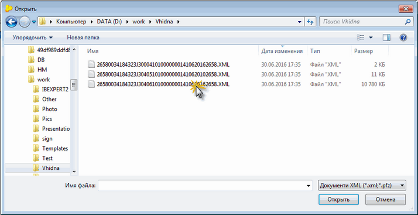
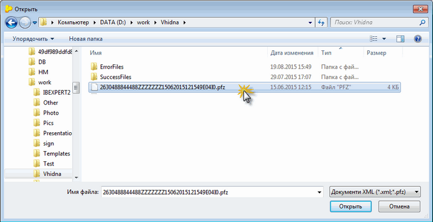
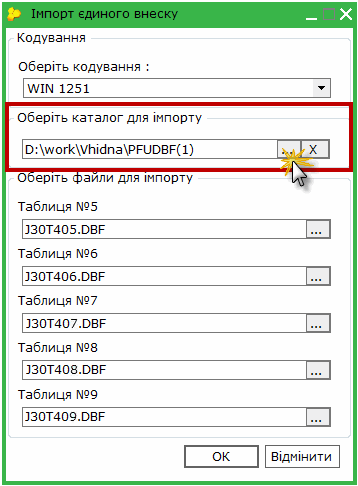
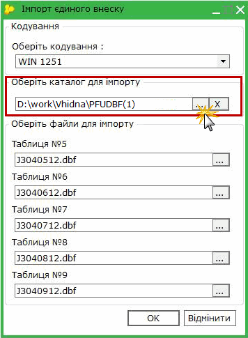
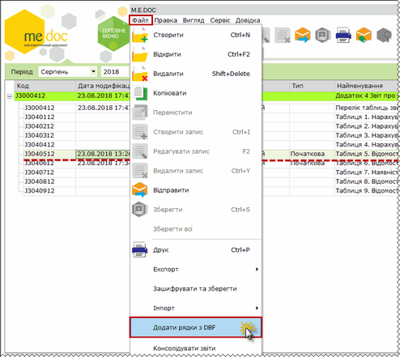
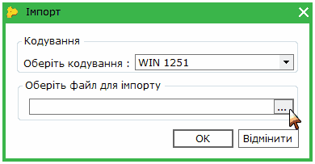

[← Зміст довідки](../)


# Імпорт звіту з єдиного внеску з інших систем

## Імпорт звіту з єдиного внеску з інших систем

_Шлях у довідці: Розділи програми › Звітність › Єдиний внесок › Додаток 4 " Звіт про суми нарахованої заробітної плати застрахованих осіб та суми нарахованого єдиного внеску на загальнообов’язкове державне соціальне страхування" › Імпорт звіту з єдиного внеску з інших систем_

Звіти з єдиного внеску можуть імпортуватися із pfz, xml та dbf файлів.

Pfz – файли представляють zip-архіви, в яких міститься ряд файлів xml-формату.

- [Імпорт xml файлів (нової версії J та поредньої F)](#contribution_import-contribution_import_jf)
- [Імпорт із pfz файлів файлів (до 01.01.2016)](#contribution_import-contribution_import_pfz)
- [Імпорт із dbf файлів](#contribution_import-contribution_import_dbf)

### Імпорт xml файлів (нової версії J та попередньої F)

_Шлях у довідці: Розділи програми › Звітність › Єдиний внесок › Додаток 4 " Звіт про суми нарахованої заробітної плати застрахованих осіб та суми нарахованого єдиного внеску на загальнообов’язкове державне соціальне страхування" › Імпорт звіту з єдиного внеску з інших систем › Імпорт xml файлів (нової версії J та попередньої F)_

Починаючи з 01.01.2016 р. файли нової версії "J" та попередньої "F" імпортуються з формату .xml.

Імпорт виконується у модулі Єдиний внесок у наступній послідовності:

1. Обрати команду Файл - Імпорт - Імпорт звітів.

2. Відкриється вікно Открыть. У полі Тип файлів вибрати значення "Документи XML".

3. Звичайним для операційної системи Windows способом обрати каталог, де збережений файл.

4. Виділити цей файл курсором миші та натиснути кнопку Открыть.

5. По закінченні процедури, система виведе протокол імпорту даних. Якщо імпорт не виконаний, буде повідомлена причина.

Імпортовані звіти поміщаються у модуль Єдиний внесок у відповідний звітний період. Імпортовані таблиці позначаються синім кольором, яким виділяються імпортовані у програму документи.

### Імпорт версії І із pfz файлів (до 01.01.2016)

_Шлях у довідці: Розділи програми › Звітність › Єдиний внесок › Додаток 4 " Звіт про суми нарахованої заробітної плати застрахованих осіб та суми нарахованого єдиного внеску на загальнообов’язкове державне соціальне страхування" › Імпорт звіту з єдиного внеску з інших систем › Імпорт версії І із pfz файлів (до 01.01.2016)_

Зверніть увагу! Попередня версія звіту "І" не може імпортуватися з файлів PFZ в нову версію з 01.01.2016 р. У своїй бухгалтерській програмі внесіть зміни та експортуйте файл нової версії (J або F).

Такі файли імпортуються за процедурою імпорту xml файлів.

Імпорт виконується у модулі Єдиний внесок у наступній послідовності:

1. Обрати команду Файл - Імпорт…

2. Відкриється вікно Открыть. У полі Тип файлів вибрати значення "Документи XML".

3. Звичайним для операційної системи Windows способом обрати каталог, де збережений файл \*.pfz.

4. Виділити цей файл курсором миші та натиснути кнопку Открыть.

5. По закінченні процедури, система виведе протокол імпорту даних. Якщо імпорт не виконаний, буде повідомлена причина.

Імпортовані звіти поміщаються у модуль Єдиний внесок у відповідний звітний період. Імпортовані таблиці позначаються синім кольором, яким виділяються імпортовані у програму документи.

Зверніть увагу!

Попередня  версія звіту "Н" з файлів PFZ не може імпортуватися в нову версію "І" в періоді «Травень, 2015». У своїй бухгалтерській програмі внесіть зміни та експортуйте файл з новою версією таблиць.

### Імпорт із dbf файлів

_Шлях у довідці: Розділи програми › Звітність › Єдиний внесок › Додаток 4 " Звіт про суми нарахованої заробітної плати застрахованих осіб та суми нарахованого єдиного внеску на загальнообов’язкове державне соціальне страхування" › Імпорт звіту з єдиного внеску з інших систем › Імпорт із dbf файлів_

В цьому розділі:

[Як імпортувати дані?](#contribution_import-contribution_import_dbf)

[Імпорт додаткових рядків у таблиці за допомогою функції "Додати рядки з DBF"](#contribution_import-contribution_import_dbf)

У форматі dbf у програму можуть імпортуватися Таблиці (5-9) звіту з єдиного внеску.

Примітка:

Опис структури DBF для імпорту файлів у програму міститься у документі з назвою "Структура файлов импорта таблиц (5-9) Додатка 4 ЕСВ (DBF).pdf", який знаходиться у каталозі help\manuals\:

за замовчуванням, C:\Documents and Settings\All Users\Application Data\Medoc\Medoc\help\manuals\.

Також цей документ викликається із Пуск - М.Е.Doc - Імпорт документу ЄСВ.

У програму можна імпортувати вже заповнені в інших бухгалтерських програмах Таблиці, а також додати до вибраних таблиць пропущені раніше записи.

Як імпортувати дані?

В програму можна імпортувати таблиці (5 – 9).

Імпорт виконується у наступній послідовності:

1. Оберіть команду Файл - Імпорт - Імпорт з DBF.

2. Відкриється вікно Імпорт єдиного внеску. У полі Оберіть кодування вкажіть потрібне значення. У полі Оберіть каталог для імпорту вкажіть шлях до каталогу розміщення dbf-файлів.

Назви таблиць звітів залежать від версії звітів, що опрацьовуються:

|  |  |
| --- | --- |
|  |  |
| Для версій звітів (J3000410, F3000410, J3000411, F3000411) | Для версії звітів (J3000412, F3000412) |

3. Поля Таблиці № 5, Таблиці № 6, Таблиці № 7, Таблиці № 8, Таблиці № 9 заповняться автоматично, виходячи із наявності файлів в указаному каталозі.

Імпорт із DBF файлів таблиць (5-9) попередньої версії "H" у нову версію «І» можливий. Але в таблиці 6 звіту потрібно самостійно заповнити нові поля.

4. Натисніть ОК для початку процесу імпорту.

5. По закінченні процедури, система виведе протокол імпорту даних. Якщо імпорт не виконаний, буде повідомлена причина.

6. Звіти поміщаються у модуль, як ПОЧАТКОВИЙ ЗВІТ.

Всі таблиці після імпорту потрібно відкрити, перевірити (F4), оновити поля (F5) та зберегти (Ctrl+S).

Поля, які не передбачені у структурі DBF, заповняться поточними даними (дата, номер аркуша) та даними із картки установи. Переглянути їх можна у паперовій формі звіту (меню Правка /Електронна форма або F11).

Після перевірки всіх імпортованих звітів потрібно створити відсутні таблиці.

У разі, якщо потрібно імпортувати декілька файлів та потім "звести" всі такі файли в один звіт, використовується функція [Консолідувати звіти](UCContribution.html#uccontribution-contribution_import_consolid).

Якщо при імпорті з dbf файлів у таблицях знайдені пропущені записи, їх можна додати окремо за допомогою функції "Додати рядки з DBF" (з файлів, що містять такі пропущені записи).

[До початку](#contribution_import-contribution_import_dbf)

Імпорт додаткових рядків у таблиці за допомогою функції "Додати рядки з DBF"

Функція Додати рядки з DBF дозволяє вносити додаткові (пропущені) записи у вже заповнені таблиці модуля (з 5 по 9).

Додаються рядки одночасно тільки у одну обрану у модулі таблицю.

Виконується для обраної в модулі таблиці:

- із меню Файл/ Додати рядки з DBF
- із контекстного меню/Додати рядки з DBF

Натисніть, щоб збільшити малюнок

Далі відкривається діалогове вікно для вибору DBF файлу для імпорту (відповідає таблиці), рядки із якого потрібно додати у обрану таблицю.

Після вибору таблиці, яку потрібно імпортувати, виконується перевірка кодування DBF файлу, і у випадку невідповідності кодування програма пропонує перекодувати файл.

Після закінчення імпорту відкривається "Протокол імпорту даних", у якому повідомляється про результат імпорту. Якщо імпорт успішний, в обрану таблицю будуть додані нові записи.

Далі потрібно відкрити всі Таблиці, в які додані рядки, перевірити (F4), оновити поля (F5) та зберегти (Ctrl+S).

[До початку](#contribution_import-contribution_import_dbf)


