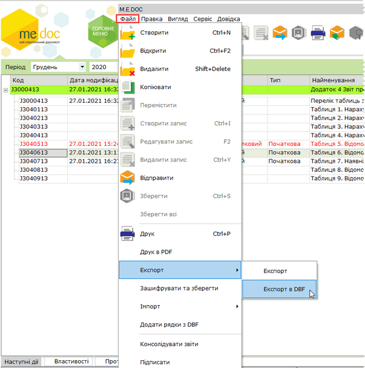
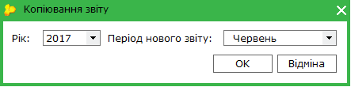
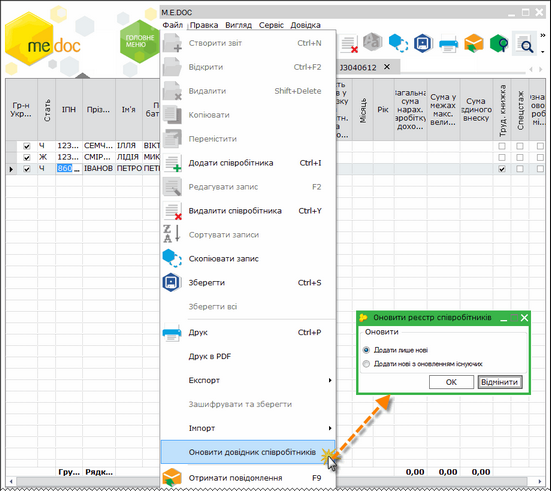
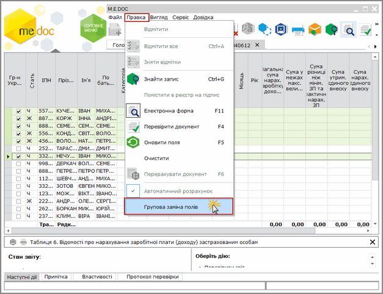
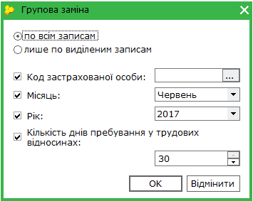

[← Зміст довідки](../)


# Додаткові функції у модулі

## Додаткові функції у модулі

_Шлях у довідці: Розділи програми › Звітність › Єдиний внесок › Додаток 4 " Звіт про суми нарахованої заробітної плати застрахованих осіб та суми нарахованого єдиного внеску на загальнообов’язкове державне соціальне страхування" › Додаткові функції у модулі_

У модулі є декілька додаткових функцій, які полегшують роботу:

- [Експорт даних Таблиць (5-9) в DBF файл](#contribution_service-contribution_service_export_dbf)
- [Копіювання звіту](#contribution_service-contribution_service_copy)
- [Оновлення реєстру співробітників за даними Таблиці 6](#contribution_service-contribution_service_upd)
- [Групове заповнення даних по співробітниках у Таблиці 6](#contribution_service-contribution_service_t6_replace)

### Експорт даних Таблиць (5-9) в DBF файл

_Шлях у довідці: Розділи програми › Звітність › Єдиний внесок › Додаток 4 " Звіт про суми нарахованої заробітної плати застрахованих осіб та суми нарахованого єдиного внеску на загальнообов’язкове державне соціальне страхування" › Додаткові функції у модулі › Експорт даних Таблиць (5-9) в DBF файл_

Експорт Таблиць (5-7) в DBF файл може використовуватися для перенесення (на інший комп'ютер) таблиць консолідованого звіту, створеного у модулі Єдиний внесок шляхом консолідації декількох початкових звітів.

В DBF файл можуть експортуватися лише Таблиці 5, 6, 7, 8 та 9!!!

Виконується за допомогою функції Експорт в DBF.

Для експорту потрібно у електронній таблиці модулю виділити курсором миші комплект документів (загальний рядок з назвою звіту) та вибрати Файл - Експорт - Експорт в DBF.

Натисніть, щоб збільшити малюнок

У вікні, що відкриється, звичайним способом оберіть каталог, в якому потрібно зберегти DBF файли.

Після закінчення процедури відображається протокол з результатами експорту.

### Копіювання звіту

_Шлях у довідці: Розділи програми › Звітність › Єдиний внесок › Додаток 4 " Звіт про суми нарахованої заробітної плати застрахованих осіб та суми нарахованого єдиного внеску на загальнообов’язкове державне соціальне страхування" › Додаткові функції у модулі › Копіювання звіту_

Ця функція призначена для копіювання всього комплекту документів звіту з єдиного внеску у поточний період чи у інший звітний період.

Може використовуватись у таких випадках:

- якщо потрібно відредагувати та повторно експортувати звіт (у тому числі і підписаний ЕП) для подання в ПФУ до кінця звітного періоду;
- помилкового подання звіту не за звітний період, а за попередній (і згідно з п. 5.3 Наказу № 454 страхувальник повинен подати два звіти: звіт за попередній період та звіт за поточний період);
- аби полегшити заповнення деяких таблиць.

Для копіювання звіту потрібно у електронній таблиці модулю виділити курсором миші потрібний комплект документів (загальний рядок з назвою звіту) та вибрати Файл/Копіювати чи натиснути на кнопку  на панелі інструментів вікна.

У наступному вікні Копіювання звіту вказати звітний період, у який скопіювати звіт:

Після копіювання звіт поміщається у обраний період, всі скопійовані документи (таблиці) будуть виділені зеленим кольором, їх можна відкривати та редагувати.

Зверніть увагу!

Звіти до 01.01.2016 копіюються лише у версію "І".

Звіти з 01.01.2016 копіюються з конвертацією у нові форми "J" або "F".

### Оновлення реєстру співробітників за даними Таблиці 6

_Шлях у довідці: Розділи програми › Звітність › Єдиний внесок › Додаток 4 " Звіт про суми нарахованої заробітної плати застрахованих осіб та суми нарахованого єдиного внеску на загальнообов’язкове державне соціальне страхування" › Додаткові функції у модулі › Оновлення реєстру співробітників за даними Таблиці 6_

Дана функція використовується, наприклад, у випадку, якщо документи імпортуються з інших бухгалтерських систем, а не формуються у модулі, при цьому довідник Співробітники не підтримується в актуальному стані.

На основі даних про працівників, внесених у Таблицю 6 модулю, за допомогою цієї функції у реєстрі співробітників можна оновити дані.

Виконується за допомогою функції Файл/Оновити довідник співробітників у вікні відкритої Таблиці 6.
При оновленні даних у діалоговому вікні потрібно вказати спосіб оновлення - додати лише нові записи, чи додати нові з оновленням вже існуючих.

Натисніть, щоб збільшити малюнок

Після оновлення реєстру програма у окремому вікні повідомляє про результат.

---

Якщо в Таблиці 6 виділити вибіркові записи, при виконанні цієї функції в довіднику "Співробітники" оновляться записи тільки виділених співробітників.

Для виділення використовується перша колонка (зліва) без назви:

Необхідно виділити перший рядок у таблиці лівою кнопкою миші та утримуючи, перетягнути її до останнього запису
або - при натиснутій клавіші SHIFT клавіатури обрати лівою кнопкою миші перший та останній запис групи.
Обраний діапазон у таблиці буде виділений кольором.

### Групове заповнення даних по співробітниках у Таблиці 6

_Шлях у довідці: Розділи програми › Звітність › Єдиний внесок › Додаток 4 " Звіт про суми нарахованої заробітної плати застрахованих осіб та суми нарахованого єдиного внеску на загальнообов’язкове державне соціальне страхування" › Додаткові функції у модулі › Групове заповнення даних по співробітниках у Таблиці 6_

У таблиці 6 реалізована можливість автоматичного групового заповнення даних про співробітників за допомогою функції Групова заміна полів.

Виконується у таких у колонках таблиці:

- код застрахованої особи,
- місяць,
- рік,
- кількість днів перебування у трудових відносинах.

Виділіть у таблиці окремі записи співробітників, оберіть Правка - Групова заміна полів.

Натисніть, щоб збільшити малюнок

У відкритому вікні Групова заміна заповніть ті колонки, дані у яких будуть однакові.

Доробка дозволяє пришвидшити та частково автоматизувати заповнення таблиці.


