[← Зміст довідки](../)


# Робота з розділом "Корпорація"

## Робота з розділом "Корпорація"

_Шлях у довідці: Розділи програми › Корпорація › Робота з розділом "Корпорація"_

У даному розділі довідки розглянуто наступне:

- [Реєстр консолідованих звітів](#corpincrst-m_e_doc-corp_modul_rz)
- [Опис основних функціональних елементів інтерфейсу](#corpincrst-m_e_doc-corp_modul_rz_inter)
- [Робота з розділом "Реєстр консолідованих звітів"](#corpincrst-m_e_doc-corp_modul_rz_robota)
- [Реєстр запитів на консолідацію](#corpincrst-m_e_doc-corp_modul_rzapytiv)

### Реєстр консолідованих звітів

_Шлях у довідці: Розділи програми › Корпорація › Робота з розділом "Корпорація" › Реєстр консолідованих звітів_

Реєстр консолідованих звітів призначений для створення, збереження у систематизованому вигляді раніше створених та імпортованих в програму документів всіх організацій (в тому числі і консолідованих), а також для обробки бухгалтерської та фінансової звітності з метою подачі до контролюючих органів телекомунікаційними засобами зв'язку.

У даному розділі довідки розглянуто наступне:

- [Опис основних функціональних елементів інтерфейсу](#corpincrst-m_e_doc-corp_modul_rz_inter)
- [Робота з розділом "Реєстр консолідованих звітів"](#corpincrst-m_e_doc-corp_modul_rz_robota):
- [Створення звітів](#corpincrst-m_e_doc-corp_modul_rz_robota)
- [Отримання звітів від підзвітних установ поштою](#corpincrst-m_e_doc-corp_modul_rz_robota)
- [Ручний режим обробки прийнятих документів](#corpincrst-m_e_doc-corp_modul_rz_robota)
- [Імпорт звітів від підзвітних установ з диска](#corpincrst-m_e_doc-corp_modul_rz_robota)
- [Консолідація звітів](#corpincrst-m_e_doc-corp_modul_rz_robota)
- [Розшифровка консолідації](#corpincrst-m_e_doc-corp_modul_rz_robota)
- [Копіювання звітів в іншу установу](#corpincrst-m_e_doc-corp_modul_rz_robota)
- [Відправка звіту від імені підзвітної установи](#corpincrst-m_e_doc-corp_modul_rz_robota)
- [Отримання повідомлень від імені підзвітної установи](#corpincrst-m_e_doc-corp_modul_rz_robota)

#### Опис основних функціональних елементів інтерфейсу

_Шлях у довідці: Розділи програми › Корпорація › Робота з розділом "Корпорація" › Реєстр консолідованих звітів › Опис основних функціональних елементів інтерфейсу_

Модуль побудований у вигляді таблиці - реєстру, окремий рядок якої відображає коротку інформацію про кожний документ. Переглянути більш повну інформацію можна у окремій вкладці, яка відкривається подвійним кліком по потрібному запису.

У лівій частині модулю розташована навігаційна панель. Панель містить розділи, що призначені для полегшення пошуку документів. При виборі певного розділу на панелі навігації, в робочій області відображаються документи, що відповідають заданим умовам фільтрації.

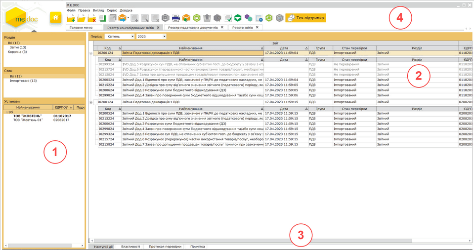

Натисніть на картинку, щоб збільшити її

1. Навігаційна панель

Панель містить розділи, що призначені для полегшення пошуку документів. При виборі певного розділу на панелі навігації, в робочій області відображаються документи, що відповідають заданим умовам фільтрації.

- Розділ – містить фільтри, що відповідають етапам обробки документів, наприклад, таким як: «Звітні», «Прийняті», «Не прийняті».
- Стан – містить статуси, що відповідають етапам роботи з документами, наприклад, таким як: «Не перевірені», «Вірні», «Помилкові» тощо.
- Установи – містить фільтри, які відповідають найменуванням підзвітних організацій та установ. Відображаються тільки ті назви установ, у яких у обраному періоді присутні звіти.
- Одержувач – містить фільтри, що відповідають назвам звітних органів, відображають документи за призначенням відповідно.
За замовчуванням дана панель відключена. Для її відображення в меню "Вигляд" оберіть команду "Одержувач".

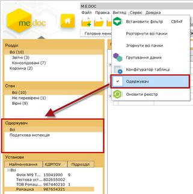

Натисніть на картинку, щоб збільшити її

2. Робоча область

Містить безпосередньо записи реєстру звітності: відображає створені, отримані поштою або імпортовані документи у заданому звітному періоді, тобто звіти, з якими безпосередньо ведеться робота, а також консолідовані звіти.

Також при виділення казначейських звітів внизу робочої області відображається панель Класифікаційних розрізів звітів. Містить записи звітів за класифікаціями.

Набором колонок у таблиці реєстру можна керувати. Для цього натисніть на кнопку  на панелі інструментів. Відкриється вікно Конфігуратор таблиці. Встановіть відповідні галочки та натисніть кнопку  для збереження.

Для зручності роботи у реєстрі, реалізована функція ГРУПУВАННЯ записів реєстру по колонкам таблиці реєстру. Для активації цієї функції оберіть пункт меню Вигляд - Групування даних або натисніть кнопку  на панелі інструментів. Над реєстром з'явиться додаткова панель. Перетягніть на цю панель потрібні колонки за допомогою лівої кнопки миші. Реалізовано запам’ятовування позиціонування при групуванні даних в реєстрі консолідованих звітів.

3. Панель вкладок звіту

Містить службову інформацію щодо обраного документа. Панель доступна як у відкритому документі, так і з реєстру документів (за умови виділення потрібного документа).

- Наступні дії – містить інформацію щодо поточного стану документа, а також перелік можливих дій з документом у цьому стані. Слугує певною підказкою користувачу про доступні дії, які можна виконати з документом у певному стані;
- Властивості – у режимі читання містить всю службову інформацію про документ, таку як: стан, період створення, дата та час останньої модифікації, інформація про сертифікати, якими підписано документ тощо. Інформація на цій вкладці постійно оновлюється та доповнюється при будь-яких змінах у документі;
- Протокол перевірки  – містить результати перевірки документа програмою внутрішніх розрахунків на наявність помилок.
- Примітка – відображає дані введені в текстове поле вкладки Примітка (Панель вкладок звіту) відкритого звіту.

4. Панель інструментів

Містить кнопки, що надають швидкий доступ до найбільш часто використовуваних функцій. Наведіть покажчик миші на інструмент і чекайте протягом секунди для відображення короткої підказки, що описує його призначення.

#### Робота з  Реєстром консолідованих звітів

_Шлях у довідці: Розділи програми › Корпорація › Робота з розділом "Корпорація" › Реєстр консолідованих звітів › Робота з  Реєстром консолідованих звітів_

В цьому розділі:

[Створення звітів](#corpincrst-m_e_doc-corp_modul_rz_robota)

[Отримання звітів від підзвітних установ поштою](#corpincrst-m_e_doc-corp_modul_rz_robota)

[Ручний режим обробки прийнятих документів](#corpincrst-m_e_doc-corp_modul_rz_robota)

[Імпорт звітів від підзвітних установ з диска](#corpincrst-m_e_doc-corp_modul_rz_robota)

[Консолідація звітів](#corpincrst-m_e_doc-corp_modul_rz_robota)

[Розшифровка консолідації](#corpincrst-m_e_doc-corp_modul_rz_robota)

[Копіювання звітів в іншу установу](#corpincrst-m_e_doc-corp_modul_rz_robota)

[Відправка звіту від імені підзвітної установи](#corpincrst-m_e_doc-corp_modul_rz_robota)

[Отримання повідомлень від імені підзвітної установи](#corpincrst-m_e_doc-corp_modul_rz_robota)

Звіти від підзвітних організацій приймаються як звичайна вхідна кореспонденція або за допомогою імпорту документів в систему. Прийняті документи поміщаються до Реєстру. У модулі також можна вести звітність головної установи. Для цього реалізована функція створення, як простих звітів, так і по класифікаціям. Процедура створення звітів в програмі включає: вибір звітного періоду, вибір бланка, на підставі якого створюється звіт, відкриття і заповнення бланка звіту, перевірка і збереження.

Додаткова інформація, властивості створеного документа, а також варіанти дій з документом певного статусу міститься на панелі вкладок документа.

Створення звітів

У розділі Корпорація є можливість створювати звіти як за Головну установу так і за підзвітні організації. Це реалізовано для випадків, якщо в отриманих від підзвітних організацій звітах виявлені помилки.

1. Оберіть період в якому потрібно створити звіт. За замовчуванням встановлено поточний період.

2. Для створення нового документа скористайтесь одним із наступних способів:

- на панелі інструментів натисніть кнопку Створити;
- виберіть команду Файл - Створити;
- у контекстному меню оберіть команду Створити;
- натисніть комбінацію клавіш Ctrl+N.

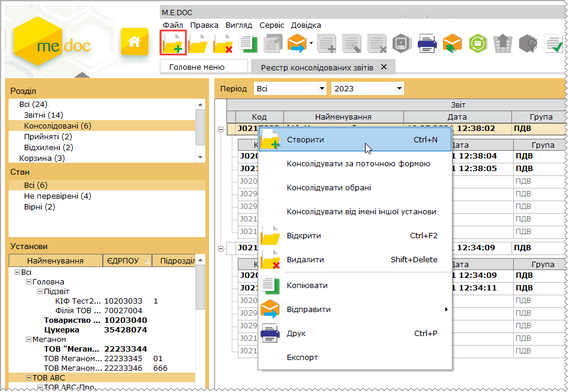

Натисніть на картинку, щоб збільшити її

3. Відкриється довідник з переліком підприємств. Структура даного довідника повністю повторює налаштовану [структуру підзвітних підприємств](UCIncRst.html#ucincrst-m_e_doc-corp_pidzvitni).

Оберіть назву підприємства, від імені якого потрібно створити звіт та натисніть ОК.

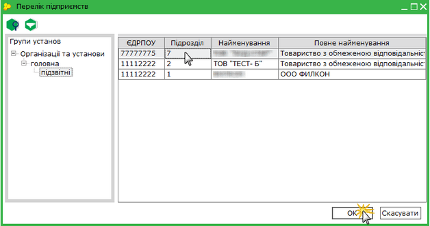

4. Відкриється вікно Створення звіту.

Із загальної групи Бланки оберіть відповідний розділ та групу звітності. Оберіть потрібний для створення бланк документа та відкрийте його подвійним кліком лівої клавіші миші або натисніть на кнопку Створити.

5. Бланк звіту після відкриття автоматично заповнюється даними із картки установи підприємства, від ім'я якого створюється звіт, та іншою наведеною в системі інформацією.

6. Більш докладно про роботу зі звітами, правила заповнення та редагування дивіться у розділі[Створення, заповнення та редагування звітів](UCDocRstByPer5.html#ucdocrstbyper5-rdoc_robota_stvor) даного документа.

В розділі Реєстр консолідованих звітів також доступні наступні функції:

|  |  |  |
| --- | --- | --- |
|  | Shift+Del | Видалення помилкового звіту. |
|  | Ctrl+F2 | Відкрити звіт. |

Для успішного виконання консолідації Реєстр податкових накладних головного підприємства необхідно імпортувати або створювати у розділі Облік ПДВ - Реєстр виданих та отриманих податкових накладних, а Реєстр податкових накладних підзвітних установ необхідно імпортувати у розділі Реєстр консолідованих звітів.

[До початку](#corpincrst-m_e_doc-corp_modul_rz_robota)

Отримання звітів від підзвітних установ поштою

Отримання повідомлень від підзвітних організацій виконується як звичайна вхідна кореспонденція за допомогою одного із наступних способів:

- із меню Файл - Отримати повідомлення;
- за допомогою функціональної клавіші F9;
- кнопкою  на панелі інструментів головного вікна програми.

Після цього запускається перевірка наявності вхідних повідомлень і якщо такі повідомлення є у поштовій скриньці, вони завантажуються. Для прийняття у програму їх потрібно розшифрувати (ввести пароль захисту секретного ключа печатки установи).

Якщо надійшли повідомлення (та квитанції), відкриється вікно Отримано повідомлення.

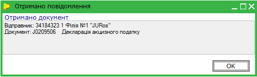

Після закриття цього вікна звіти поміщаються безпосередньо у Реєстр (розділ Корпорація), розподіляючись по установам. Знайти отримані звіти можна за допомогою фільтрів на панелі Установи.

Зверніть увагу! Назва підзвітної установи присутня на панелі Установи тільки за умови наявності отриманого від неї звіту у вибраному звітному періоді.

Якщо вхідна кореспонденція була отримана в конфігурації M.E.Doc.Корпорація, всі отримані поштою документи поміщаються в модуль Корпорація - Реєстр консолідованих звітів.

[До початку](#corpincrst-m_e_doc-corp_modul_rz_robota)

Ручний режим обробки прийнятих документів

За замовчуванням в [параметрах системи](UCIncRst.html#ucincrst-m_e_doc-corp_nalasht) в полі Перевіряти та відправляти квитанцію встановлено значення Автоматично. Це означає, що при прийомі документів від підзвітних установ, окрім звіту про доставку документа, автоматично формується звіт про результати обробки, згідно якої документ прийнято.

Для того, щоб мати змогу спочатку перевірити документ на наявність помилок та самостійно вирішувати приймати документ або повернути відправнику для доопрацювання, в полі Перевіряти та відправляти квитанцію необхідно встановити значення у ручному режимі.

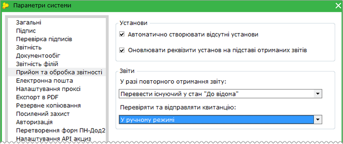

В ручному режимі обробки прийнятий по пошті документ від підзвітної установи набуває статусу Очікують перевірки.

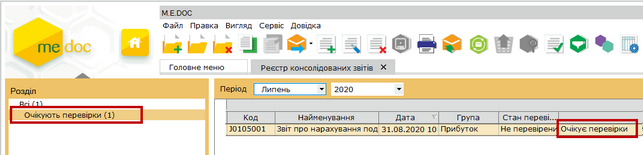

Натисніть на картинку, щоб збільшити її

Документи в стані Очікують перевірки, Квитанцію відхилено відправлено, Квитанцію відхилено доставлено не потрапляють в консолідацію.

Після перевірки документа на наявність помилок, передбачено 2 варіанти подальших дій: Прийняти або Відхилити.

Для цього встановіть у фільтрі розділ Очікують перевірки, а потім оберіть у меню Файл або у контекстному меню потрібний варіант.

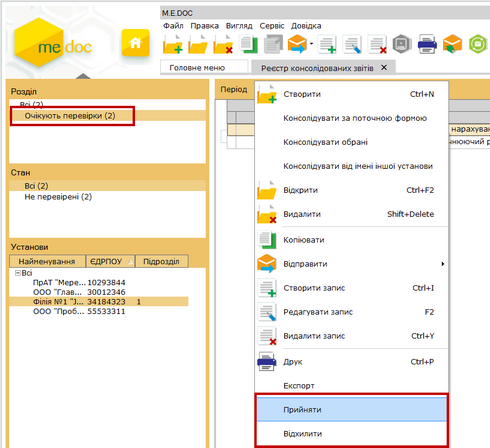

Натисніть на картинку, щоб збільшити її

В разі вибору варіанту Прийняти в підзвітну установу відправляється квитанція про прийняття документа.

В разі вибору варіанту Відхилити необхідно вказати причину відхилення документа:

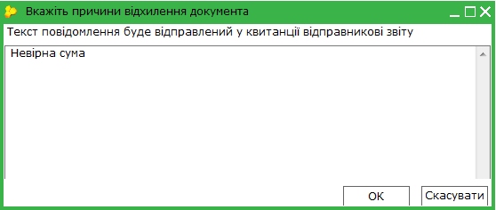

Далі документ підписується комплектом ЕП та відправляє назад до підзвітної установи.

Відхилений документ, який отримала назад підзвітна установа, розблоковується (знімаються підписи з документа). Його можна відредагувати та відправити повторно в Головну установу.

Документ може редагуватись нескінченну кількість разів, поки не буде прийнятий в Головній установі.

[До початку](#corpincrst-m_e_doc-corp_modul_rz_robota)

Імпорт звітів від підзвітних установ з диска

Для імпорту отриманих звітів у форматі внутрішнього XML («для обміну звітністю») в меню Файл оберіть команду Імпорт - Імпорт звітів XML.

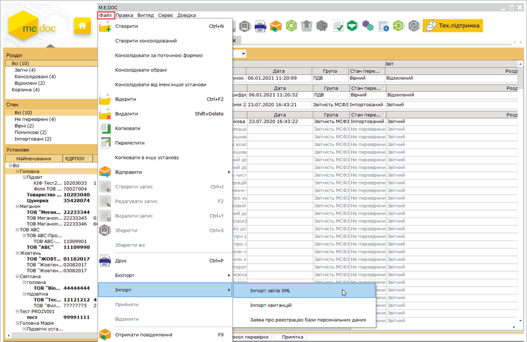

Натисніть на картинку, щоб збільшити її

Відкриється вікно Відкриття файлу. Оберіть каталог, де розташовано потрібний файл.

По закінченню процесу імпорту система повідомить у який період проімпортовано файли та яку кількість. Звіти розподіляються по установах. Знайти імпортовані звіти можна скориставшись фільтрами на панелі Установи.

При імпорті звітів, які не можуть дублюватись в межах періоду, система запропонує варіанти дії:

- Замінити. При виборі цього варіанту звіт (за умови, що він не містить класифікатори) видаляється в Корзину, імпортований заміняє видалений звіт. Звіт, що містить класифікаційний розріз, видаляється безповоротно та замінюється імпортованим.;
- Додати. При виборі цього варіанту в існуючий звіт (без класифікаційних розрізів) додаються дані імпортованого. Звіт, що містить класифікаційний розріз, видаляється безповоротно та замінюється імпортованим.;
- Пропустити. При виборі цього варіанту, звіти, що дублюються, не імпортуються.

При імпорті бюджетних звітів, класифікаційні розрізи яких відрізняються від встановлених в системі для цих бланків, система попередить про виникнення помилкового відображення та запропонує варіанти дії:

- Імпортувати.
- Пропустити.

Зверніть також увагу, якщо такий звіт із класифікаційними розрізами, що відрізняються від встановлених в системі, буде відправлений електронним каналом зв’язку, ПК "M.E.Doc" його автоматично відхилить, як помилковий.

[До початку](#corpincrst-m_e_doc-corp_modul_rz_robota)

Консолідація звітів

Основною функцією даного модуля є консолідація звітів. Система автоматично виконує об'єднання всіх документів з таким же кодом у вибраному звітному періоді.

В модулі Реєстр консолідованих звітів існує 4 способи виконання консолідації звітів:

- [Консолідація за поточною формою](#corpincrst-m_e_doc-corp_modul_rz_robota)
- [Створити консолідований](#corpincrst-m_e_doc-corp_modul_rz_robota)
- [Консолідувати обрані](#corpincrst-m_e_doc-corp_modul_rz_robota)
- [Консолідувати від імені іншої установи](#corpincrst-m_e_doc-corp_modul_rz_robota).

1. Консолідувати за поточною формою

1.1. У модулі Реєстр консолідованих звітів виділіть документ, по якому необхідно виконати злиття.

1.2. Для виконання консолідації скористайтесь одним із наступних способів:

- виберіть команду Файл - Консолідувати за поточною формою;
- у контекстному меню оберіть команду Консолідувати за поточною формою.

1.3. При консолідації звітів підзвітних організацій, система пропонує включити для злиття звіти головної організації. Відкривається вікно Додаткові звіти основної організації, де міститься перелік звітів головної установи.

Для додавання звітів головної установи до складу звіту, що консолідується, виділіть галочкою необхідні документи.

1.4. Система автоматично виконає об'єднання документів. Звіт набуде статус Консолідований.

Натисніть, щоб збільшити малюнок

1.5. Після перевірки звіту та його складових, він готовий до відправки в контролюючі органи за допомогою електронних каналів зв'язку з використанням ЕП.

2. Створити консолідований

Для того що б не шукати в реєстрі потрібний документ для злиття, можна створити консолідований звіт і система об'єднає документи з вказаним кодом.

2.1. Для виконання консолідації скористайтесь одним із наступних способів:

- виберіть команду Файл - Створити консолідований;
- у контекстному меню оберіть команду Створити консолідований.

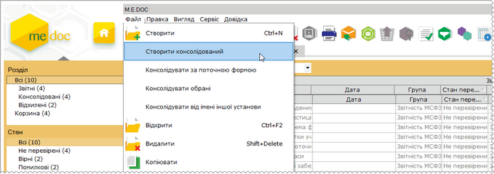

Натисніть, щоб збільшити малюнок

2.1. Відкриється вікно Створення звіту.

Із загальної групи Бланки оберіть відповідний розділ та групу звітності. Оберіть потрібний для консолідації бланк документа подвійним кліком лівої клавіші миші або натисніть на кнопку Створити.

2.3. Система автоматично виконає об'єднання документів. Звіт набуде статус Консолідований.

3. Консолідувати обрані

3.1. У модулі Реєстр консолідованих звітів виділіть ті документи, які необхідно консолідувати (рекомендуємо використовувати комбінацію клавіш Shift + стрілка вниз або Ctrl + клік лівою клавішею миші).

Нагадуємо, що обрані звіти мають бути з однаковим кодом.

3.2. Для виконання консолідації скористайтесь одним із наступних способів:

- виберіть команду Файл - Консолідувати обрані;
- у контекстному меню оберіть команду Консолідувати обрані.

3.3. Система виконає об'єднання документів. Звіт набуде статус Консолідований.

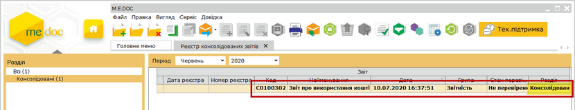

Натисніть на картинку, щоб збільшити її

4. Консолідувати від імені іншої установи

4.1. Для виконання консолідації скористайтесь одним із наступних способів:

- виберіть команду Файл - Консолідувати від імені іншої установи;
- у контекстному меню оберіть команду Консолідувати від імені іншої установи.

4.3. Відкриється вікно Перелік підприємств. Оберіть установу, від імені якої необхідно виконати консолідацію звітів та натисніть кнопку ОК.
За замовчанням встановлена галочка в полі Включити до консолідацій раніше консолідовані звіти, тобто консолідуватись будуть як нові так і звіти в статусі Консолідований. За потреби зніміть галочку.

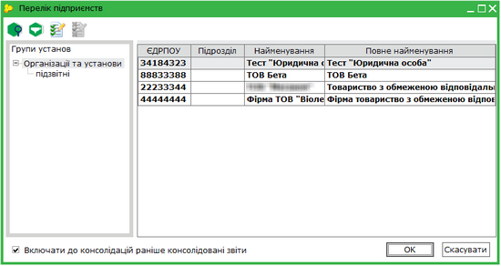

Натисніть на картинку, щоб збільшити її

4.4. Відкриється вікно Створення звіту.

Із загальної групи Бланки оберіть відповідний розділ та групу звітності. Оберіть потрібний для консолідації бланк документа подвійним кліком лівої клавіші миші або натисніть на кнопку Створити.

4.5. Система виконає об'єднання документів. Сконсолідований звіт буде розміщений в установі, від імені якої відбувалась консолідація (панель Установи), та набуде статус Консолідований.

Консолідовані звіти відображуються, як в Реєстрі консолідованої звітності, так і в [Реєстр звітів](UCDocRstByPer5.html#ucdocrstbyper5-rdocs). Тут відображаються всі етапи роботи з документом (статус документа). У Реєстрі консолідованої звітності звіти готуються і перевіряються, а з Реєстру звітів консолідовані звіти підписуються і відправляються в контролюючі органи.

Обов'язково ознайомтесь із правилами консолідації [пакетів звітних документів](UCIncRst.html#ucincrst-rdocs_paket_corp).

[До початку](#corpincrst-m_e_doc-corp_modul_rz_robota)

Розшифровка консолідації

У відкритих консолідованих звітах існує можливість перегляду в підсумкових полях складові значення.

1. Відкрийте консолідований звіт.

2. Виділіть клітинку з консолідованим значенням.

3. На панелі вкладок звіту оберіть вкладку Розшифровка консолідації.

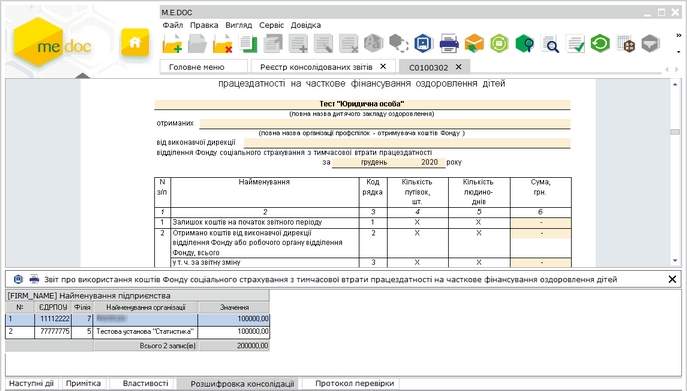

Натисніть на картинку, щоб збільшити її

4. Для того, щоб відкрити звіт, який є складовим консолідованого, натисніть двічі лівою клавішею миші по запису в розшифровці.

Реалізовано можливість перегляду розшифровки консолідації в звітах, які заблоковані від редагування (підписані ЕП або відправлені електронним каналом зв’язку). Перегляд відбувається при позиціонуванні на поле із підсумковим значенням.

Реалізовано відображення розшифровки значень для динамічних строк, які не були сконсолідовані, а просто додані в консолідований звіт.

У таблицю вкладки додано строку, що містить назву й опис поля, консолідація якого розшифровується.

[До початку](#corpincrst-m_e_doc-corp_modul_rz_robota)

Копіювання звітів в іншу установу

В реєстрі доступна функція копіювання звіту в іншу установу. Скопіювати можна лише один звіт і лише в установу, яка має відповідну ліцензію на використання конфігурації M.E.Doc.Корпорація.

1. Виділіть звіт, що потрібно скопіювати.

2. Оберіть команду Файл - Копіювати в іншу установу.

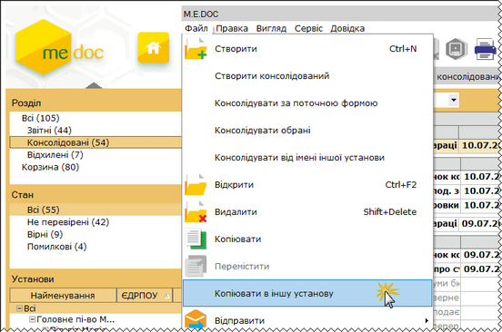

Натисніть на картинку, щоб збільшити її

3. Відкриється вікно Перелік підприємств. Оберіть установу, в яку потрібно скопіювати звіт та натисніть кнопку ОК.

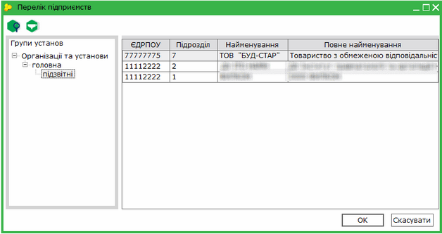

4. У окремому вікні відкриється скопійований звіт. Він також відобразиться в реєстрі установу, в яку виконувалось копіювання.

[До початку](#corpincrst-m_e_doc-corp_modul_rz_robota)

Відправка звіту від імені підзвітної установи

Перед відправкою повідомлень від імені підзвітних установ обов'язково переконайтесь, що в підзвітній установі [налаштована електронна пошта](FormCompanyParams.html#formcompanyparams-admcompanyparams_emaile).

Для того, щоб відправити звіт від імені підзвітної установи, виконайте дії в наступній послідовності:

1. На панелі "Установи" оберіть підзвітну організацію, від імені якої потрібно відправити звіт в контролюючий орган.

2. Виділіть звіт, що потрібно відправити в контролюючий орган.

3. Скористайтесь одним із наступних способів:

- на панелі інструментів натисніть кнопку Відправити - Відправити від імені його установи;
- виберіть команду Файл - Відправити - Відправити від імені його установи;
- у контекстному меню оберіть команду Відправити - Відправити від імені його установи.

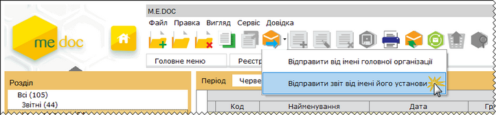

4. Розпочнеться стандартний процес [відправки вихідних повідомлень](UC_ECP.html#uc_ecp-ecp).

[До початку](#corpincrst-m_e_doc-corp_modul_rz_robota)

Отримання повідомлень від імені підзвітної установи

Перед прийомом повідомлень від імені підзвітних установ обов'язково переконайтесь, що в підзвітній установі [налаштована електронна пошта](FormCompanyParams.html#formcompanyparams-admcompanyparams_emaile).

Для того, щоб отримати повідомлення від імені підзвітної установи, виконайте дії в наступній послідовності:

1. В меню Файл оберіть команду Отримати повідомлення за підзвітні установи.

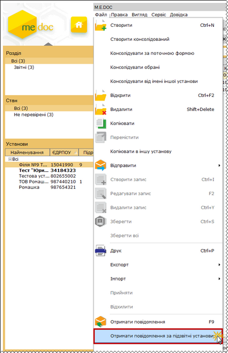

Натисніть на картинку, щоб збільшити її

2. Відкриється вікно Перелік підприємств. Оберіть установу, від імені якої потрібно отримати повідомлення та натисніть кнопку ОК.

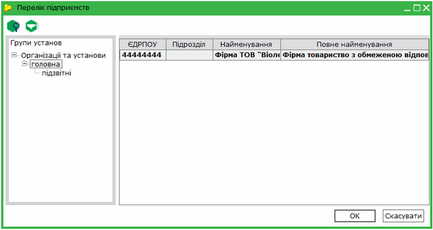

3. Розпочнеться стандартний процес прийому вхідної кореспонденції.

[До початку](#corpincrst-m_e_doc-corp_modul_rz_robota)

### Реєстр запитів на консолідацію

_Шлях у довідці: Розділи програми › Корпорація › Робота з розділом "Корпорація" › Реєстр запитів на консолідацію_

В цьому розділі:

[Опис основних функціональних елементів інтерфейсу](#corpincrst-m_e_doc-corp_modul_rzapytiv)

[Створення запиту на консолідацію](#corpincrst-m_e_doc-corp_modul_rzapytiv)

[Вкладка "Загальні"](#corpincrst-m_e_doc-corp_modul_rzapytiv)

[Вкладка "Бланки"](#corpincrst-m_e_doc-corp_modul_rzapytiv)

[Вкладка "Установи"](#corpincrst-m_e_doc-corp_modul_rzapytiv)

[Вкладка "Розрізи"](#corpincrst-m_e_doc-corp_modul_rzapytiv)

[Вкладка "Фільтрація"](#corpincrst-m_e_doc-corp_modul_rzapytiv)

[Вкладка "Сортування"](#corpincrst-m_e_doc-corp_modul_rzapytiv)

[Вкладка "Скрипт"](#corpincrst-m_e_doc-corp_modul_rzapytiv)

[Вкладка "Звіти"](#corpincrst-m_e_doc-corp_modul_rzapytiv)

Модуль Реєстр запитів на консолідацію надає більш ширші можливості консолідації звітів. Запит дозволяє задавати параметри для консолідації звітів, як в системних полях, так і по полям форм, що змінюються, за класифікаційними розрізами, за формами, по організаціях, дозволяє використовувати фільтри. Консолідація може бути проведена як в поточному періоді, так і дозволяє задати будь-який інший звітний період. Також є можливість користувачеві самостійно написаний скрип, за яким буде відбуватися консолідація звітів.

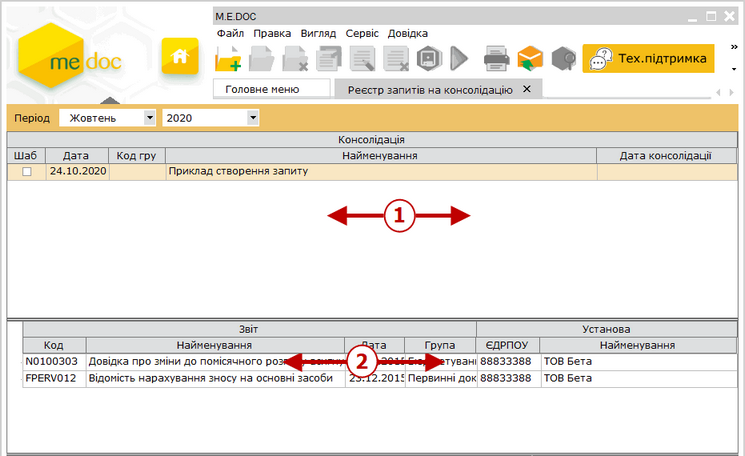

1. Реєстр запитів на консолідацію

Містить перелік створених запитів на консолідацію, а також шаблонів запиту на консолідацію. Шаблони запитів на консолідацію відмічені галочками у колонці Шаблон, вони можуть використовуватись багаторазово для створення консолідованих звітів.

2. Реєстр консолідованих документів

Містить перелік консолідованих документів по обраному запиту. Для відображення консолідованих документів необхідно виділити потрібний запит у реєстрі запитів.

[До початку](#corpincrst-m_e_doc-corp_modul_rzapytiv)

Створення запиту на консолідацію

Для створення запиту на консолідацію виконайте такі дії:

1. Натисніть кнопку Створити на панелі інструментів або натисніть комбінацію клавіш Ctrl+N.

У окремому вікні відкриється Запит на консолідацію. Запит включає наступні розділи: Загальні, Бланки, Установи, Розрізи, Фільтрація, Сортування, Скрипт, Звіти.

2. Поетапно заповніть запропоновані поля форми.

2.1. Загальні

У розділі Загальні задаються основні параметри запиту, такі як: назва, код групи, періоди звітів тощо.

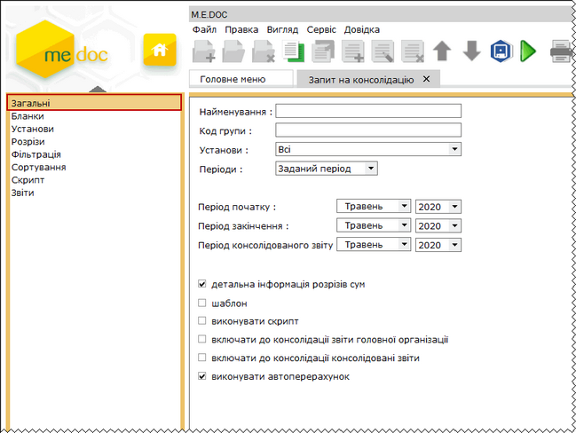

- Найменування - умовна назва запиту на консолідацію. У дане поле вводиться довільне найменування з метою полегшення пошуку створюваного запиту в Реєстрі запитів.
- Код групи - умовна кодифікація запиту. У дане поле вводиться довільна комбінація символів з метою полегшення пошуку створюваного запиту в Реєстрі запитів.
- Установи - умова задання переліку установ для консолідації. Представляє собою фіксований список наступних значень:
- Всі - консолідація відбудеться по всіх підприємствах, що присутні у програмному комплексі;
- Підзвітні - консолідація відбудеться по підприємствах, що є підлеглими поточному, тобто ті, що буди підпорядковані у довіднику [Підзвітні підприємства](UCIncRst.html#ucincrst-m_e_doc-corp_pidzvitni)
- Запитати - при виконанні консолідації система виведе довідник підприємств з метою вказання переліку підприємств для консолідації. Консолідація розпочнеться тільки після вказання підприємств;
- Задані - консолідація відбудеться по установах, що вказані у розділі Установи даного запиту на консолідацію.
- Періоди - умова задання періоду консолідації. Представляє собою фіксований список наступних значень:
- Поточний період - консолідація відбудеться у поточному звітному періоді;
- Запитати період - при виконанні консолідації система виведе запит з метою вказання періоду консолідації. Консолідація розпочнеться тільки після вказання періоду;
- Заданий період - консолідація відбудеться в межах вказаного періоду в полях, що розташовані нижче: Період початку, Період закінчення.
- Період початку - місяць та рік звітного періоду, починаючи з якого консолідувати данні. Консолідація по цьому параметру відбудеться тільки за умови, що в полі Періоди вказано значення Заданий період.
- Період закінчення - місяць та рік звітного періоду, закінчуючи яким консолідувати данні. Консолідація по цьому параметру відбудеться тільки за умови, що в полі Періоди вказано значення Заданий період.
- Період консолідованого звіту - місяць та рік звітного періоду, в який буде поміщено результуючий консолідований звіт.
- Детальна інформація розрізів сум - встановлена позначка в цьому полі включає відображення даних на вкладці Розшифровка консолідації.
- Шаблон - якщо в даному полі встановлена позначка, то даний запит на консолідацію збережеться як шаблон. Шаблони запитів на консолідацію відмічені галочками у колонці Шаблон, вони можуть використовуватись багаторазово для створення консолідованих звітів.
- Виконувати скрипт - якщо в даному полі встановлена позначка, консолідація буде виконуватись згідно власної програми-скрипта, що записана у розділі Скрипт.
Увага! Якщо позначка у даному полі встановлена, а поле у розділі Скрипт пусте, консолідація не виконається, результуючий звіт буде пустим!

- Включати до консолідації звіти головної організації - при наявній позначці в даному полі, в результуючий консолідований звіт буде включно звіт Головної установи.
Увага! Звіт Головної установи із заданим кодом повинен бути присутнім в [Реєстрі звітів](UCDocRstByPer5.html#ucdocrstbyper5-rdocs) в указаному звітному періоді.

- Включати до консолідації консолідовані звіти - якщо в даному полі встановлена позначка, то в результуючий звіт буде включено консолідовані звіти підзвітних установ.
Увага! При виконанні даної функції в консолідацію можуть потрапити звіти, що вже входять в консолідований звіт, тобто виконається дублювання даних.
З метою уникнення утворення некоректних даних, переконайтесь, що вже сконсолідовані звіти (входять в склад консолідованого звіту) або не присутні у системі, або розташовані в Корзині.

- Виконувати автоперерахунок - встановлена позначка в цьому полі вказує, що після консолідації в підсумковому документі автоматично виконається перерахунок даних в тих полях, де це передбачено.
За замовчанням галочка в даному полі встановлена. За необхідності відключіть функцію автоперерахунку.

Після закінчення, натисніть на кнопку  для збереження внесених даних.

2.2. Бланки

У розділі Бланки задається перелік бланків, за якими проводити консолідацію. Кількість бланків для консолідації не обмежено.

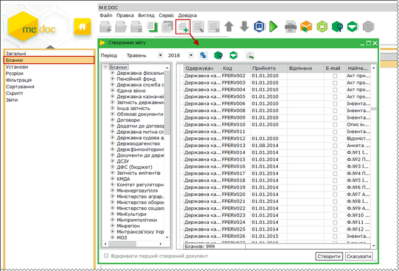

Натисніть на картинку, щоб збільшити її

Для додавання бланка на панелі інструментів виберіть команду Створити запис або натисніть комбінацію клавіш Ctrl+I. Відкриється стандартне вікно Створення звіту.

Бланки, які утворюють пакети звітних документів, відображаються у вигляді дерева. Це суттєво спрощує пошук бланків, які можуть бути в різних пакетах.

Із загальної групи Бланки оберіть відповідний розділ та групу звітності. Оберіть потрібний для додавання бланк документа та відкрийте його подвійним кліком лівої клавіші миші або натисніть на кнопку Створити.

Якщо обрано основний документ пакету - до переліку бланків додається лише він.
Якщо обрано додаток до основного документа - до переліку бланків додається основний документ та обраний додаток.

Після закінчення, натисніть на кнопку  для збереження внесених даних.

2.3. Установи

У розділі Установи задається перелік підзвітних установ, за якими проводити консолідацію документів. Консолідація по цьому параметру відбудеться тільки за умови, що у розділі Загальні в полі Установи вказано значення Задані.

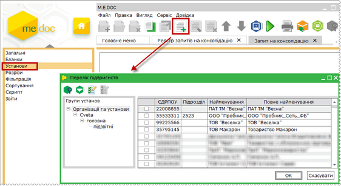

Натисніть на картинку, щоб збільшити її

Для додавання установи на панелі інструментів виберіть команду Створити запис або натисніть комбінацію клавіш Ctrl+I. Відкриється Довідник з переліком установ, що присутні у програмному комплексі. Встановіть галочки напроти потрібних підприємств та натисніть Вибрати.

Після закінчення, натисніть на кнопку  для збереження внесених даних.

2.4. Розрізи

У розділі Розрізи задається перелік системних полів бланків, а також полів із картки установи, за якими проводити консолідацію документів.

У даному розділі у верхній частині вікна відображаються бланки, які були задані у розділі Бланки.

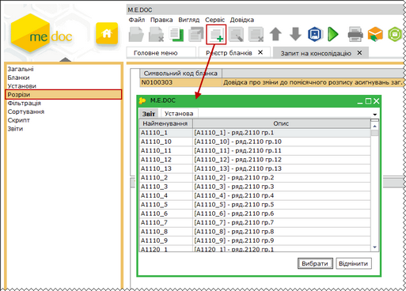

Натисніть на картинку, щоб збільшити її

Для того, щоб додати розріз, виділіть бланк у переліку та на панелі інструментів виберіть команду Створити запис, або натисніть комбінацію клавіш Ctrl+I.

Відкриється окреме вікно, що містить 2 вкладки: Звіт та Установа.

Вкладка Звіт містить перелік всіх полів обраного бланка, вкладка Установа містить перелік полів картки підприємства.

Оберіть потрібний параметр та натисніть кнопку Вибрати.

Пояснення щодо механізму консолідації по Розрізам:

Коли в Запиті задаються розрізи, система перевіряє рівність значень у заданих полях, і ті значення, які співпадають, консолідуються у окремий результуючий звіт.

Приклад:

Маємо три звіти від підприємства №1 та два звіти від підприємства №2.

У полі "А1" містяться наступні дані:

|  |  |
| --- | --- |
| Підприємство №1 | Підприємство №2 |
| 100 | 200 |
| 200 | 200 |
| 100 |  |

В результаті консолідації маємо 2 окремих результуючих звіти:

1. в полі "А1" значення - 200 (100+100)

2. в полі "А1" значення - 600 (200+200+200)

Після закінчення, натисніть на кнопку  для збереження внесених даних.

2.5. Фільтрація

У розділі Фільтрація задаються окремі параметри, та значення цих параметрів, та за умови рівності цих значень в звітах, звіти будуть включатись у консолідований.

У даному розділі у верхній частині вікна відображаються бланки, які були задані у розділі Бланки.

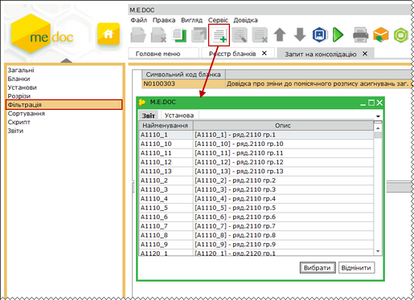

Натисніть на картинку, щоб збільшити її

Для того, щоб додати фільтр, виділіть бланк у переліку та на панелі інструментів виберіть команду Створити запис, або натисніть комбінацію клавіш Ctrl+I.

Відкриється окреме вікно, що містить 2 вкладки: Звіт та Установа.

Вкладка Звіт містить перелік всіх полів обраного бланка, вкладка Установа містить перелік полів картки підприємства.

Оберіть потрібний параметр та натисніть кнопку Вибрати. Далі у полі Значення введіть значення даного параметру, з яким система буде порівнювати.

Пояснення щодо механізму консолідації по Фільтрам:

Коли в Запиті задаються фільтри, система перевіряє рівність вказаних значень у заданих полях зі звітами і ті значення, які співпадають консолідуються у результуючий звіт.

Приклад:

У полі "А1" встановлено значення 10. Згідно заданим параметрам, система перевіряє звіти і консолідує тільки ті звіти, в яких значення поля "А1" = 10

Після закінчення, натисніть на кнопку  для збереження внесених даних.

2.6. Сортування

У розділі Сортування задається порядок відображення полів у консолідованому звіті.

У даному розділі у верхній частині вікна відображаються бланки, які були задані у розділі Бланки.

Зверніть увагу! Сортування полів активне тільки для бланків, що містять динамічні таблиці, наприклад, Податкова накладна.

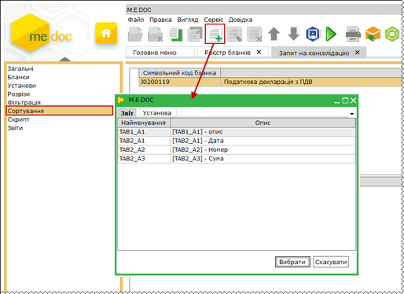

Натисніть на картинку, щоб збільшити її

Для того, щоб встановити сортування , виділіть бланк у переліку та на панелі інструментів виберіть команду Створити запис, або натисніть комбінацію клавіш Ctrl+I.

Оберіть потрібний параметр та натисніть кнопку Вибрати.

Після закінчення, натисніть на кнопку  для збереження внесених даних.

2.7. Скрипт

Скрипт – поле для внесення власної програми-скрипта для виконання злиття документів. Для виконання консолідації за скриптом, необхідно встановити галочку у полі Виконувати скрипт у розділі Загальні шаблону запиту.

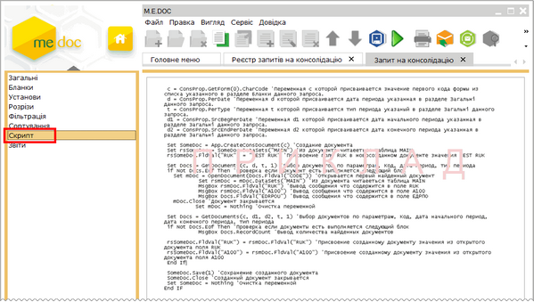

Натисніть на картинку, щоб збільшити її

Після закінчення, натисніть на кнопку  для збереження внесених даних.

2.8. Звіти

У розділі Звіти містяться результати консолідації за запитом.

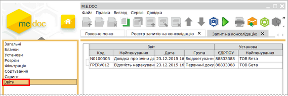

Натисніть на картинку, щоб збільшити її

3. Для виконання консолідації за запитом, натисніть кнопку  Виконати консолідацію на панелі інструментів.

Зверніть увагу! Якщо виконується повторно консолідація одного і того ж запиту, всі попередні результати перезаписуються новими даними.

4. У відкритому Запиті також доступні наступні функції:

Копіювати запит.

Консолідовані звіти відображуються в Реєстрі запитів на консолідацію, в Реєстрі консолідованої звітності, а також в Реєстр звітів. В Реєстрі звітів відображуються всі етапи роботи з документом (статус документа). У Реєстрі консолідованої звітності звіти готуються і перевіряються, а з Реєстру звітів консолідовані звіти підписуються і відправляються в контролюючі органи.

Увага!

При консолідації бюджетних форм, у модулі Корпорація - Реєстр консолідованої звітності не відображаються класифікаційні розрізи звіту. Для перегляду класифікацій відкрийте звіт.

[До початку](#corpincrst-m_e_doc-corp_modul_rzapytiv)


