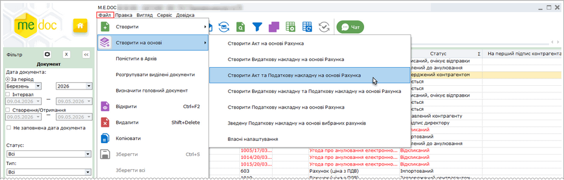
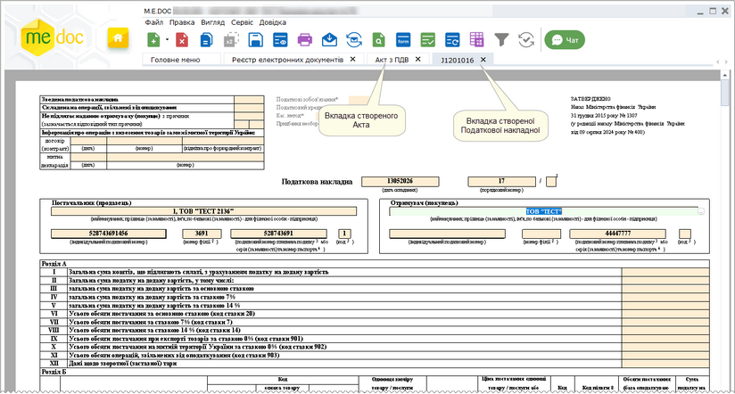
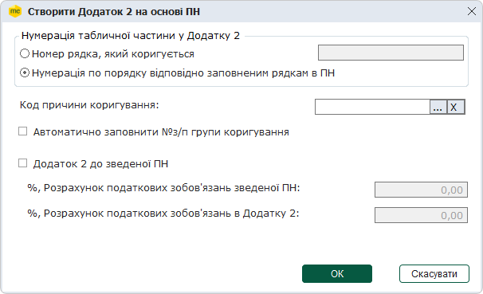
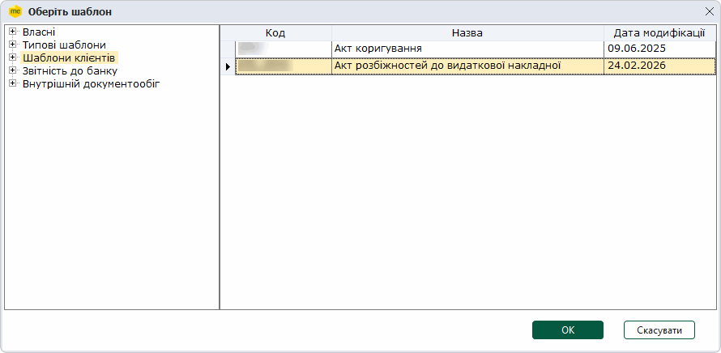
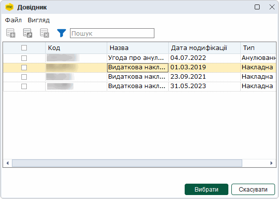
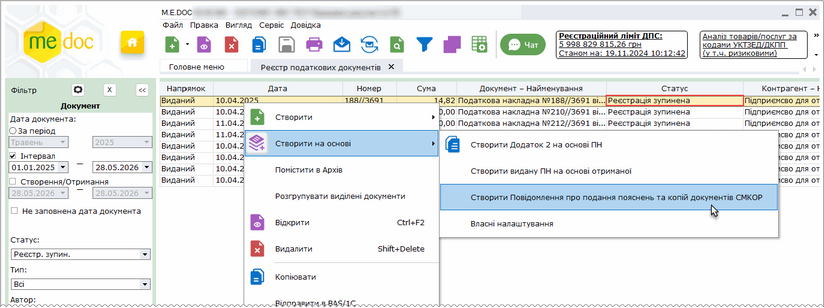

[← Зміст довідки](../)


# Як створити документ на основі існуючого

## Як створити документ на основі існуючого

_Шлях у довідці: Розділи програми › Первинні документи › Робота з первинними документами › Як створити документ на основі існуючого_

У програмі M.E.Doc реалізовано створення первинних документів на основі існуючих:

- [Податкової накладної, Акта, Видаткової накладної на підставі Рахунка](#creat_doc_-creat_doc_)
- [Податкової накладної на підставі Видаткової накладної](#creat_doc_-creat_doc_);
- [Податкової накладної на підставі Акту](#creat_doc_-creat_doc_);
- [Податкової накладної на основі декількох рахунків](#creat_doc_-creat_doc_);
- [Додатку 2 на основі Податкової накладної](#creat_doc_-creat_doc_);
- [Акта розбіжностей на основі Видаткової накладної](#creat_doc_-creat_doc_);
- [Виданої Податкової накладної на основі отриманої](#creat_doc_-creat_doc_);
- [первинних документів за власними налаштуваннями](#creat_doc_-creat_doc_);
- [повідомлення про подання пояснень та копій документів СМКОР](#creat_doc_-creat_doc_);

УВАГА! Для коректного функціонування наступні поля шаблонів повинні мати назви:

Поля у таблиці, що визначаються користувачем:

TAB1\_NOMENKLATURA\_NAME - Товар (Найменування робіт, послуг);

TAB1\_A3 - Кількість;

TAB1\_OV\_NAME - Одиниця виміру;

TAB1\_A5 - Ціна з/без ПДВ;

TAB1\_A6 - Сума з/без ПДВ.

Поле у документі, визначається користувачем:

KVO - Всього найменувань.

Поля у документі, системні:

DOCSUM - Сума по документу;

DOCSUM\_TEXT - Сума по документу (текст);

SUMWITHOUTPDV - Сума без ПДВ;

SUMPDV - Загальний ПДВ.

Обов'язкові поля у кожному документі. По цим полям відбувається [зв'язування документів](Conn_doc.html#conn_doc-conn_doc).

DOG\_NUM - Номер договору;

DOG\_DATE - Дата договору.

Зміна назви вказаних вище полів зробить неможливим перенесення даних при створені документів на основі інших.

Зверніть увагу:

Для того, щоб користувач мав можливість створювати документи на основі існуючих, у модулі [Адміністрування - Управління ролями](UCManageRoles.html#ucmanageroles-ucmanageroles) у розділі Облік ПДВ - Податкові накладні, Первинні документи - Реєстр податкових документів та/або Первинні документи - Реєстр електронних документів повинні бути встановлені опції Створення первинного документа на підставі іншого. Якщо опції не встановлено, у відповідному модулі програми команда Створити на основі відсутня у контекстному меню та у меню програми.

За замовчуванням опції встановлені.

Документи, створені на основі існуючих,  зберігаються у відповідних реєстрах: Податкова накладна та Додаток 2 - у Реєстрі податкових документів, інші первинні документи - у Реєстрі електронних документів.

Заповнити поля Код ознаки джерела податкового номера можна за допомогою команди головного меню [Правка – Групова обробка полів ПН/РК](UCDFDocsRst.html#ucdfdocsrst-doc_group_field_edit).

Створення документів на підставі Рахунка

У розділі розглянуто приклад створення Акту та Податкової накладної на підставі Рахунка. Створення документів інших типів виконується аналогічним чином.

1. У вікні Реєстру електронних документів оберіть Рахунок, на підставі якого необхідно створити документи.

2. Оберіть один із способів:

- виберіть команду меню Файл - Створити на основі - Створити Акт та Податкову накладну на основі Рахунка;
- у контекстному меню оберіть команду Створити на основі - Створити Акт та Податкову накладну на основі Рахунка:

Натисніть, щоб збільшити малюнок

3. У вікні Оберіть шаблон, що відкриється, оберіть шаблон, за яким потрібно створити Акт. Натисніть кнопку ОК.

4. Відкриються вкладки, що відповідають створюваним документам.

Натисніть, щоб збільшити малюнок

Поля створених документів автоматично заповнюються даними вихідного документа (у нашому прикладі - Рахунку).

- Для коректного перенесення даних необхідно вказати [коректні назви полів у шаблонах документів](#creat_doc_-creat_doc_).
- Документи зберігаються у відповідних реєстрах: Податкова накладна - у Реєстрі податкових документів, Акт - у Реєстрі електронних документів.

Поле номера документа - порожнє. Якщо була налаштована [автоматична нумерація документів](FormCompanyParams.html#formcompanyparams-admcompanyparams_zv), створені документи отримають номер, сформований згідно виконаних налаштувань.

5. Для збереження створеного документа натисніть кнопку .

[До початку](#creat_doc_-creat_doc_)

Створення Податкової накладної на підставі Видаткової накладної

1. У вікні Реєстру електронних документів оберіть Видаткову накладну, на підставі якої необхідно створити документ.

2. Оберіть один із способів:

- виберіть команду меню Файл - Створити на основі -  Створити Податкову накладну на основі Видаткової накладної;
- у контекстному меню оберіть команду Створити на основі - Створити Податкову накладну на основі Видаткової накладної.

3. Відкриється вкладка, що відповідає створюваній Податковій накладній. Поля створеного документа автоматично заповнюються даними вихідного документа (Видаткової накладної). Поле номера документа - порожнє. Якщо була налаштована [автоматична нумерація документів](FormCompanyParams.html#formcompanyparams-admcompanyparams_zv), створений документ отримає номер, сформований згідно виконаних налаштувань.

4. Для збереження створеного документа закрийте вкладку та натисніть кнопку Так у вікні повідомлення.

[До початку](#creat_doc_-creat_doc_)

Створення Податкової накладної на підставі Акту

1. У вікні Реєстру електронних документів оберіть Акт, на підставі якого необхідно створити документ.

2. Оберіть один із способів:

- виберіть команду меню Файл - Створити на основі - Створити Податкову накладну на основі Акту;
- у контекстному меню оберіть команду Створити на основі -  Створити Податкову накладну на основі Акту.

3. Відкриється вкладка, що відповідає створюваній Податковій накладній. Поля створеного документа автоматично заповнюються даними вихідного документа (Акт). Поле номера документа - порожнє. Якщо була налаштована [автоматична нумерація документів](FormCompanyParams.html#formcompanyparams-admcompanyparams_zv), створений документ отримає номер, сформований згідно виконаних налаштувань.

4. Для збереження створеного документа закрийте вкладку та натисніть кнопку Так у вікні повідомлення.

[До початку](#creat_doc_-creat_doc_)

Створення Податкової накладної на основі вибраних рахунків

Функція дає змогу створити ПН на основі декількох вихідних рахунків, створених на основі системних шаблонів рахунків.

1. У вікні Реєстру електронних документів оберіть декілька Рахунків, на підставі яких необхідно створити ПН.

2. Оберіть один із способів:

- виберіть команду меню Файл - Створити на основі - Зведену Податкову накладну на основі вибраних рахунків;
- у контекстному меню оберіть команду Створити на основі - Зведену Податкову накладну на основі вибраних рахунків.

3. Відкриється вкладка, що відповідає створюваній Податковій накладній. До новоствореної ПН переносяться ціни з рахунків. Поле номера документа - порожнє. Якщо була налаштована [автоматична нумерація документів](FormCompanyParams.html#formcompanyparams-admcompanyparams_zv), створений документ отримає номер, сформований згідно виконаних налаштувань.

- Для рахунку, створеного за шаблоном з кодом "1С82РАХ", значення поля "Ціна" не переноситься.
- Якщо при створенні ПН було обрано рахунки декількох контрагентів, то для кожного контрагента створюється ПН відповідно до його рахунків, обраних на початку.

4. Для збереження створеного документа закрийте вкладку та натисніть кнопку Так у вікні повідомлення.

[До початку](#creat_doc_-creat_doc_)

Створення Додатку 2 на основі Податкової накладної

Функція дає змогу створити ПН на основі декількох вихідних рахунків, створених на основі системних шаблонів рахунків.

Функція дає змогу створити РК на основі ПН.

1. У вікні Реєстру податкових документів оберіть одну або декілька виданих ПН.

2. Оберіть один із способів:

- виберіть команду меню Файл - Створити на основі - Створити Додаток 2 на основі ПН;
- у контекстному меню оберіть команду Створити на основі - Створити Додаток 2 на основі ПН.

3. Відкриється вікно Створити Додаток 2 на основі ПН.

- Номер рядка, який коригується
Вказуються номери рядків ПН, які потрібно коригувати.
Можна вказати один номер рядка або діапазон номерів. Діапазон можна вказати через кому або через дефіс (наприклад, "1, 5", "1-3").
Якщо буде обрано неіснуючий номер рядка, то при створенні РК відобразиться повідомлення про відсутність рядка у ПН, а РК буде створено з незаповненою табличною частиною.
Якщо буде обрано некоректний діапазон, то при створенні РК відобразиться повідомлення про невідповідність рядків у ПН, а РК буде заповнено даними з ПН.

- Нумерація по порядку відповідно заповнення рядкам в ПН
В РК переносяться рядки згідно ПН.
Параметр встановлений за замовчуванням.

- Код причини коригування
значення обирається з підключеного Довідника умовних кодів причин коригування. Обране значення присвоюється всім вибраним для коригування рядкам.

- Автоматично заповнити №з/п групи коригування
при встановленій опції у сформованому РК у графі №з/п групи коригування заповнюється нумерація для кожного рядка, починаючи з 1-го.

- Додаток 2 до зведеної ПН
розрахунок податкових зобов'язань при створенні Додатку 2 на основі зведеної виданої Податкової накладної.

Якщо опцію встановлено, стають доступними поля: %, Розрахунок податкових зобов'язань зведеної ПН та %, Розрахунок податкових зобов'язань в Додатку 2. Для формування РК введіть значення в цих полях та натиснути ОК. У створеному РК автоматично розраховуються та заповнюються графи 13 та 14 розділу Б, де рядком зі знаком «-» зазначаються показники граф, які підлягають коригуванню, наступним рядком зазначаються виправлені показники.

4. Оберіть потрібний параметр та натисніть кнопку ОК.

5. Відкриється вкладка, що відповідає створюваному РК.

Залежно від обраних налаштувань у створюваному РК автоматично заповнюються поля: Код причини коригування, №з/п групи коригування,  Коригування кількості, Коригування вартості. При одночасному виборі кількох ПН для кожної обраної ПН створюється РК, що заповнюються однаковим кодом причини коригування, якщо такий був обраний у вікні Створити Додаток 2 на основі ПН.

Зверніть увагу!

Автоматичне заповнення графи РК Коригування кількості або Коригування вартості здійснюється лише для кодів 101 – 104.

У разі вибору коду 101, 102 або 104 автоматично додається лише рядок РК, що виводить в нуль відповідний рядок ПН. Для коректного заповнення РК необхідно вручну створити рядок, що додає позицію з новим значенням, яке коригується.

- При створенні РК 12-ї версії на основі ПН попередніх версій (10-ї та більш ранніх) поля Код ознаки джерела податкового номера заповнюються автоматично значеннями кодів, що вказані у [Картці підприємства](UCOrg.html#ucorg-sprorg_org) та [Картці контрагента](UCPartnerRst.html#ucpartnerrst-sprpartner).
- При створенні РК 12-ї версії на основі ПН 11-ї версії перенесення значень полів Код ознаки джерела податкового номера виконується автоматично.

[До початку](#creat_doc_-creat_doc_)

Створення Акта розбіжностей на основі Видаткової накладної

Функція дає змогу створити Акт розбіжностей на основі Видаткової накладної. Шаблон документа типу Акт розбіжностей попередньо повинен бути створений за допомогою розділу [Шаблони документів](UCRtfDocTemplate.html#ucrtfdoctemplate-pdocs_shablon_stvor).

Для створення Акта розбіжностей:

1. У вікні Реєстру електронних документів оберіть одну або декілька Видаткових накладних.

2. Оберіть один із способів:

- виберіть команду меню Файл - Створити на основі - Створити Акт розбіжностей на основі Накладної;
- у контекстному меню оберіть команду Створити на основі - Створити Акт розбіжностей на основі Накладної.

3. Відкриється вікно Оберіть шаблон.

4. Оберіть потрібний шаблон документа та натисніть кнопку ОК. (У вікні відображені лише шаблони, що мають тип Акт розбіжностей).

5. Відкриється вкладка, що відповідає створюваному Акту розбіжностей.

[До початку](#creat_doc_-creat_doc_)

Створення виданої Податкової накладної на основі отриманої

Функція дає змогу створювати видані Податкові накладні на основі отриманих ПН.

1. У вікні Реєстру податкових документів оберіть Податкову накладну, на підставі якої необхідно створити видану ПН.

2. Оберіть один із способів:

- виберіть команду меню Файл - Створити на основі -  Створити видану ПН на основі отриманої;
- у контекстному меню оберіть команду Створити на основі - Створити видану ПН на основі отриманої.

3. Відкриється вкладка, що відповідає створюваній Податковій накладній. Поля створеного документа автоматично заповнюються даними вихідного документа ("отриманої" Податкової накладної). Заповніть область з даними про Отримувача (покупця).

4. Для збереження створеного документа закрийте вкладку та натисніть кнопку Так у вікні повідомлення.

[До початку](#creat_doc_-creat_doc_)

Створення первинних документів за власними налаштуваннями

Для створення первинних документів за власними налаштуваннями:

1. У вікні реєстру оберіть документ, для якого [налаштовано](UCRtfFromDocSettings.html#ucrtffromdocsettings-ucrtffromdocsettings) створення документів за власними налаштуваннями.

2. Оберіть один із способів:

- виберіть команду меню Файл - Створити на основі - Власні налаштування;
- у контекстному меню оберіть команду Створити на основі - Власні налаштування.

3. Відкриється вікно Довідник.

4. Якщо для обраного документа [налаштовано](UCRtfFromDocSettings.html#ucrtffromdocsettings-ucrtffromdocsettings) створення кількох дочірніх документів, у вікні Довідники будуть відображені всі доступні шаблони дочірніх документів. Щоб обрати потрібний шаблон (шаблони), встановіть позначку у відповідному рядку. Натисніть кнопку Вибрати.

5. Відкриється вкладка, що відповідає створюваному первинному документу. Поля створеного документа автоматично заповнюються даними головного документа, відповідність полів документів налаштовується у розділі [Налаштування переносу полів для функції Створити на основі](UCRtfFromDocSettings.html#ucrtffromdocsettings-ucrtffromdocsettings).

Налаштування відповідності полів документів можуть бути надіслані отримувачу разом з головним документом іншим користувачем. Для цього відправник головного документа повинен бути власником шаблона головного документа, а для шаблона головного документа повинен бути встановлений атрибут [Відправляти отримувачу перенос полів](UCRtfDocTemplate.html#ucrtfdoctemplate-pdocs_shablon_stvor).

[До початку](#creat_doc_-creat_doc_)

Створення Повідомлення про подання пояснень та копій документів СМКОР

Для ПН/РК, що маються статус Реєстрація зупинена (реєстрація Податкової накладної/Розрахунку коригування призупинена з причини наявності Критеріїв оцінки ризиків), існує можливість створення Повідомлення про подання пояснень та копій документів щодо податкових накладних/розрахунків коригування, реєстрацію яких зупинено.

1. У вікні Реєстру податкових документів оберіть ПН/РК (або декілька ПН/РК), що мають  статус Реєстрація зупинена.

Функція доступна лише для ПН/РК, що мають статус Реєстрація зупинена. Якщо серед виділених ПН/РК є хоча б один документ, що має інший статус, функція недоступна.

2. Оберіть один із способів:

- виберіть команду меню Файл - Створити на основі -  Повідомлення про подання пояснень та копій документів СМКОР;
- у контекстному меню оберіть команду Створити на основі - Повідомлення про подання пояснень та копій документів СМКОР.

Натисніть, щоб збільшити малюнок

3. Створене Повідомлення буде відкрито у окремій вкладці. Повідомлення заповнюється даними із виділених ПН/РК.

4. Заповніть обов'язкові поля Повідомлення та додайте необхідні вкладення, як описано у розділі [Створення, заповнення та редагування звітів](UCDocRstByPer5.html#ucdocrstbyper5-rdoc_robota_stvor).

Створювати Повідомлення про подання пояснень та копій документів на основі ПН/РК можуть користувачі, для яких налаштовано відповідні права.

[До початку](#creat_doc_-creat_doc_)


