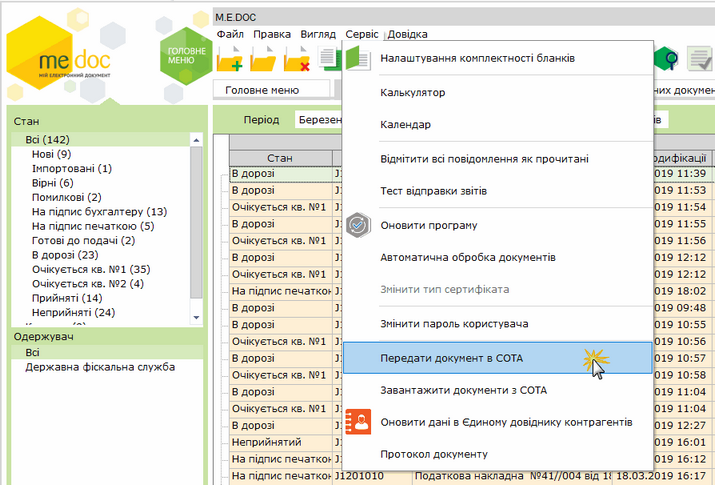
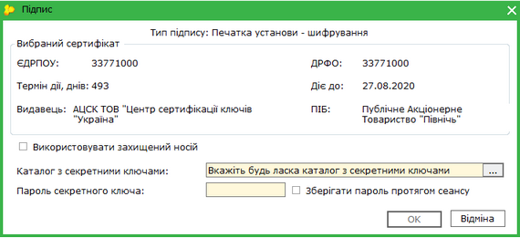
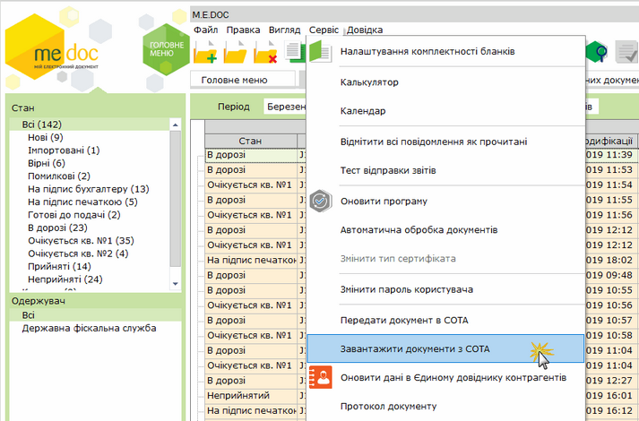
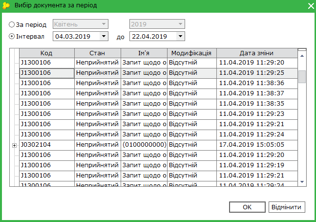

[← Зміст довідки](../)


# Обмін документами з СОТА

## Обмін документами з СОТА

_Шлях у довідці: Допоміжні сервіси › Обмін документами з СОТА_

В цьому розділі:

[Передача документів до СОТА](#datamedoconline-dataflow)

[Завантаження документів з СОТА](#datamedoconline-dataflow)

У M.E.Doc можливо передавати у/завантажувати із СОТА документи модулів:

- Реєстр звітів;
- Реєстр первинних документів,
- Реєстр акцизних документів,
- Об’єднана звітність ПДФО та ЄСВ
- Реєстр товарно-транспортних накладних,
- Інформаційна довідка
- Єдиний внесок.

Для обміну документами у M.E.Doc необхідно виконати відповідну команду головного меню: Сервіс – Передати документ в СОТА або Сервіс – Завантажити документи з СОТА.

Здійснювати обмін документами можливо лише з Головної установи. Функція обміну документами для філій недоступна.

Передача документів з M.E.Doc до СОТА

Передача документів у СОТА виконується за наступними правилами:

1. Якщо документ відсутній у СОТА, виконується копіювання документа. Не можливо виконати експорт документів, що у M.E.Doc мають статус В дорозі або Очікується кв. ...

2. Якщо документ існує у СОТА, виконується заміщення існуючого документа. Передача виконується в залежності від статусу, який документ має у програмах. Комбінації статусів, при яких можливо передати документ з заміщенням, позначено "+" у таблиці нижче:

|  |  |  |  |  |  |  |  |  |
| --- | --- | --- | --- | --- | --- | --- | --- | --- |
|  | | СОТА | | | | | | |
| Готується/Вірний | На підпис … (не накладено жодного підпису) | На підпис … (накладено хоча б один підпис) | Готовий до подачі | В дорозі/Очікується кв. ... | Прийнятий | Неприйнятий |
| M.E.Doc | Готується/Вірний | + | + |  |  |  |  |  |
| На підпис ... | + | + |  |  |  |  |  |
| Готовий до подачі | + | + |  |  |  |  |  |
| В дорозі/Очікується кв. ... |  |  |  |  |  |  |  |
| Прийнятий | + | + | + | + | + |  | + |
| Неприйнятий | + | + | + | + |  |  |  |

Для виконання передачі документа з програми M.E.Doc до СОТА:

1. Оберіть документ, або групу документів, які потрібно передати у СОТА. Якщо буде обрано головний документ пакету звітів, операція перенесення у СОТА буде виконана для всіх документів пакету.

2. Оберіть команду меню Сервіс - Передати документ в СОТА.

3. У вікні Підпис введіть пароль секретного ключа та натисніть кнопку ОК.

4. Розпочнеться процес передачі даних на сервер.

5. Після завершення передачі даних відкриється вікно протоколу передачі даних.

Протокол містить повідомлення про результати передачі документів. Якщо передача документа на сервер не відбулась, для документа у протоколі міститься повідомлення - "неможливо передати на сервер".  Для успішної передачі документів необхідно [дотримуватись умов](#datamedoconline-dataflow), за яких можливий експорт документів.

6. Передані документи відобразяться у відповідному розділі СОТА.

[До початку](#datamedoconline-dataflow)

Завантаження документів у M.E.Doc з СОТА

Для завантаження документа у M.E.Doc з програми СОТА:

1. Оберіть документ, або групу документів, які потрібно імпортувати.

2. Оберіть команду меню Сервіс - Завантажити документи з СОТА.

3. У вікні Підпис введіть пароль секретного ключа та натисніть кнопку ОК.

4. У вікні Вибір документів за період встановіть період, до якого належать документи. Для цього оберіть один із способів:

- Встановіть позначку За період, та у полях праворуч оберіть з списку період та рік, до якого належать документи;
- Встановіть позначку Інтервал, та у полях праворуч оберіть значення початку та закінчення періоду часу, до якого належать документи.

У вікну буде відображено список документів з серверу СОТА, які належать до встановленого періоду:

Для пакету документів у вікні відображається головний документ. Щоб переглянути додатки, натисніть значок  ліворуч від рядка документа.

Документи доступні для завантаження відображено чорним кольором.

Документи, які неможливо завантажити відображені у вікні сірим кольором. Для того, щоб переглянути причину, з якої завантаження документа неможливе, оберіть документ у списку за допомогою миші. У нижній частині вікна з'явиться рядок - роз'яснення.

5. Оберіть документ, або групу документів, які потрібно завантажити у  M.E.Doc та натисніть кнопку ОК.

6. Розпочнеться процес завантаження даних. Після завершення завантаження даних відкриється вікно протоколу.

7. Завантажені документи відобразяться у відповідному модулі M.E.Doc.

[До початку](#datamedoconline-dataflow)


