[← Зміст довідки](../)


# Створення Універсального документа із вкладеннями

## Створення Універсального документа із вкладеннями

_Шлях у довідці: Розділи програми › Первинні документи › Реєстр електронних документів › Створення Універсального документа із вкладеннями_

В цьому розділі:

[Створення Універсального документа із вкладеннями за допомогою ШІ](#doc_dov_form-doc_dov_form)

[Створення Універсального документа із вкладеннями вручну](#doc_dov_form-doc_dov_form)

[Додавання та видалення вкладень](#doc_dov_form-doc_dov_form)

[Визначення маршруту документа із вкладеннями](#doc_dov_form-doc_dov_form)

[Операції із вкладеннями](#doc_dov_form-doc_dov_form)

[Підписання ЕП та відправка документів із вкладеннями](#doc_dov_form-doc_dov_form)

[Копіювання документа із вкладеннями](#doc_dov_form-doc_dov_form)

[Експорт документів із вкладеннями](#doc_dov_form-doc_dov_form)

[Імпорт документів із вкладеннями](#doc_dov_form-doc_dov_form)

[Друк Універсального документа із вкладеннями в PDF](#doc_dov_form-doc_dov_form)

У Реєстрі електронних документів можна створювати документи спеціального формату, що призначенні для відправки контрагентам вкладень різних форматів: txt, rtf, doc, docx, xls, xlsx, pdf, png, jpeg, jpg, zip. У документах із вкладеннями можна обрати тип документа, вказати суму та номер документа, а також, визначити кількість та порядок отримувачів, яким буде надсилатися документ.

Створення Універсального документа із вкладеннями за допомогою ШІ

Створити Універсальний документ можна за допомогою штучного інтелекту (ШІ), для цього достатньо додати вкладення - програма автоматично визначить та підставить основні реквізити документа. Це допомагає швидше створювати документи та зменшує кількість ручної роботи та можливих помилок.

- Керування функціоналом доступне в розділі Адміністрування - Консоль адміністратора – Загальні налаштування – Налаштування АІ через перемикач Автозаповнення з АІ.
- Функціонал доступний за наявності ліцензії Електронний документообіг та увімкнений за замовчуванням.
- Заповнення реквізитів за допомогою ШІ виконується при додаванні файлів вкладень будь-якого формату, що підтримуються, крім файлів zip.
- Для коректної роботи функціоналу переконайтеся у наявності доступу до ресурсу https://my.medoc.ua.

1. Створіть Універсальний документ. Для цього оберіть один із способів:

- на панелі інструментів натисніть кнопку Створити - Завантажити (PDF, DOCX, тощо);
- виберіть команду Файл - Створити - Завантажити (PDF, DOCX, тощо);
- у контекстному меню оберіть команду Створити - Завантажити (PDF, DOCX, тощо).

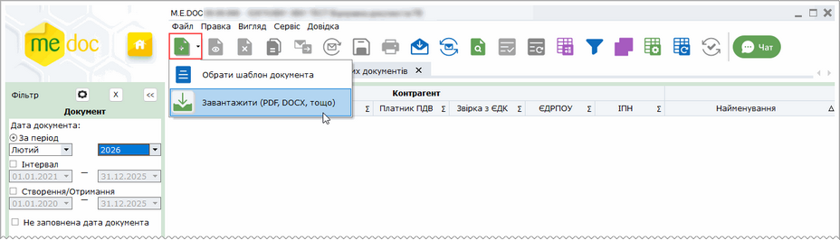

Натисніть, щоб збільшити малюнок

2. Відкриється вікно Відкриття файлу, у якому оберіть документ (чи кілька документів), які необхідно додати до Універсального документа у якості вкладень:

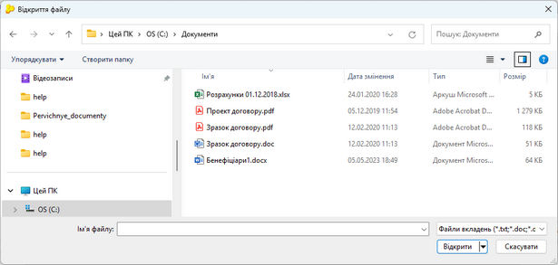

Натисніть, щоб збільшити малюнок

3. Відкриється вкладка Універсальний документ. Деякий час триватиме розпізнавання реквізитів у файлі вкладенні та перенесення їх у відповідні поля Універсального документа:

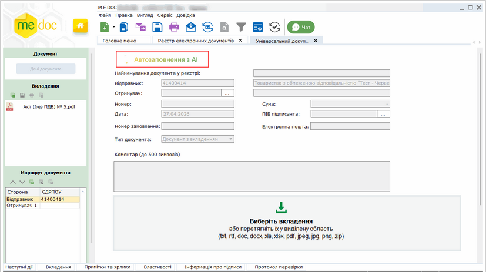

Натисніть, щоб збільшити малюнок

4. По завершенню розпізнавання реквізити з'являться у полях Універсального документа. Поля, які були заповнені за допомогою штучного інтелекту, позначаються позначкою .

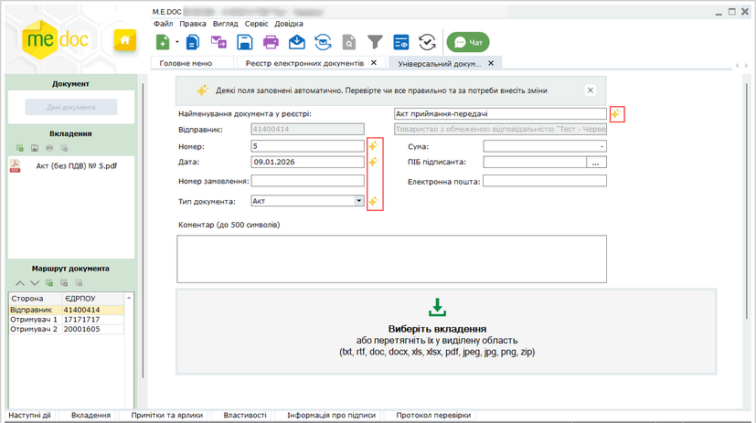

Натисніть, щоб збільшити малюнок

Автоматично заповнюються:

- ЄДРПОУ та назва контрагента;
- номер і дата документа;
- сума;
- тип документа;
- назва документа у реєстрі.

Перевірте правильність заповнення цих полів. У разі потреби, відкоригуйте їх значення вручну, а також дозаповніть інші необхідні дані. Докладно про реквізити Універсального документа дивіться у розділі [Створення Універсального документа із вкладеннями вручну](#doc_dov_form-doc_dov_form).

- Якщо вкладень кілька – дані реквізитів беруться з першого завантаженого файлу.
- У разі видалення єдиного вкладення в Універсальному документі заповнені реквізити зберігаються. Оновлення реквізитів відбудеться після завантаження нового вкладення.
- Якщо додано кілька вкладень, при видаленні першого з них реквізити автоматично оновлюються на основі наступного файлу. Аналогічно, при видаленні кожного наступного вкладення дані підтягуються з наступного доступного файлу.

Якщо ви скасували обрання файлів-вкладень, вікно Універсального документа матиме вигляд:

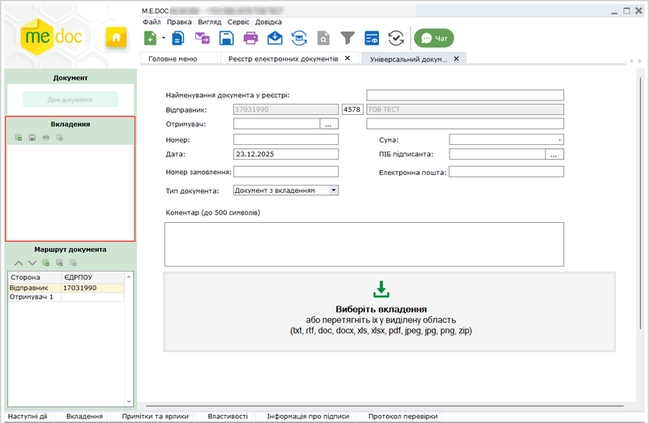

Натисніть, щоб збільшити малюнок

Додати вкладення можна у будь-який час, як описано у розділі [Додавання та видалення вкладень](#doc_dov_form-doc_dov_form). У такому разі реквізити Універсального документа також будуть заповнені за допомогою ШІ на основі доданого вкладення. Якщо ви додавали вкладення з [Реєстру електронних документів](#doc_dov_form-doc_dov_form) заповнення реквізитів за допомогою ШІ виконується під час відкриття Універсального документа.

5. Збережіть документ, натиснувши кнопку  або комбінацію клавіш Ctrl+S.

6. У таблиці Реєстру електронних документів перелік доданих файлів відображається на вкладці Вкладення.

[До початку](#doc_dov_form-doc_dov_form)

Створення Універсального документа із вкладеннями вручну

Якщо у вас є ліцензія Електронний документообіг і в розділі Адміністрування - Консоль адміністратора - Загальні налаштування - Налаштування АІ увімкнено функціонал Автозаповнення з АІ, заповнення реквізитів Універсального документа виконуватиметься автоматично [за допомогою штучного інтелекту](#doc_dov_form-doc_dov_form).

В інших випадках реквізити Універсального документа необхідно заповнювати вручну.

1. Оберіть один із способів:

- на панелі інструментів натисніть кнопку Створити - Завантажити (PDF, DOCX, тощо);
- виберіть команду Файл - Створити - Завантажити (PDF, DOCX, тощо);
- у контекстному меню оберіть команду Створити - Завантажити (PDF, DOCX, тощо).

Натисніть, щоб збільшити малюнок

2. Відкриється вікно Відкриття файлу, у якому оберіть документ (чи кілька документів), які необхідно додати до Універсального документа у якості вкладень:

Натисніть, щоб збільшити малюнок

3. Відкриється вкладка Універсальний документ. Обрані файли будуть відображені у області Вкладення:

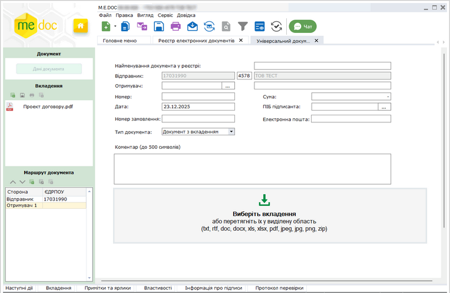

Натисніть, щоб збільшити малюнок

Якщо ви скасували обрання файлів-вкладень, вікно Універсального документа матиме вигляд:

Натисніть, щоб збільшити малюнок

Додати вкладення можна у будь-який час, як описано у розділі [Додавання та видалення вкладень](#doc_dov_form-doc_dov_form).

4. Заповніть поля Універсального документа:

Натисніть, щоб збільшити малюнок

- Найменування документа у реєстрі - введена назва відображається у колонці Найменування таблиці Реєстру електронних документів, поле може залишатися пустим, у такому випадку у таблиці реєстру відображатиметься назва Універсальний документ;
- Тип документа - залежно від обраного типу при підписанні документа буде застосовано комплект підписів, що налаштований саме для обраного типу документа, тип відображається у колонці Тип таблиці Реєстру електронних документів, за замовчуванням встановлено тип Документ з вкладенням;

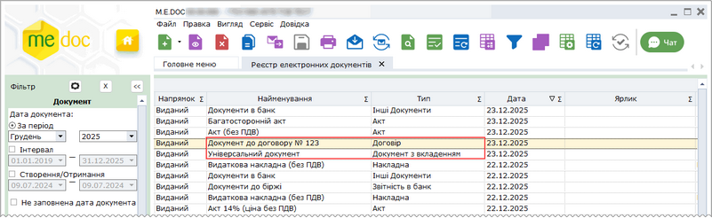

Натисніть, щоб збільшити малюнок

- Відправник - поле заповнюється за замовчуванням;
- Отримувач - оберіть отримувача документа з підключеного довідника Контрагенти;

Якщо відправник та/або отримувач документа є філією, у полях Відправник та/або Отримувач відповідно відображаються коди філій.

- Дата - вкажіть дату документа, за замовчуванням встановлюється поточна дата;
- Номер введіть номер документа;
- Сума - сума документа, (у разі потреби);
- ПІБ підписанта - ім'я та прізвище відповідальної особи, що підписує документ;
- Номер замовлення – вкажіть номер документа відповідно до внутрішньої системи документообігу користувача (у разі потреби);
- Електронна пошта – e-mail співробітника, що відправляє документ (у разі потреби);
- Коментар – довільний коментар до документа, може містити до 500 символів (у разі потреби).

3. Збережіть документ, натиснувши кнопку  або комбінацію клавіш Ctrl+S.

[До початку](#doc_dov_form-doc_dov_form)

Додавання та видалення вкладень

Додавати вкладення можна як у вікні відкритого документа, так і з Реєстру електронних документів.

Для додавання вкладень з Реєстру електронних документів:

Щоб додати вкладення у документ з Реєстру електронних документів, виділіть документ у таблиці реєстру та натисніть кнопку  на вкладці Наступні дії або на вкладці Вкладення. У вікні Відкриття файлу оберіть потрібний документ (або декілька документів) та натисніть Відкрити.

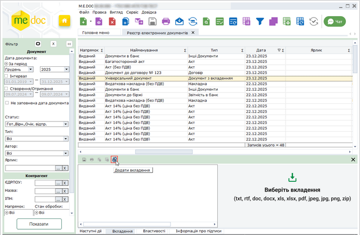

Натисніть, щоб збільшити малюнок

Для додавання вкладень у вікні відкритого документа:

1. Відкрийте документ та оберіть один із способів:

- натисніть кнопку  у розділі Дані документа;
- натисніть кнопку  на вкладці Вкладення у нижній частині вікна;
- натисніть кнопку   на панелі Вкладення у лівій частині вікна відкритого документа;
- натисніть іконку  на вкладці Наступні дії або вкладці Вкладення у нижній частині вікна;
- виконайте команду головного меню Правка - Додати вкладення.

У вікні Відкриття файлу оберіть потрібний документ та натисніть Відкрити:

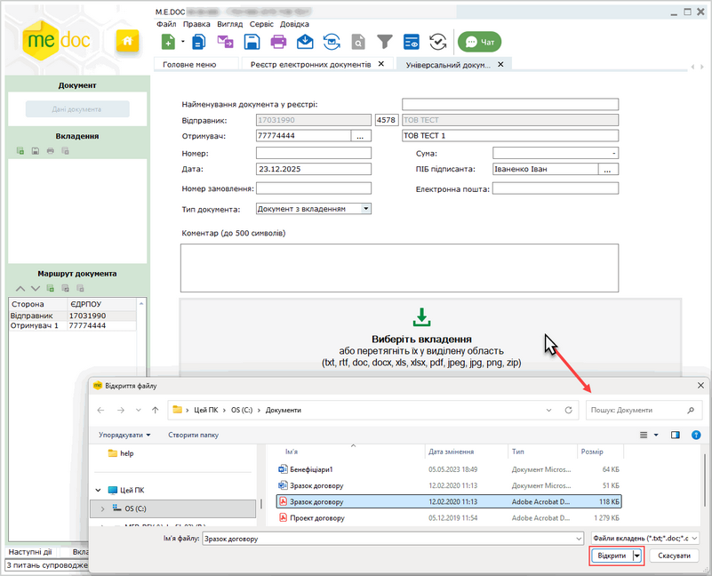

Натисніть, щоб збільшити малюнок

Додати вкладення можна, перетягнувши за допомогою миші назву документа у блок Вкладення або розділ Дані документа.

Також, можна одночасно додати декілька файлів вкладень, перетягнувши назву папки, у якій зберігаються документи, у блок Вкладення або розділ Дані документа. До Універсального документа будуть додані всі файли, що містяться у обраній папці та мають дозволені для вкладень формати (txt, rtf, doc, docx, xls, xlsx, pdf, png, jpeg, jpg, zip). Загальний розмір всіх файлів не повинен перевищувати 30 Мбайт.

При додаванні вкладень виконується перевірка унікальності імен та форматів файлів. При спробі додати файли з однаковими іменами та форматами буде виведено відповідне повідомлення.

Неможливо додати у вкладення файл, що не містить інформації. При спробі додати документи, що не містять даних, буде виведено повідомлення про неможливість додавання «пустих» документів.

2. Назва завантаженого файлу буде відображена на панелі Вкладення. Для перегляду файлу натисніть на його назві. Вміст документа буде відкрито у вкладці Універсального документа:

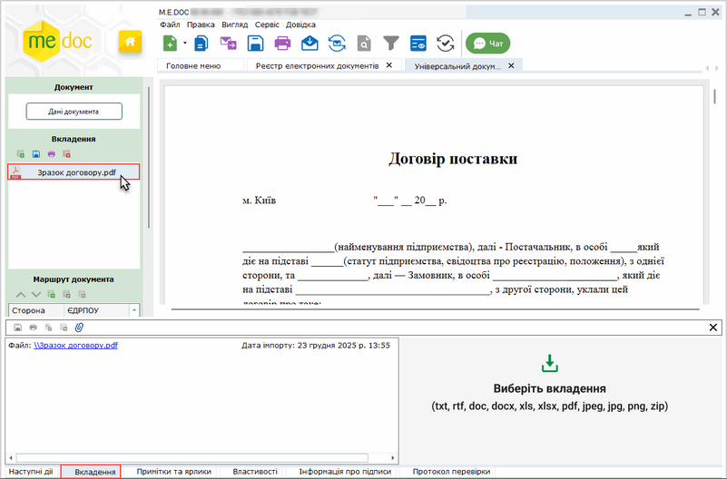

Натисніть, щоб збільшити малюнок

Можна змінити ім'я файлу вкладення. Для цього на панелі Вкладення натисніть 2 рази лівою кнопкою миші на назві файлу.

Також, імена завантажених файлів наводиться на вкладці Вкладення.

Якщо вміст вкладення неможливо відобразити, виводиться відповідне повідомлення з кнопками:

Відкрити - по натисканню кнопки вкладення відкривається у відповідному додатку;

Зберегти - по натисканню кнопки файл вкладення зберігається у обраному каталозі:

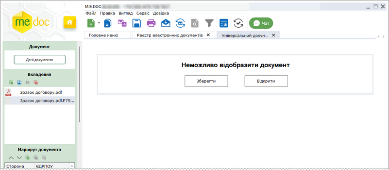

Натисніть, щоб збільшити малюнок

Зберегти вкладення також можливо, натиснувши на кнопку  на панелі Вкладення у лівій частині вікна

3. Щоб додати наступний документ, виконайте дії описані у [п.1](#doc_dov_form-doc_dov_form).

За допомогою вкладки Вкладення можна додавати вкладення як у вікні відкритого документа, так і безпосередньо з Реєстру електронних документів, попередньо виділивши потрібний документ із вкладеннями у таблиці:

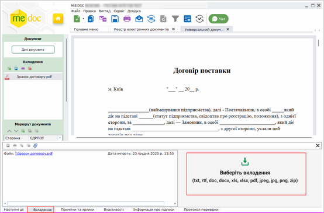

Натисніть, щоб збільшити малюнок.
Вкладка Вкладення у вікні відкритого документа

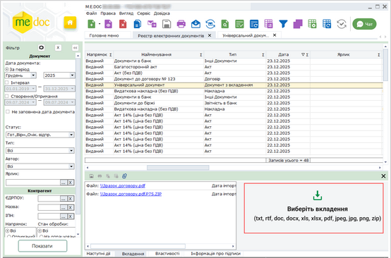

Натисніть, щоб збільшити малюнок.
Вкладка Вкладення у таблиці реєстру

Додавати та видаляти вкладення можна лише у документах, що мають статус Готується.

Щоб видалити вкладення у вікні відкритого документа, виділіть назву файлу на панелі Вкладення у лівій частині вікна та натисніть кнопку  :

-02-02-189_zoom70.png>)

Натисніть, щоб збільшити малюнок

4. Збережіть зміни у документі, натиснувши кнопку  або комбінацію клавіш Ctrl+S.

5. У таблиці Реєстру електронних документів перелік доданих файлів відображається на вкладці Вкладення.

Виконати операції зі вкладеннями (видалити, зберегти, або відкрити вкладення) можливо [за допомогою вкладки Вкладення](#doc_dov_form-doc_dov_form), як у Реєстрі електронних документів, так і у вікні відкритого документа.

[До початку](#doc_dov_form-doc_dov_form)

Визначення маршруту документа із вкладеннями

Для визначення маршруту відправки документа:

1. Відкрийте документ. Маршрут відправки документа налаштовується на панелі Маршрут документа у лівій частині вікна. За замовчуванням для документа вказується Відправник та один Отримувач, дані якого були вказані при створенні документа у розділі Дані документа:

2. За потреби, додайте отримувачів документа, натиснувши кнопку Додати  на панелі Маршрут документа. Відкриється вікно довідника Контрагенти, у якому оберіть контрагента, якого необхідно додати у маршрут.

3. Налаштуйте маршрут документа за допомогою кнопок панелі інструментів у розділі Маршрут документа:

- Видалити отримувача. Оберіть отримувача у розділі Маршрут документа та натисніть кнопку . У вікні повідомлення, що відкриється, підтвердіть видалення, натиснувши Так.

Зверніть увагу! У маршруті обов'язково повинен бути присутній хоча б один отримувач документа!

- Змінити отримувача. Оберіть отримувача у списку та натисніть кнопку  або натисніть кнопку  у рядку з ЄДРПОУ контрагента. Відкриється вікно довідника Контрагенти, у якому оберіть потрібного контрагента.
- Змінити порядок отримувачів. За допомогою стрілок  розташуйте отримувачів у потрібній послідовності. Документ відправляється отримувачам у послідовності, що визначена на панелі Маршрут документа.

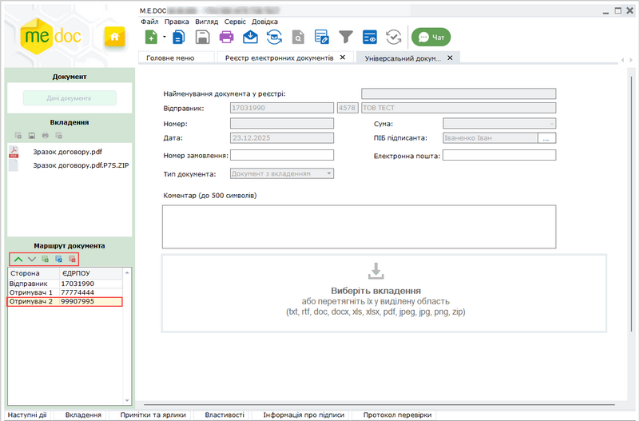

Натисніть на рисунок, щоб збільшити його

4. Збережіть документ, натиснувши кнопку  або комбінацію клавіш Ctrl+S.

Кожен з отримувачів з свого боку погоджує та підписує документ. Погоджений документ відправляється наступному отримувачу, згідно з визначеним маршрутом. Відправка документа далі за маршрутом здійснюється автоматично у момент його погодження учасником багатостороннього обміну.

Контрагентам, що вже отримали документ, надсилаються квитанції про погодження та підписання документа від кожного отримувача.

Якщо ж документ було відхилено будь-яким з отримувачів, контрагентам, що вже отримали документ, надсилається квитанція про відхилення документа. Обробка документа припиняється.

Інформація про погодження (відхилення) та підписання документа кожним контрагентом відображається на вкладці Протокол.

[До початку](#doc_dov_form-doc_dov_form)

Операції із вкладеннями

Для виконання операцій із вкладеннями:

1. Оберіть документ із вкладеннями у Реєстрі електронних документів та перейдіть на вкладку Вкладення. (Або оберіть вкладку Вкладення у вікні відкритого документа).

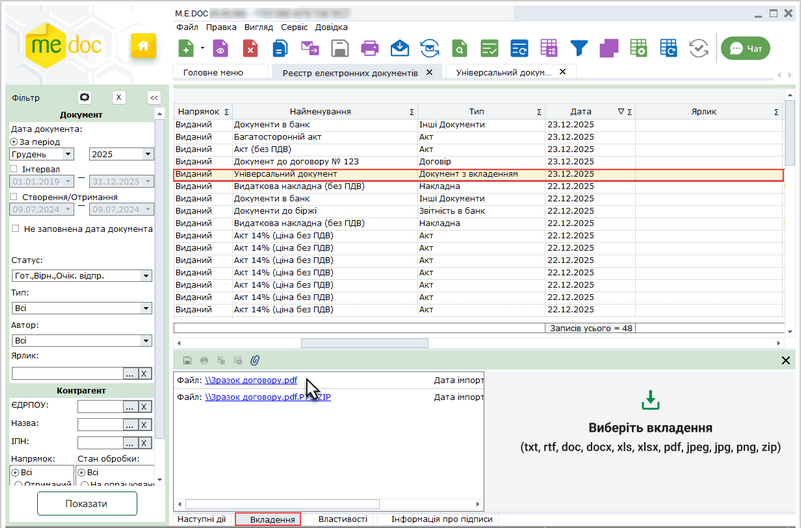

Натисніть, щоб збільшити малюнок

2. Натисніть лівою кнопкою миші на назві потрібного файлу. Відкриється вікно вибору операцій. Для непідписаних документів доступні операції:

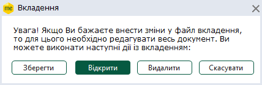

При натисканні на кнопки виконуються операції:

- Зберегти
відкривається вікно вибору папки для збереження.

- Відкрити
файл відкривається для перегляду у програмі відповідно до формату файлу.

- Видалити
файл видаляється. Видалити вкладення можна тільки з непідписаних та невідправлених документів.

- Скасувати
вікно вибору операції закривається.

При підписанні документів із вкладеннями виконується також підписання вкладень. При погодженні документа контрагентом виконується допідписання вкладення у форматі p7s.

Для підписаних вкладень можливо виконати операції:

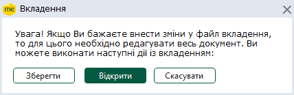

Після натискання кнопки Зберегти, необхідно обрати шлях збереження та формат збереження підписаного вкладення:

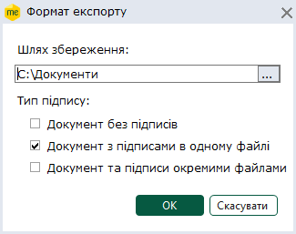

- Документ без підписів
Зберігається файл вкладення без накладених підписів.

- Документ з підписами
Зберігається файл вкладення у відповідному форматі, комплект підписів буде накладено безпосередньо на файл вкладення.

- Документ з підписами у форматі .P7S

Зберігається архів, що містить файл вкладення та файли підписів. Підписи зберігаються окремими файлами формату .p7s. Ім'я файлу підпису має формат: <ім’я файлу документа>.<розширення файлу документа>.(N).p7s, де N – номер підпису.

[До початку](#doc_dov_form-doc_dov_form)

Підписання ЕП та відправка документів із вкладеннями

Існує декілька способів відправки документів:

1. Із вкладки "Наступні дії"

Даний спосіб дозволяє відправити лише один документ - відкритий або виділений в Реєстрі електронних документів.

В доступних діях з документом передбачено декілька варіантів для зручності користувача:

Передати документ на підпис

На виконання цієї команди документ блокується від редагування та набуває статусу На підпис відповідальній особі. Документ знаходиться в стані очікування.
В Наступних діях стає доступним можливість [Підписати документ](UC_ECP.html#uc_ecp-ecp).
Після накладення підписів стає доступною функція Відправити документ. Програма повторно запропонує підписати файл сертифікатом печатки установи, таким чином підписується "конверт", в який поміщається файл для відправки.

Підписати документ

На виконання команди відразу розпочнеться стандартний процес [підписання документа](UC_ECP.html#uc_ecp-ecp) ЕП.
Після накладення підписів та печатки установи, стає доступною функція Відправити. Програма повторно запропонує підписати файл сертифікатом печатки установи, таким чином підписується "конверт", в який поміщається файл для відправки.

2. Безпосередньо з Реєстру електронних документів

Даний спосіб дозволяє відправляти як один документ, так и групу документів одночасно.

У реєстрі виберіть потрібний документ або групу документів та оберіть один із варіантів:

- на панелі інструментів натисніть кнопку Відправити - ;
- виберіть команду Файл - Відправити;
- у контекстному меню оберіть команду Відправити.

На виконання команди розпочнеться [підписання документа](UC_ECP.html#uc_ecp-ecp) ЕП та одразу відправка документа адресату. По закінченню процедури, система виведе протокол відправки документів.

При підписанні документів виконується також і підписання вкладень. При погодженні документа контрагентом виконується також допідписання вкладення у форматі p7s.

Інформація про підписи, а також факсиміле підписів, відображається у вікні перегляду вкладень Універсального документа на останній сторінці вкладення.

Для відображення інформації про підписантів на вкладеннях до Універсального документа необхідно встановити відмітку Накладати інформацію про підписантів у розділі [Адміністрування – Параметри системи – Документообіг](FormCompanyParams.html#formcompanyparams-admcompanyparams_sdo).

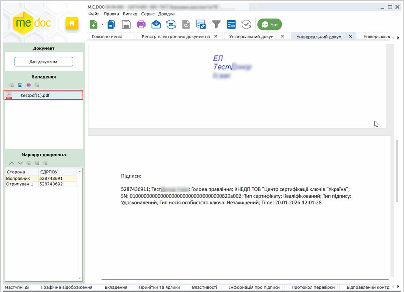

Натисніть, щоб збільшити малюнок

[До початку](#doc_dov_form-doc_dov_form)

Копіювання документа із вкладеннями

Для копіювання документа із вкладеннями:

1. Виділіть документ, копію якого потрібно створити. Для копіювання групи документів виділіть потрібне курсором миші, утримуючі клавіші <Ctrl> або <Shift>.

2. Оберіть один із способів копіювання:

- на панелі інструментів натисніть кнопку Копіювати - ;
- із контекстного меню команда Копіювати;
- команда Файл - Копіювати.

Із вікна відкритого документа копіюється тільки поточний документ.

3. На виконання функції копіювання відкриється вікно Дата виписки, у якому оберіть дату виписки копії документа.

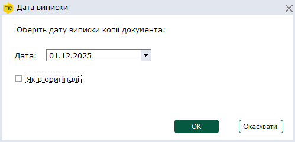

За замовчуванням встановлюється дата виписки документа, що копіюється.

Для того, щоб обрати іншу дату виписки, натисніть кнопку  у полі Дата. Відкриється вікно календаря, у якому оберіть потрібну довільну дату.

Якщо у копії необхідно зберегти дату виписки документа, встановіть позначку Як в оригіналі.

4. Після того, як дату обрано, натисніть кнопку ОК. Відкриється вікно копії документа. Скопійовані документи можна редагувати.

[До початку](#doc_dov_form-doc_dov_form)

Експорт документів із вкладеннями

Для збереження даних на електронному носії чи у обраному каталозі:

1. Оберіть у таблиці реєстру документ, якій потрібно експортувати.

2. Оберіть команду головного меню Файл – Експорт – Експорт документа або команду контекстного меню Експорт – Експорт документа.

3. У вікні Експорт документа оберіть каталог для збереження даних та параметри збереження даних (докладно дивіться розділ [Експорт електронних документів](UCDFDocsRstNew.html#ucdfdocsrstnew-exp_perv_el)). Ім'я файлу формується автоматично. Натисніть кнопку ОК.

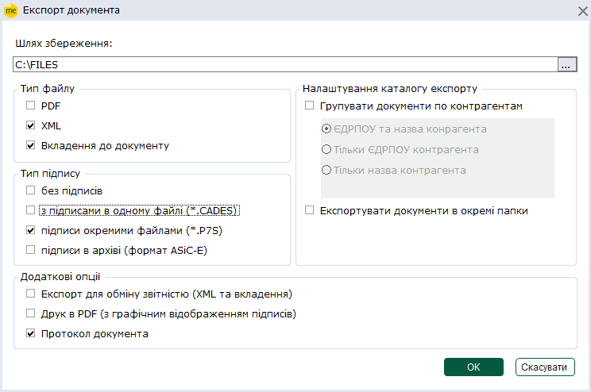

4. Система повідомить про результати експорту даних. Файл із вкладеннями буде збережено у обраному каталозі.

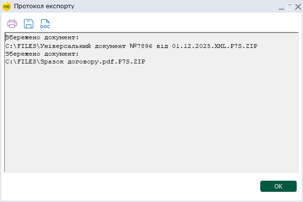

[До початку](#doc_dov_form-doc_dov_form)

Імпорт документів із вкладеннями

Для імпорту документа із вкладеннями:

1. У меню оберіть команду Файл - Імпорт - Імпорт звітів.

2. На виконання команди відкриється вікно вибору файлів вказаного формату, які імпортуються.

3. Вкажіть шлях до каталогу розміщення файлів. Оберіть файли та натисніть Відкрити для початку процесу імпорту.

4. По закінченні процедури система виведе протокол імпорту даних.

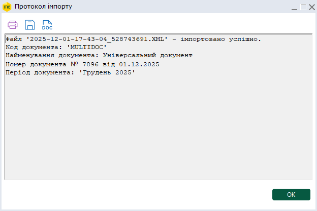

[До початку](#doc_dov_form-doc_dov_form)

Друк Універсального документа із вкладеннями в PDF

Дана функція дозволяє зберегти обрані документи на диску комп’ютера у файлах формату .pdf.

Для друку документів у PDF необхідно виділити потрібні документи.
У реєстрі документів реалізована можливість друку як одного файлу, так и групи файлів одночасно. Для групового друку документів виділіть потрібне курсором миші, утримуючі клавіші <Ctrl> або <Shift>.

Для друку документів у PDF виконайте дії у наступній послідовності:

1. Оберіть один із способів:

- із контекстного меню команда Друк в PDF;
- команда меню Файл - Друк в PDF.

2. У вікні Огляд папок вкажіть каталог, у якому потрібно зберегти файли .pdf.

3. Система повідомить про закінчення операції друку.

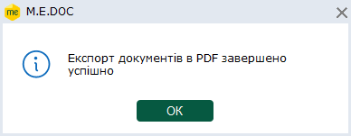

У обраному каталозі буде створено папку, назва якої відповідає назві збереженого Універсального документа. Всі вкладення до Універсального документа (якщо такі додані до документа) та сам документ зберігаються у окремих файлах формату PDF.

У файлах PDF відображається факсиміле підписів, що накладені на документ та вкладення (за наявності), та інформація про підписантів (за наявності відмітки у розділі [Адміністрування – Параметри системи – Документообіг](FormCompanyParams.html#formcompanyparams-admcompanyparams_sdo) - Накладати інформацію про підписантів).

Також функція друку документа  у PDF доступна і у відкритому вікні документа:

- команда меню Файл - Друк в PDF.

Із вікна відкритого документа у форматі PDF зберігається тільки поточний документ.

[До початку](#doc_dov_form-doc_dov_form)


