[← Зміст довідки](../)


# Експорт податкових документів

#### Експорт податкових документів

_Шлях у довідці: Розділи програми › Первинні документи › Реєстр податкових документів › Експорт податкових документів_

В цьому розділі:

[Експорт документів у формат XML для подання у контролюючі органи](#exp_perv-exp_perv)

[Експорт документів у формат XML для подання у Головну установу](#exp_perv-exp_perv)

[Експорт підписаних документів (від'ємних Додатків 2)](#exp_perv-exp_perv)

[Шифрування та збереження первинних документів](#exp_perv-exp_perv)

[Експорт до облікової системи](#exp_perv-exp_perv)

[Експорт даних про реєстрацію в ЄРПН у формати DBF та CSV](#exp_perv-exp_perv)

[Універсальний експорт](#exp_perv-exp_perv)

[Експорт таблиці реєстру](#exp_perv-exp_perv)

[Експорт квитанцій про реєстрацію в ЄРПН](#exp_perv-exp_perv)

Експорт первинних документів призначений для збереження документів у обраному каталозі або електронному носії з метою подачі вивантажених звітів у контролюючі органи, для подачі звітів у Головну установу (для підзвітних організацій), або для експорту даних у інші облікові системи.

При експорті звіту із програми його назва та розширення відповідають регламентованим правилам подання звітів до певних контролюючих органів. Звіти перевіряються на заповнюваність обов'язкових реквізитів у документі згідно затверджених схем XSD (тільки для Податкових накладних та Додатку 2). Ці перевірки аналогічні тим, які виконуються при прийманні документів у контролюючих органах.

Експорт документів в каталог чи на електронний носій можливий тільки в повній робочій версії ПК M.E.Doc.

У Реєстрі податкових документів можна експортувати як один файл, так і групу файлів одночасно. Для групового експорту документів виділіть рядки потрібних документів лівою кнопкою миші, утримуючи клавіші <Ctrl> або <Shift>.

Функція експорту доступна і у відкритому вікні документа. Із вікна відкритого документа експортується тільки поточний документ.

Експорт документів для подання у контролюючі органи

Дана функція призначена для збереження звіту на електронному носії чи у обраному каталозі. Виконати експорт можливо тільки для Податкових накладних та Додатку 2.

Експорт документів виконується у наступній послідовності:

1. Виділіть потрібний для експорту документ у Реєстрі податкових документів.

2. Оберіть команду експорту документа одним із наступних способів:

- команда меню Файл - Експорт - Експорт;
- у контекстному меню команда Експорт.

3. Відкриється вікно Експорт. Оберіть опцію для подачі у контролюючий орган.

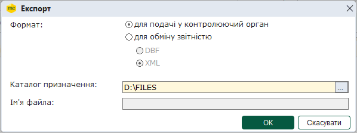

4. Вкажіть каталог, де зберегти експортовані дані, у полі Каталог призначення. Документ зберігається у файлі формату .xml. Ім'я файлу регламентоване правилами подання звітів до контролюючого органу.

5. Натисніть ОК.

6. Після закінчення процедури, система виведе протокол експорту документів. Якщо для експорту було обрано групу документів, у разі вдалого виконання операції, у протоколі вказано кількість сформованих звітів та імена файлів, у яких збережено дані.

[До початку](#exp_perv-exp_perv)

Експорт документів у формат XML для подання у Головну установу

Дана функція призначена для збереження документів на електронному носії чи у обраному каталозі з метою передачі його у Головну установу для подальшого аналізу, або з метою передачі його у іншу базу даних у ПК "M.E.Doc". Експорт документів для подання у Головну установу виконується у форматі «Внутрішній (нативний) XML». Експорт виконується для всіх видів первинних документів. Якщо документи містять підписи та квитанції, також експортуються дані підписів та квитанцій.

Експорт документів виконується у наступній послідовності:

1. Виділіть потрібний для експорту документ, або групу документів, у таблиці реєстру.

2. Експорт документа викликається одним із наступних способів:

- команда меню Файл - Експорт - Експорт;
- у контекстному меню команда Експорт.

3. На виконання функції експорту відкривається вікно Експорт. Оберіть опцію "для обміну звітністю".

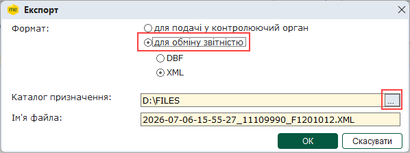

4. Встановіть позначку, що відповідає формату, у якому потрібно зберегти дані: DBF або XML.

5. Вкажіть каталог, де зберегти створений файл, у полі Каталог призначення.

Ім'я файлу згенерується автоматично. Ім'я містить в собі дату, час створення, код ЕДРПОУ підприємства та код документа.

6. Натисніть ОК.

7. Система повідомить про закінчення процесу експорту.

Примітка:

Якщо для експорту було обрано групу документів, дані всіх обраних Податкових накладних та Додатків 2 об'єднуються у одному файлі. Дані інших типів первинних документів зберігаються у окремих файлах: для кожного типу документів буде відкрито вікно Експорт та запропоновано ім'я файлу. Якщо експортується кілька документів певного типу, до імені файлу, автоматично додається порядковий номер.

[До початку](#exp_perv-exp_perv)

Експорт підписаних документів

Дана функція призначена для збереження на електронні носії підписаних від'ємних Додатків 2. Виконати такий експорт можливо тільки для документів, які підписані повним комплектом підписів та готові до відправки або вже були відправлені.

Документи, які були відправлені, експортуються з накладеними підписами, не зашифровані на адресата.

Експорт документів виконується у наступній послідовності:

1. Виділіть підписаний від'ємний Додаток 2, який необхідно експортувати.

2. У вкладці Наступні дії оберіть нову функцію Експортувати підписаний документ.

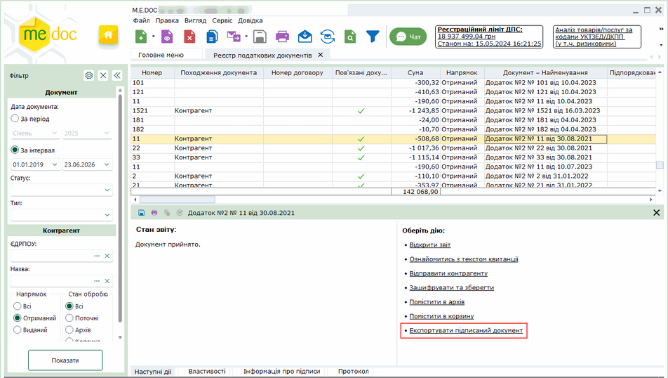

Натисніть, щоб збільшити

3. Вкажіть каталог, де зберегти файл.

4. Документи зберігаються у файлі формату для подачі у контролюючий орган (.xml).

[До початку](#exp_perv-exp_perv)

Шифрування та збереження документів

Призначення функції - збереження підписаних та зашифрованих на одержувача документів. Даний спосіб може використовуватися для відправлення документів електронною поштою контрагентам чи в ДПС у випадку, якщо на комп'ютері відсутній доступ до мережі Інтернет.

У процесі  вивантаження обирається формат експорту.

Виконати такий експорт можливо тільки для документів Податкова накладна або Додаток2.

Підпис, шифрування та експорт документів виконується у наступній послідовності:

1. У таблиці модуля виділіть документи, які необхідно експортувати.

2. Оберіть один із способів:

- команду меню Файл - Зашифрувати та зберегти;
- із контекстного меню команду Зашифрувати та зберегти;
- команду Зашифрувати та зберегти на вкладці Наступні дії.

Функція доступна також у відкритому вікні документа:

- у меню Файл - Зашифрувати та зберегти. В цьому випадку дії виконуються лише з цим відкритим документом.

3. Відкриється вікно Вибір адресата.

Для документів, що призначені ДПС, оберіть розділ Для подачі звітності. Якщо документи призначені контрагентам, оберіть розділі Інші.

У правій частині вікна оберіть назву потрібного адресата:

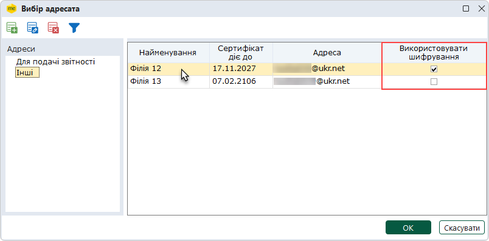

Обов'язково перевірте, чи використовується підпис та шифрування при обміні з обраним контрагентом:

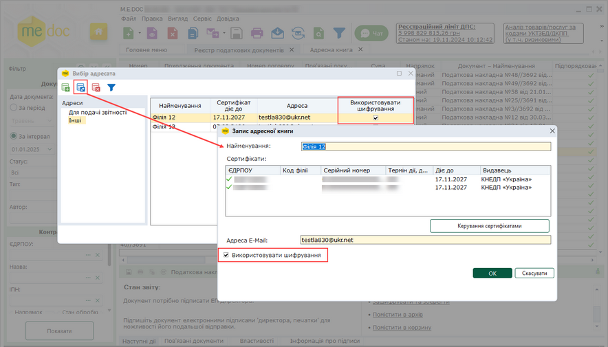

Натисніть, щоб збільшити

Якщо підпис та шифрування не використовуються, Ваші документи будуть незахищені.

4. У наступному вікні оберіть відповідний формат файлу:

- для подачі у контролюючий орган;
- для обміну звітністю - обміні документами з обраним контрагентом.

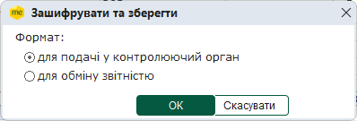

5. Вкажіть шлях для збереження файлу.

6. Далі запускається звичайна процедура накладання підписів та шифрування файлу.

7. Після закінчення процедури відкривається протокол операції, в якому вказується каталог із збереженими файлами.

[До початку](#exp_perv-exp_perv)

Експорт до облікової системи

Дана функція призначена для експорту даних до систем автоматизації бухгалтерського обліку. Для успішного експорту система бухгалтерського обліку має бути належним чином налаштована та працювати на момент виконання експорту.

Експорт документів виконується у наступній послідовності:

1.  Виділіть потрібні для експорту документи.

2. У меню Файл оберіть Експорт та далі Експорт до облікової системи.

3. Система повідомить про результати виконання процесу експорту.

[До початку](#exp_perv-exp_perv)

Експорт даних про реєстрацію в ЄРПН у формати DBF та CSV

Ця функція призначена для збереження даних реєстрації податкових накладних в Єдиному реєстрі податкових накладних (ЄРПН). Дані зберігаються на електронному носії чи у обраному каталозі у форматі DBF або CSV. Виконати експорт можливо тільки для Податкових накладних та Додатку 2, що зареєстровані у ЄРПН.

Експорт документів виконується у наступній послідовності:

1. Виділіть потрібний для експорту документ у Реєстрі податкових документів.

2. Виберіть команду меню Файл - Експорт - Експортувати дані про реєстрацію в ЄРПН.

3. На виконання функції експорту відкривається модальне вікно Експорт.

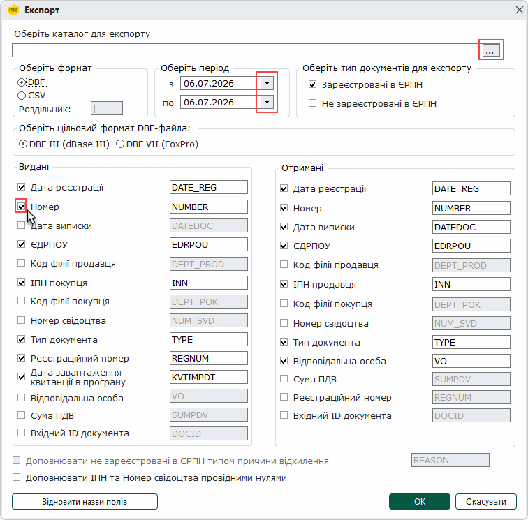

4. Вкажіть каталог, де зберегти створений файл, у полі Оберіть каталог для експорту.

5. У області Оберіть формат оберіть потрібний формат для експорту DBF або CSV. При виборі формату CSV стає активним поле Роздільник, у якому вказується роздільник даних для файлу CSV (наприклад, ; або ,).

6. У області Оберіть період оберіть дати початку та закінчення періоду часу, у який були зареєстровані документи.

7. У області Оберіть тип документів для експорту оберіть тип - Зареєстровані в ЄРПН та/або Не зареєстровані в ЄРПН.

8. У області Видані обираються дані документів, що були видані контрагентам.

   У області Отримані - дані документів, що були отримані від контрагентів. Встановіть позначки, що відповідають даним, які потрібно експортувати.

9. Обраним даним по замовчуванню пропонується назва колонки, у якій буде збережено дані. Якщо необхідно змінити назву колонки, вкажіть нову назву у полі, розташованому праворуч від назви даних.

   Натиснувши кнопку Відновити назви полів, можливо повернути назву, запропоновану за замовчуванням, Первинна назва буде повернена ВСІМ відредагованим назвам.

10. Якщо необхідно, щоб номера ІПН та свідоцтва містили 12 символів, встановіть позначку Доповнювати ІПН та Номер свідоцтва провідними нулями. До номерів, що містять менше 12 символів, перед номером буде додана необхідна кількість нулів.

11. Натисніть ОК.

12. Система повідомить про закінчення процесу експорту.

[До початку](#exp_perv-exp_perv)

Універсальний експорт

Дана функція призначена для збереження даних первинних документів на електронному носії чи у обраному каталозі. Функція дає можливість обрати формат, у якому буде збережено дані: DBF або Excel.

Експорт документів виконується у наступній послідовності:

1. Налаштування параметрів експорту

1. Виділіть потрібний для експорту документ у реєстрі.

2. Виберіть команду меню Файл - Експорт - Універсальний експорт.

3. На виконання функції експорту відкривається модальне вікно Експорт. Оберіть вкладку Налаштування.

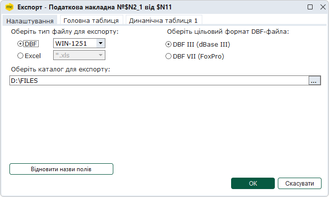

4. У розділі Оберіть тип файлу для експорту встановіть позначку, що відповідає формату файлу, в якому необхідно зберегти дані.

5. Якщо було обрано тип файлу DBF, у полі праворуч, оберіть кодування символів, яке буде застосоване при збереженні файлу.

6. У полі Оберіть каталог для експорту вкажіть каталог, де зберегти створений файл.

2. Налаштування експорту даних

Процедура експорту передбачає розподілення даних документа на дві таблиці: Головну таблицю та Динамічну таблицю. Вміст кожної таблиці налаштовується окремо на однойменних вкладках вікна Експорт.

1. Перейдіть на вкладку Головна таблиця.

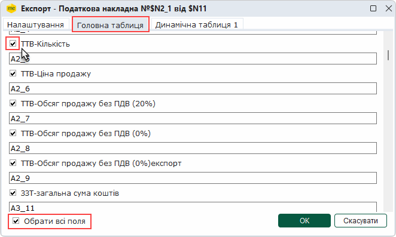

2. Встановіть позначки, що відповідають даним, які повинні бути експортовані. Для того щоб обрати всі поля, встановіть позначку Обрати всі поля у нижній частині вікна.

3. Обраним даним по замовчуванню пропонується назва колонки, у якій буде збережено дані. Якщо необхідно змінити назву колонки, вкажіть нову назву у полі, розташованому під назвою даних. Натиснувши кнопку Відновити назви полів, на вкладці Налаштування, можливо повернути назву, запропоновану по замовчуванню. Первинна назва буде повернена ВСІМ відредагованим назвам.

4. Перейдіть на вкладку Динамічна таблиця 1.

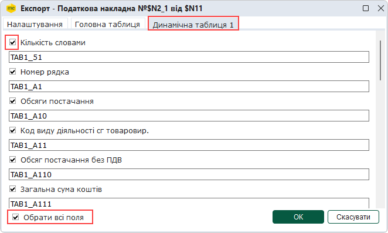

5. Встановіть позначки, що відповідають даним, які повинні бути експортовані. Для того щоб обрати всі поля, встановіть позначку Обрати всі поля у нижній частині вікна.

6. Обраним даним по замовчуванню пропонується назва колонки, у якій буде збережено дані. Якщо необхідно змінити назву колонки, вкажіть нову назву у полі, розташованому під назвою даних.

3. Виконання експорту

1. Після виконання всіх необхідних налаштувань натисніть кнопку ОК на будь-якій вкладці вікна Експорт.

2. Система повідомить про закінчення процесу експорту.
Якщо в налаштуваннях було обрано тип файлу DBF, буде сформовано 2 файли: файл з розширенням DBF, що містить дані, та допоміжний файл з розширенням DBT. Якщо в налаштуваннях було обрано тип файлу Exсel, дані буде збережено на одному аркуші файлу формату .xlsx.

Примітка:

Якщо для експорту було обрано групу однотипних документів (лише Податкові накладні, або лише Додаток 2), дані експортуються в один файл, у якому кожному документу відповідає окремий рядок.

Якщо для експорту була обрана група, що містить документи різного типу, кожен тип зберігається у окремому файлі (окремий файл для Податкових накладних, та окремий файл для Додатків 2). На збереження кожного типу документів буде відкрито вікно Експорт, де необхідно налаштувати параметри імпорту документів певного типу.

[До початку](#exp_perv-exp_perv)

Експорт таблиці реєстру

Дана функція призначена для збереження даних, що відображені на момент експорту у вікні реєстру.

Експорт документів виконується у наступній послідовності:

1. У меню Файл оберіть Експорт реєстру та далі Експорт таблиці Excel.

2. Відкривається вікно діалогу збереження файлів ОС Windows, у якому вкажіть ім'я файлу для збереження даних.

3. Натисніть кнопку Зберегти.

4. Система повідомить про закінчення процесу експорту.

Також можна роздрукувати або зберегти у PDF-файл дані, що відображені у вікні реєстру. Для цього:

1. У меню Файл оберіть Експорт реєстру та далі Друк реєстру.

2. Відкривається вікно діалогу для вибору принтера, у якому вкажіть ім'я принтера для друку або оберіть друк у PDF-файл для збереження даних.

3. Натисніть кнопку Друк. Якщо обрано друк у PDF-файл, відкривається вікно діалогу збереження файлів ОС Windows, у якому вкажіть ім'я файлу для збереження даних, натисніть кнопку Зберегти.

4. Система повідомить про закінчення процесу друку.

[До початку](#exp_perv-exp_perv)

Експорт квитанцій про реєстрацію в ЄРПН

Дана функція призначена для збереження даних про квитанції реєстрації документів у Єдиному реєстрі податкових накладних (ЄРПН). Дані зберігаються у вигляд текстового файлу формату RTF на електронному носії чи у обраному каталозі. Виконати експорт можливо тільки для Податкових накладних та Додатку 2, що зареєстровані у ЄРПН.

Експорт документів виконується у наступній послідовності:

1. Виділіть потрібний для експорту документ у Реєстрі податкових документів.

2. Експорт документа викликається одним із наступних способів:

- команда Файл - Експорт - Експортувати в RTF квитанцію про реєстрацію в ЄРПН;
- із контекстного меню команда Експортувати в RTF квитанцію про реєстрацію в ЄРПН.

3. Відкривається вікно діалогу Огляд папок, у якому оберіть шлях до каталогу, в якому буде збережено файл з експортованими даними. Натисніть кнопку ОК.

4. Система повідомить про закінчення процесу експорту.

[До початку](#exp_perv-exp_perv)

## Перевірка захищеного обміну з контрагентом

_Шлях у довідці: Експорт податкових документів › (поза змістом)_

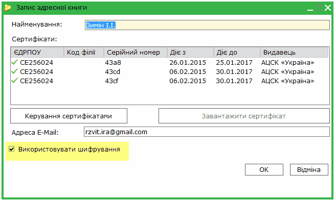


