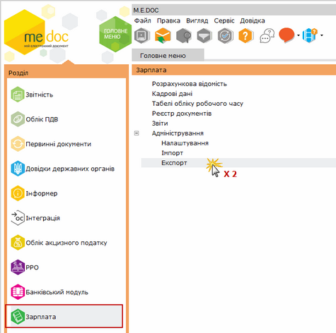
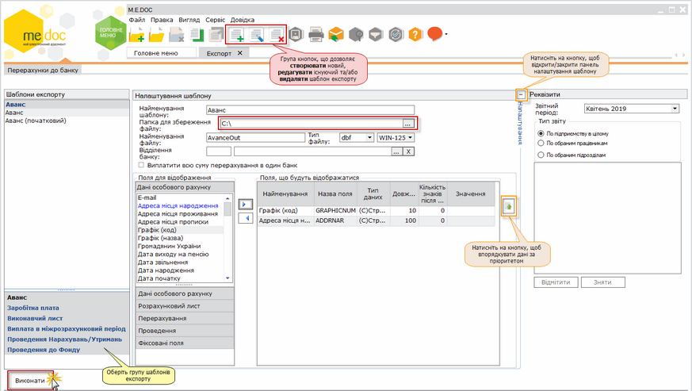

[← Зміст довідки](../)


# Експорт

## Експорт

_Шлях у довідці: Розділи програми › Зарплата › Адміністрування › Експорт_

Реалізована можливість експортувати перерахунки до банку у формат \*.dbf.

1. У розділі Зарплата - Адміністрування подвійним кліком лівої клавіші миші відкрийте розділ Експорт.

Натисніть, щоб збільшити малюнок

2. Оберіть групу шаблонів для експорту серед запропонованих:

- Аванс
- Заробітна плата
- Виконавчий лист
- Виплата в міжрозрахунковий період
- Проведення Нарахувань/Утримань
- Проведення до Фонду

3. Для того, щоб створити новий шаблон скористайтесь одним із наступних способів:

- на панелі інструментів натисніть кнопку Створити запис;
- натисніть комбінацію клавіш Ctrl+I;
- оберіть команду Правка/Створити запис.

Натисніть, щоб збільшити малюнок

4. Налаштуйте параметри шаблону для експорту:

- Найменування шаблону - заповнюється автоматично, відповідно заданому виду оплати у графі Шаблони експорту, можливо корегувати назву шаблону експорту вручну з клавіатури;
- Папка для збереження файлу - натисніть на кнопку  та вкажіть шлях для вивантаження файлу за обраним шаблоном;

         Увага! Для користувачів Windows 8 та Windows 10:
          якщо файл зберігається на диск, де встановлена операційна система, потрібно обов'язково перевірити чи маєте ви доступ до цього диску та/або папки.

- Найменування файлу - введіть назву файлу, що вивантажиться за обраним шаблоном;
- Тип файлу - із випадаючого списку оберіть тип файлу та кодування;
- Відділення банку - оберіть із довідника МФО та найменування банку, в який здійснюється перерахунок коштів (заповнюється за потребою).
- Виплатити всю суму перерахування в один банк - відзначається, галочкою,  за потребою;
- За допомогою кнопок  та  формуйте перелік полів, що будуть відображатись у вивантаженому файлі.
- За допомогою кнопки  упорядкуйте дані у розділі Поля, що будуть відображатися за пріоритетністю;
- У блоці атрибутів Реквізити оберіть звітний період, на підставі даних якого сформувати документ для експорту.

У області Тип звіту встановіть позначку біля варіанту, на підставі яких саме даних формувати документ:
- по всьому підприємству;
- по обраним працівникам;
- по обраним підрозділам.

За умови вибору варіанту "По обраним працівникам", нижче відобразиться перелік співробітників підприємства. Встановіть позначки напроти тих працівників, для яких потрібно сформувати документ.

За умови вибору варіанту "По обраним підрозділам" нижче відобразиться перелік підрозділів підприємства. Встановіть галочки напроти тих підрозділів, на підставі даних яких потрібно сформувати документ.

5. Після налаштування всіх параметрів натисніть кнопку Виконати.


