[← Зміст довідки](../)


# Параметри системи

## Параметри системи

_Шлях у довідці: Розділи програми › Адміністрування › Параметри системи_

Даний модуль дозволяє налаштувати основні параметри програми, пов'язані із початком експлуатації, підписом документів ЕП, налаштуванням комплекту підписів, настроюванням електронної пошти.

Модуль включає наступні підрозділи:

- [Загальні](#formcompanyparams-admcompanyparams_total). Налаштовуються основні властивості програми, пов'язані з її експлуатацією.
- [Підпис](#formcompanyparams-admcomanyparams_pen). Налаштовуються атрибути, пов'язані із накладанням електронного підпису.
- [Перевірка підписів](#formcompanyparams-admcomanyparams_pp). Налаштовується перевірка актуальності сертифікатів електронних підписів, що використовуються в процесі обміну електронними документами.
- [Звітність](#formcompanyparams-admcompanyparams_zv). Налаштовуються основні властивості звітних документів.
- [Документообіг](#formcompanyparams-admcompanyparams_sdo). Налаштовується використання поштового з'єднання для відправки документів з системи.
- [Звітність філій](#formcompanyparams-admcompanyparams_rep). Налаштовується підпорядкованість підприємства, а також автоматичний обмін звітністю між філіями та головною установою за допомогою електронної пошти.
- [Електронна пошта](#formcompanyparams-admcompanyparams_emaile). Налаштовується поштове з’єднання для відправки/отримання документів в електронному вигляді.
- [Налаштування проксі](#formcompanyparams-admcompanyparams_prox). Налаштовуються параметри підключення до проксі-сервера.
- [Експорт документів](#formcompanyparams-pdf_autoexport). Налаштовуються параметри автоматичного збереження документів у форматі PDF.
- [Резервне копіювання](#formcompanyparams-admcompanyparams_rk). Встановлення за замовчанням створення резервних копії перед закриттям програми.
- [Посилений захист](#formcompanyparams-admcompanyparams_zahyst). Встановлення використання посиленого захисту ЕП.
- [Авторизація](#formcompanyparams-admcompanyparams_authorize). Встановлення використання посиленого захисту авторизації та налаштувань користувачів з ACTIVE DIRECTORY.
- [Перетворення форм ПН-Дод2](#formcompanyparams-admcompanyparams_peretvor). Налаштовуються параметри перетворення старих форм ПН/РК у нові форми при імпорті.
- [Налаштування API акциз](#formcompanyparams-admcompanyparams_rivnemir). Налаштовується підключення до серверу системи моніторингу рівнемірів/витратомірів.
- [Налаштування АРІ НБУ](#formcompanyparams-admcompanyparams_api_nbu). Налаштовується підключення до спеціального вебресурсу НБУ для подання [звітів до НБУ небанківських фінансових установ (НФУ)](NBU.html#nbu-nbu).
- [Додаткові налаштування](#formcompanyparams-add_set). Налаштовується рівень протоколювання системних подій для запису до log-файлів.

### Загальні

_Шлях у довідці: Розділи програми › Адміністрування › Параметри системи › Загальні_

Підрозділ дозволяє налаштувати основні властивості програми, пов'язані з її експлуатацією.

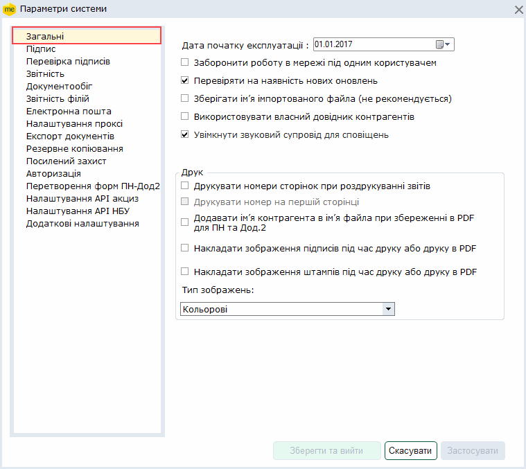

- Дата початку експлуатації

Це дата початку відліку звітних періодів у програмі, а також відображення бланків документів.

Обирається із підключеного до поля календаря або вводиться із клавіатури.

За замовчанням встановлюється дата першого дня року, в якому почали користуватися програмою. Але може бути змінена на актуальну для відображення потрібних документів, наприклад, за минулі звітні періоди.

- Заборонити роботу в мережі під одним користувачем.

В рамках розмежування прав доступу користувачів до функцій програми, кожному з них надаються логін та пароль. Наявність галочки у цьому полі означає, що в мережевому варіанті ПК M.E.Doc під певними логіном та паролем зможе працювати тільки один користувач.

- Перевіряти на наявність нових оновлень

Встановлена опція вмикає перевірку наявності нових оновлень програмного комплексу при кожному вході в систему. В разі присутності не встановлених оновлень на сервері, відкривається вікно з переліком оновлень.

За замовчанням дана галочка встановлена.

Для перевірки наявності нових оновлень комп'ютер із встановленим програмним комплексом обов'язково повинен бути підключений до мережі Інтернет. В разі відсутності прямого підключення до Інтернету, необхідно налаштувати [параметри підключення до проксі-сервера](#formcompanyparams-admcompanyparams_prox).

- Зберігати ім’я імпортованого файла (не рекомендується)

Якщо опція встановлена, то під час імпорту до програми XML-файлів у форматі подачі до контролюючого органу зберігаються назви цих файлів.

Ці самі назви будуть використовуватись також при відправці звіту, експорті в форматі контролюючого органу та ін., якщо ці дії виконуються із увімкненим параметром.

Параметр не впливає на імпорт файлів форматів PFZ, DBF та інших форматів.

Особливості імпорту із увімкненим параметром:

- програма не перевіряє відповідність назви файлу формату контролюючого органу;
- програма не перевіряє унікальність назви імпортованого файлу;
- максимальна довжина назви файлу з розширенням - 50 символів. Якщо назва файлу буде довшою, то при виконанні імпорту назву буде обрізано.
- Використовувати власний довідник контрагентів

Встановлена опція вмикає можливість редагування даних контрагентів, які були отримані з ЄДК (у відкритій картці контрагента користувач має можливість редагувати поля: найменування, адреса, ЄДРПОУ, ІПН, філія, телефон, тощо. Але поля вкладки "Історія в ЄДК" недоступні для редагування).

- Увімкнути звуковий супровід для сповіщень

Встановлена опція вмикає звуковий супровід при появі повідомлень, модальних вікон і протоколів імпорту, відправки та прийому пошти. Щоб вимкнути звуковий супровід - видаліть опцію. За замовчуванням опція вимкнена.

- Друкувати номери сторінок при роздрукуванні звітів.

Якщо опція встановлена, під час друку звітів, РПН, ПН та Дод. 2 на аркуші додаються номери сторінок.

- Друкувати номер на першій сторінці.

Якщо опція встановлена, під час друку та експорту у PDF на першій сторінці документа проставляється номер сторінки. Опція працює для документів: Звіти, Реєстр податкових накладних, Податкова накладна та Додаток 2. За замовчуванням, опція відключена.

- Додавати ім'я контрагента в ім'я файла при збереженні в PDF для ПН та Дод.2.

Якщо опція встановлена, під час друку та експорту у PDF у назві файла зазначатиметься назва контрагента-отримувача документа.

- Накладати зображення підписів під час друку або експорту у PDF

Встановлена опція дозволяє роздруковувати та експортувати в PDF документи із сканкопіями підпису та печатки установи, як власної, так і контрагентів.

- Накладати зображення штампів під час друку або експорту у PDF

Якщо опція встановлена, на зображення документа під час друку та експорту у PDF буде накладатися штамп про обробку документа («Доставлений контрагенту», «Зареєстровано в ЄРПН» тощо). Налаштування застосовується для всіх типів документів.

- Тип зображень.

Вибір типу зображення сканкопій підписів для друку та експорту: кольорові чи у режимі підвищеної контрастності.

Для збереження внесених змін натисніть Зберегти та вийти.

По натисканню кнопки Застосувати відбувається збереження змін у налаштуваннях параметрів системи, вікно Параметри системи залишається відкритим. Якщо зміни не вносилися - кнопка Застосувати неактивна.

Для того, щоб закрити вікно Параметрів системи без збереження змін, натисніть Скасувати.

### Підпис

_Шлях у довідці: Розділи програми › Адміністрування › Параметри системи › Підпис_

Підрозділ дозволяє налаштувати властивості програми, пов'язані із накладанням електронного підпису.

Якщо встановлена опція Використовувати пароль останнього підпису для ключа шифрування, система автоматично підставляє пароль печатки установи для шифрування.

Примітка:

Обрання шляху до носія (каталогу) розміщення секретних ключів підписувача відбувається в процесі накладення підпису, безпосередньо у вікні для введення паролю

Налаштування комплектів підписів

За наявності на підприємстві декількох осіб, що відповідають за підписання документів ЕП (наприклад, кілька бухгалтерів), реалізована можливість надання права підпису будь-яким відповідальним особам (співробітникам), за умови наявності у них сертифікатів ЕП.

При налаштуванні комплектності підписів можна додавати сертифікати потрібних осіб за типом (Бухгалтер, Директор). Таким чином, при підписанні документа, система запропонує обрати сертифікат особи серед заданого в параметрах системи списку сертифікатів.

1. Оберіть тип звітності, для якого потрібно задати комплект підписів.

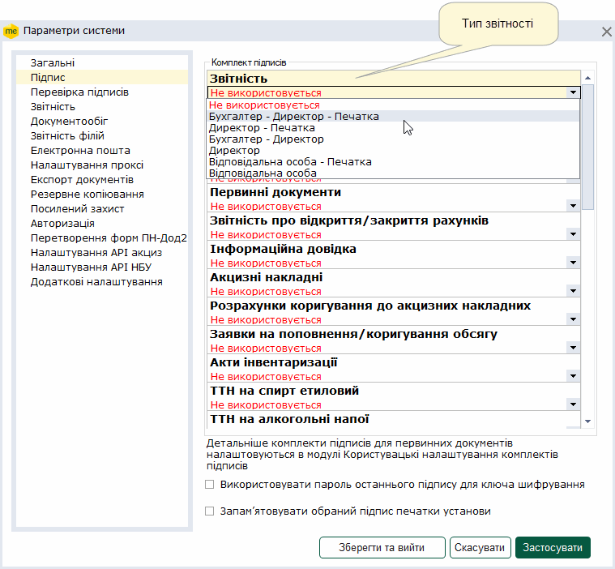

2. Під назвою типу звітності із списку, що відкриється, оберіть потрібний варіант комплекту накладання електронних підписів на документи посадовими особами (наприклад, Бухгалтер - Директор - Печатка).

3. Щоб обрати підписанта або редагувати список підписантів, виділіть тип сертифікату та натисніть кнопку .

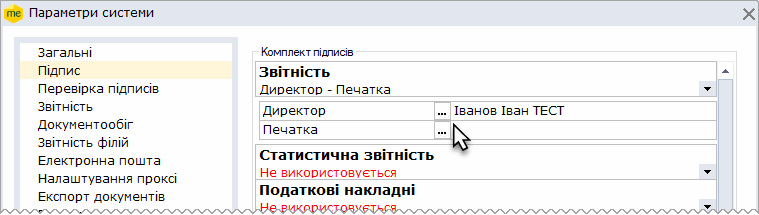

4. Відкриється окреме вікно Налаштування комплекту підписів. За допомогою кнопок Додати та Видалити відредагуйте список за власних потреб.

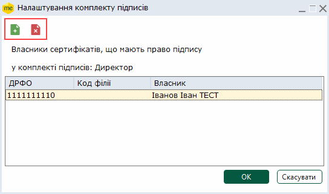

5. При додаванні підписанта відображається перелік всіх сертифікатів всіх КНЕДП, які наявні в модулі [Сертифікати](UCAsignCert.html#ucasigncert-admcert_cert).

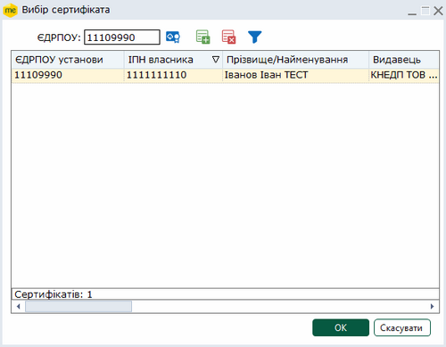

УВАГА! При виборі будь-якого сертифіката відбувається вибір підписанта, а не сертифіката.

Для підпису типу Відповідальна особа у вікні Вибір сертифіката можна обрати кілька осіб, виділивши потрібні записи курсором при натиснутих клавішах <Ctrl> або <Shift>.

6. При підписанні документа буде виводитись список заданих відповідальних осіб.

Детальне налаштування комплектів підписів для первинних документів виконується у модулі [Сценарії підписання первинних документів](UCPDocSignSettings.html#ucpdocsignsettings-ucpdocsignsettings).

Комплект підписів Первинні документи за замовчуванням застосовується для всіх типів первинних документів, для яких не налаштовано комплект підписів у модулі [Сценарії підписання первинних документів](UCPDocSignSettings.html#ucpdocsignsettings-ucpdocsignsettings).

Налаштування для комплекту підписів Первинні документи встановлюються автоматично та можуть бути змінені користувачем.

Якщо встановлена позначка в полі Використовувати пароль останнього підпису для ключа шифрування, під час відправки документа для шифрування буде використано пароль останнього сертифікату, яким було підписано документ. Запит на введення паролю шифрування виводитись не буде.

Якщо встановлена опція Запам’ятовувати обраний підпис печатки установи, найменування печатки зберігається у обраних комплектах підписів. При підписанні відповідного типу звітності буде застосовуватись лише той сертифікат печатки з типом підписання, який був обраний користувачем у налаштуваннях комплекту. При шифруванні документа буде запропоновано здійснити вибір доступних сертифікатів організації.

Існує можливість налаштувати окремі комплекти підписів для кожного типу документів: Податкові накладні, Додаток 2, Акти, Рахунки, та інші. Налаштування комплектів підписів для кожного типу документів не є обов’язковим. Якщо налаштування для типу документа відсутнє, відображатиметься попередження та буде запропоновано обрати комплект підписів.

Для ФОП при виборі типу звітності "Податкові накладні, Додаток 2 та Первинні документи" у списку, що випадає, доступний комплект "Директор (тільки для Первинних документів)".

Зверніть увагу! При обранні цього комплекту підписів, для користувачів заблоковано можливість надсилати Податкові накладні та Додаток 2, тільки первинні документи.

[До початку](#formcompanyparams-admcomanyparams_pen)

### Перевірка підписів

_Шлях у довідці: Розділи програми › Адміністрування › Параметри системи › Перевірка підписів_

Підрозділ дозволяє увімкнути сервіс перевірки актуальності сертифікатів електронних підписів, що використовуються в процесі обміну електронними документами. Застосовується для перевірки сертифікатів всіх ЦСК, які  підтримуються у програмі.

Перевіряється статус сертифікатів - дійсний, відкликаний, заблокований.

Перевірка стану сертифікатів виконується вручну у модулях [Реєстр податкових документів, Реєстр електронних документів](#formcompanyparams-admcomanyparams_pp) та [Реєстр документів довільних форматів](#formcompanyparams-admcomanyparams_pp).

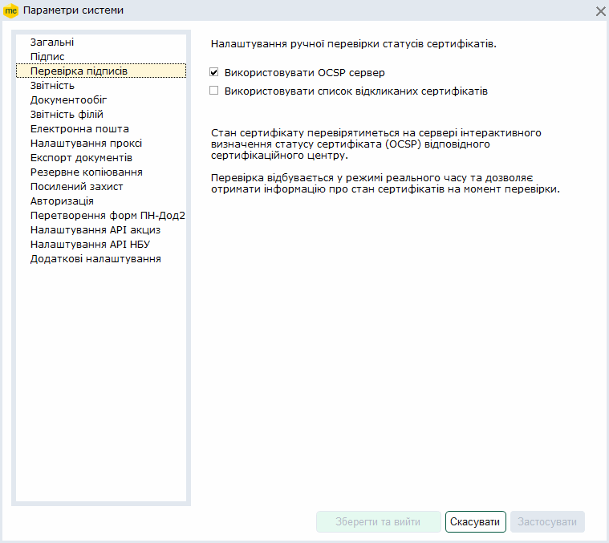

Оберіть один із варіантів:

- Використовувати OCSP сервер

Встановлена галочка в цьому полі вмикає перевірку стану сертифікатів ЕП у режимі реального часу на сервері OCSP відповідного кваліфікованого надавача електронних довірчих послуг.
Радимо використовувати даний спосіб перевірки актуальності сертифікатів, як більш швидкий.

OCSP сервер для перевірки актуальності сертифікатів КНЕДП "Україна":

|  |  |  |
| --- | --- | --- |
| Кваліфікований надавач електронних довірчих послуг | адреса OCSP сервера | Порт |
| КНЕДП Україна | http://uakey.com.ua/services/ocsp/ | 80 |

- Використовувати список відкликаних сертифікатів

Вмикає перевірку актуальності сертифікатів електронного підпису за списком відкликаних сертифікатів. Список відкликаних сертифікатів завантажується з сервера відповідного КНЕДП та оновлюються кожні 15 хвилин.

Списки відкликаних сертифікатів КНЕДП "Україна" завантажуються за посиланнями:

|  |  |  |
| --- | --- | --- |
| Кваліфікований надавач електронних довірчих послуг | посилання для завантаження списку відкликаних сертифікатів | |
| основний список | додатковий список |
| КНЕДП Україна | http://uakey.com.ua/list.crl | http://uakey.com.ua/list-delta.crl |

При використанні ЕП інших КНЕДП необхідно надати доступ до адрес TSP, OCSP, CMP відповідних кваліфікованих надавачів електронних довірчих послуг.

Після увімкнення даного сервісу в різних модулях програмного комплексу стає активною можливість перевірки актуальності сертифікатів електронних підписів, що використовуються. Перевірка буде виконуватися за обраним варіантом (на OCSP сервері чи за списком відкликаних сертифікатів). Наприклад:

- [Довільне підписання](UCSignFile.html#ucsignfile-ucsignfile)

Оберіть підписаний документ (вхідний або вихідний). У контекстному меню оберіть команду Властивості, на виконання якої відкриється однойменне вікно.

Натисніть кнопку Перевірка підписів.

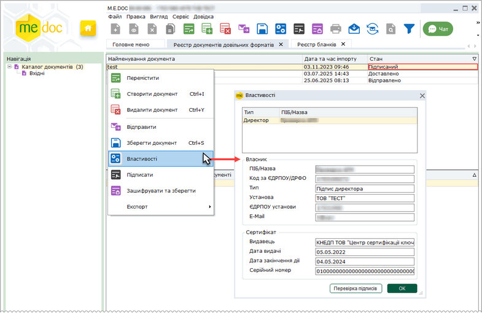

Натисніть, щоб збільшити малюнок

Система виконає перевірку згідно виконаним налаштуванням та повідомить про результат.

- [Первинні документи](UCRtfRstMain.html#ucrtfrstmain-ucrtfrstmain)

В первинних документах функція перевірки актуальності сертифікатів доступна на вкладці Протокол.

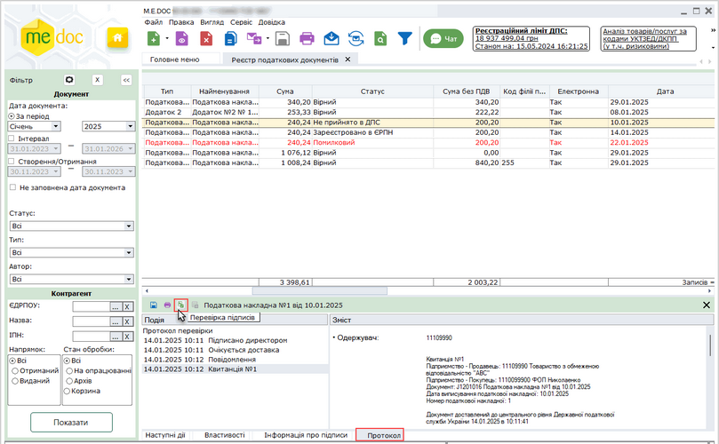

Натисніть на картинку, щоб збільшити її

### Звітність

_Шлях у довідці: Розділи програми › Адміністрування › Параметри системи › Звітність_

Підрозділ дозволяє налаштувати основні властивості звітних документів.

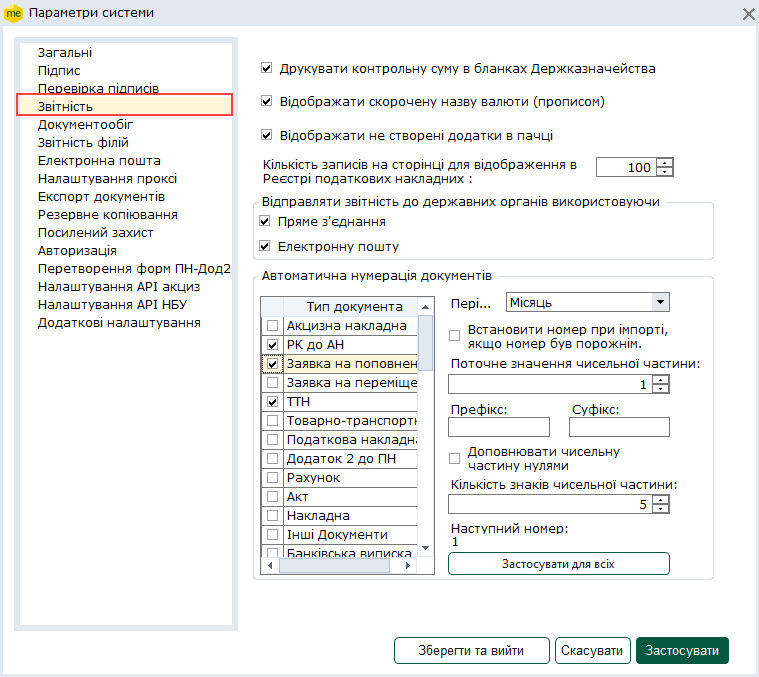

- Друкувати контрольну суму в бланках Держказначейства
Наявність галочки в цьому полі визначає, чи будуть видимими на екрані та друкуватися у паперових формах казначейських звітів код ЄДРПОУ та контрольна сума.
За замовчанням, позначка у цьому полі відсутня, тобто у звітах контрольну суму та код ЄДРПОУ не видно на екрані та вона не друкується у паперовій формі.
Встановіть галочку у цьому полі, щоб контрольна сума та код ЄДРПОУ були видимі на екрані та надрукувались у паперовій формі.

- Відображати скорочену назву валюти (прописом)
Наявність галочки в цьому полі вказує на те, що в документах, при заповнені полів "Сума прописом", буде відображатись скорочена назва валюти, наприклад: "грн.", "коп.". При відсутності галочки, буде відображатись повна назва, наприклад: "гривень", "копійок".

- Відображати нестворені додатки в пачці
Наявність галочки в цьому полі вказує на те, що в пакетах звітних документах відображаються нестворені додатки до основного документа.

- Кількість записів на сторінці для відображення в Реєстрі податкових накладних
Дозволяє задавати кількість записів, що будуть відображатись на сторінці Реєстру отриманих та виданих податкових накладних.
Вкажіть потрібну кількість записів у полі «Кількість записів на сторінці для відображення в Реєстрі податкових накладних».
В реєстрі податкових накладних відобразиться задана кількість записів на сторінці.

- Відправляти звітність до державних органів використовуючи:
- Пряме з'єднання

Встановлена галочка в даному полі означає, що звіти в контролюючі органи відправлятимуться за прямим з'єднанням.

- Електронну пошту

Встановлена галочка в даному полі означає, що звіти в контролюючі органи відправлятимуться електронною поштою. У одному листі відправляється декілька звітів. Якщо об’єм вкладення перевищує 1 Мб, вміст автоматично розбивається на декілька пакетів, для кожного з яких формується окремий електронний лист.

Якщо встановлено обидві галочки, то при відправці звітів до контролюючих органів спочатку виконується відправка за прямим з'єднанням. Якщо пряме з'єднання недоступне, то виконується відправка електронною поштою.

Автоматична нумерація документів

Для налаштування автоматичної нумерації виконайте дії:

1. У області Тип документа встановіть позначки біля типів документів, для яких буде застосовуватися автоматична нумерація. Якщо позначка у розділі Тип документа відсутня, поля налаштування автонумерації для цього типу документів неактивні.

2. У полі Період оберіть термін (місяць або рік), на протязі якого буде використовуватися нумерація.

3. Якщо імпортованим документам необхідно присвоювати автоматичний номер, встановіть опцію Встановити номер при імпорті, якщо номер був порожнім. Тим імпортованим документам, що не містять номеру, буде автоматично присвоєно номер, сформований згідно вказаних налаштувань.

4. У полі Поточне значення чисельної частини вкажіть цифрове значення, з якого необхідно почати нумерацію документів. Для кожного документа, що отримує автоматичний номер, чисельне значення номеру збільшується на 1. Після закінчення терміну, вказаного у полі Період, нумерація знов починається з значення, вказаного у полі Поточне значення чисельної частини. Нумерація для кожного типу документів ведеться окремо.

5. У полі Префікс вкажіть символ або комбінацію символів, що буде додано перед чисельною частиною номеру.

6. У полі Суфікс вкажіть символ або комбінацію символів, що буде додано після чисельною частиною номеру.

Поля Префікс та Суфікс містять символи, що є незмінними для всіх номерів, поля необов’язкові і використовуються при необхідності. Суфікс та префікс неможливо задати для нумерації документів Податкова накладна та Додаток 2, так як згідно вимог ГНАУ у номерах цих документів не допускається жодних символів, крім цифрових.

7. Якщо встановлена опція Доповнювати чисельну частину нулями, до перед чисельним значенням номеру будуть додані нулі. Кількість нулів залежить від значення вказаного у полі Кількість знаків чисельної частини.

8. У полі Кількість знаків чисельної частини вкажіть кількість числових символів, що повинен містити номер. Наприклад, у полі Поточне значення чисельної частини вказано значення «12» (два знаки), у полі Кількість знаків чисельної частини вказано значення «5» - до чисельної частини номера документа буде додано 3 нулі.

9. Для того, щоб дублювати виконані налаштування для всіх типів документів, натисніть кнопку Застосувати для всіх.

У полі Наступний номер відображається номер, сформований згідно виконаних налаштувань, та який буде автоматично присвоєно наступному документу.

Для збереження внесених змін натисніть Застосувати.

Для скасування змін натисніть Скасувати.

### Документообіг

_Шлях у довідці: Розділи програми › Адміністрування › Параметри системи › Документообіг_

У підрозділі налаштовується та перевіряється зв'язок з серверами ДПС та ПТАХ для відправки ПН/РК та інших документів із системи.

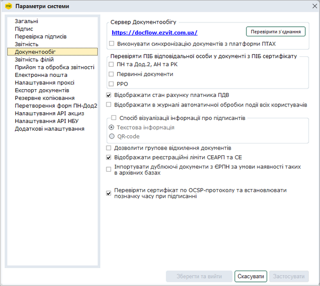

Відповідно до рекомендацій ДПС з використання електронного сервісу ДПС Single Window of Electronic Documents (сервіс SWinED) для обміну податковими документами між контрагентами у програмі реалізовано автоматичну відправку Податкових накладних, Розрахунків коригування до ПН, Акцизних накладних та Розрахунків коригування до АН через сервіс обміну ДПС. Сервіс ДПС передбачає підтвердження отримання електронного документа – фіксує дату отримання документів отримувачем (покупцем) від постачальника.

Якщо сервіс SWinED тимчасово недоступний, відправка документів автоматично виконуватиметься через платформу ПТАХ.

За замовчанням всі електронні документи з системи завжди відправляються по прямому з'єднанню на Сервер документообігу. Адреса серверу: [https://docflow.ezvit.com.ua/](https://docflow.ezvit.com.ua/).

- Перевірити з'єднання
Кнопка дозволяє перевірити наявність зв'язку зі службою гарантованої доставки документів та з сервером ДПС.
Система повідомить про успішне з’єднання або про помилку.

Якщо виникла помилка з'єднання зі службою гарантованої доставки документів радимо виконати наступні дії:

- Перевірте налаштування Firewall комп'ютера, на якому встановлено систему M.E.Doc, чи не обмежено доступ до серверу документообігу.
- Перевірте, чи не блокує встановлена антивірусна програма адресу серверу, як потенційно небезпечний.
- За умови використання проксі-серверу, перевірте, чи додано адресу серверу до переліку адрес, доступ до яких дозволено.
- Виконувати синхронізацію документів з платформи ПТАХ
Якщо опцію встановлено, для екземпляра програми виконуватиметься синхронізація вхідних та вихідних первинних документів, ПН/РК, АН/РК та ТТН (при використанні кількох екземплярів програми для одного підприємства).

Під час прийому пошти в екземплярі програми виконується перевірка наявності вхідних та вихідних документів підприємства на сервері ПТАХ та завантаження цих документів у базу програми. Документи, у яких виконувались зміни (погодження відхилення, редагування, блокування тощо), заміщуються їх актуальними версіями. Таким чином у екземплярі програми забезпечується набір актуальних документів підприємства.

- Перевіряти ПІБ відповідальної особи у документі з ПІБ сертифікату

Перевіряти чи відповідає ім'я особи, що зазначене у документі, сертифікату, яким підписується цей документ. Якщо сертифікат не належить вказаній відповідальній особи, підписання документа не виконуватиметься. На вкладці Протокол перевірки після перевірки документа буде відображено повідомлення: Для вказаної відповідальної особи відсутній відповідний за іменем власника сертифікат підписання

Група містить опції:

- ПН та Дод.2, АН та РК – якщо опція встановлена, виконується перевірка відповідності імен для документів Податкова накладна, Додаток 2 до податкової накладної, Акцизна накладна та Розрахунок коригування акцизної накладної;
- Первинні документи – виконувати перевірку для первинних документів  (за умови, що у шаблоні первинного документа у властивостях поля, яке містить ПІБ відповідальної особи, встановлено опцію [ПІБ підписанта](UCRtfDocTemplate.html#ucrtfdoctemplate-pdocs_shablon_constructor_func_2));
- РРО – виконувати перевірку для документів РРО.
- Відображати стан рахунку платника ПДВ
Встановлена галочка в даному полі вмикає відображення лімітів (за даними розрахунку в M.E.Doc та за даними ДПС) в Реєстрі податкових документів.

- Відображати в журналі автоматичної обробки події всіх користувачів
Налаштування доступне адміністратору. Встановлена галочка включає відображення подій всіх користувачів (а не тільки поточного) в журналі автоматичної обробки.

- Спосіб візуалізації інформації про підписантів
Встановлена відмітка вмикає відображення даних електронного підпису у екранній та друкованій формі документа. При встановленні відмітки доступні опції:

- QR-code – якщо опцію встановлено, при перегляді документів, під час друку та друку в PDF інформація про електронний підпис буде відображатися у вигляді QR-коду, що містить назву організації, назву, номер та дату документа, посаду та ПІБ підписанта, дату та час створення електронної позначки часу. Опція активується за замовчуванням після встановлення відмітки Спосіб візуалізації інформації про підписантів.

Зверніть увагу, відображення інформації про електронний підпис у вигляді QR-коду доступно у Реєстрі електронних документів. Якщо загальна кількість символів у коді перевищує 700, QR-код не генеруватиметься, інформація про електронний підпис на документі не відображатиметься.

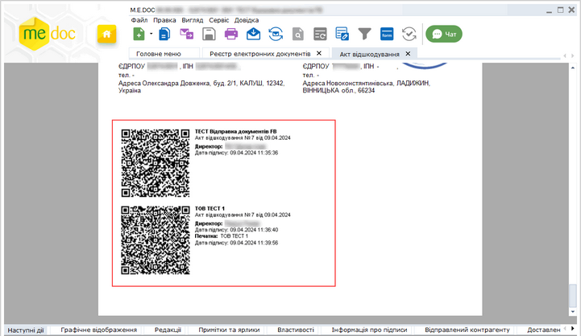

Натисніть, щоб збільшити малюнок

- Текстова інформація – якщо опцію встановлено, при перегляді документів, під час друку та друку в PDF інформація про електронний підпис буде відображатися у вигляді тексту: сертифікат, видавець сертифікату, серійний номер, час підпису.

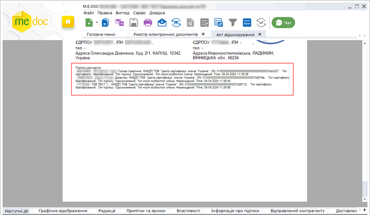

Натисніть, щоб збільшити малюнок

- Дозволити групове відхилення документів
Встановлена галочка вмикає у Реєстрі електронних документів та Реєстрі податкових документів можливість групового відхилення вхідних документів, що мають статус «Отримані».

- Відображати реєстраційні ліміти СЕАРП та СЕ
Встановлена галочка вмикає у Реєстрі акцизних документів (пальне) та Реєстрі акцизних документів (спирт етиловий) відображення реєстраційних лімітів СЕАРП та СЕ (суми податку і обсягу пального та спирту етилового).
За замовчуванням параметр встановлено.

- Імпортувати дублюючі документи з ЄРПН за умови наявності таких в архівній базі
Якщо параметр увімкнено, то за наявності дублів при імпорті документів з ЄРПН дублюючі документи, завантажені з ЄРПН, виділяються в реєстрі червоним кольором.
Якщо параметр вимкнено, то дублюючі документи з ЄРПН не завантажуються.

- Перевіряти сертифікат по OCSP-протоколу та встановлювати позначку часу при підписанні

Якщо відмітка встановлена при підписанні первинного документа буде автоматично виконуватись перевірка стану сертифікату по OCSP-протоколу та накладатись позначка часу. Налаштування діє для первинних документів крім ПН та РК.

Для коректної роботи даної функції на комп'ютері із встановленим програмним комплексом обов'язково повинен бути налаштований доступ до OCSP серверу перевірки актуальності сертифікатів КНЕДП.

Якщо опцію вимкнено, при підписанні документа проставляється локальна дата та час на комп'ютері, стан сертифікату не перевіряється.

Інформація про стан сертифікату та позначку часу певного документа відображається у протоколі під час отримання первинного документа та на вкладці Отримано панелі вкладок відкритого документа.

Можна налаштувати перевірку стану сертифіката ЕП у ручному режимі за допомогою опції [Використовувати OCSP сервер](#formcompanyparams-admcomanyparams_pp) розділу Перевірка підписів.

Для збереження налаштувань натисніть Застосувати.

Щоб зберегти налаштування та закрити вікно Параметри системи, натисніть Зберегти та вийти.

Для скасування змін натисніть Скасувати.

Документи з системи відправляються виключно по прямому з'єднанню, тобто забезпечується гарантована доставка документа адресату. В разі відсутності прямого з'єднання, система повідомить користувача про неможливість відправки повідомлення.

### Звітність філій

_Шлях у довідці: Розділи програми › Адміністрування › Параметри системи › Звітність філій_

У підрозділі назначається підпорядкованість поточного підприємства: головна установа або структурний підрозділ (філія). Налаштовується автоматичний обмін звітністю між філіями та головною установою за допомогою електронної пошти. Детальніше про налаштування цієї схеми описано у модулях [Допоміжні сервіси - Звітність філій](UCDeptReps.html#ucdeptreps-ucdeptreps) та [Допоміжні сервіси - Реєстрація ПН та Дод.2](UCDeptNN.html#ucdeptnn-ucdeptreps).

Якщо Ви використовуєте програму у режимі M.E.Doc.Корпорація виконувати налаштування у даному підрозділі не потрібно.

Встановлення налаштувань у даному підрозділі у режимі M.E.Doc.Корпорація зробить неможливим документообіг між Головною установою та Філіями.

За умови, що поточне підприємство є головною установою, встановіть галочку в полі Прийом звітів від філій.

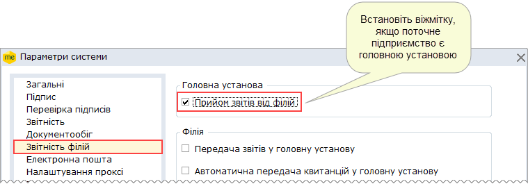

Якщо встановлена відмітка Прийом звітів від філій, у програмному комплексі з'являються додаткові модулі програми:

- Адміністрування - [Налаштування звітності філій](UCDeptTermSet.html#ucdepttermset-coprdeptset).
- Звітність - Звітність філій

Якщо поточне підприємство є структурним підрозділом (філією), встановіть галочку в полі Передача звітів у головну установу.

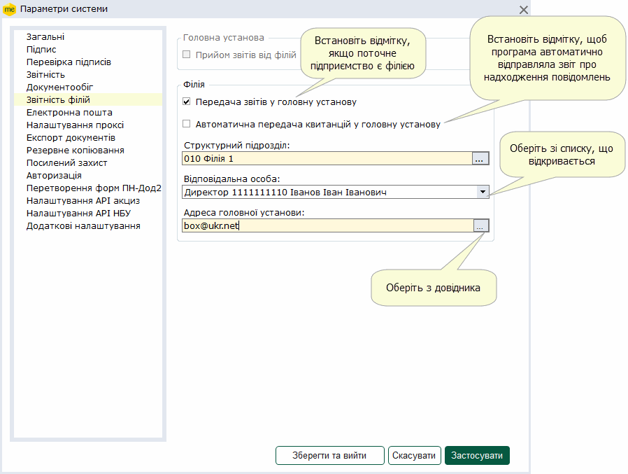

Стає доступним для налаштування блок даних Філія, який потрібно заповнити:

- Автоматична передача квитанцій у головну установу
Якщо у цьому полі встановлена галочка, система буде автоматично відправляти у головну установу звіт про доставку (квитанцію), як тільки надійшли підписані звіти у філію.

- Структурний підрозділ
Дане поле містить код та найменування поточного структурного підрозділу. Є обов'язковим для заповнення.
Виберіть із довідника "Підрозділи" філію, якою є поточне підприємство.

- Відповідальна особа
В даному полі потрібно вказати особу, на ім’я якої будуть шифруватися документи при обміну звітності з головною установою.
Представляє собою список, що випадає, з переліком відповідальних осіб поточного підприємства-філії: директор та бухгалтер.
Є обов'язковим для заповнення. Виберіть із списку, що випадає, дані особи, що відповідатиме за обмін звітністю з головною установою.

- Адреса головної установи
Містить електронну адресу головної установи. Є обов'язковим для заповнення.
Виберіть дані головної установи із адресної книги.

Для збереження внесених змін натисніть Застосувати.

Для скасування змін натисніть Скасувати.

### Електронна пошта

_Шлях у довідці: Розділи програми › Адміністрування › Параметри системи › Електронна пошта_

В цьому розділі:

[Налаштування поштового з'єднання](#formcompanyparams-admcompanyparams_emaile)

[Налаштування доступу до пошти за допомогою пароля додатка](#formcompanyparams-admcompanyparams_emaile):

- [Налаштування доступу до пошти Gmail](#formcompanyparams-admcompanyparams_emaile)
- [Налаштування доступу до пошти Ukr.net](#formcompanyparams-admcompanyparams_emaile)
- [Налаштування доступу до пошти Office365](#formcompanyparams-admcompanyparams_emaile)

Налаштування роботи з використанням технології ОAuth 2.0:

- [поштовий провайдер Office 365](#formcompanyparams-admcompanyparams_emaile)
- [індивідуальні налаштування Office365](#formcompanyparams-admcompanyparams_emaile)
- [використання власного додатка Google Cloud](#formcompanyparams-admcompanyparams_emaile)

Для зручності обміну звітність, відправлення документів електронною поштою, у програмний комплекс вбудовано поштовий клієнт. До початку користування електронною поштою безпосередньо із програми потрібно налаштувати поштове з'єднання.

Поштовий клієнт підтримує роботу по протоколу РОР3 та SMTP, а також протокол IMAP.

- Рекомендується створити окрему електронну скриньку на одному з надійних УКРАЇНСЬКИХ поштових серверів, яка використовуватиметься лише для відправлення звітності та отримання електронних квитанцій.
- Якщо у програмі ведеться звітність декількох установ для кожної з них потрібно налаштувати поштове з'єднання.

Увага! Для кожного підприємства необхідно налаштувати окрему поштову скриньку з унікальною адресою.

Налаштування поштового з'єднання

За замовчуванням для відправки та прийому пошти використовується загальнодоступний застосунок M.E.Doc, налаштування якого виконується на вкладці Загальні розділу Електронна пошта:

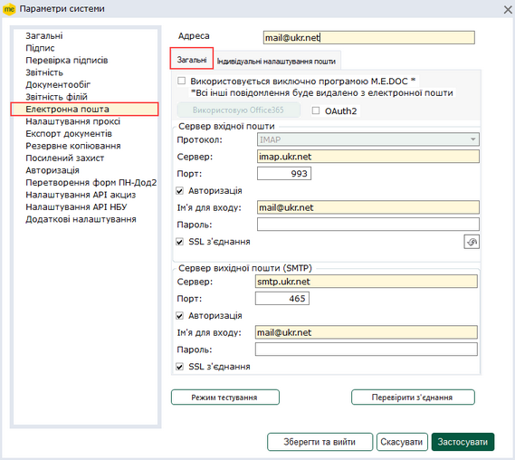

Натисніть, щоб збільшити малюнок

- Адреса
Поштова адреса електронної скриньки, що призначена для обміну повідомлень.
Дане поле заповнюється вручну з клавіатури. Є обов'язковим для заповнення.

Примітка:

При введенні користувачем адреси e-mail, поля вводу параметрів серверів для вхідної та вихідної пошти заповняться автоматично для таких найпоширеніших поштових серверів: ukr.net; meta.ua; gmail.com

- Використовується виключно програмою M.E.Doc
Якщо встановити галочку в цьому полі, система буде автоматично видаляти з поштового сервера ті повідомлення, що не стосуються встановленої електронної звітності підприємства.

- Сервер вхідної пошти/вихідної пошти (SMTP)

Протокол - оберіть із списку протокол вхідної пошти POP3 або IMAP.

Сервер - введіть ім'я або IP-адресу сервера для прийому (відправлення) пошти. Адреса може бути представлена як в символьному так і в цифровому вигляді.

Порт - введіть номер порту для вхідної/вихідної пошти.
За замовчанням: POP3 - 110 або 995 для SSL
За замовчанням: IMAP - 143 або 993 для SSL

SMTP - 25 або 465 для SSL

Авторизація - якщо ваш сервер підтримує безпечну авторизацію, встановіть галочку у цьому полі.
Стають доступними для налаштування поля Ім'я для входу та Пароль, які потрібно заповнити.

SSL з'єднання - якщо поштовий сервер використовує захищений (SSL) протокол передачі даних, встановіть відмітку в цьому полі. Автоматично зміниться номер порту.

- Кнопка
Призначена для копіювання введених параметрів з блоку даних Сервер вхідної пошти (POP3) у блок даних Сервер вихідної пошти (SMTP).

- Перевірити з'єднання
Після заповнення всіх параметрів електронної пошти можна перевірити, чи правильно здійснені налаштування.
Для цього натисніть кнопку Перевірити з'єднання.
На виконання команди на вказану поштову скриньку буде відправлене повідомлення про успішне з’єднання або зауваження за наявності помилок.

- Режим тестування
Якщо при налаштуванні електронної пошти у вбудованому поштовику виникли якісь складності, слід включити режим тестування, скориставшись однойменною кнопкою. Відкриється допоміжне вікно.

Тестовий режим
Встановлена опція свідчить про початок ведення протоколу відправлення/отримання пошти.

Показати протокол
Щоб переглянути протокол роботи пошти, натисніть на цю кнопку.

Надсилати всі повідомлення за адресою
Встановлена позначка в цьому полі дозволяє ввести адресу альтернативної електронної пошти. На вказану адресу будуть переадресовуватись повідомлення.

Вести файл реєстрації пошти
Встановлена опція дозволяє реєструвати подій, пов'язані з використанням поштового клієнта:

- Детальна інформація;
- Інші події;
- Попередження користувача;
- Попередження системи;
- Помилки;
- Інформаційні повідомлення.

Щоб обрати тип події, яку необхідно реєструвати, пересувайте повзунок за допомогою миші вгору або вниз. В залежності від позиції повзунка змінюється тип події, що буде реєструватися.

Видалити файл реєстрації пошти
По натисканню кнопки видаляється файл реєстрації подій, пов'язаних з використанням поштового клієнта.

Після виходу з режиму тестування, всі тестові налаштування скасуються.

- Кнопка Використовую Office365
У разі використання хостингу Exchange online або Office 365 за допомогою кнопки можна автоматично заповнити поля для налаштувань серверів вхідної та вихідної пошти.

У полі Адреса введіть адресу поштової скриньки, що призначена для обміну повідомлень. Натисніть кнопку Використовую Office365 для автоматичного заповнення параметрів у областях Сервер вхідної пошти та Сервер вихідної пошти :

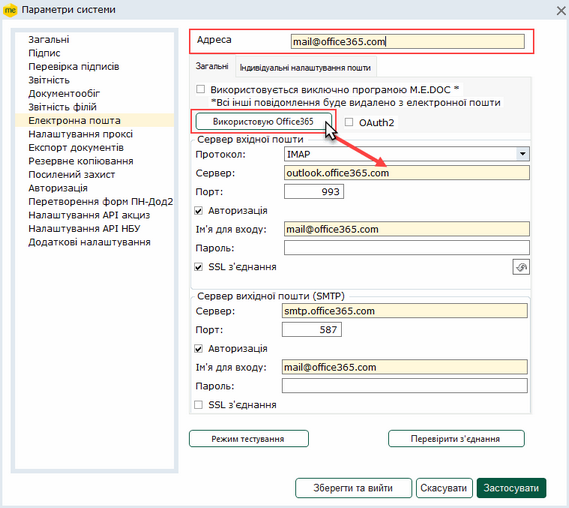

Натисніть, щоб збільшити малюнок

Кнопка Використовую Office365 доступна, якщо у полі Адреса введено назву будь-якої поштової скриньки, крім доменів @ukr.net, @gmail.com або @meta.ua. (При введенні адреси, що має домен @ukr.net, @gmail.com або @meta.ua кнопка стає неактивною.)

По натисканню кнопки Використовую Office365 автоматично [виконуються налаштування](#formcompanyparams-admcompanyparams_emaile) прийому і відправки пошти з використанням технології OAuth 2.0.

Для збереження внесених змін натисніть Застосувати.

Для скасування змін натисніть Скасувати.

Якщо ви є користувачами поштових сервісів Gmail, рекомендуємо налаштувати [доступ до пошти за допомогою пароля додатка](#formcompanyparams-admcompanyparams_emaile).

[До початку](#formcompanyparams-admcompanyparams_emaile)

Налаштування доступу до пошти за допомогою пароля додатка

Якщо ви є користувачами поштових сервісів Gmail або Ukr.net, маєте можливість налаштувати доступ до пошти за допомогою пароля додатка. Такий доступ до пошти забезпечує додатковий рівень безпеки та більш надійний захист інформації.

При використанні цього типу доступу до ваших електронних повідомлень необхідний додатковий код (пароль додатка), який можливо отримати, виконавши налаштування на сайті поштового сервісу, яким ви користується:

Налаштування доступу до пошти Gmail

Налаштування та використання можливе лише в облікових записах, у яких увімкнено двохетапну перевірку.

Для створення та використання паролів додатків, скористайтеся інструкцією нижче, або зверніться безпосередньо до інструкції на сайті Google (звертаємо вашу увагу, що спосіб налаштування може змінюватися).

1. Перейдіть в обліковий запис Google.

2. На лівій панелі навігації виберіть Безпека.

3. Переконайтеся, що у вашому обліковому записі увімкнена Двохетапна перевірка. Якщо двохетапна перевірка увімкнена, перейдіть до [п.4](#formcompanyparams-admcompanyparams_emaile).

Якщо Двохетапна перевірка неактивна, увімкніть її:

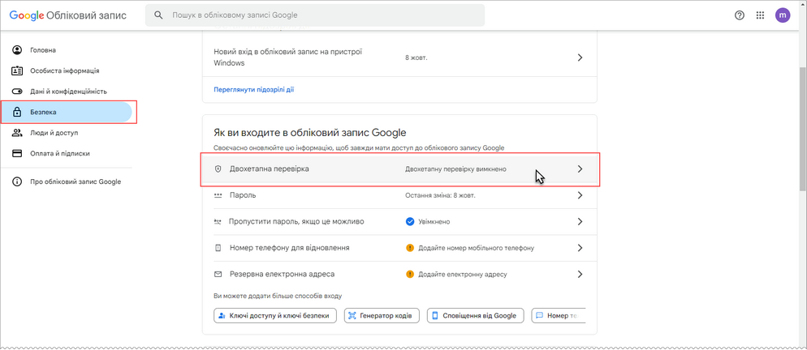

Натисніть, щоб збільшити малюнок

Якщо розділу Двохетапна перевірка немає, можливо ваш обліковий запис належить компанії, навчальному закладу чи іншій організації. Для виконання налаштувань зверніться до системного адміністратора.

Виконуючи вказівки Google налаштуйте Двохетапну перевірку, вказавши пароль до свого облікового запису, а потім зазначивши номер телефону:

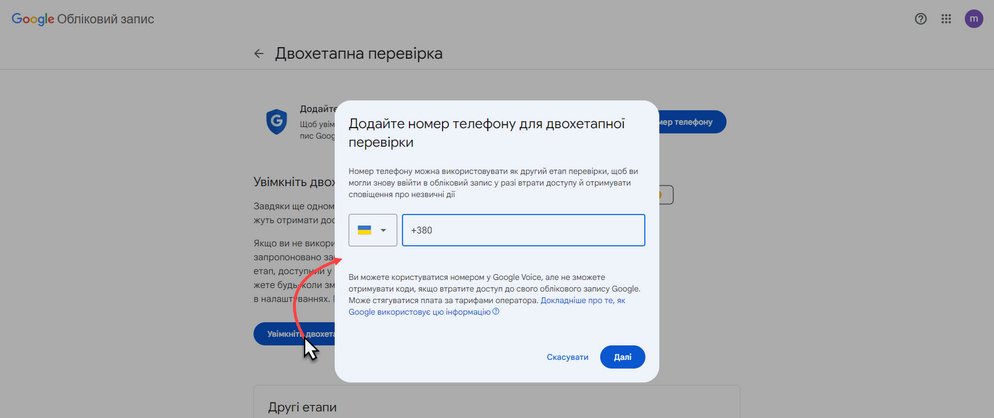

Натисніть, щоб збільшити малюнок

На наступній сторінці введіть цифровий код, який ви отримаєте для підтвердження номеру телефону:

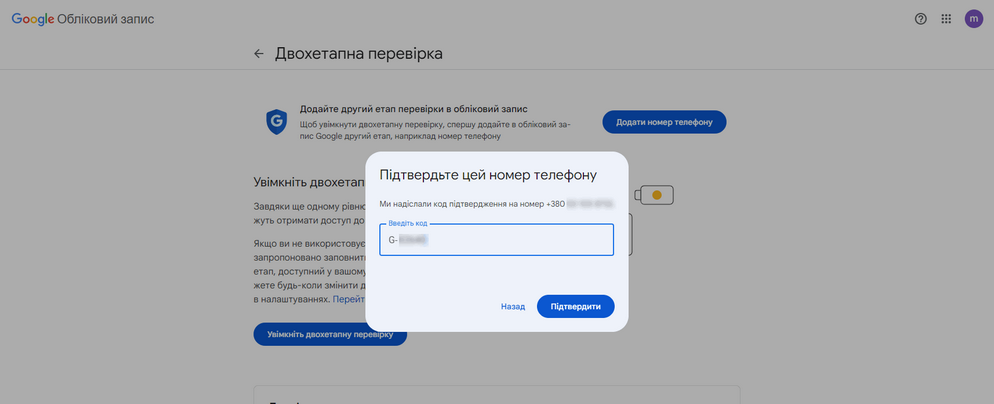

Натисніть, щоб збільшити малюнок

Застосування Двохетапної перевірки увімкнено, натисніть Готово для продовження:

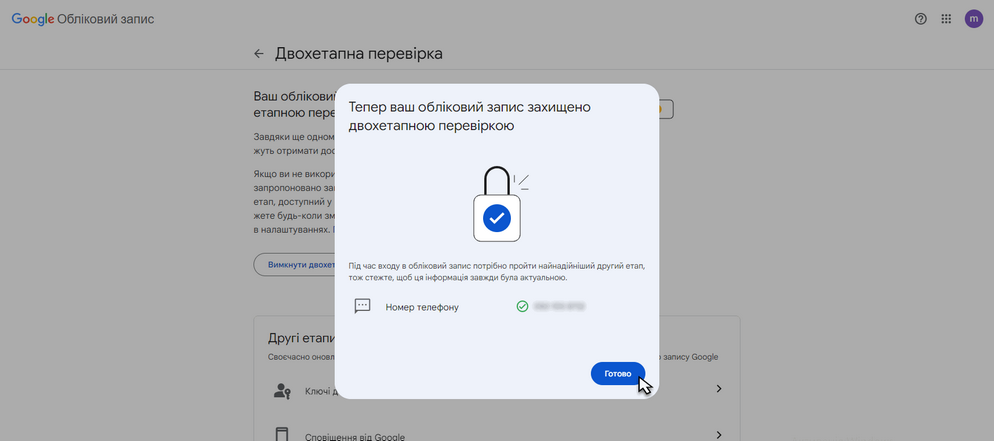

Натисніть, щоб збільшити малюнок

4. Перейдіть у розділ Безпека та знайдіть розділ Паролі додатків за допомогою рядка пошуку:

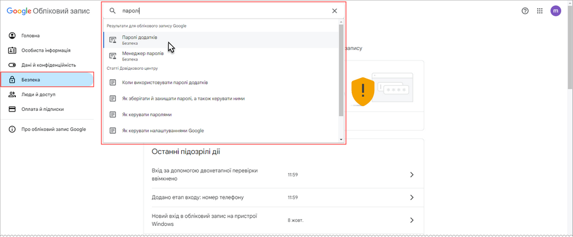

Натисніть, щоб збільшити малюнок

5. Вкажіть пароль до свого облікового запису, а потім на сторінці Паролі додатків введіть назву додатку, до якого додається пароль, та натисніть Створити:

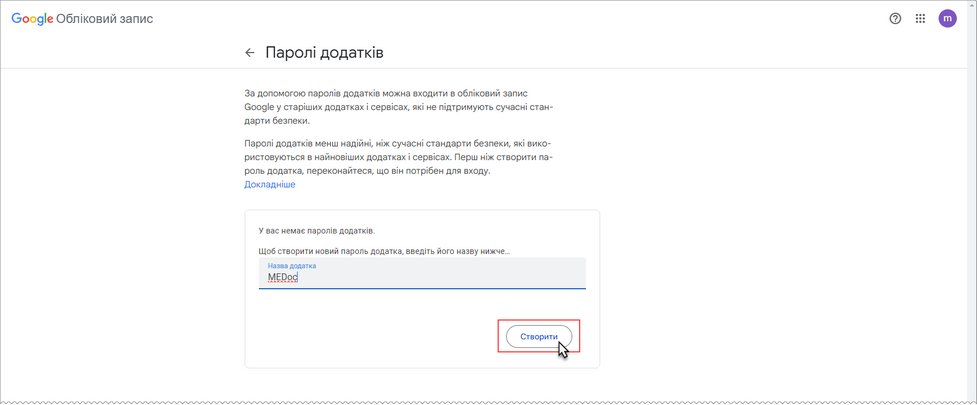

Натисніть, щоб збільшити малюнок

6. Відкриється вікно, що містить автоматично згенерований пароль додатка. Скопіюйте (виділіть мишею та натисніть клавіші <Ctrl>+<C>) або запишіть 16-значний код - це необхідно, щоб одноразово ввести згенерований пароль у налаштуваннях програми M.E.Doc.

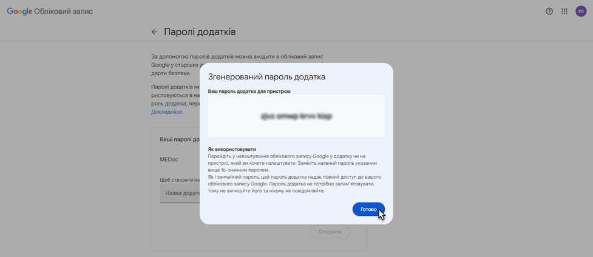

Натисніть, щоб збільшити малюнок

7. Натисніть Готово.

8. Перейдіть у розділ Параметрах системи - Електронна пошта та виконайте налаштування:

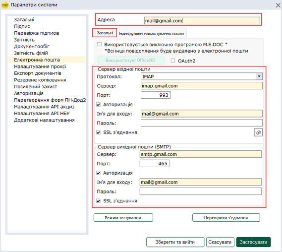

Натисніть, щоб збільшити малюнок

У розділі Сервер вхідної пошти:

- у полі Протокол із списку оберіть значення IMAP;
- у полі Сервер введіть imap.gmail.com;
- у полі Порт введіть 993;
- встановіть позначку Авторизація;
- у полі Ім'я для входу введіть ім'я вашої поштової скриньки Gmail, у якій створювався пароль;
- внесіть згенерований у [п.8](#formcompanyparams-admcompanyparams_emaile) пароль у поле Пароль;
- встановіть позначку SSL з'єднання.

У розділі Сервер вихідної пошти:

- у полі Сервер введіть smtp.gmail.com;
- у полі Порт введіть 465;
- встановіть позначку Авторизація;
- у полі Ім'я для входу введіть ім'я вашої поштової скриньки Gmail, у якій створювався пароль;
- внесіть згенерований у [п.8](#formcompanyparams-admcompanyparams_emaile) пароль у поле Пароль;
- встановіть позначку SSL з'єднання.

Зверніть увагу! Якщо ви зміните пароль вашого облікового запису Google, паролі додатків буде анульовано. Щоб мати доступ до вашої пошти Gmail після змінення пароля облікового запису Google, необхідно створити новий пароль додатка та оновити налаштування Електронної пошти у M.E.Doc.

[До початку](#formcompanyparams-admcompanyparams_emaile)

Налаштування доступу до пошти Ukr.net

Для створення та використання паролів додатків, скористайтеся інструкцією нижче, або зверніться безпосередньо до інструкції на сайті Ukr.net (звертаємо вашу увагу, що спосіб налаштування може змінюватися).

1. Зайдіть у поштову скриньку Ukr.net, використовуючи ваш логін та пароль

2. В правій частині зверху натисніть .

3. Оберіть пункт Керування IMAP-доступом.

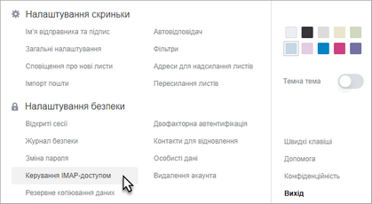

Натисніть, щоб збільшити малюнок

4. У розділі Керування IMAP-доступом натисніть на перемикач у пункті Доступ до зовнішніх програм.

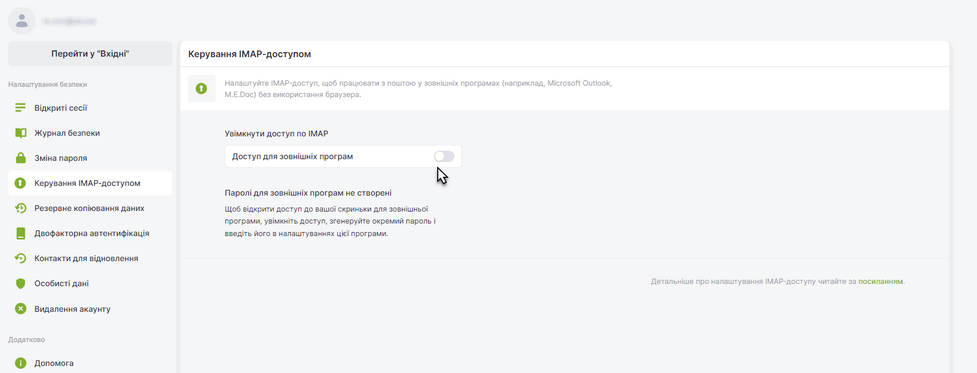

Натисніть, щоб збільшити малюнок

5. У вікні, що відкриється введіть пароль облікового запису пошти Ukr.net та натисніть Продовжити:

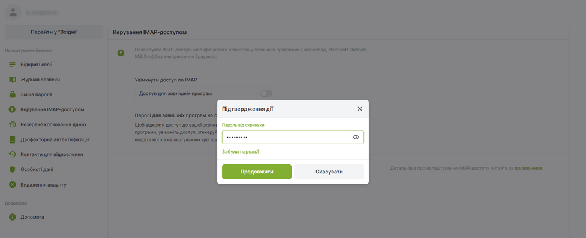

Натисніть, щоб збільшити малюнок

6. У наступному вікні задайте ім’я для зовнішньої програми та натисніть Створити пароль.

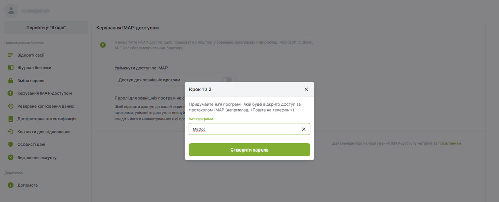

Натисніть, щоб збільшити малюнок

7. Скопіюйте (запам’ятайте) згенерований пароль.

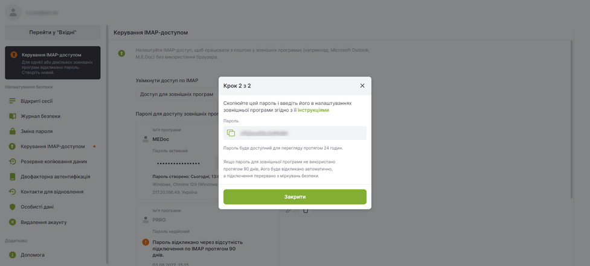

Натисніть, щоб збільшити малюнок

8. В налаштуваннях Ukr.net натисніть Закрити.

9. Перейдіть у розділ Параметрах системи - Електронна пошта та виконайте налаштування:

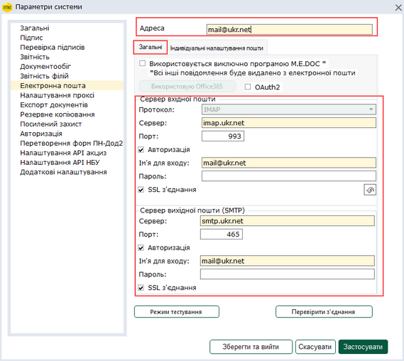

Натисніть, щоб збільшити малюнок

У розділі Сервер вхідної пошти:

- у полі Протокол значення IMAP встановлюється за замовчуванням;
- у полі Сервер введіть imap.ukr.net;
- у полі Порт введіть 993;
- встановіть позначку Авторизація;
- у полі Ім'я для входу введіть ім'я вашої поштової скриньки Ukr.net, у якій створювався пароль;
- внесіть згенерований у [п.7](#formcompanyparams-admcompanyparams_emaile) пароль у поле Пароль;
- встановіть позначку SSL з'єднання.

У розділі Сервер вихідної пошти:

- у полі Сервер введіть smtp.ukr.net;
- у полі Порт введіть 465;
- встановіть позначку Авторизація;
- у полі Ім'я для входу введіть ім'я вашої поштової скриньки Ukr.net, у якій створювався пароль;
- внесіть згенерований у [п.7](#formcompanyparams-admcompanyparams_emaile) пароль у поле Пароль;
- встановіть позначку SSL з'єднання.

[До початку](#formcompanyparams-admcompanyparams_emaile)

Налаштування доступу до пошти Office365

Для створення та використання паролів додатків, скористайтеся інструкцією нижче, або зверніться безпосередньо до інструкції на сторінці Microsoft [https://docs.microsoft.com/uk-ua/azure/active-directory/authentication/howto-mfa-app-passwords](https://docs.microsoft.com/uk-ua/azure/active-directory/authentication/howto-mfa-app-passwords). (звертаємо вашу увагу, що спосіб налаштування може змінюватися). Також, більш докладну інформацію про налаштування приватної та корпоративної пошти можна знайти у інструкції, що знаходиться у каталозі встановлення програми ...\help\Інструкція з налаштування пошти провайдера Office365.pdf.

1. Увійдіть у свій обліковий запис Microsoft на сторінці [https://login.microsoftonline.com](https://login.microsoftonline.com). Перейдіть в розділ Безпека та оберіть підрозділ Керувати способом входу:

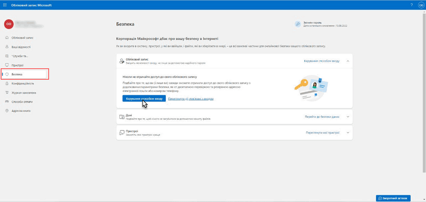

Натисніть, щоб збільшити малюнок

2. У розділі Додаткові параметри безпеки увімкніть двоетапну перевірку:

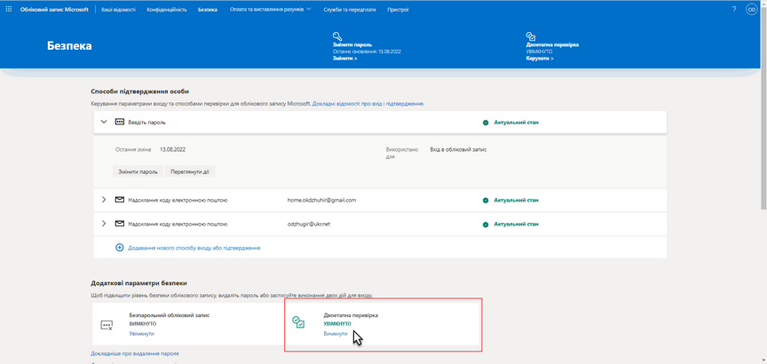

Натисніть, щоб збільшити малюнок

3. Для двоетапної перевірки знадобиться встановити мобільний застосунок Authenticator, який можна завантажити за посиланнями на офіційній сторінці застосунку в магазини мобільних застосунків AppStore (iPhone) або PlayMarket (Android) [https://www.microsoft.com/uk-ua/security/mobile-authenticator-app](https://www.microsoft.com/uk-ua/security/mobile-authenticator-app).

Натисніть, щоб збільшити малюнок

4. Підключить у застосунку свій обліковий запис відповідно до вказівок.

5. Коли застосунок буде налаштовано, у обліковому записі Microsoft можна буде завершити налаштування двоетапної перевірки:

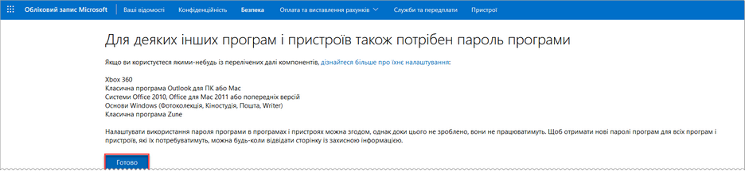

Натисніть, щоб збільшити малюнок

6. Після налаштування двоетапної перевірки у обліковому записі Microsoft створіть пароль для програми, натиснувши посилання Створити новий пароль програми у розділі Паролі програм:

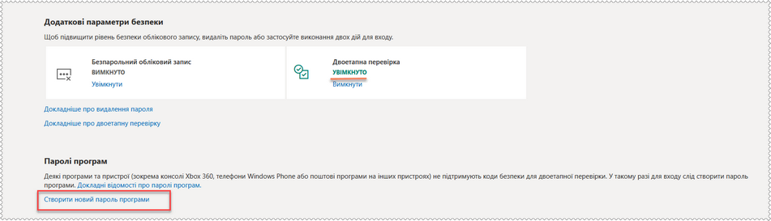

Натисніть, щоб збільшити малюнок

7. Скопіюйте пароль для налаштування прийому пошти в програмі M.E.Dос:

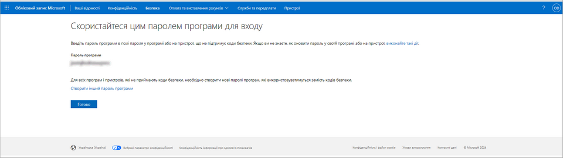

Натисніть, щоб збільшити малюнок

8. Перейдіть у розділ Параметрах системи - Електронна пошта та виконайте налаштування:

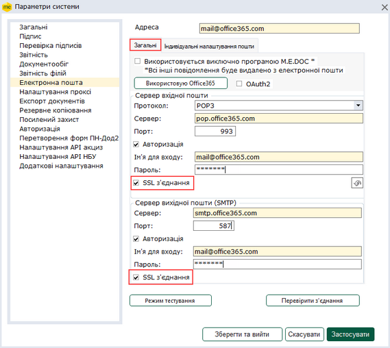

Натисніть, щоб збільшити малюнок

У розділі Сервер вхідної пошти:

- у полі Протокол із списку оберіть значення IMAP;
- у полі Сервер введіть outlook.office365.com;
- у полі Порт введіть 993;
- встановіть позначку Авторизація;
- у полі Ім'я для входу введіть ім'я вашої поштової скриньки office365.com, у якій створювався пароль;
- внесіть згенерований та скопійований у [п.7](#formcompanyparams-admcompanyparams_emaile) пароль у поле Пароль;
- встановіть позначку SSL з'єднання.

У розділі Сервер вихідної пошти:

- у полі Сервер введіть smtp.office365.com;
- у полі Порт введіть 587;
- встановіть позначку Авторизація;
- у полі Ім'я для входу введіть ім'я вашої поштової скриньки office365.com, у якій створювався пароль;
- внесіть згенерований та скопійований у [п.7](#formcompanyparams-admcompanyparams_emaile) пароль у поле Пароль;
- переконайтеся, що для вихідної пошти знято відмітку SSL з'єднання.

[До початку](#formcompanyparams-admcompanyparams_emaile)

Налаштування роботи з поштовим провайдером Office 365 з використанням технології ОAuth 2.0

Для прийому і відправки повідомлень у програмі M.E.Doc реалізовано роботу з поштовим провайдером Office 365 по протоколу OAuth 2.0.

- Прийом і відправку пошти з використанням технології OAuth 2.0 можна налаштувати для корпоративних облікових записів.
- Після встановлення опції ОAuth2 виконується перевірка наявності access token (токену доступу). Якщо access token відсутній, буде запропоновано авторизуватися на сервері почтового провайдера для отримання access token. Після успішного отримання та збереження access token автоматично виконуються налаштування для використання протоколу ОAuth 2.0.
- Повторне отримання access token для використання протоколу ОAuth 2.0 необхідне після відновлення програми з резервної копії.

1. Відкрийте розділ Адміністрування – Параметри системи і перейдіть у вкладку Електронна пошта.

2. Введіть повну назву електронної пошти облікового запису Microsoft в поле Адреса. Деякі поля налаштувань пошти будуть заповнені автоматично.

3. Натисніть кнопку Використовую Office365:

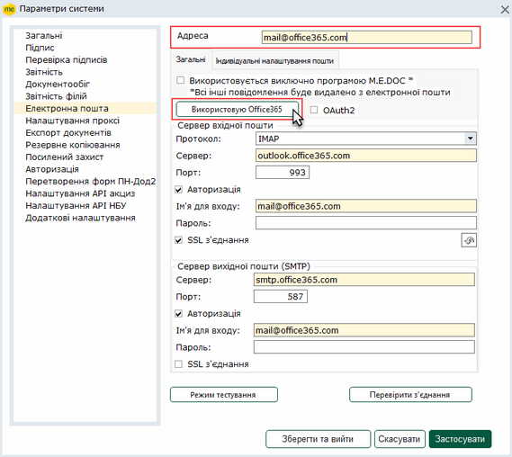

Натисніть, щоб збільшити малюнок

Опція OAuth2 доступна за умови, якщо у полі Сервер вказано налаштування для провайдера: outlook.office365.com.

По натисканню кнопки Використовую Office365 також виконується [автоматичне заповнення полів](#formcompanyparams-admcompanyparams_emaile) для налаштувань серверів вхідної та вихідної пошти для провайдера outlook.office365.com.

4. У вікні авторизації Microsoft, що відкриється, виберіть свій логін або додайте його, натиснувши "+" :

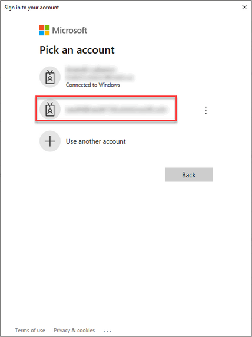

Натисніть, щоб збільшити малюнок

Вікно вікні авторизації Microsoft також відкривається після встановлення опції OAuth2.

5. Введіть пароль зазначеної поштової скриньки:

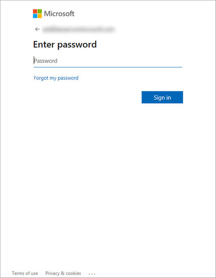

Натисніть, щоб збільшити малюнок

6. Якщо у вас налаштовано багатофакторну або двохфакторну автентифікацію, підтвердіть вхід у поштову скриньку за допомогою програми Authentificator на своєму смартфоні:

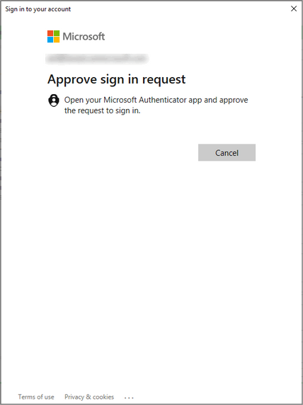

Натисніть, щоб збільшити малюнок

7. Для завершення налаштування виконайте перевірку з'єднання, натиснувши кнопку Перевірити з'єднання.

Після авторизації буде автоматично встановлена опція OAuth2.

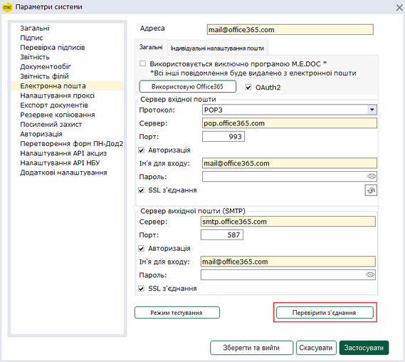

Натисніть, щоб збільшити малюнок

8. У разі успішної перевірки з'єднання у вікні повідомлення, що відкриється, для продовження натисніть ОК.

9. Збережіть налаштування, натиснувши кнопку Зберегти та вийти або Застосувати.

Перевірка наявності access token та його отримання (у разі потреби) також виконується по натисканню кнопки Перевірити з'єднання.

[До початку](#formcompanyparams-admcompanyparams_emaile)

Індивідуальні налаштування Office365

При роботі з провайдером Office365 можна налаштувати власний застосунок Entra ID для відправки та прийому пошти.

Щоб використовувати для відправки та прийому пошти індивідуальні налаштування Office365 (власний застосунок EntraID), виконайте дії:

1. Перейдіть на вкладку Індивідуальні налаштування пошти:

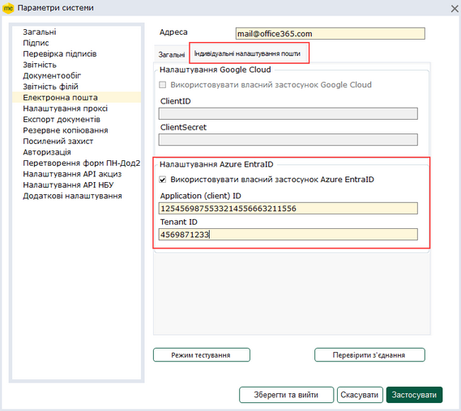

Натисніть, щоб збільшити малюнок

2. Встановіть відмітку Використовувати власний застосунок Azure EntraID.

3. У полях Tenant ID та Application (client) ID введіть унікальні ідентифікатори вашого застосунку EntraID.

4. Натисніть кнопку Перевірити з’єднання, щоб перевірити, чи працюють налаштування.

5. Для збереження налаштувань натисніть кнопку Застосувати або Зберегти та вийти.

Якщо опція Використовувати власний застосунок Azure EntraID вимкнена, для відправки та прийому пошти використовуватиметься загальнодоступний застосунок M.E.Doc, налаштування якого виконується на вкладці [Загальні розділу Електронна пошта](#formcompanyparams-admcompanyparams_emaile).

[До початку](#formcompanyparams-admcompanyparams_emaile)

Використання власного додатка Google Cloud

Для створення власного додатка Google Cloud:

1. Перейдіть до вікна авторизації Google. Авторизуйтеся під своїм обліковим записом Gmail.

2. Перейдіть за посиланням [https://console.cloud.google.com/projectselector2/cloud-hub/](https://console.cloud.google.com/projectselector2/cloud-hub/) та натисніть Create Project:

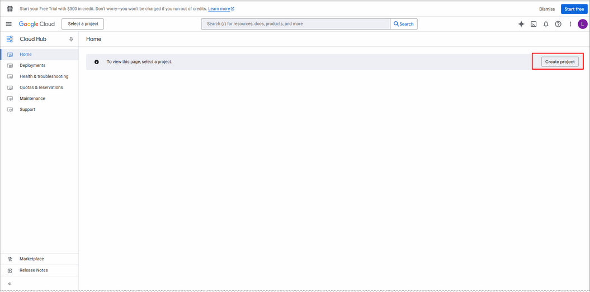

Натисніть, щоб збільшити малюнок

Для нового облікового запису потрібно прочитати та погодитись з умовами використання, наприклад:

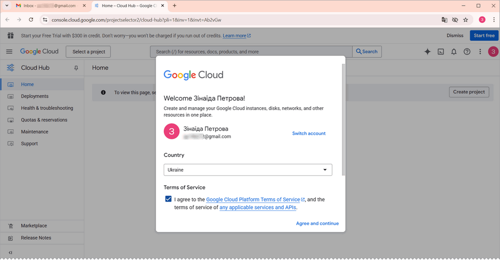

Натисніть, щоб збільшити малюнок

3. Введіть довільну назву застосунку (наприклад oAuth) та натисніть Create:

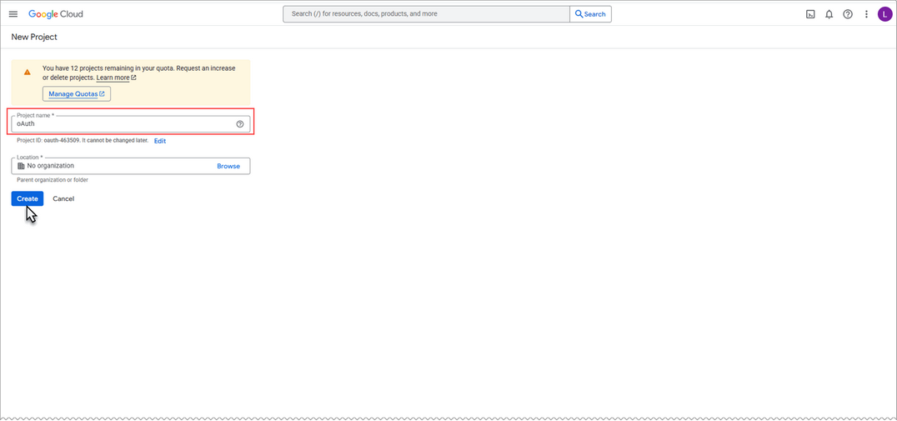

Натисніть, щоб збільшити малюнок

4. Дочекайтеся завантаження сторінки.

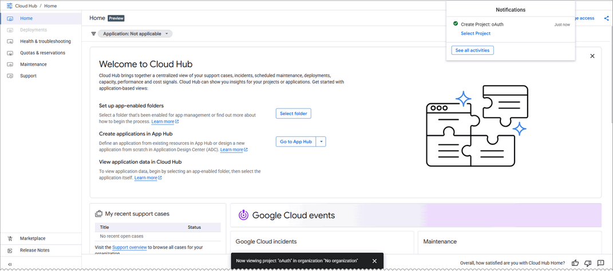

Натисніть, щоб збільшити малюнок

5. Перейдіть за посиланням [https://console.cloud.google.com/auth/overview](https://console.cloud.google.com/auth/overview). Натисніть Get started:

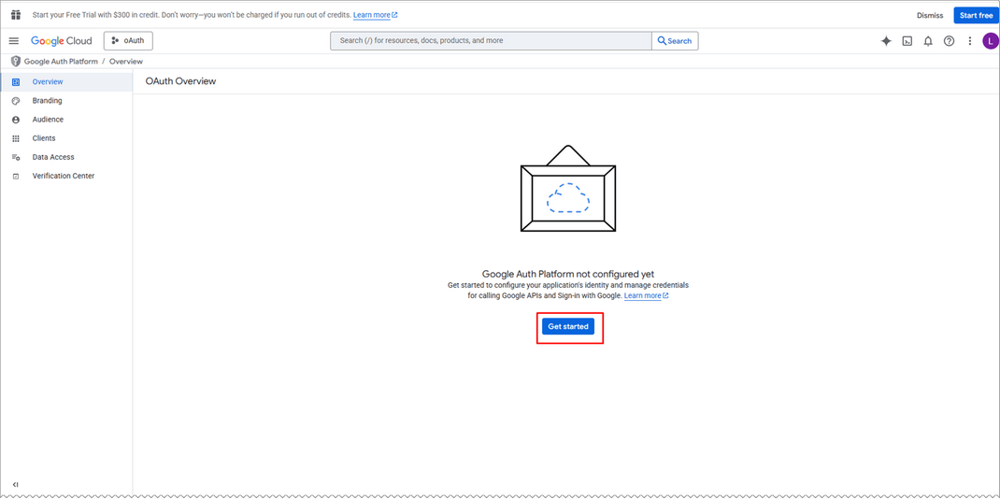

Натисніть, щоб збільшити малюнок

6. У вікні, що відкриється, введіть довільну назву застосунку (наприклад oAuth) та оберіть пошту зі списку, що відкривається. Натисніть Next:

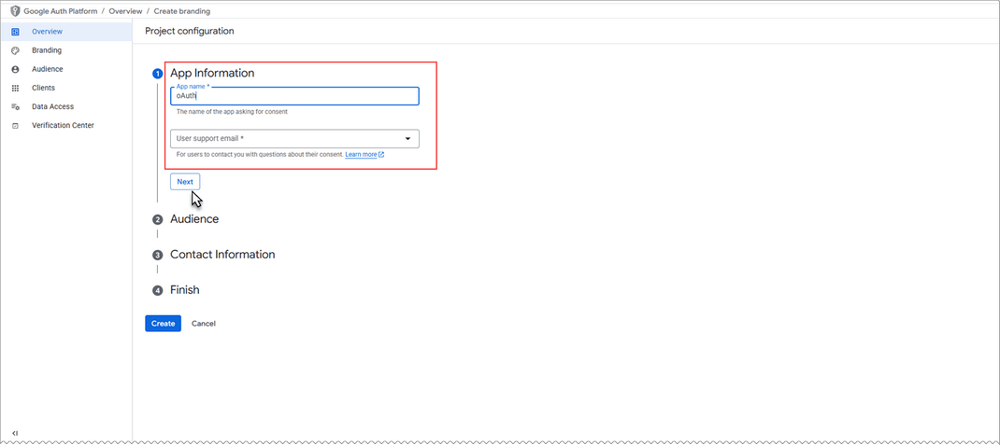

Натисніть, щоб збільшити малюнок

7. На наступному кроці вкажіть External. Натисніть Next:

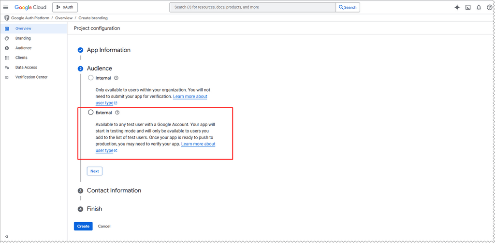

Натисніть, щоб збільшити малюнок

8. Введіть адресу електронної пошти. Натисніть Next:

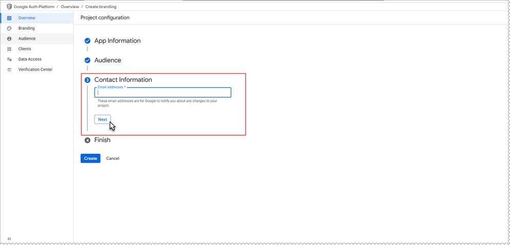

Натисніть, щоб збільшити малюнок

9. Погодьтесь з умовами, встановивши позначку, та натисніть Create:

Натисніть, щоб збільшити малюнок

10. Перейдіть за посиланням [https://console.cloud.google.com/apis/library/gmail.googleapis.com](https://console.cloud.google.com/apis/library/gmail.googleapis.com) та на сторінці, що відкриється, натисніть Enable:

Натисніть, щоб збільшити малюнок

11. Перейдіть за посиланням [https://console.cloud.google.com/auth/](https://console.cloud.google.com/auth/). Відкрийте вкладинку Data Access та натисніть Add or remove scopes:

Натисніть, щоб збільшити малюнок

12. У списку дозволів встановіть відмітку /auth/gmail.modify:

Натисніть, щоб збільшити малюнок

та /auth/gmail.send, натисніть Update:

Натисніть, щоб збільшити малюнок

13. Застосуйте виконані налаштування, натиснувши кнопку Save:

Натисніть, щоб збільшити малюнок

14. Перейдіть на вкладинку Audience та натисніть Publish app:

Натисніть, щоб збільшити малюнок

Для завершення створення власного додатка Google Cloud у вікні, що відкриється, натисніть Confirm:

Натисніть, щоб збільшити малюнок

15. Отримайте значення параметрів, що [необхідні для налаштування Google Cloud для відправки та прийому пошти у програмі M.E.Doc](#formcompanyparams-admcompanyparams_emaile), перейдіть у вкладинку Clients та натисніть Create client:

Натисніть, щоб збільшити малюнок

16. У списку, що відкривається, оберіть Desktop App та натисніть Create:

Натисніть, щоб збільшити малюнок

17. Відкриється вікно, що мітить значення параметрів Client ID та Client secret. Значення цих параметрів [використовуються для налаштування Google Cloud для відправки та прийому пошти у програмі M.E.Doc](#formcompanyparams-admcompanyparams_emaile). Для налаштування Google Cloud у програмі M.E.Doc відкрийте вікно розділу Адміністрування - Параметри системи - Електронна пошта, не закриваючи вікно з параметрами створеного додатка. Щоб скопіювати у буфер обміну значення параметра Client ID або Client secret, натискайте іконку  у відповідному полі:

Натисніть, щоб збільшити малюнок

Налаштувати Google Cloud у програмі M.E.Doc також можна згодом у будь який зручний час. Після створення додатка Google Cloud параметри Client ID та Client Secret будуть збережені у його записі та доступні для перегляду та копіювання:

Натисніть, щоб збільшити малюнок

18. Щоб у програмі M.E.Doc для відправки та прийому пошти використовувати індивідуальні налаштування Google Cloud, перейдіть на вкладку Індивідуальні налаштування пошти:

Натисніть, щоб збільшити малюнок

19. Встановіть відмітку Використовувати власний застосунок Google Cloud.

20. У полях ClientID та ClientSecret введіть унікальні ідентифікатори вашого застосунку Google Cloud, [що були отримані при налаштування застосунку](#formcompanyparams-admcompanyparams_emaile).

21. Перейдіть на вкладку Загальні та встановіть опцію OAuth2:

Натисніть, щоб збільшити малюнок

22. Відкриється вікно браузера, у якому натисніть Додатково:

Натисніть, щоб збільшити малюнок

На наступній сторінці натисніть Перейти до оAuth:

Натисніть, щоб збільшити малюнок

Відкриється вікно, у якому встановіть відмітку Вибрати все та натисніть Продовжити:

Натисніть, щоб збільшити малюнок

23. Для збереження налаштувань у вікні Параметри системи натисніть кнопку Застосувати або Зберегти та вийти.

[До початку](#formcompanyparams-admcompanyparams_emaile)

### Налаштування проксі

_Шлях у довідці: Розділи програми › Адміністрування › Параметри системи › Налаштування проксі_

Для здійснення оновлення програми, система автоматично перевіряє з'єднання з мережею Інтернет. В разі відсутності прямого підключення до Інтернету, необхідно налаштувати параметри підключення до проксі-сервера.

- Не використовувати проксі-сервер
Ознака проставляється, якщо проксі сервер не використовується.

- Використовувати системні налаштування проксі-сервера
Ознака проставляється, якщо для з'єднання з мережею Інтернет.

- Налаштувати проксі вручну
Стають доступними для заповнення та редагування інші поля блоку Параметри підключення до проксі-сервера.

- Адреса
Вкажіть доменне ім'я або IP-адресу проксі-сервера.

- Порт
вкажіть номер порту, який використовується проксі-сервером для підключень (за замовчуванням, встановлено значення 3128).

- Авторизація
За умови використання авторизованого доступу до мережі Інтернет, встановіть позначку в полі. Стають доступними для заповнення та редагування розташовані нижче поля.

- Розбивати логін на компоненти (ім'я домена - логін)
При використанні доменного доступу передбачена можливість автоматичного розподілу по полям введеного Логіну на ім'я домену та логін.
Для цього встановіть позначку в полі Розбивати логін на компоненти.
Тепер введіть в поле Логін значення, використовуючи наступний формат:
<ім'я домену>\<логін> або <логін>@<ім'я домену>.

- Логін
Введіть логін користувача

- Пароль
Введіть пароль користувача

- Домен
Введіть домен

- Для перевірки правильності введених даних натисніть на кнопку Перевірити з'єднання або Перевірити з'єднання (всі адреси). Система повідомить про успішне з'єднання або помилку.
- Поле Використовувати налаштування проксі за замовчанням для всіх користувачів доступне лише під обліковим записом Admin.
Якщо встановлена дана позначка, у інших користувачів системи використовуються ті ж налаштування підключення до проксі-серверу, які встановлені під обліковим записом "Admin", при цьому в облікових записах користувачів налаштування проксі блокуються.

Для збереження внесених змін натисніть Застосувати.

Для скасування змін натисніть Скасувати.

### Експорт документів

_Шлях у довідці: Розділи програми › Адміністрування › Параметри системи › Експорт документів_

Підрозділ дозволяє налаштувати автоматичний експорт документів, які були прийняті або відхилені одержувачем. Документи експортуються у файли формату PDF та/або XML (у форматі для подачі в контролюючий орган).

Особливості експорту даних в залежності від розділу програми:

|  |  |
| --- | --- |
| Звітність | Експорт даних відбувається при отриманні фінальної Квитанції № 2, яка містить інформацію про те, що звіт прийнятий Контролюючим органом. |
| Первинні документи | Експортуються документи, які були прийняті або відхилені у ДПС (після отримання відповіді), та прийняті або відхилені Контрагентом (після отримання квитанції). |
| Банківські рахунки | Експортуються відправлений файл, обидві Квитанції та відповідь (якщо така існує). |
| Інформаційна довідка | Якщо запит прийнято, зберігається отримана відповідь на запит. Запит не прийнято - експортується запит та квитанція. |
| Корпорація | На стороні Головної установи експортується звіт, отриманий від Підзвітної організації з Квитанцією про прийняття.   На стороні  Підзвітної організації, експортується Звіт та Квитанція про прийняття, після того як звіт прийнято Головною установою. |

- Експорт документів в PDF
Встановленням опції вмикається виконання автоматичного експорту документів у форматі PDF.

- Експорт документів в XML (формат податкової)
Якщо опція встановлена, виконується автоматичний експорт документів у форматі XML.

Якщо жодна з опцій Експорт документів в PDF або Експорт документів в XML (формат податкової)  не встановлена, експорт документів не виконується, поля налаштування експорту не активні.

- Шлях для збереження документів на сервері
У полі обирається каталог, в якому будуть зберігатися експортовані документи. У обраному каталозі автоматично створюються папка з номером ЕДРПОУ поточного підприємства. У папці створюються підкаталоги, які відповідають розділам та періодам, до яких належать документи, починаючи від поточного періоду.

Приклад назви каталогу для первинних документів: D:\PDF\30012346\Звітність\Листопад 2022\Документ прийнято). Під час експорту враховуються статуси первинних документів: "прийняті", "відхилені". Документи, що мають однаковий статус зберігаються у окремому каталозі, назва якого відповідає статусу.

Приклад назви каталогу для збереження звітності: C:\export\3334444555\Звітність\грудень 2022\Документ прийнято\F0100112 звітний. При експорті документів розділу Звітність кожен документ зберігається у окремий підкаталог, що відповідає періоду експорту, а також у підкаталог, що відповідає коду звіту.

Якщо в даному періоді чи розділі не було документів для експорту, підкаталог з такою назвою створений не буде.

- Періодичність автоматичного експорту
У області  задається періодичність виконання експорту:

- Фіксована, через – якщо позначка встановлена, експорт виконується через сталий проміжок часу. Період часу, через який буде виконуватись експорт, обирається із списку, що відкривається, у полі праворуч;
- Під час прийому пошти – якщо позначка встановлена, експорт виконується під час кожного приймання пошти.

Примітка:

Користувачам, які використовують [Автоматичну обробку](UCGlobalAutoProcJournal.html#ucglobalautoprocjournal-pdocs_avto) документів, рекомендується налаштовувати експорт через сталі проміжки часу.

- Налаштування за розділами
У області вказуються розділи, з яких буде виконуватись автоматичний експорт документів. Щоб обрати розділ, встановіть позначку у відповідному рядку.

- По натисканню кнопки Оберіть звітність можна вибирати документи, для яких необхідно виконувати експорт. У вікні, що відкриється по натисканню кнопки, встановіть позначки біля назв документів, для яких потрібно виконувати експорт:

Якщо документи не обрано, за замовчуванням виконується експорт всіх документів розділів, обраних у області налаштувань Налаштування за розділами.

Наступні поля призначені для налаштування експорту первинних документів:

- Розбивати файли по папкам (ЄДРПОУ, ІПН)
Використовується для налаштування експорту первинних документів. Якщо опція встановлена, документи від різних контрагентів зберігаються у окремих підкаталогах.
Наприклад, "D:\PDF\30012346\Первинні документи\Жовтень\Вхідні\802655002\Акт\Документ отримано", де папка "802655002" – це папка контрагента. Якщо позначка не встановлена, то шлях до документа буде такий: "D:\PDF\30012346\Первинні документи\Жовтень\Вхідні\Акт\Документ отримано".

- Додавати ідентифікатор (ЄДРПОУ, ІПН) у ім’я файлу
Використовується для налаштування експорту первинних документів. Якщо позначка встановлена, до імені файлу додається коди ЄДРПОУ та ІПН.

- Додавати ІПН продавця в ім'я файлу для первинних документів
Використовується для додавання в ім'я файлу ІПН продавця при експорті ПН/РК в PDF.

- Налаштування виконуються для поточної організації. Якщо необхідно налаштувати експорт для іншої організації, виконайте команду Змінити поточне підприємство, а потім виконайте налаштування в розділі Параметрах системи -  Експорт документів для обраної організації.
- При експорті документів у форматі PDF документ та квитанція зберігаються у одному PDF-файлі: на початку файлу документ, після документа - квитанція. Експортується лише остання квитанція, в якій міститься інформація про те, прийнято документ або відхилено.
- Якщо для первинного документа існують дві фінальні Квитанції (відповідно до вибраного порядку обміну первинними документами), і експорт згідно налаштувань виконувався до отримання другої квитанції, документ дублюється у двох папках (наприклад, у папці «Зареєстровано ДПС» і «Затверджено контрагентом»).
- Якщо документ вже існує у папці, при наступному експорті він заміщається.
- Документи ЄСВ зберігаються у каталозі Звітність. Всі документи пакету зберігаються у одному файлі у наступному порядку: головний документ, додатки, фінальна квитанція.

Налаштування експорту у мережевій версії

Якщо використовується мережева версія програми, поля для налаштування експорту на робочих станціях недоступні. Налаштування параметрів експорту виконуються на сервері. Каталог для зберігання експортованих файлів також розташовується на сервері. У цьому каталозі будуть зберігатися файли, які експортуються зі всіх робочих станцій.

Увага! Для станцій має бути відкритий доступ до каталогу зберігання експортованих документів.

- Перед кожним виконанням автоматичного експорту перевіряється кількість вільного місця на диску комп'ютера. Якщо вільне місце складає менш 50МБ, документи не експортуються.
- Виводиться вікно повідомлення, що інформує користувача про неможливість виконати експорт документів через недостатній об'єм вільного місця на диску.
- Якщо під час експорту трапилася помилка, виводиться повідомлення про помилку друку у PDF. Експорт документів буде виконано після усунення причини помилки.

### Резервне копіювання

_Шлях у довідці: Розділи програми › Адміністрування › Параметри системи › Резервне копіювання_

В цьому розділі:

[Збереження попередньої робочої копії програми](#formcompanyparams-admcompanyparams_rk)

[Резервне копіювання перед закриттям програми](#formcompanyparams-admcompanyparams_rk)

Збереження попередньої робочої копії програми

Встановлена галочка в цьому полі включає функцію збереження робочої копії програми за вказаним шляхом перед оновленням.

Перед кожним оновленням програми, автоматично створюється архів бази даних (zvit.fdb). Якщо під час оновлення виникла будь-яка помилка, система відновлює дані з цього архіву. За замовчанням, після процесу відновлення (з помилками чи без) файл архіву бази даних видаляється.
Якщо в цьому полі встановлена позначка, архів бази даних не видаляється, а зберігається у каталозі, що вказав користувач. При цьому можна відновити дані попередньої робочої версії програми в будь-який момент.

Зверніть увагу!!! При кожному оновленні папка, що містить архів бази даних очищується від файлів попередньої робочої копії програми, а на їх місце зберігаються нові.

[До початку](#formcompanyparams-admcompanyparams_rk)

Резервне копіювання перед закриттям програми

При закритті програмного комплексу у вікні [Завершення роботи](Help.html#help-setup_end) є можливість обрати створення резервної копії всієї бази програми:

На вкладці Резервне копіювання розділу Параметри системи можна налаштувати автоматичне створення резервної копії всієї бази, що буде здійснюватися при кожному закритті програми. Встановленні налаштування будуть використовуватись за замовчуванням.

Щоб активувати створення резервної копії всієї бази автоматично, встановіть опцію Створювати резервну копію всієї бази перед закриттям програми.

За потреби встановіть необхідні налаштування:

- Розташування резервних копій - вкажіть шлях до каталогу, у якому зберігатимуться створені резервні копії.
- Зберігати тільки ...  - встановіть опцію та вкажіть кількість останніх створених резервних копій, що потрібно зберігати за вказаним шляхом. Попередні резервні копії, що перевищують кількість заданих, видаляються.

При кожному виході з програмного комплексу буде автоматично створюватися резервна копія всієї бази згідно з обраними параметрами.

Увага! Відмовитись від створення копії у вікні Завершення роботи буде неможливо. Поле Резервне копіювання буде неактивне.

[До початку](#formcompanyparams-admcompanyparams_rk)

### Посилений захист

_Шлях у довідці: Розділи програми › Адміністрування › Параметри системи › Посилений захист_

Підрозділ призначений для встановлення використання посиленого захисту ЕП, а саме вимог до паролів секретних ключів, які зберігаються у файлі (без використання [захищеного носія](UCAsignCert.html#ucasigncert-admcert_nosij_faktura) - токена).

- Підрозділ доступний тільки адміністратору.
- Налаштування посиленого захисту ЕП діє для всіх організацій в БД.

Для того, щоб активувати використання посиленого захисту ЕП, встановіть галочку в полі Посилений захист ЕП (для ключів, збережених у файлі).

Стають доступними наступні налаштування:

- Мінімальна довжина (кількість символів)
Вкажіть мінімальну довжину пароля секретного ключа (поле приймає значення в діапазоні 3-64).

- Термін дії пароля (кількість днів)
Кількість днів, протягом яких діє встановлений користувачем пароль секретного ключа  (поле приймає значення в діапазоні 1-1000 днів).
Якщо встановлений цей параметр, то нагадування користувачу про необхідність зміни пароля з'являтиметься за 1 день до кінця терміну дії пароля.

- Складний пароль
Встановіть ознаку, якщо пароль повинен бути складним, тобто включати символи хоча б трьох категорій з:

- великі букви;
- малі букви;
- цифри;
- інші символи.

Для збереження внесених змін натисніть Застосувати.

Для скасування змін натисніть Скасувати.

Після першої активації даної функції ВСІ користувачі повинні будуть змінити паролі згідно встановлених налаштувань.

Далі запит на зміну пароля буде з'являтись користувачам в залежності від відповідності їх паролів налаштуванням.

При введенні користувачем пароля секретного ключа відобразиться вікно зміни пароля із вимогами до пароля в залежності від встановлених налаштувань (мінімальна довжина та/або складність пароля).

Натисніть, щоб збільшити малюнок

Після першої активації даної функції ВСІ користувачі повинні будуть змінити паролі згідно встановлених налаштувань.

У вікні зміни пароля введіть старий та новий паролі у відповідні поля та натисніть кнопку ОК.

УВАГА! При зміні пароля секретного ключа змінюється і сам файл секретного ключа (\*.zs2) у вказаному при підписанні каталозі. Тому якщо файл секретного ключа записаний десь іще (наприклад, на флеш-носії), його обов'язково потрібно перезаписати на новий файл.

### Авторизація

_Шлях у довідці: Розділи програми › Адміністрування › Параметри системи › Авторизація_

В цьому розділі:

[Налаштування посиленого захисту](#formcompanyparams-admcompanyparams_authorize)

[Налаштування використання ACTIVE DIRECTORY](#formcompanyparams-admcompanyparams_authorize)

Підрозділ призначений для встановлення використання:

- посиленого захисту авторизації;

або

- налаштування та прав користувачів з ACTIVE DIRECTORY.
- Одночасно можна обрати тільки одну групу налаштувань.
- Підрозділ доступний тільки адміністратору.

Налаштування посиленого захисту

Для того, щоб активувати використання посиленого захисту  авторизації в M.E.Doc, встановіть галочку в полі Використовувати посилений захист.

Стають доступними наступні налаштування:

- Мінімальна довжина (кількість символів)
Вкажіть мінімальну довжину пароля секретного ключа (поле приймає значення в діапазоні 0-32).
Для вимкнення опції введіть "0" або залиште поле порожнім (пароль для входу не потрібний).
Увага! Наступний пароль не може бути таким самим, як попередній. При зміні пароля встановити порожній пароль два рази підряд буде неможливо.

- Термін дії пароля (кількість днів)
Кількість днів, протягом яких діє встановлений користувачем пароль (поле приймає значення в діапазоні 0-1000 днів).
За замовчуванням встановлено значення 45 днів.
Для вимкнення опції введіть "0" (необмежений термін дії пароля).

- Кількість спроб невдалого введення паролю
Вкажіть кількість спроб некоректного введення паролю, після яких користувач більше не зможе увійти в програму в поточному сеансі.
Для вимкнення опції введіть "0" (необмежена кількість спроб).

- Складний пароль
Встановіть ознаку, якщо пароль повинен бути складним, тобто включати символи хоча б трьох категорій з:

- великі букви;
- малі букви;
- цифри;
- інші символи.

Для збереження внесених змін натисніть Застосувати.

Для скасування змін натисніть Скасувати.

Після першої активації якщо встановлений термін дії пароля, ВСІ користувачі повинні будуть змінити паролі згідно встановлених налаштувань.

У випадку, якщо термін дії пароля не встановлений, при вході користувачі не отримають запит на зміну простого пароля на складний.
Далі запит на зміну пароля буде з'являтись користувачам в залежності від терміну дії пароля.

Вікно зміни пароля

При введенні користувачем пароля при вході в програму відобразиться вікно зміни пароля із вимогами до пароля в залежності від встановлених налаштувань (мінімальна довжина та/або складність пароля).

- Без зміни пароля подальша робота буде неможливою
- Увага! Наступний пароль не може бути таким самим, як попередній

У вікні зміни пароля введіть старий та новий паролі у відповідні поля та натисніть кнопку ОК.

[До початку](#formcompanyparams-admcompanyparams_authorize)

Налаштування використання ACTIVE DIRECTORY

Для того, щоб активувати використання налаштування та прав користувачів з ACTIVE DIRECTORY, встановіть галочку в полі Використовувати ACTIVE DIRECTORY.

Стають доступними наступні налаштування:

- Домен
Вкажіть назву домена.

- Заборона доступу без авторизації в домені
Якщо опцію не встановлено, то користувач, відсутній в домені, зможе авторизуватись під користувачем, зареєстрованим в M.E.Doc.
Встановіть ознаку для обмеження входу користувачам, незареєстрованим в домені. В цьому випадку незареєстрований користувач зможе увійти до програми тільки під логіном адміністратора.

- Використовувати пароль доменного облікового запису
Якщо опцію встановлено, виконується перевірка пароля користувача Active Directory при авторизації у програмі M.E.Doc. При авторизації у програмі, у вікні вибору користувача, необхідно обрати ім’я користувача та ввести пароль поточного користувача Active Directory. Буде виконано перевірку відповідності введеного пароля. Якщо результат перевірка негативний, виводиться повідомлення про некоректно введені логін та пароль, вхід у програму не виконується.

Якщо опцію не встановлено, авторизація користувача буде відбуватись автоматично, тобто при вході в M.E.Doc не буде відображатись вікно авторизації користувача в системі, а одразу вікно Вибір установи.

- Автоматичне оновлення користувачів з ACTIVE DIRECTORY (хв)
Якщо опцію встановлено, виконується порівняння даних облікових записів користувачів у базі програми з даними користувачів з ACTIVE DIRECTORY та за результатами перевірки автоматично здійснюється оновлення існуючих облікових записів, видалення записів з групи у програмі, якщо вони відсутні у ACTIVE DIRECTORY, переміщення облікових записів у іншу групу, додавання нових користувачів.

Автоматичне оновлення облікових записів здійснюється при кожній авторизації у програмі, під час роботи програми оновлення виконується із зазначеним часовим інтервалом. Щоб встановити періодичність оновлення, введіть часовий інтервал у хвилинах у полі нижче.

Зверніть увагу, оновлення даних виконується лише для існуючих груп користувачів. Щоб додати групу користувачів у програму, у розділі Адміністрування – Управління користувачами необхідно виконати команду [Імпортувати групу з AD](UCAdminUsers.html#ucadminusers-admusr).

Для збереження внесених змін натисніть Застосувати.

Для скасування змін натисніть Скасувати.

[До початку](#formcompanyparams-admcompanyparams_authorize)

### Перетворення форм ПН-Дод2

_Шлях у довідці: Розділи програми › Адміністрування › Параметри системи › Перетворення форм ПН-Дод2_

У підрозділі налаштовується конвертація попередніх форм ПН/РК у оновлені версії форм при імпорті ПН/РК (у будь-якому форматі).

- Використовувати налаштування перетворення форм документів при імпорті 7-х версій ПН-Дод2

Якщо галочка встановлена, при виконанні імпорту ПН-РК 7-ї форми (незалежно від формату) вони будуть імпортовані у програму по новій 13-й формі згідно встановлених налаштувань.

- Налаштувати перетворення 7-ї форми ПН у актуальну форму ПН

Якщо галочка встановлена, стають доступними для заповнення наступні налаштування:

ІПН посадової особи, що зазначена в ПН

- Визначити автоматично за даними підписанта із сертифіката
Якщо параметр встановлено, то поле Реєстраційний номер облікової картки в ПН буде заповнюватись автоматично значенням з сертифікату підписанта (знайденим за ПІБ уповноваженої особи, яка вказана в документі 7-ї форми)

Автоматичне заповнення поля буде виконано, якщо потрібний сертифікат завантажений в програму. Інакше поле залишиться порожнім.

- Заповнювати значенням

Якщо параметр встановлено, то поле Реєстраційний номер облікової картки в ПН буде заповнюватись значенням, обраним в полі.

При натисканні на кнопку  відкривається Довідник співробітників, у якому обирається потрібна особа.

Якщо залишити поле порожнім, то при перетворенні ПН поле Реєстраційний номер облікової картки залишиться порожнім.

- Налаштувати перетворення 7-ї форми Дод2 у актуальну форму Дод2

Якщо галочка встановлена, стають доступними для заповнення наступні налаштування:

ІПН посадової особи, що зазначена в РК

- Визначити автоматично за даними підписанта із сертифіката

Якщо параметр встановлено, то поле Реєстраційний номер облікової картки в РК буде заповнюватись автоматично значенням з сертифікату підписанта (знайденим за ПІБ уповноваженої особи, яка вказана в документі 7-ї форми)

Автоматичне заповнення поля буде виконано, якщо потрібний сертифікат завантажений в програму. Інакше поле залишиться порожнім.

- Заповнювати значенням

Якщо параметр встановлено, то поле Реєстраційний номер облікової картки в РК буде заповнюватись значенням, обраним в полі.

При натисканні на кнопку  відкривається Довідник співробітників, у якому обирається потрібна особа.

Якщо залишити поле порожнім, то при перетворенні РК поле Реєстраційний номер облікової картки" залишиться порожнім.

Для збереження внесених змін натисніть Застосувати.

Для скасування змін натисніть Скасувати.

### Налаштування API акциз

_Шлях у довідці: Розділи програми › Адміністрування › Параметри системи › Налаштування API акциз_

Для завантаження та перегляду показників рівнемірів/витратомірів у модулі Облік акцизного податку - [Показники рівнемірів/витратомірів](UCSIURSpr.html#ucsiurspr-ucsiurspr), а також виконання [автоматичного заповнення](AkcizRstFunkc.html#akcizrstfunkc-akciz_reestr_funkc_stvor_vytratomir) Довідки про зведені за добу підсумкові облікові дані на основі завантажених даних рівнемірів/витратомірів, необхідно налаштувати підключення до серверу системи моніторингу рівнемірів/витратомірів.

Інтеграція з системою моніторингу рівнемірів/витратомірів можлива за умов:

- система моніторингу рівнемірів/витратомірів, що використовується на підприємстві, підтримує можливість здійснення обміну даними з ПЗ M.E.Doc (за детальною інформацією зверніться до представника розробника);
- придбання ліцензії Облік акцизного податку з доступом до API та ліцензії M.E.Doc.Облік акцизного податку.

Встановіть опцію Використовувати рівнемір, стануть доступними поля для налаштування підключення до серверу системи моніторингу рівнемірів/витратомірів (параметри для підключення видаються адміністратором системи моніторингу):

- Адреса
Вкажіть адресу сервера системи моніторингу рівнемірів/витратомірів.

- Порт
вкажіть номер порту, який використовується для підключень.

- Логін

Введіть логін для підключення до серверу системи моніторингу рівнемірів/витратомірів.

- Пароль
Введіть пароль для підключення до серверу системи моніторингу.

Для перевірки правильності введених даних натисніть на кнопку Перевірити з'єднання. Система повідомить про успішне з'єднання або помилку.

- Автоматичне отримання даних рівнеміра щодоби о
Встановіть позначку та задайте точний час, у який буде здійснюватися автоматичне завантаження показників. Для встановлення часу введіть значення годин та хвилин у полі праворуч.

Автоматичне завантаження відбувається за умови, якщо на вказаний час служба програми запущена та працює (при мережевому варіанті роботи) або запущена та працює програма M.E.Doc (при локальному варіанті роботи).

Незалежно від налаштувань автоматичного отримання даних, завантаження показників відбувається при відкритті модуля Облік акцизного податку - [Показники рівнемірів/витратомірів](UCSIURSpr.html#ucsiurspr-ucsiurspr) (за наявності нових даних).

Для збереження внесених змін натисніть Застосувати або Зберегти та вийти.

Для скасування змін натисніть Скасувати.

### Налаштування АРІ НБУ

_Шлях у довідці: Розділи програми › Адміністрування › Параметри системи › Налаштування АРІ НБУ_

Для подання звітності до Національного банку України (НБУ) для небанківських фінансових установ (НФУ) необхідно налаштувати підключення до спеціального ресурсу НБУ (АРІ НБУ).

Подання звітності через спеціальний ресурс Національного банку України потребує попередньої реєстрації користувача на ресурсі [portal.bank.gov.ua](http://portal.bank.gov.ua/).

- Розділ налаштування підключення до вебпорталу НБУ доступний за наявності ліцензії Звітність до НБУ для небанківських установ.
- Створення та відправка звітності НФУ здійснюється у модулі [Реєстр звітів](NBU.html#nbu-nbu).

Важливо! Для відправлення звіту необхідно мати відкритий доступ до АРІ за адресою https://api.bank.gov.ua. Для налаштування доступу АРІ отримайте логін та пароль доступу від НБУ.

У полях для налаштування підключення до АРІ НБУ зазначте дані:

- Логін

Введіть логін  для підключення;

- Пароль
Введіть пароль для підключення.

Для перевірки правильності введених даних натисніть на кнопку Перевірити з'єднання. Система повідомить про успішне з'єднання або помилку.

Для збереження внесених змін натисніть Застосувати або Зберегти та вийти.

Для скасування змін натисніть Скасувати.

### Додаткові налаштування

_Шлях у довідці: Розділи програми › Адміністрування › Параметри системи › Додаткові налаштування_

Підрозділ дозволяє налаштувати рівень протоколювання системних подій для запису до log-файлів.

Можна обрати один з рівнів протоколювання:

- Детальна інформація;
- Помилки та попередження;
- Помилки.

За замовчуванням встановлено рівень протоколювання –- Помилки та попередження.

Щоб змінити рівень збереження подій, натисніть лівою кнопку миші на повзунку та, утримуючи кнопку, перетягніть його догори або вниз. У вікні буде відображено повідомлення про рівень фіксації подій у програмі, що відповідає положенню повзунка.

Для збереження внесених змін натисніть Застосувати або Зберегти та вийти.

Для скасування змін натисніть Скасувати.

Для мережевого варіанта роботи налаштування рівня протоколювання здійснюється за допомогою утиліти [ConnectionSetup.exe](ConnectionSetup.html#connectionsetup-connectionsetup), запущеної з кореневого каталогу серверної частини. Налаштування знаходиться на вкладці Основні.


