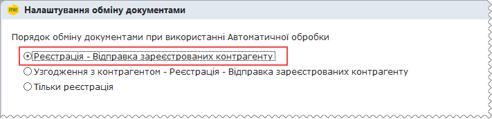
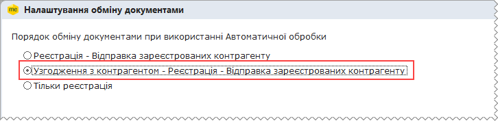
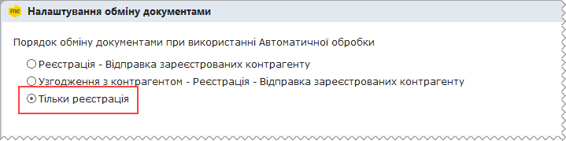
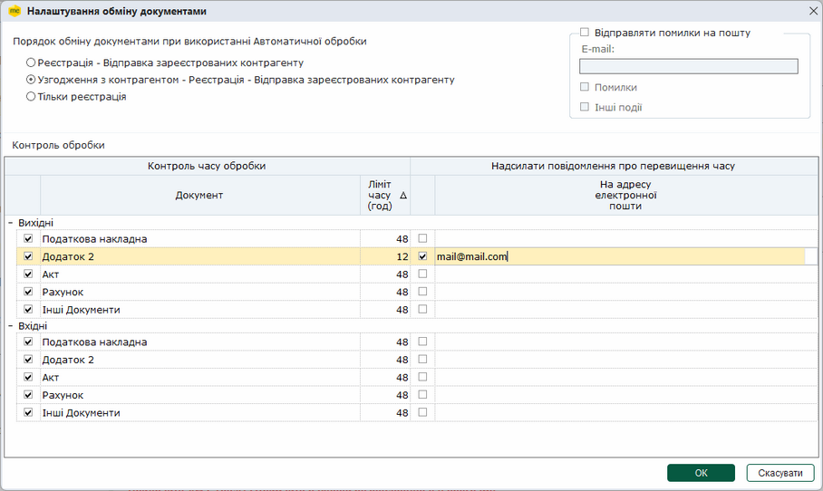
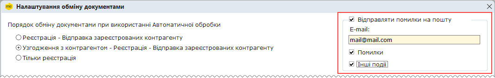

[← Зміст довідки](../)


# Налаштування обміну документами

## Налаштування обміну документами

_Шлях у довідці: Розділи програми › Первинні документи › Налаштування обміну документами_

В цьому розділі:

[Порядок обміну документами](#formdocparams-formdocparams)

[Контроль обробки](#formdocparams-formdocparams)

[Налаштування відправки повідомлень на пошту](#formdocparams-formdocparams)

До початку роботи з Первинною документацією обов'язково потрібно налаштувати параметри роботи модуля. Тут налаштовується порядок обробки та встановлюються допустимий час обробки кожного виду первинних документів.

Зверніть увагу!

Податкові накладні, які відправляються через Автоматичну обробку документів, обробляються за певним сценарієм, які в програмному комплексі названі маршрутами.

При відправленні ПН/РК вручну користувачу дозволено самостійно обирати адресата (із Наступних дій – Відправити в ДПС чи Відправити контрагенту).

Але, дозвіл не поширюється на:

- ПН/РК з умовними ІПН 100000000000, 200000000000, 300000000000, 400000000000, 500000000000 та 600000000000 - такі документи відправляються тільки на реєстрацію в ДПС;
- РК з від’ємними сумами та ІПН контрагента - ці документи відправляються тільки контрагенту.

Для налаштування параметрів оберіть Первинні документи - Налаштування обміну документами.

Відкриється вікно Налаштування обміну документами.

Порядок обміну документами

Передбачено 3 маршрути обробки Податкових накладних:

- включає в себе послідовно реєстрацію в ЄРПН - відправку зареєстрованих ПН контрагенту:

- включає в себе послідовно: попереднє узгодження з контрагентом вмісту ПН - реєстрацію в ЄРПН - відправку зареєстрованих ПН контрагенту:

- включає в себе тільки реєстрацію в ЄРПН:

Звертаємо Вашу увагу, що відправити зареєстровану ПН контрагенту або ж відправити затверджену контрагентом ПН у ДПС можливо з Архіву (із Наступних дій – Відправити в ДПС чи Відправити контрагенту).

[До початку](#formdocparams-formdocparams)

Контроль обробки

Для всіх первинних документів можливо налаштувати контроль часу обробки. Для кожного типу документа задається ліміт часу проходження етапів обробки. Якщо заданий час перевищено, система візуально повідомляє про це користувача.

1. Встановіть позначки напроти найменування первинного документа, якщо потрібно відслідковувати час його обробки.

2. В полі Ліміт часу (год) введіть кількість допустимих годин для обробки первинного документа.

3. У розділі Надіслати повідомлення про перевищення часу встановіть познички напроти найменування первинних документів, для яких потрібно отримувати повідомлення про перевищення встановленого терміну обробки. У полі На адресу електронної пошти вкажіть е-mail, на якій необхідно відправляти повідомлення.

Натисніть, щоб збільшити малюнок

[До початку](#formdocparams-formdocparams)

Налаштування відправки повідомлень на пошту

Існує можливість відслідковування роботи автообробника за допомогою відправки повідомлень на електронну пошту.

Для налаштування відправки повідомлень потрібно відмітити поле Відправляти помилки на пошту та налаштувати інші параметри:

- вказати адресу електронної пошти, куди будуть відправлятись повідомлення;
- обрати типи повідомлень (Помилки та/або Інші події), які потрібно отримувати.

Якщо обрано Інші події, то будуть відравлятись повідомлення про: запуск та зупинку модулів автообробника, результати роботи модулів автообробника.

[До початку](#formdocparams-formdocparams)


