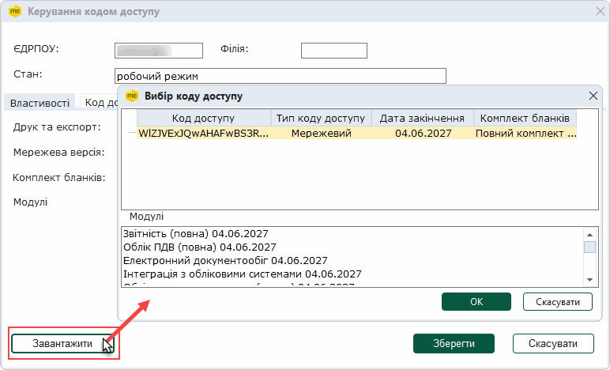
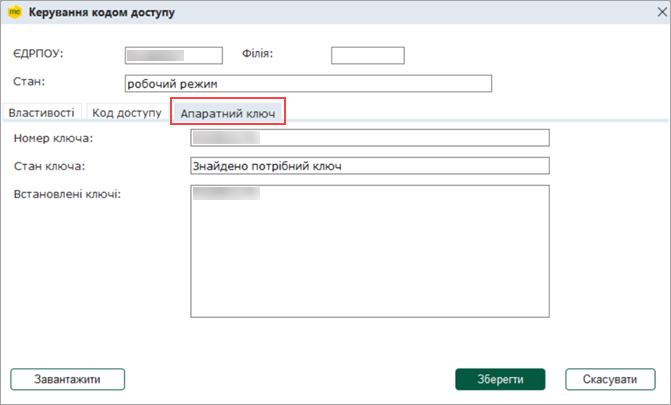
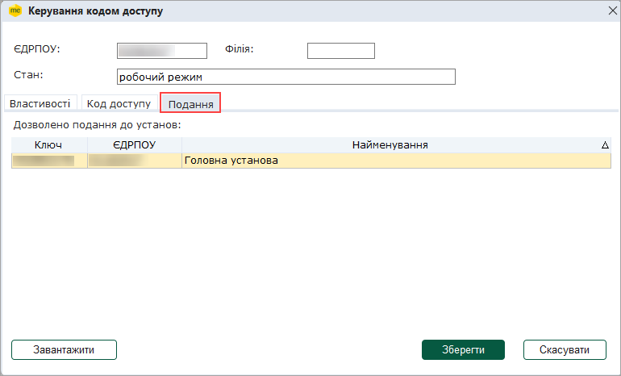

[← Зміст довідки](../)


# Керування кодом доступу

## Керування кодом доступу

_Шлях у довідці: Розділи програми › Адміністрування › Керування кодом доступу_

В цьому розділі:

[Основні відомості про ліцензійний код](#formlicinfo-admlic)

[Перехід з демоверсії в робочий режим](#formlicinfo-admlic)

[Керування кодом доступу у конфігурації M.E.Doc.Корпорація](#formlicinfo-admlic)

Після встановлення на комп'ютер, програма запускається в [демонстраційному режимі](Help.html#help-connect_).

Даний модуль дозволяє перевести програму з демонстраційного режиму в робочий стан шляхом введення ліцензійного коду, та в подальшому відслідковувати стан програмного комплексу за терміном дії ліцензії.

Основні відомості про ліцензійний код

Код ліцензії - це унікальний набор символів, призначений для захисту програми від несанкціонованого використання. Введення ліцензійного коду переводить програму з демонстраційного режиму в робочий стан та дозволяє використовувати повний функціоналу програмного комплексу.

- Код є індивідуальним для кожного підприємства, при його генерації враховуються реєстраційні дані Вашої установи. Таким чином, виданий код для однієї установи, не буде дійсним при використанні його для іншої установи.
- Код діє протягом терміну ліцензії. Після закінчення терміну дії ліцензії необхідно поновити код доступу.

Коли закінчиться терміну дії коду, система не одразу переходить до демонстраційного режиму, а залишається у робочому стані до моменту встановлення пакету оновлень. Після оновлення система знову повернеться в демоверсію, про що буде попереджено..

- Рекомендується зберігати ліцензійний код протягом терміну дії у текстовому файлі (\*.txt) на комп'ютері.

Попередньо сплативши рахунок за використання системи M.E.Doc, ліцензійний код можна отримати:

- у офісі розробника програмного комплексу;
- із сайту розробника [http://medoc.ua/](http://medoc.ua/);
- безпосередньо із цього модуля програми (при наявності на комп'ютері із встановленою програмою доступу до мережі Інтернет).

Для більш детальної інформації про ліцензійний код та способи його отримання  звертайтеся до служби підтримки користувачів.

Перехід з демоверсії в робочий режим

Якщо у Вас є ліцензійний код (збережений у текстовий форматі), скопіюйте його та ведіть у поле на вкладці Код ліцензії.

В інакшому випадку, код ліцензії можна завантажити безпосередньо із програми, за умови, що комп’ютер, на якому встановлено програму підключений до мережі Інтернет.

1. Натисніть на кнопку Завантажити. Відбудеться з'єднання через мережу Інтернет із сайтом компанії-розробника програми та пошук коду для Вашої установи.

2. Якщо ліцензування програмного комплексу було попередньо сплачено, відкриється вікно Вибір коду доступу, у якому міститься перелік доступних для даної установи ліцензій. У нижній частині вікна відображається список модулів, що містяться у обраній ліцензії.

Якщо на сайті присутні декілька ліцензій, по замовчуванню обирається ліцензія, що містить найбільшу кількість модулів. Така ліцензія відображається у першому рядку вікна Вибір коду доступу.

Для того, щоб переглянути список усіх ліцензій, натисніть лівою клавішею миші позначку біля напису Показати всі. Відкриється список усіх доступних ліцензій.

Для завантаження оберіть потрібну ліцензію та натисніть кнопку ОК.

Ліцензійний код автоматично завантажиться у програму.

3. Якщо ліцензійний код відсутній на сайті, система запропонує Вам завантажити ліцензію з диску. За умови, що у Вас є ліцензійний код (збережений у текстовий форматі) вкажіть шлях до його місце розташування.

4. Для збереження внесених даних натисніть на кнопку Зберегти. Після збереження внесених даних демонстраційна версія програми зміниться на робочу.

Керування кодом доступу у конфігурації M.E.Doc.Корпорація

Для підприємств з розгалуженою ієрархічною структурою, що здійснюють підготовку, прийом/передачу, обробку і накопичення звітних документів між організаціями та працюють у конфігурації M.E.Doc.Корпорація:

- Для головної установи, що отримує звіти від підзвітних підприємств, консолідує їх та подає у контролюючі органи. Після коректного налаштування програми у вікні Керування кодом доступу з'являється вкладка Апаратний ключ:

- Для підзвітних підприємств, що звітують у головну установу, за наявності ліцензії у вікні Керування кодом доступу присутня вкладка Подання, що містить інформацію про ЄДРПОУ, назву та апаратний ключ головної установи, у яку подаються звіти:

Докладно про налаштування та використання програми у конфігурації Корпорація дивіться у розділі [Прийом та обробка звітності](UCIncRst.html#ucincrst-m_e_doc-corp).


