[← Зміст довідки](../)


# Конструктор шаблона документа

## Конструктор шаблона документа

_Шлях у довідці: Додатково: FormRTFDsgn › Конструктор шаблона документа_

У даному розділі розглянуті такі теми:

- [Опис основних функціональних елементів інтерфейсу конструктору шаблону](#formrtfdsgn-pdocs_shablon_constructor_opys)
- [Поля шаблону](#formrtfdsgn-pdocs_shablon_constructor_func_2)
- [Функції конструктору шаблону](#formrtfdsgn-pdocs_shablon_constructor_func)
- [Особливості написання програм модифікацій на вкладці "Програми"](#formrtfdsgn-vb_script)

### Опис основних функціональних елементів інтерфейсу конструктору шаблону

_Шлях у довідці: Додатково: FormRTFDsgn › Конструктор шаблона документа › Опис основних функціональних елементів інтерфейсу конструктору шаблону_

Вікно конструктора шаблона складається з 5 основних частин:

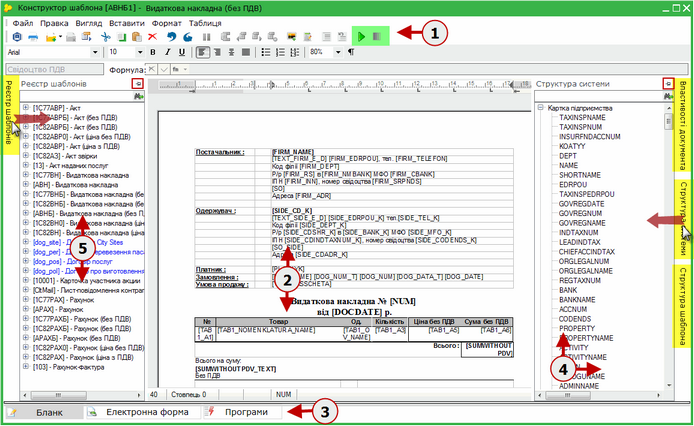

Натисніть, щоб збільшити малюнок

1. Панель інструментів.

Панель інструментів містить в собі рядок меню та безпосередньо інструментальні панелі.

Рядок меню містить команди основного меню. Усі команди є ієрархічними: при виборі однієї з таких команд на екрані з'являється спадаючі меню.

Інструментальні панелі надають швидкий доступ до основних команд і процедур. Наведіть покажчик миші на інструмент і чекайте протягом секунди, щоб відобразити коротку підказку, що описує, для чого він призначений.

На панелі інструментів розташовані кнопки ввімкнення/вимкнення режиму отладки документу (за замовчанням шаблон відображається в режимі редагування):

- натисніть  (F5) для ввімкнення режиму отладки. Призначений для перегляду створеного шаблону. В цьому режимі екранне відображення документа повністю співпадає з відображенням бланку документа при його створенні;
- натисніть  (Shift + F5) для вимкнення режиму отладки та переходу в режим редагування.

2. Робоча область.

Робоча область - вікно текстового редактору, призначено для створення, перегляду, редагування тексту шаблону.
Зверху і зліва області документа розташовані координатні лінійки, що дозволяють бачити розміри сторінки, розміри полів документа, положення будь-якого абзацу і його першого рядка.
У нижній частині вікна розташована рядок стану, де відображається інформація про поточний документ.

Текстовий курсор позначає позицію вводу символу. Розмір тексту на екрані залежить від вибраного масштабу.

Текст шаблону документу введіть вручну із клавіатури, відформатуйте, використовуючи команди панелі інструментів.

Шаблон, як правило, містити змінні поля, динамічні таблиці, формули та підключені довідники. Особливості створення та використання полів описано у наступному [розділі даної довідки](#formrtfdsgn-pdocs_shablon_constructor_func).

3. Режими відображення шаблону на екрані.

Містить вкладки, при переключенні між якими змінюється режим відображення шаблону документу на екрані:

- Бланк - представляє собою зовнішній вигляд документу. Цей режим призначений для створення, редагування тексту шаблону;
- Електронна форма - містить перелік полів та таблиць, що містяться у даному шаблоні. При наведені на полу відображається підказка - властивості даного поля;
- Програми - призначена для створення програм модифікації документа з використанням мови програмування VBScript.

4. Панель властивостей.

Представляє собою допоміжну висувну панель. Містить наступні вкладки:

- Структура системи - містить перелік всіх можливих полів, що є у системі. Реалізовано пошук полів за назвою.
- Структура шаблона - містить перелік полів, що використані у вибраному шаблоні. Реалізовано пошук полів за назвою.
- Властивості документа- відображає основні властивості документу. При виділенні певного поля, відображає його властивості.

Для того щоб зафіксувати панель, натисніть на кнопку  в кутку панелі, кнопка змінить вигляд на .

На панелях Структура системи та Структура шаблона реалізована функція перетягування полів в робочу область шаблону з метою створення однойменних полів.

Панель Структура шаблона містить додаткові кнопки, що слугують для створення полів в шаблоні. Поля додаються у перелік полів шаблону, звідки їх можна перетягнути у робочу область.

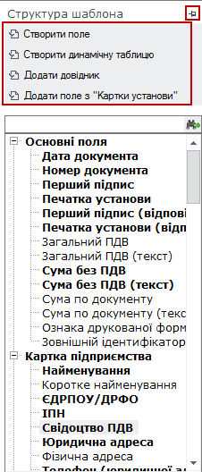

5. Реєстр шаблонів.

Представляє собою допоміжну висувну панель. Містить список всіх шаблонів первинних документів, що створені у системі. При розгортанні запису, відображається перелік полів, що є у шаблоні. З цієї панелі також можна перетягувати поля у робочу область з метою створення.

Для того щоб зафіксувати панель, натисніть на кнопку  в кутку панелі, кнопка змінить вигляд на .

### Поля шаблону

_Шлях у довідці: Додатково: FormRTFDsgn › Конструктор шаблона документа › Поля шаблону_

В цьому розділі:

[Як створити користувацьке поле](#formrtfdsgn-pdocs_shablon_constructor_func_2)

[Як вставити поле в документ](#formrtfdsgn-pdocs_shablon_constructor_func_2)

[Як додати довідник](#formrtfdsgn-pdocs_shablon_constructor_func_2)

[Як вставити в документ динамічну таблицю](#formrtfdsgn-pdocs_shablon_constructor_func_2)

Основною структурною одиницею, з якої складається шаблон документу є поле. Для створення доступні 4 типи полів:

►

Поля користувача - це поле, якому користувач може самостійно задавати атрибути, такі як найменування, ідентифікатор, тип даних тощо. У бланку таке поле доступне для заповнення власноруч з клавіатури. Може також містити формулу.

►

Системні поля - змінна, що містить задані властивості із картки поточного підприємства, картки контрагента та інших системних полів. Більшість полів заповнюються автоматично в момент створення документу даними із однойменних системних полів.

►

Довідник - поле, до якого підключений заданий довідник із переліку довідників системи. Заповнюється обраними даними із довідника.

►

Динамічна таблиця - дозволяє вставити у шаблон таблицю із заданою кількістю стовпчиків та рядків. В динамічній таблиці передбачена можливість додавати рядки в процесі заповнення документу створеного на основі шаблону.

Як створити користувацьке поле

Для того, щоб створити користувацьке поле скористайтесь одним із наступних способів:

- в меню Правка оберіть команду Створити > Створити поле;
- оберіть команду Створити поле на панелі Структура шаблону;
- оберіть кнопку Створити > Створити поле на панелі інструментів.

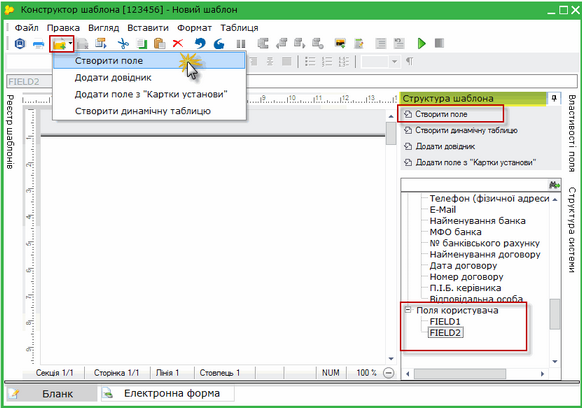

Натисніть, щоб збільшити малюнок

На панелі Структура шаблона з'явиться нова група Поля користувача, у яку додано щойно створене поле.
Для коректного використання полю потрібно задати для нього правильні параметри і властивості.

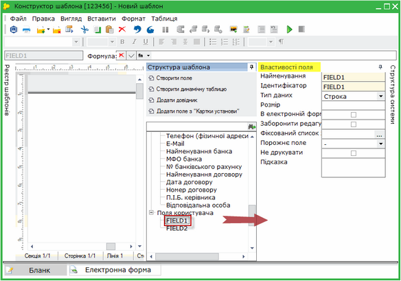

Натисніть, щоб збільшити малюнок

Виділіть поле і на панелі Властивості поля заповніть наступні параметри:

- Найменування - назва користувацького поля. Заповнюється вручну із клавіатури. Радимо використовувати унікальне найменування.
- Ідентифікатор - унікальний набір цифр та/або літер для ідентифікації користувацького поля в шаблоні. Заповнюється вручну із клавіатури.
- Тип даних - задає формат користувацького поля. Передбачено наступний перелік типів:
- Строка - тип даних, значеннями якого є довільна послідовність символів алфавіту (рядок). Наприклад: "вітаю усіх!"
Якщо використовується цей тип даних, з'являються додаткові властивості:
- Розмір - використовується для обмеження кількості символів в полі.
- Число з точкою - тип даних, який використовується для відображення чисел з виділенням дробової частини. Наприклад: 0,25; 2,00
Якщо використовується цей тип даних, з'являються додаткові властивості:
- Знаків після коми - кількість символів, які слід відображати після коми;
- Формат - відображення числа у вигляді цілої і дробової частини, або цілої або дробової. В базі зберігається повне введене значення. За замовчанням округлення виконується до другого знака;
- Відділяти розряди - якщо встановлена дана ознака, в даному полі відображатиметься роздільник груп розрядів;
- Відображати прописом - якщо встановлена дана ознака, числове значення в цьому полі відображається прописом.
- Дата - використовується для відображення значень дати. Наприклад: 01.02.2015.
Якщо використовується цей тип даних, з'являються додаткові властивості:
- Формат - перелік доступних для відображення форматів дати;
- Розбивати на ячейки - якщо встановлена ознака в цьому полі, кожний елемент дати поміщається в окрему клітинку. Властивість доступна лише для числового формату дати.
Також вмикається додатковий параметр - Вирівнювати по - правому чи лівому краю.

- Час - використовується для відображення часу. Наприклад: 14:05:00
- Ціле число - це будь-яке ціле число, що може бути додатнім чи від’ємним. Наприклад: 10, -74
Якщо використовується цей тип даних, з'являються додаткові властивості:
- Відображати прописом - якщо встановлена дана ознака, числове значення в цьому полі відображається прописом.
- Булеве значення - може приймати значення правда та неправда. Використовується для відображення значень двох станів, наприклад true/false, yes/no або on/off.
- В електронній формі - якщо встановлена дана ознака, користувацьке поле буде доступне для заповнення в електронній формі документу (Вигляд/Електронна форма).
- Заборонити редагування - якщо встановлена дана ознака, поле заблоковане від редагування. Використовується, наприклад, для розрахункових полів.
- Фіксований список значень - даний атрибут використовується з метою створення жорсткого списку значень для вибору в полі.
- Порожнє поле - встановлюється, що саме відображати в порожньому полі документу. Оберіть із списку доступних значень.
- Не друкувати - якщо встановлена дана ознака, поле не друкуватиметься.
- Підказка - текстове поле для нотаток користувача щодо обраного поля.

По закінченню внесення даних, збережіть, натиснувши на кнопку .

Тепер налаштоване поле можна вставити в шаблон будь-яким зручним для Вас способом, описаним в наступному розділі.

[Наверх](#formrtfdsgn-pdocs_shablon_constructor_func_2)

Як вставити поле в документ

Всі поля в документ вставляються з панелей Структура шаблона, Структура системи та Реєстр шаблонів.

Вставити поле в документ можна одним із наступних способів:

1. Шляхом перетягування потрібного поля з панелей.
Для цього потрібно виділити потрібне поле на одній із панелі, утримуючи ліву клавішу миші, перетягнути поле у потрібне місце документу.

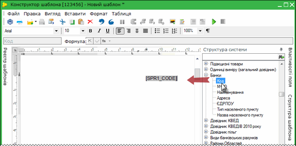

Натисніть, щоб збільшити малюнок

2. Встановіть курсор там де потрібно вставити поле. Оберіть необхідне поле на одній із панелей та двічі натисніть лівою клавішею миші по ньому.

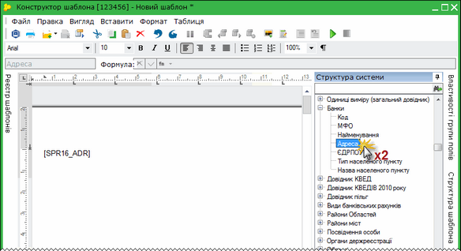

Натисніть, щоб збільшити малюнок

3. Встановіть курсор там де потрібно вставити поле. Оберіть необхідне поле на одній із панелей та натисніть кнопку Поле на панелі інструментів.

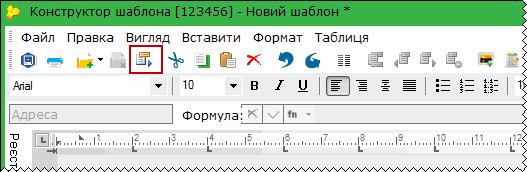

Порада №1

В деяких бланках користувач створює поля власноруч. Такі поля можуть бути в нагоді і в інших шаблонах документів. Для того не створювати їх знову, поля можна вставити в поточний шаблон. Для цього на панелі Реєстр шаблонів знайдіть бланк, в якому знаходиться потрібне поле, розгорніть його вміст і знайшовши поле вставте будь-яким зручним для Вас способом, описаним в даному розділі.

Порада №2

Поля Дата документу, Номер документу, Сума без ПДВ, Загальний ПДВ, Сума по документу, ЄДРПОУ (Контрагента), Найменування (Контрагента) - це поля, значення яких відображається в Реєстрі первинних документів. Радимо використовувати самі ці поля в шаблоні, а не створювати користувацькі поля власноруч.

Порада №3

Якщо документ, що створений на основі шаблону, буде відправлятись контрагенту електронним каналом зв'язку, в цьому шаблоні обов'язково мають бути поля ЄДРПОУ (Контрагента) та/або ІПН (Контрагента). На підставі даних з цих полів відбувається пошук контрагента в адресній книзі.
Для того, щоб ці поля в документі не було видно, встановіть ознаку Не друкувати та/або виділіть поле іншим кольором (Формат/Колір фону тексту).

Порада №4

Для відображення в документі зразків підписів та/або печатки на панелі Структура шаблона в групі Основні поля оберіть Підпис бухгалтера (відповідний), Підпис директора (відповідний) та Печатка установи (відповідна).

Також зверніть увагу:

На панелі Структура шаблону представлені найбільш уживані основні поля, поля з Картки підприємства та поля з Картки контрагента.

Передбачена можливість вставляти в шаблон інші поля з Картки підприємства, яких немає в запропонованому за замовчанням переліку.

Для цього в меню Правка оберіть команду Створити > Додати поле з "Картки установи (або кнопка Створити > Додати поле з "Картки установи" на панелі інструментів).

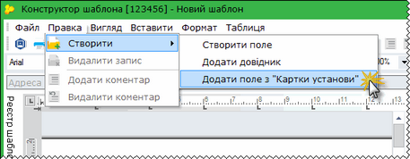

Натисніть, щоб збільшити малюнок

Відкриється вікно Вибір поля з картки установи. Оберіть потрібне поле і натисніть ОК.

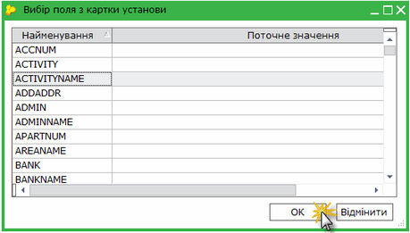

Натисніть, щоб збільшити малюнок

Поле додасться в блок Картка підприємства панелі Структура шаблону. Тепер його можна вставити в шаблон будь-яким зручним для Вас способом, описаним в даному розділі.

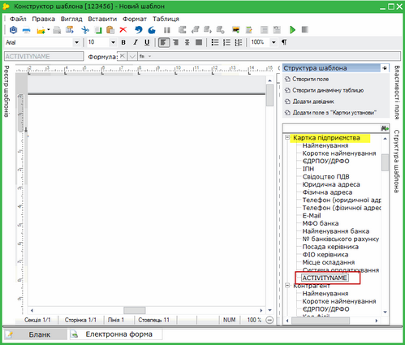

Натисніть, щоб збільшити малюнок

[Наверх](#formrtfdsgn-pdocs_shablon_constructor_func_2)

Як додати довідник

Вставити поле з підключеним довідником в документ можна одним із наступних способів:

- в меню Правка оберіть команду Створити > Додати довідник
- оберіть команду Додати довідник на панелі Структура шаблону
- оберіть кнопку Створити > Додати довідник на панелі інструментів.

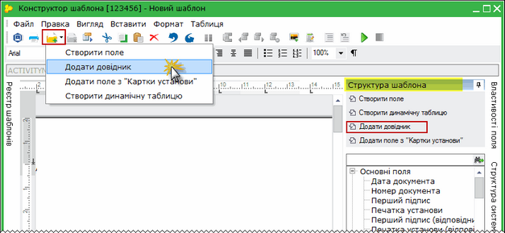

Натисніть, щоб збільшити малюнок

На виконання команди відкриється вікно Підключити. У полі "Довідник" натисніть кнопку вибору. У вікні, що відкрилось, оберіть потрібний довідник та натисніть кнопку ОК.

У вікні Підключити довіднику привласнюється ідентифікатор - унікальний набір цифр та/або літер для однозначної ідентифікації поля довідника. За замовчанням система пропонує код, але за потреби його можна змінити власноруч.
Натисніть ОК для продовження.

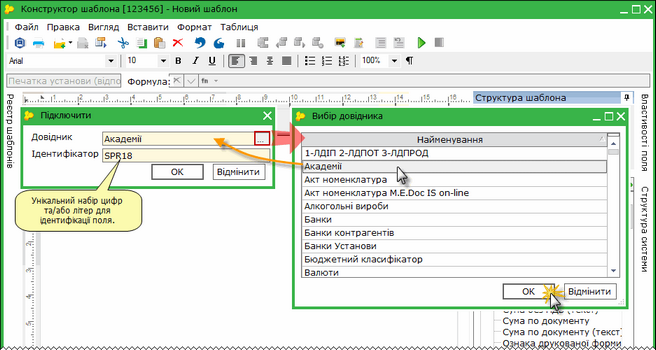

Натисніть, щоб збільшити малюнок

Обраний довідник додасться на панель "Структура шаблону".

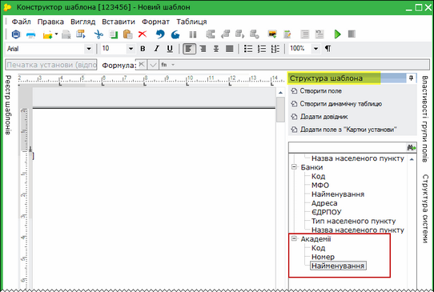

Натисніть, щоб збільшити малюнок

Тепер будь-яке поле з обраного довідника можна вставити в шаблон зручним для Вас способом, описаним в[розділі вище](#formrtfdsgn-pdocs_shablon_constructor_func_2).

[Наверх](#formrtfdsgn-pdocs_shablon_constructor_func_2)

Як вставити в документ динамічну таблицю

Вставити динамічну таблицю в документ можна одним із наступних способів:

- в меню Таблиця оберіть команду Створити динамічну таблицю
- оберіть команду Створити динамічну таблицю на панелі Структура шаблону
- оберіть кнопку Створити > Створити динамічну таблицю на панелі інструментів.

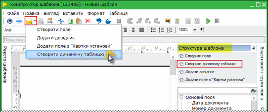

Натисніть, щоб збільшити малюнок

Відкриється додаткове вікно вибору параметрів динамічної таблиці. За замовчанням пропонується створити таблицю на 1 рядок та 6 стовпчиків. Встановіть потрібне значення рядків і стовпчиків таблиці та натисніть Вставити.

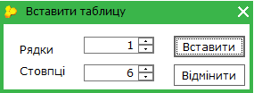

Таблиця вставляється в шаблон. Дані про поля таблиці відображаються на панелі Структура шаблона. Налаштувати індивідуальні параметри кожного окремого поля таблиці можна на панелі "[Властивості поля](#formrtfdsgn-pdocs_shablon_constructor_func_2)"

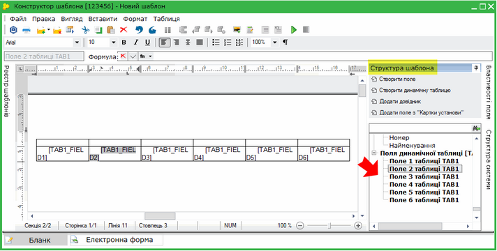

Натисніть, щоб збільшити малюнок

[Наверх](#formrtfdsgn-pdocs_shablon_constructor_func_2)

### Функції конструктору шаблону

_Шлях у довідці: Додатково: FormRTFDsgn › Конструктор шаблона документа › Функції конструктору шаблону_

В цьому розділі:

[Як змінити орієнтацію сторінки](#formrtfdsgn-pdocs_shablon_constructor_func)

[Завантаження готового шаблону](#formrtfdsgn-pdocs_shablon_constructor_func)

[Налаштування комплекту підписів](#formrtfdsgn-pdocs_shablon_constructor_func)

Як змінити орієнтацію сторінки

Для зміни орієнтації сторінки в меню Файл оберіть опцію Параметри сторінки.. Відкриється окреме вікно, в якому оберіть потрібну орієнтацію сторінки.

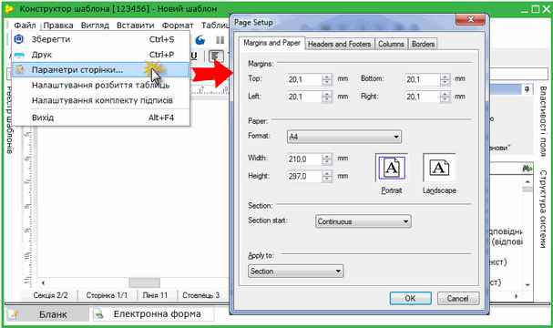

Натисніть, щоб збільшити малюнок

[Наверх](#formrtfdsgn-pdocs_shablon_constructor_func)

Завантаження готового шаблону

Реалізована можливість завантажувати в конструктор шаблонів вже готовий шалон із багатьох загальновживаних форматів, створених в зовнішніх текстових редакторах.

Для завантаження готового шаблону в меню Вставити оберіть опцію Файл... Відкриється окреме вікно, в якому вкажіть шлях до розташування шаблону та оберіть потрібний файл.

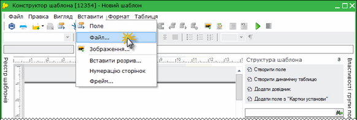

Натисніть, щоб збільшити малюнок

Вміст готового шаблону завантажиться в редактор.

Зверніть увагу! Динамічні таблиці не завантажуються, їх потрібно буде створити в редакторі шаблонів.

[Наверх](#formrtfdsgn-pdocs_shablon_constructor_func)

Налаштування комплекту підписів

У конструкторі шаблону документу доступна функція Налаштування комплекту підписів для створеного шаблону документу.

Виконується за допомогою команди Файл/Налаштування комплекту підписів.

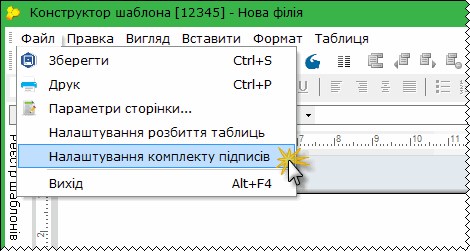

Відкриється модальне вікно Підписи. За допомогою кнопок зі стрілками сформуйте бажаний комплект підписів для даного документу.

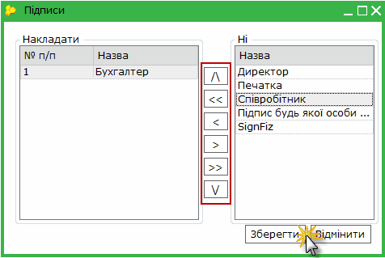

[Наверх](#formrtfdsgn-pdocs_shablon_constructor_func)

### Особливості написання програм модифікацій на вкладці "Програми"

_Шлях у довідці: Додатково: FormRTFDsgn › Конструктор шаблона документа › Особливості написання програм модифікацій на вкладці "Програми"_

Вкладка Програми призначена для створення програм модифікації документа з використанням мови програмування VBScript.

Основні програми, що використовуються:

|  |  |
| --- | --- |
| CREATE | Створення. Виконується при створенні нового документа. |
| OPEN | Відкриття. Виконується при відкритті документа. |
| SAVE | Збереження. Виконується при збереженні документа. |
| CLOSE | Закриття. Виконується при закритті документа. |
| CHECK | Перевірка документа. Виконується по кнопці перевірки документа. |
| MODIFY | Модифікація тіла документа. Виконується при зміні кожного поля тіла документа. Виконується при зміні сумарних полів таблиць.     Перед викликом MODIFY заповнюється глобальна змінна VBScript  DocEditedFieldName = <ім'я поля тіла таблиці, що модифікується>  або DocEditedFieldName = Null, якщо перерахування викликане не по введенню в поле. |
| TABLE | Модифікація рядка таблиці. Виконується при зміні кожного поля таблиці, при необхідності перераховуються підсумки.     Перед викликом TABLE заповнюється глобальна змінна VBScript  DocEditedTableNumber = <номер підтаблиці, що модифікується>  або DocEditedTableNumber = Null, якщо перерахування викликане не по введенню в поле.     Поточним записом ZDataSet таблиці є рядок таблиці, де виконується редагування. |
| AFTER\_SPR | Модифікація. Виконується при зміні поля з підключеним довідником. |


