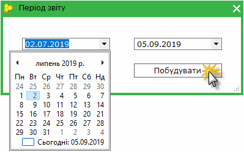
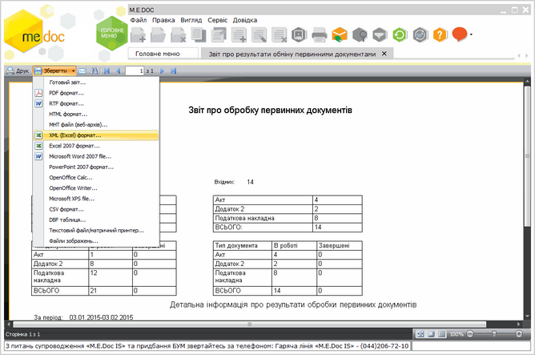

[← Зміст довідки](../)


# Звіт про обробку первинних документів

## Звіт про обробку первинних документів

_Шлях у довідці: Додатково: FormRepStaT › Звіт про обробку первинних документів_

З метою аналізу обміну первинними документами за проміжок часу, додано можливість формувати Звіт про обробку первинних документів, який містить детальну інформацію про результати обробки первинних документів за вказаний період.

1. Звіт відкривається подвійним кліком лівої клавіші миші з Головного меню програми Первинні документи - Звіт про обробку первинних документів.

2. У вікні, що відкриється, оберіть дату початку та дату закінчення періоду, за який потрібно відобразити Звіт.

3. Натисніть Продовжити.

4. Сформований звіт відкриється в окремому вікні спеціального редактору. Звіт відображається тільки в режимі перегляду, його не можна редагувати.

У вікні редактору доступні такі функції:

- Друк - дозволяє надрукувати сформований звіт;
- Зберегти - дозволяє зберегти звіт в одному із найуживаніших форматів.

Натисніть, щоб збільшити малюнок


