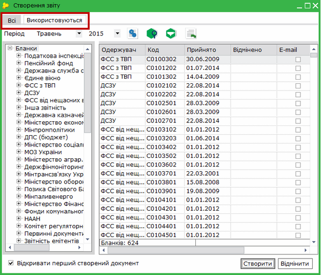

[← Зміст довідки](../)


# Вікно Створення звіту

## Вікно Створення звіту

_Шлях у довідці: Додатково: FormSelectReport2 › Вікно Створення звіту_

З версії 10.00.040, у вікні Створення звіту додані вкладки Всі та Використовуються.

Вкладка Всі містить весь перелік бланків, що був обраний при налаштуванні комплектності бланків.

Вкладка Використовуються містить бланки документів, що були створені користувачем у попередніх періодах, тобто містить найбільш вживані бланки. Таким чином формується користувацький комплект бланків.

УВАГА!
Якщо Ви не можете знайти потрібний бланк на вкладці Використовуються,
перейдіть на вкладку Всі.

Поле Відмінено заповнюється розробниками системи на підставі чинного законодавства та регламентуючих документів державних органів, які отримують звіти, та містить останній день періоду, за який подається звіт з цим кодом.

Ця дата використовується системою для визначення необхідності відображати цей звіт для подачі у вибраний користувачем період звітності.

Ця дата не визначає дату, після якої звіт не потрібно складати.

Період формування звітності зазначається чинним законодавством та не відображається в цьому вікні.

Наприклад:

Звіт "№ 1П-НПП (річна)", код S0403507.

Поле Відмінено заповнено значенням "31.12.2015". Це означає, що за 2015 рік необхідно здавати звіт по цій формі (цьому коду звіту) до терміну, визначеному законодавством, а саме до 29.02.2016.

При цьому звіт "№ 1П-НПП (річна)" за 2016 рік необхідно буде здавати на новому бланку з кодом S0403508.


