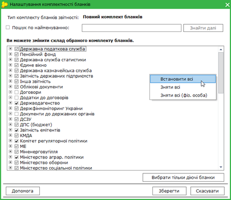
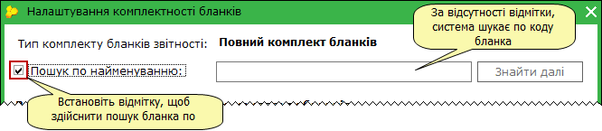

[← Зміст довідки](../)


# Налаштування комплектності бланків

## Налаштування комплектності бланків

_Шлях у довідці: Розділи програми › Адміністрування › Налаштування комплектності бланків_

У даному модулі можна змінити склад обраного при [створенні підприємства](Connect_org.html#connect_org-connect_org) комплекту бланків.

У верхній частині вікна відображена назва обраного типу звітних форм.
У полі вікна представлений обраний користувачем комплект звітності у вигляді ієрархічного списку.

Для зручності та прискорення пошуку, бланки згруповані за призначенням (одержувачем). При розгортанні певної групи можна побачити бланки, які входять до її складу.

1. Встановіть/зніміть галочку напроти обраної форми, щоб включити або, навпаки, виключити бланк до загального переліку форм, що використовуються.

Для того, щоб одночасно встановити або зняти всі галочки, натисніть правою клавішею миші в будь-якому місці вікна, що містить ієрархічний список. У контекстному меню, що відкриється, виберіть потрібний варіант. Пункт Зняти всі (фіз. особа) призначений для вимкнення бланків юр. осіб для фізичних осіб і навпаки - бланки фіз. осіб для юридичних осіб. Для відновлення відображення всіх бланків комплекту оберіть пункт Встановити всі.

Натисніть, щоб збільшити малюнок

При необхідності, бланки можна шукати по найменуванню або по коду бланка.

За замовчанням система шукає бланки по коду. Щоб здійснити пошук по найменуванню, встановіть галочку у відповідному полі.

2. Щоб обрати тільки діючі бланки, у нижній частині вікна натисніть кнопку Відображати тільки діючі бланки. Після натискання кнопки буть автоматично встановлені позначки у рядках діючих на поточний момент бланків. Для бланків, що на даний момент не діють, позначки будуть видалені. Відповідно, у програмі при обранні бланків для створення звітів відображатимуться тільки діючі на поточний момент бланки.

3. Для збереження внесених змін натисніть кнопку Зберегти.

Для скасування внесених змін натисніть кнопку Відміна.


