[← Зміст довідки](../)


# Перенесення організації у веб-сервіс СОТА

## Перенесення організації у веб-сервіс СОТА

_Шлях у довідці: Розділи програми › Адміністрування › Перенесення організації у веб-сервіс СОТА_

В цьому розділі:

[Авторизація у сервісі СОТА](#formtransfertosota-formtransfertosota)

[Реєстрація у сервісі СОТА](#formtransfertosota-formtransfertosota)

[Перенесення даних до веб-сервісу СОТА](#formtransfertosota-formtransfertosota)

За допомогою Майстра перенесення організації у веб-сервіс СОТА можливо здійснювати перенесення документів підприємства з програми M.E.Doc у веб-сервіс СОТА. Для підприємства виконується перенесення документів, що містяться у розділах:

- Реєстр звітів;
- Єдиний внесок;
- Реєстр первинних документів;
- Реєстр документів РРО;
- Облік акцизного податку.

Для документів, які не мають фінального статусу, а мають статус: Відправлено, Отримано повідомлення, Отримана перша квитанція, Отримана друга квитанція перенесення не виконується.

Для перенесення документів необхідно авторизуватись у веб-сервісі СОТА. Для авторизації потрібно ввести номер мобільного телефону та пароль до облікового запису у веб-сервісі СОТА.

Якщо сервіс СОТА використовується вперше, спочатку користувачу буде запропоновано [зареєструватись](#formtransfertosota-formtransfertosota).

Авторизація у сервісі СОТА

1. Якщо користувач вже має  обліковий запис у веб-сервісі, буде запропоновано авторизуватись. Введіть номер мобільного телефону, що був вказаний при реєстрації на веб-сервісі СОТА. Натисніть кнопку Далі:

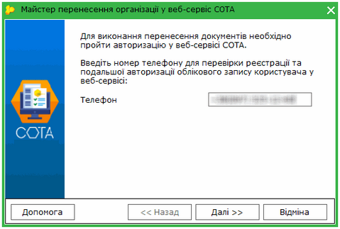

Натисніть, щоб збільшити малюнок

2. Введіть пароль для авторизації у веб-сервісі СОТА, та натисніть кнопку Далі:

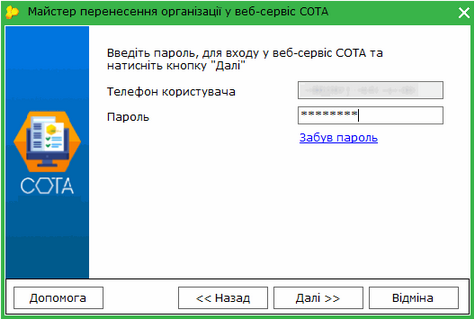

Натисніть, щоб збільшити малюнок

Якщо ви забули пароль, натисніть посилання Забув пароль, та виконайте вказівки системи для відновлення пароля.

3.  У вікні майстра з'явиться повідомлення з періодом часу, за який буде виконуватись [перенесення](#formtransfertosota-formtransfertosota) даних. Для початку перенесення натисніть Далі:

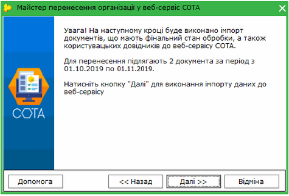

Натисніть, щоб збільшити малюнок

4.  Після завершення операції відкриється вікно:

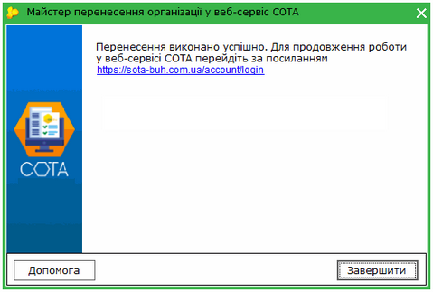

Натисніть, щоб збільшити малюнок

Перейдіть за посиланням для початку роботи у веб-сервісі СОТА.

[До початку](#formtransfertosota-formtransfertosota)

Реєстрація у веб-сервісі СОТА

Якщо ви не маєте облікового запису в СОТА:

1. Введіть номер мобільного телефону, який буде пов'язаний зі створюваним обліковим записом у веб-сервісі СОТА. Цей номер телефону буде використовуватись для входу у обліковий запис. Натисніть кнопку Далі:

Натисніть, щоб збільшити малюнок

2. У наступному вікні введіть прізвище, ім'я та по батькові користувача та пароль для входу у обліковий запис. Підтвердіть правильність введення пароля. Пароль повинен містити не менше 7 символів, із них: хоча б одну цифру (0-9), один спеціальний символ, велику та малу літери латинського алфавіту.

Ознайомтесь з умовами обробки персональних даних, натиснувши на посилання.

Встановіть відмітку, якою надаєте згоду на обробку ваших персональних даних, та натисніть Далі.

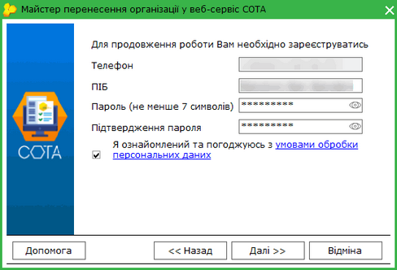

Натисніть, щоб збільшити малюнок

3. На вказаний номер телефону буде надіслано код підтвердження реєстрації, введіть його у наступному вікні та натисніть Далі:

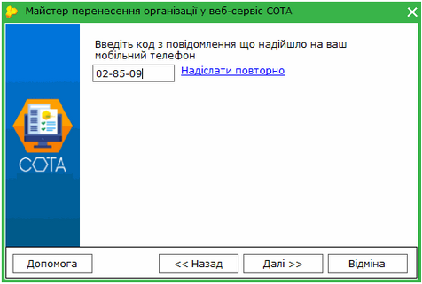

Натисніть, щоб збільшити малюнок

Якщо повідомлення з кодом не отримано, оберіть у вікні Надіслати повторно. Відкриється сторінка веб-сервісу СОТА. На сторінці СОТА натисніть кнопку Надіслати повторно (кнопка активується через 60 секунд).

4. Обліковий запис у веб-сервісі СОТА створено. Для продовження натисніть Далі:

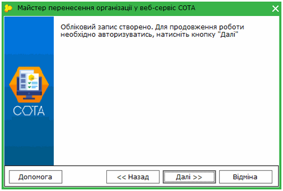

Натисніть, щоб збільшити малюнок

5. Виконайте авторизацію у веб-сервісі. Введіть номер телефону, вказаний при створенні облікового запису, натисніть Далі:

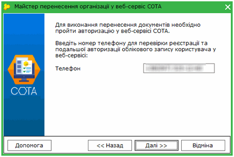

Натисніть, щоб збільшити малюнок

6. У наступному вікні введіть пароль:

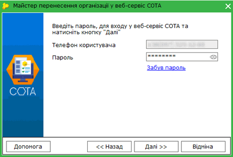

Натисніть, щоб збільшити малюнок

7. Відкриється повідомлення з пропозицією підписати Угоду про надання послуг:

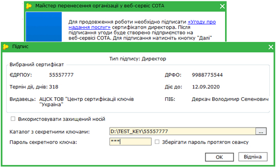

Натисніть, щоб збільшити малюнок

Ознайомтеся з угодою, натиснувши посилання. Потім натисніть кнопку Далі та підпишіть угоду ЕП директора.

8. Наступний крок - перенесення даних до веб-сервісу.

[До початку](#formtransfertosota-formtransfertosota)

Перенесення даних до веб-сервісу СОТА

1. Для перенесення автоматично обираються документи, дата створення яких дорівнює або менша за поточну дату. Якщо після перенесення у документи внесено зміни, повторно ці документи не переносяться.

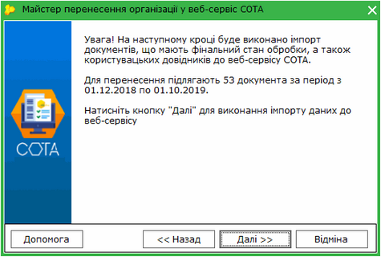

Натисніть, щоб збільшити малюнок

Натисніть кнопку Далі.

2. Відкриється вікно, у якому відображається процес обробки даних. Перенесення документів може зайняти деякий час.

Можливо припинити перенесення документів, натиснувши кнопку Відміна.

Зверніть увагу, можливо перенести не більше 20000 документів.

У веб-сервіс СОТА переносяться лише ті документи, які раніше не переносилися. Якщо документ вже був збережений у СОТА, при перенесенні існуючий документ буде замінено.

Для нового облікового запису СОТА також виконується перенесення даних з довідників підприємства, що створюються користувачами.

3. Після перенесення даних система повідомить про завершення операції. Перенесені документи доступні для опрацювання у веб-сервісі СОТА. Перейти у веб-сервісі СОТА можна, натиснувши на посилання у вікні:

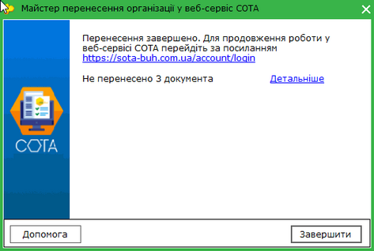

Натисніть, щоб збільшити малюнок

У вікні відображається кількість документів, які не вдалося перемістити (за наявності). Для перегляду докладної інформації про причини невдалого імпорту натисніть кнопку Детальніше. Відкриється вікно протоколу:

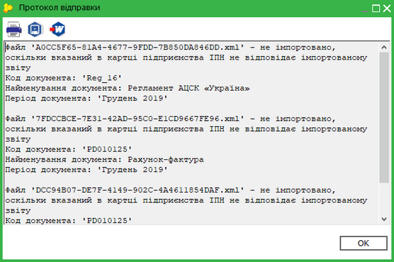

Натисніть, щоб збільшити малюнок

[До початку](#formtransfertosota-formtransfertosota)


