[← Зміст довідки](../)


# Універсальний імпорт

## Універсальний імпорт

_Шлях у довідці: Розділи програми › Звітність › Універсальний імпорт_

Універсальний імпорт - сервіс, який дозволяє настроювати та зберігати шаблони завантаження документів довільних структур. Налаштувавши один раз шаблон завантаження документа, всі наступні завантаження будуть зведені до декількох натиснень кнопки.

Імпорт передбачено для документів у форматі \*.xls, \*.xlsx, \*.dbf.

У даному розділі розглянуті такі теми:

- [Порядок імпорту документів](#formuniimpparams-uniimp_imp)
- [Створення та налаштування шаблонів імпорту](#formuniimpparams-uniimp_imp)
- [Редагування шаблону імпорту](#formuniimpparams-uniimp_redag)
- [Імпорт та експорт шаблонів](#formuniimpparams-uniimp_importexport)

### Порядок імпорту документів

_Шлях у довідці: Розділи програми › Звітність › Універсальний імпорт › Порядок імпорту документів_

Для імпорту даних виконайте дії у наступній послідовності:

1. У Головному меню оберіть модуль Звітність і далі подвійним кліком правої клавіші миші відкрийте розділ Універсальний імпорт.

Універсальний імпорт також можна здійснити у модулях [Реєстр звітів](UCDocRstByPer5.html#ucdocrstbyper5-rdocs), [Реєстр податкових документів](UCDFDocsRst.html#ucdfdocsrst-pdocs_reestr), [Інформаційна довідка](UCGovQry.html#ucgovqry-ucgovqry) та [Реєстр отриманих та виданих податкових накладних](UCDocNaklRstMain5.html#ucdocnaklrstmain5-docnaklrst). Для цього у головному меню оберіть команду Файл - Імпорт - Універсальний імпорт.

2. Відкриється вікно Універсальний імпорт. Необхідно обрати шаблон для імпорту документів.

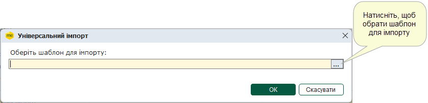

3. Відкриється вікно з переліком існуючих шаблонів документів для імпорту.

Оберіть потрібний шаблон зі списку або [створіть новий шаблон імпорту](#formuniimpparams-uniimp_stvor), та натисніть кнопку ОК.

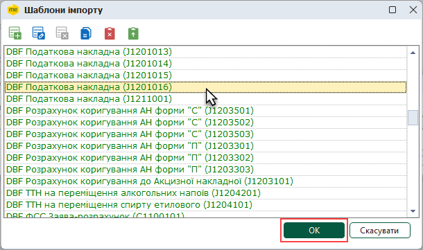

4. У наступному вікні вказується файл, з якого потрібно імпортувати дані. У полі Оберіть файл(и) для імпорту натисніть на кнопку вибору та вкажіть шлях до місця розташування файлу документа, що потрібно імпортувати.

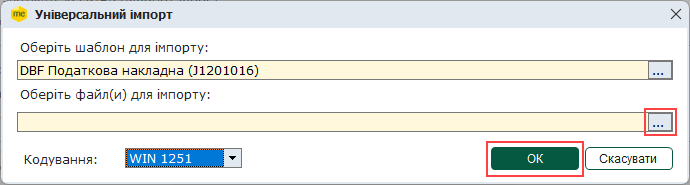

У полі Кодування, у разі потреби, можна обрати кодування, що використовується у файлі, який імпортується. За замовчуванням використовується WIN 1251.

Для початку імпорту даних натисніть кнопку ОК.

5. Система повідомить про результати імпорту даних.

### Створення та налаштування шаблонів імпорту

_Шлях у довідці: Розділи програми › Звітність › Універсальний імпорт › Створення та налаштування шаблонів імпорту_

Для створення та налаштування нового шаблону імпорту виконайте дії у наступній послідовності:

1. У вікні вибору шаблону імпорту натисніть кнопку Додати.

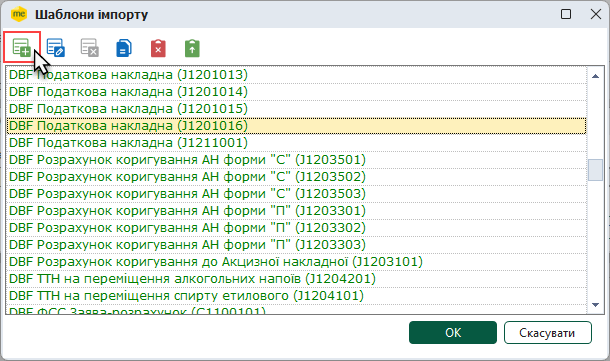

2. Заповніть запропоновані поля форми:

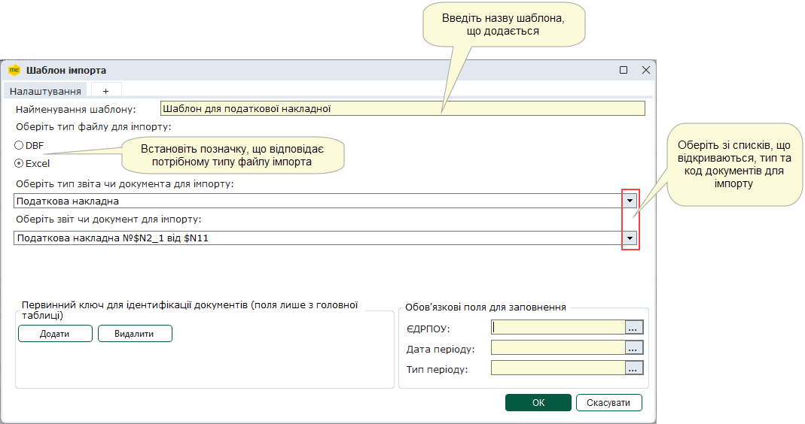

- Найменування шаблону - назва шаблону імпорту. Введіть вручну з клавіатури назву шаблону для імпорту.
- Тип файлу для імпорту - передбачено завантаження даних із файлів у форматах \*.dbf, \*.xls та \*.xlsx. Встановіть відмітку напроти потрібного типу файлу для створюваного шаблону.
- Тип звіту чи документа для імпорту - список з переліком типів документів, які можна завантажити у програмний комплекс.
Доступні слідуючи типи:
- Реєстр податкових накладних;
- Податкова накладна;
- Додаток №2 до податкової накладної;
- Інформаційна довідка;
- Первинні документи.

Оберіть у списку потрібний тип документа для створюваного шаблону.

- Звіт чи документ для імпорту - список кодів документів з їх назвами. Список кодів документів формується в залежності від обраного типу документа в попередньому полі.
Оберіть у списку потрібний код документа для імпорту для створюваного шаблону.

3. Для того, щоб додати та налаштувати таблицю даних, натисніть на "+" на панелі вкладок.

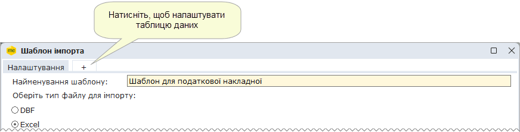

4. Для налаштування шаблону необхідно завантажити файл, що містить структуру даних. Це може бути будь-який пустий або заповнений документ з визначеною структурою, по полям якого будуть проводитись співставлення з полями бланків.
У полі Вкажіть файл для імпорту натисніть на кнопку вибору та вкажіть шлях до місця розташування файлу документа, з якого буде завантажуватися структура.

5. Далі потрібно завантажити структуру файлу в систему для подальшого співставлення її полів. Для цього натисніть кнопку Завантажити структуру файла.

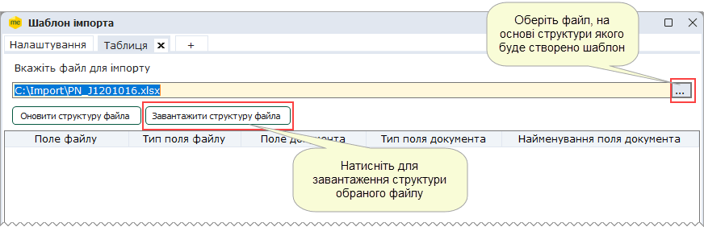

В результаті завантаження внизу з'явиться табличка із заповненими колонками Поле файлу та Тип поля файлу.

6. Наступним кроком потрібно провести співставлення завантажених полів із структури шаблону з полями бланків програмного комплексу. Це потрібно для коректного відображення даних після імпорту.

Наведіть курсор миші на рядок у колонці Поле документа. Натисніть на кнопку, що з'явилась.

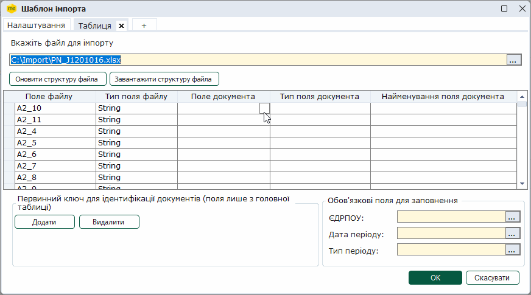

Відкриється вікно Поля документа. Розгорніть потрібну групу полів, натиснувши на .

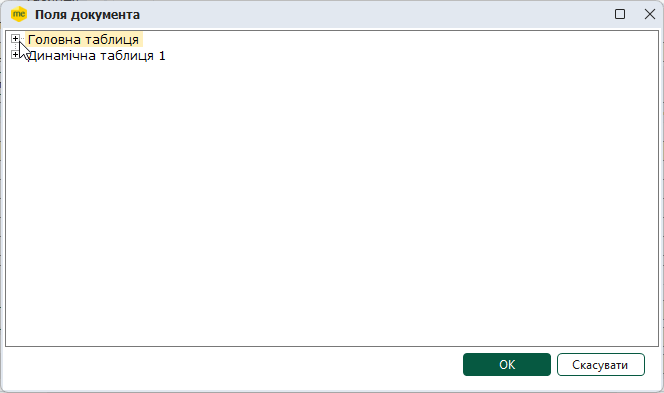

Оберіть поле документа, що відповідає полю із завантаженої структури та натисніть ОК.

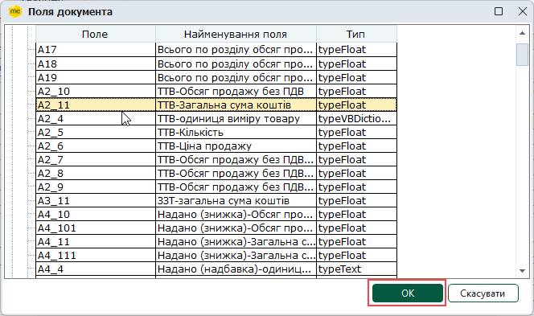

Поля Тип поля документа та Найменування поля документа заповнюються автоматично.

Таким чином проведіть відповідність всіх полів структури.

Примітка:

Для перегляду полів документа відкрийте документ у відповідному модулі та скористайтеся клавішею F11. Відкриється вікно перегляду електронної форми документа, що містить назви полів.

У модулях Реєстр звітів, Інформаційна довідка, Реєстр первинних документів та Реєстр отриманих та виданих податкових накладних перегляд електронної форми документа також доступний з вікна відкритого документа по команді меню Правка - Електронна форма, або по натисканню кнопки панелі інструментів Електронна форма .

7. Кожний документ має володіти яким небудь унікальним параметром, за яким його можна однозначно ідентифікувати. Це може бути, наприклад, номер документа, або номер і дата документа. Такий унікальний параметр називається первинним ключем.

Документ може містити декілька первинних ключів, але обов'язково повинен містити мінімум один первинний ключ і це значення має бути унікальним.

Зверніть увагу! Якщо в документі поле, визначене як первинний ключ, - пусте, документ не імпортується.

- Якщо первинним ключем буде обрано унікальний параметр, то всі імпортовані документи, в яких цей параметр однаковий, об'єднаються в один.
- Наприклад, первинним ключем обрано дату створення документа - 23.05.2026. Імпортували 7 податкових накладних, що були створенні саме цього дня, в результаті чого система об'єднає їх у один документ.

Отже, при налаштуванні шаблону імпорту потрібно назначити, які поля із завантаженої структури виступають первинними ключами (унікальними параметрами).

Для цього у блоці Первинний ключ для ідентифікації документів натисніть кнопку Додати. У блоці з'явиться поле для вибору первинного ключа. Натисніть кнопку вибору.

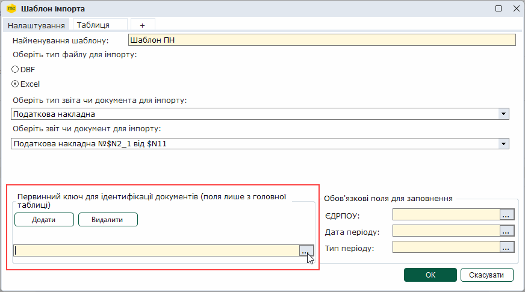

Відкриється вікно із переліком полів завантаженої структури. Оберіть поле, значення якого є унікальним для документа та натисніть кнопку ОК.

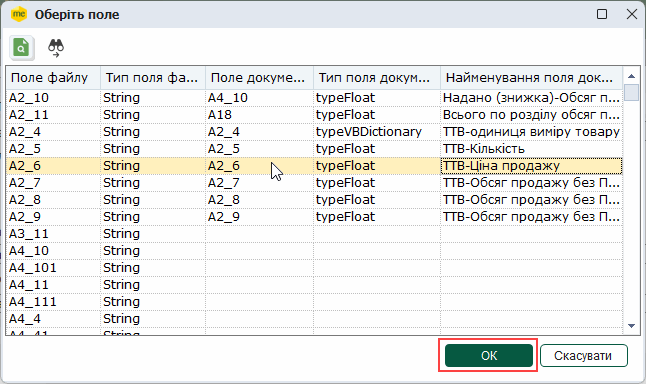

Визначте інші первинні ключі, якщо в них є необхідність.

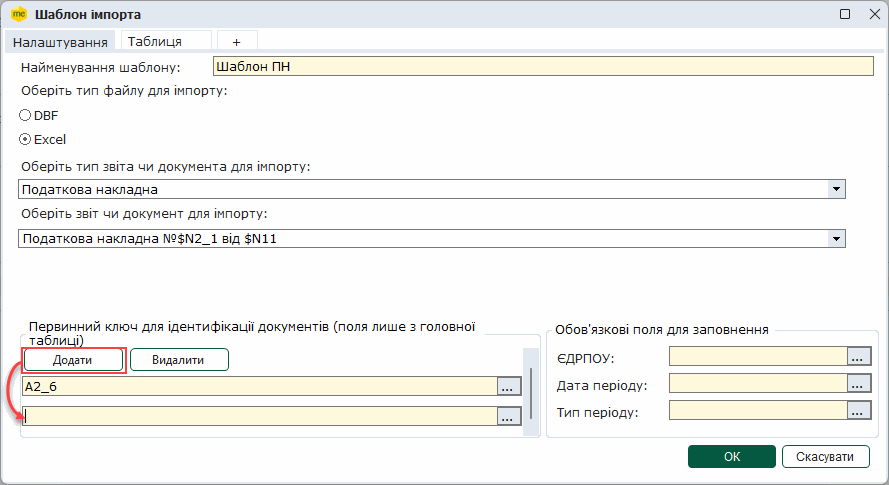

Для того, щоб видалити первинний ключ, натисніть кнопку Видалити. Видаляється ключ, що був доданий останнім.

8. Аналогічно визначенню первинного ключа потрібно визначити поля, що обов'язково повинні бути заповнені в імпортованому документі.

Зверніть увагу! Якщо в документі, що імпортується, поле визначене як обов'язкове - пусте, документ не імпортується.

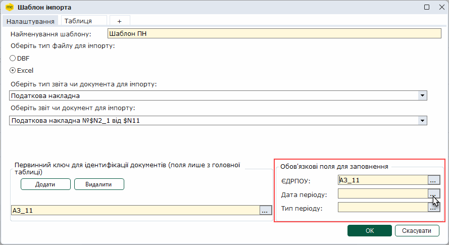

9. Якщо шаблон документа складається з декількох таблиць, налаштуйте кожну таблицю окремо.

10. Після закінчення налаштування натисніть кнопку ОК. Відтепер шаблон готовий для імпорту документів.

Шаблон для імпорту створюється та налаштовуються один раз. Надалі він просто використовується для імпорту документів.
При необхідності, шаблон можна [редагувати](#formuniimpparams-uniimp_redag).

### Редагування шаблону імпорту

_Шлях у довідці: Розділи програми › Звітність › Універсальний імпорт › Редагування шаблону імпорту_

Для редагування шаблону імпорту виконайте дії у наступній послідовності:

1. У вікні вибору шаблону імпорту оберіть шаблон, який потрібно відредагувати, та натисніть кнопку Редагувати.

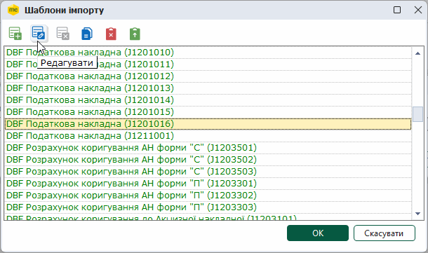

Якщо ви бажаєте внести зміни у стандартний шаблон, оберіть команду Копіювати . У вікні, що відкриється, внесіть зміни у скопійований шаблон.

2. Відредагуйте шаблон за власних потреб.

2.1. Для того щоб під час імпорту документи не дублювались, встановіть позначку Відкинути дублікати по первинному ключу. Якщо опція встановлена, при імпорті виконується контроль значень номерів та дати виписки документів. Якщо документ з такими значеннями вже існує у базі даних, імпорт такого документа не виконується. По замовчуванню опція вимкнена.

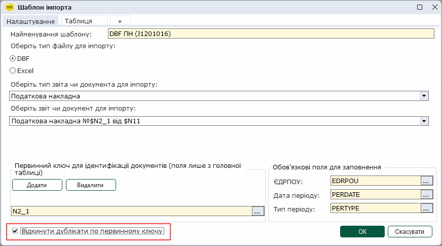

2.2. В разі, якщо у документі змінилась структура, можна її оновити. Для цього оберіть файл зі структурою у полі Вкажіть файл для імпорту та натисніть кнопку Оновити структуру файла.

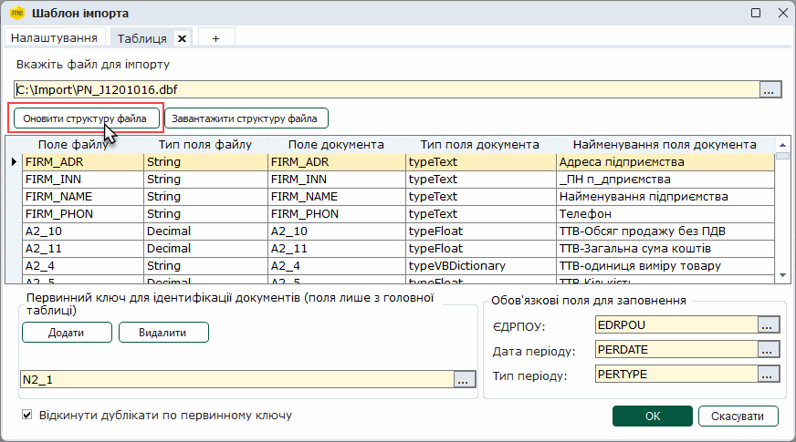

Після оновлення обов'язково перевірте структуру шаблону, та за необхідності [виконайте співставлення полів](#formuniimpparams-uniimp_stvor).

Можна скопіювати існуючий шаблон імпорту. Для копіювання шаблону:

1. Оберіть ім'я шаблону у вікні вибору шаблону імпорту та натисніть кнопку Копіювати .

2. У вікні, що відкрилось, змініть ім'я шалону та відредагуйте скопійований шаблон за власних потреб. Для збереження шаблону натисніть кнопку ОК.

3. Ім'я скопійованого шаблону з'явиться у вікні вибору шаблону імпорту.

Для видалення шаблону імпорту:

1. Оберіть ім'я шаблону у вікні вибору шаблону імпорту та натисніть кнопку Видалити .

2. У модальному вікні підтвердьте видалення шаблону імпорту, натиснувши кнопку Так.

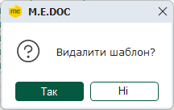

У програмному комплексі присутні системні шаблони (відображені у вікні Шаблони імпорту зеленим кольором). Системні шаблони неможливо змінити або видалити.

### Імпорт та експорт шаблонів

_Шлях у довідці: Розділи програми › Звітність › Універсальний імпорт › Імпорт та експорт шаблонів_

Існує можливість зберегти шаблон імпорту на диску комп'ютера чи електронному носії у файлі формату .xml.

Для збереження шаблону імпорту виконайте операцію експорту шаблону:

1. У вікні Шаблони імпорту оберіть шаблон, який потрібно експортувати, та натисніть кнопку Експорт шаблону .

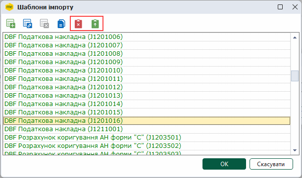

2. У діалоговому вікні ОС Windows Відкрити  введіть ім'я файлу та натисніть кнопку Зберегти.

3. Система повідомить про результати виконання експорту.

В разі, якщо необхідно перенести до системі шаблон імпорту, раніше збережений у вигляді файлу .xml, скористайтеся функцією імпорту шаблону:

1. У вікні Шаблони імпорту натисніть кнопку Імпорт шаблону .

2. У діалоговому вікні ОС Windows Зберегти як оберіть ім'я файлу, який потрібно імпортувати, та натисніть кнопку Відкрити.

3. Система повідомить про результати виконання імпорту.

Про налаштування шаблонів імпорту дивіться у файлі довідки у каталозі встановлення M.E.Doc ...\help\manuals\Інструкція з універсального імпорту.pdf.


