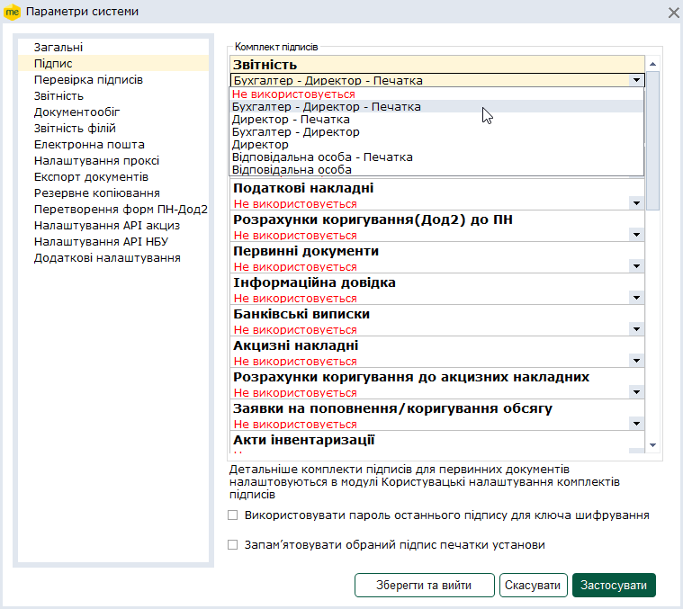
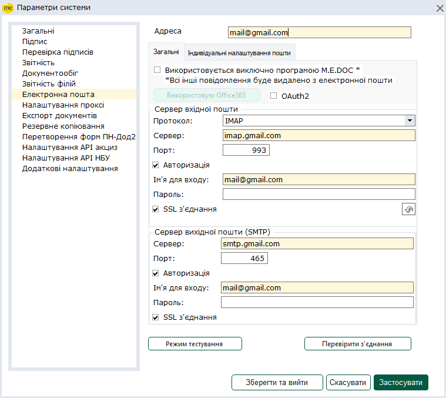
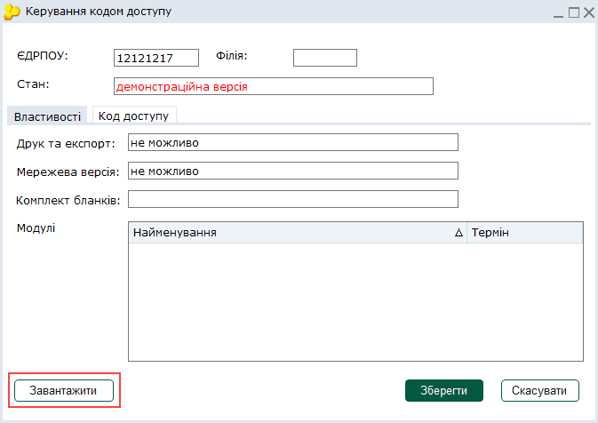

[← Зміст довідки](../)


# Налаштування програми M.E.Doс після отримання сертифікатів

## Налаштування програми M.E.Doс після отримання сертифікатів

_Шлях у довідці: Початок роботи в системі › Налаштування програми M.E.Doс після отримання сертифікатів_

В цьому розділі:

Після отримання сертифікатів необхідно виконати налаштування програми M.E.Doс :

[1. Завантаження сертифікатів ЕП](#getcert-getcert)

[2. Налаштування необхідні для електронного документообігу](#getcert-getcert)

[3. Набуття статусу суб’єкта електронного документообігу](#getcert-getcert)

[4. Повідомлення про надання інформації щодо електронного підпису](#getcert-getcert)

[5. Документи по оплаті за послугу](#getcert-getcert)

У разі необхідності можливо виконати блокування сертифіката:

[Порядок блокування сертифіката](#getcert-getcert)

1. Завантаження сертифікатів ЕП

Сертифікати можна завантажити у розділі [Адміністрування – Сертифікати – Встановлені сертифікати](UCAsignCert.html#ucasigncert-admcert_cert), обравши один із способів:

- натисніть кнопку Завантажити з Інтернету  на панелі інструментів;
- оберіть команду меню Файл - Додати сертифікат та у вікні, що відкриється, вкажіть шлях до каталогу, де зберігаються файли сертифікатів; файли сертифікатів .

Цим способом можна скористатися, якщо сертифікати зберігалися по вашому проханню на ваш з’ємний носій.

[До початку](#getcert-getcert)

2. Налаштування необхідні для електронного документообігу

Налаштування комплекту підписів

Після завантаження сертифікатів програма M.E.Doс запропонує налаштувати комплект підпису документів. Із списку, що випадає оберіть відповідальних осіб.

Виконати налаштування підписів можливо у розділі програми [Адміністрування – Параметри системи – Підпис](FormCompanyParams.html#formcompanyparams-admcomanyparams_pen). Детальне налаштування комплектів підписів для первинних документів виконується у модулі [Користувацькі налаштування комплектів підписів](UCPDocSignSettings.html#ucpdocsignsettings-ucpdocsignsettings).

Налаштування електронної пошти

Оберіть [Адміністрування – Параметри системи – Електронна пошта](FormCompanyParams.html#formcompanyparams-admcompanyparams_emaile).

Ведіть в полі Адреса ваш E-mail.

Рекомендується створити окрему електронну скриньку на одному з надійних УКРАЇНСЬКИХ поштових серверів (ukr.net, meta.ua, gmail.com), яка використовуватиметься лише для відправлення звітів та отримання електронних квитанцій.

Далі натисніть кнопку Перевірити з'єднання та обов’язково збережіть налаштування, натиснувши кнопку Застосувати або Зберегти та вийти.

Встановлення коду доступу (ліцензія на використання програми M.E.Doс)

Щоб завантажити код доступу автоматично увійдіть у [Адміністрування – Керування кодом доступу](FormLicInfo.html#formlicinfo-admlic) натисніть кнопку Завантажити.

Якщо у вікні з’явиться інформація "Не знайдено жодного коду доступу в Інтернеті. Бажаєте завантажити з диску?" та код доступу зберігається на вашому зовнішньому носій, натисніть так та оберіть шлях до файла.

Для вирішення питань щодо отримання та завантаження коду доступу телефонуйте 044-206-72-10 (технічна підтримка).

[До початку](#getcert-getcert)

3. Набуття статусу суб’єкта електронного документообігу

Починаючи з 01.09.2020 р., згідно з наказом Міністерства фінансів України від 01.06.2020 № 261 «Про внесення змін до Порядку обміну електронними документами з контролюючими органами» платник податків набуває статусу суб’єкта електронного документообігу з дати приєднання до Договору про визнання електронних документів, шляхом надсилання до контролюючого органу першого будь-якого електронного документа у встановленому форматі з дотриманням вимог законів України «Про електронні документи та електронний документообіг» та «Про електронні довірчі послуги».

Електронний документ вважається надісланим вперше у разі відсутності діючого договору про визнання електронних документів на дату отримання документа.

Для приєднання до СЕД та реєстрацїї нових сертифікатів ЕП у контролюючих органах створіть будь-який документ, що підлягає відправці у контролюючий орган, підпишіть його електронним підписом особи, що зареєстрована в ЄДР - керівником та печаткою (за наявності), та відправте до контролюючого органу.

У відповідь на перший електронний документ, відправлений у контролюючий орган, ви маєте отримаєте звіт про доставку документа, позитивну Квитанцію №1.

Статус суб'єкта електронної звітності набувається автоматично, що дає можливість надсилати звіти в електронному вигляді.

[До початку](#getcert-getcert)

4. Повідомлення про надання інформації щодо електронного підпису

Для реєстрації нових сертифікатів ЕП відповідальних осіб подається Повідомлення про надання інформації щодо кваліфікованого або удосконаленого електронного підпису для надання права підпису електронних документів іншим особам, яким делеговано право підпису, наприклад, бухгалтеру.

Щоб створити повідомлення:

1. Оберіть розділ Звітність – Реєстр звітів.

2. Виконайте команду меню Файл – Створити звіт або натисніть кнопку на панелі інструментів . У вікні Створення звіту оберіть період поточного місяця.

3. Для юридичних осіб  перейдіть у розділ Державна податкова служба – Інше та із реєстру бланків оберіть документ J1391104 "Повідомлення про надання інформації щодо кваліфікованого або удосконаленого електронного підпису, що базується на кваліфікованому сертифікаті електронного підпису".

Якщо Ви фізична особа-підприємець (ФОП), перейдіть у розділ Державна податкова служба – Звітність фізичних осіб та оберіть документ F1391104 "Повідомлення про надання інформації щодо кваліфікованого або удосконаленого електронного підпису, що базується на кваліфікованому сертифікаті електронного підпису".

Важливо! Повідомлення необхідно підписати сертифікатами посадових осіб, зазначених у табличній частині Повідомлення, і лише після цього підписати його сертифікатом керівника та печаткою (за наявності) що вже зареєстровані у системі.

[До початку](#getcert-getcert)

5. Документи по оплаті за послугу

Оригінали Документів по оплаті за послугу надходять до програми M.E.Doc.

Щоб переглянути Документів по оплаті:

1. Увійдіть у розділ Первинні документи – Реєстр первинних документів.

2. Задайте необхідний період пошуку первинних документів на панелі фільтрів ліворуч та натисніть кнопку Показати.

3. В таблиці розділу відобразиться перелік усіх документів за обраний період, перевірте та погодьте документ за допомогою команд вкладка Наступні дії.

[До початку](#getcert-getcert)

Порядок блокування сертифіката

Блокування сертифіката - це тимчасове припинення його чинності. Блокування сертифіката здійснюється на підставі заяви, яка подана в усній, письмовій формі чи у вигляді електронного документа.

- Електронна заява на блокування сертифіката формується [засобами програмного забезпечення M.E.Doc](UCAsignCert.html#ucasigncert-admcert_cert) або веб-сервісом СОТА, підписується ЕП власника сертифіката і надсилається на адресу КНЕДП.
- Заява в усній формі подається до КНЕДП в телефонному режимі. Для блокування заявник повинен повідомити співробітнику КНЕДП наступну інформацію: ідентифікаційні дані власника сертифіката, серійний номер сертифіката та фраза-пароль для голосової автентифікації.
- Для блокування сертифіката за заявою в письмовій формі до офісу КНЕДП подається письмова заява встановленого зразка, засвідчена особистим підписом керівника підприємства та печаткою або особистим підписом підписувача-власника сертифіката.

Заяву може подати:

- керівник юридичної особи з документом, що посвідчує особу та документом, що підтверджує його повноваження, або уповноважена ним особа з документом, що посвідчує особу та нотаріальну довіреністю, у встановленому законодавством порядку;
- підписувач-співробітник юридичної особи з документом, що посвідчує особу та довіреністю від керівника юридичної особи;
- фізична особа або фізична особа-підприємець з документом, що посвідчує особу.

У разі виникнення питань, звертайтесь до контактного центру.

[До початку](#getcert-getcert)


