[← Зміст довідки](../)


# Вступ

## Вступ

_Шлях у довідці: Вступ_

У цьому документі описані функціональні можливості та робота у програмному комплексі M.E.Doc (далі - ПК M.E.Doc). Також розглянуті основні робочі процедури у програмі та найбільш поширені завдання.

Довідка викликається:

- клавішею F1 із більшості розділів програми;
- із меню Довідка - Виклик довідки головного вікна програми.

### Встановлення, запуск та налаштування програми

_Шлях у довідці: Вступ › Встановлення, запуск та налаштування програми_

У даному розділі розглянуті такі теми:

- [Апаратні та програмні вимоги для експлуатації програмного комплексу](#help-setup_progr)
- [Комплектність програми](#help-setup_kompl)
- [Процедура встановлення програми](#help-setup_installation_program)
- [Із яких носіїв встановлюється програма](#help-setup_snstallation_program_whence)
- [Локальний варіант встановлення програми](#help-setup_installation_program_loc)
- [Мережевий варіант. Встановлення серверної частини](#help-setup_installation_program_server)
- [Мережевий варіант. Встановлення клієнтського робочого місця](#help-setup_installation_program_client)
- [Термінальний режим](#help-setup_installation_program_terminal)
- [Встановлення програми на базі СКБД ORACLE](#help-setup_installation_program_oracle)
- [Запуск програми](#help-setup_)
- [Вибір установи](Vybir_ustanovy.html#vybir_ustanovy-vybir_ustanovy)
- [Завершення роботи з програмою](#help-setup_end)
- [Зміна поточного підприємства](#help-setup_end_2)
- [Зміна користувача](#help-setup_end_3)

#### Апаратні та програмні вимоги для експлуатації ПК

_Шлях у довідці: Вступ › Встановлення, запуск та налаштування програми › Апаратні та програмні вимоги для експлуатації ПК_

Програмний комплекс M.E.Doc призначений для експлуатації на IBM-сумісних персональних комп'ютерах.

Вимоги до операційної системи:

Програмний комплекс коректно функціонує на комп'ютерах з сучасною операційною системою Windows зі встановленими актуальними оновленнями для систем безпеки.

Детальну інформацію дивіться за посиланням [https://medoc.ua/uk/page/technicalrequirements](https://medoc.ua/uk/page/technicalrequirements).

- Для коректної роботи програми в регіональних настроюваннях ОС повинен бути встановлений український мовний стандарт.
- Операційна система повинна підтримувати кирилицю.
- На комп'ютері повинен бути встановлений пакет MS Office (додатки Word та Excel).

Рекомендована конфігурація комп'ютера, необхідна для встановлення та функціонування програми:

Локальний варіант:

- Процесор Pentium з мінімальною тактовою частотою 2 ГГц;
- Оперативна пам'ять - не менш 2 ГБ;
- Вільне місце на жорсткому диску - не менш 1,5 (3) ГБ;
- Кольоровий графічний дисплей (розподільча здатність 1024 х 768);
- Маніпулятор типу миша та клавіатура;
- Доступ до поштового серверу;
- Доступ до мережі Інтернет;

Опційно:

- Пристрій для читання USB-накопичувачів;
- Пристрій для читання CD-дисків;
- Лазерний або струменевий принтер.

Мережевий варіант:

Сервер:

- Процесор Pentium з мінімальною тактовою частотою від 2 ГГц (мінімум 2 ядра);
- Оперативна пам'ять - не менш 4 ГБ;
- Вільне місце на жорсткому диску - не менш 1,5 (3) ГБ;
- Мережа від 100 Мбіт/с;
- Наявність доступу до порту (по замовчуванню 9996) для підключення до серверу.
- Доступ до почтового серверу;
- Доступ до мережі Інтернет.

Термінальний сервер:

- Процесор Pentium з мінімальною тактовою частотою від 2 ГГц (мінімум 2 ядра);
- Оперативна пам'ять - не менш 4 ГБ + від 30 МБ на користувача;
- Вільне місце на жорсткому диску - не менш 1,5 (3) ГБ + не менш 400 МБ на користувача;
- Мережа від 100 Мбіт/с;
- Наявність доступу до порту (по замовчуванню 9996) для підключення до серверу;
- Доступ до почтового серверу;
- Доступ до мережі Інтернет.

Станція:

- Процесор Pentium з мінімальною тактовою частотою 1,8-2 ГГц;
- Оперативна пам'ять - від 2 ГБ (залежить від об'єму звітів);
- Вільне місце на жорсткому диску - не менш 400 МБ;
- Кольоровий графічний дисплей (розподільча здатність 1024 х 768);
- Маніпулятор типу миша та клавіатура;
- Наявність доступу до порту (по замовчуванню 9996) для підключення до серверу.

Опційно:

- Пристрій для читання USB-накопичувачів;
- Пристрій для читання CD-дисків;
- Пристрій для читання гнучких дисків (дискет);
- Лазерний або струменевий принтер.

З мінімальними системними вимогами по СУБД Firebird та Oracle можна ознайомитися на сайтах розробників СУБД:

[http://www.firebirdsql.org/manual/ufb-about-sysreq.html](http://www.firebirdsql.org/manual/ufb-about-sysreq.html)

[http://docs.oracle.com/en/database/database.html](http://docs.oracle.com/en/database/database.html)

Розробник підтримує роботу ПК М.Е.Doc з використанням СУБД FireBird розміром до 100 ГБ. Для користувачів, у яких СУБД FireBird перевищує 100 ГБ, рекомендовано переходити на СУБД Oracle.

Для СУБД FireBird рекомендується використовувати функцію архівування первинних документів. Це дозволить підтримувати прийнятний розмір БД.

Додаткові вимоги до Oracle:

1. При встановленні БД Oracle потрібно встановити кодування CL8MSWIN1251. Перевірити  кодування поточної БД можна, виконавши запит:

select \* from nls\_database\_parameters where parameter='NLS\_CHARACTERSET'

2. Якщо планується використовувати клієнт Oracle - попередньо на сервер, де буде розміщено ПК M.E.Doc встановіть клієнт Oracle тієї ж розрядності, що і ОС Windows. Бажано, щоб він був клієнтом за замовчуванням, або вказаний через ConnectionSetup після встановлення дистрибутиву.

3. При встановленні клієнта Oracle для параметра NLS\_LANG потрібно встановити значення "UKRAINIAN\_UKRAINE.CL8MSWIN1251". Перевірити значення параметра можна в реєстрі.

З детальними рекомендаціями щодо системних вимог, необхідних для встановлення та функціонування програми у певних конфігураціях з використанням СУБД FireBird та Oracle можна ознайомитися за посиланням:

[https://www.medoc.ua/uk/page/technicalrequirements](https://www.medoc.ua/uk/page/technicalrequirements).

Перелік адрес, які необхідні для успішного функціонування програми:

З переліком адрес, які рекомендується додати у список виключень програм, що забезпечують захист комп'ютерної мережі, ви можете ознайомитись на нашому сайті за посиланням: [https://www.medoc.ua/uk/faq/jak-resursi-neobhdn-dlja-roboti-medoc](https://www.medoc.ua/uk/faq/jak-resursi-neobhdn-dlja-roboti-medoc).

#### Комплектність програми

_Шлях у довідці: Вступ › Встановлення, запуск та налаштування програми › Комплектність програми_

В базовий комплект постачання програмного комплексу входять:

- програмний комплекс M.E.Doc;
- довідкові матеріали та інструкції в електронному вигляді;
- ліцензійна угода.

Версії дистрибутиву програми доступні для завантаження на сайті продукту [https://medoc.ua/download](https://medoc.ua/download).

УВАГА!

Перед встановленням  програми уважно прочитайте ліцензійну угоду. В ній  описані права та обов'язки  постачальника та користувача системи.  Дія ліцензійної угоди починається з моменту встановлення програми на комп'ютер.

#### Процедура встановлення програми

_Шлях у довідці: Вступ › Встановлення, запуск та налаштування програми › Процедура встановлення програми_

Перед початком встановлення необхідно закрити всі відкриті програми на комп'ютері користувача

ПК M.E.Doc інсталюється на комп'ютер користувача в двох варіантах:

- локальний;
- мережевий.

Локальний варіант програми призначений для користування на одному робочому місці. Він встановлюється на один комп'ютер, при цьому здійснюється повна інсталяція програми з копіюванням всіх програмних файлів.

Мережевий варіант програми призначений для одночасної роботи з однією базою даних декількох користувачів. На вибраному комп'ютері встановлюється серверна частина, після чого на інших комп'ютерах встановлюються робочі місця (клієнтські станції), при встановленні задається шлях до каталогу з серверною частиною. Таким чином, декілька робочих місць об'єднуються в мережу.

У даному розділі розглянуті такі теми:

- [Із яких носіїв встановлюється програма](#help-setup_snstallation_program_whence)
- [Локальний варіант встановлення програми](#help-setup_installation_program_loc)
- [Мережевий варіант. Встановлення серверної частини](#help-setup_installation_program_server)
- [Мережевий варіант. Встановлення клієнтського робочого місця](#help-setup_installation_program_client)
- [Термінальний режим](#help-setup_installation_program_terminal)
- [Встановлення програми на базі СКБД ORACLE](#help-setup_installation_program_oracle)
- [Встановлення програми на базі СКБД PostgreSQL](#help-setup_installation_program_postgresql)
- [Перехід з БД Firebird або Oracle на БД PostgreSQL](#help-setup_installation_program_perehod-postgresql)

##### Із яких носіїв встановлюється програма

_Шлях у довідці: Вступ › Встановлення, запуск та налаштування програми › Процедура встановлення програми › Із яких носіїв встановлюється програма_

Програма завжди встановлюється з дистрибутиву.

На дистрибутив встановлюються всі наступні оновлення програми. Версії дистрибутиву програми доступні для завантаження на сайті продукту [https://www.medoc.ua/uk/download](https://www.medoc.ua/uk/download).

Для встановлення потрібно попередньо скопіювати файл дистрибутиву на жорсткий диск комп'ютера.

Після запуску на виконання файлу дистрибутиву активізується майстер встановлення програми та розпочнеться сам процес встановлення. У процесі встановлення оберіть варіант встановлення - [локальний](#help-setup_installation_program_loc) чи [мережевий](#help-setup_installation_program_server) та виконуйте інструкції програми-інсталятора.

##### Локальний варіант встановлення

_Шлях у довідці: Вступ › Встановлення, запуск та налаштування програми › Процедура встановлення програми › Локальний варіант встановлення_

Для встановлення програми, подвійним кліком лівої клавіші миші запустіть на виконання файл дистрибутиву.

Запуститься спеціальний майстер встановлення (програма-інсталятор), який допоможе встановити програмний комплекс M.E.Doc на ваш комп'ютер.

Послідовно виконуйте інструкції інсталятора. Майстер встановлення проаналізує вміст жорсткого диска комп'ютера, і при необхідності запропонує встановити відсутні компоненти - зокрема Microsoft.NET.Framework

1. У наступному вікні запускається Майстер. Натисніть Далі для продовження.

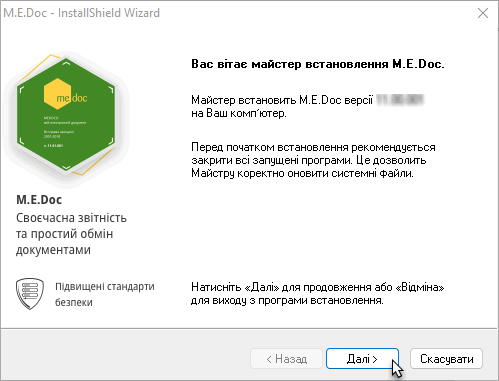

2. Відкриється вікно Ліцензійна угода. Уважно прочитайте угоду про використання програмного забезпечення і погодьтесь з умовами угоди, встановивши опцію Я приймаю умови ліцензійної угоди. Натисніть Далі для продовження.

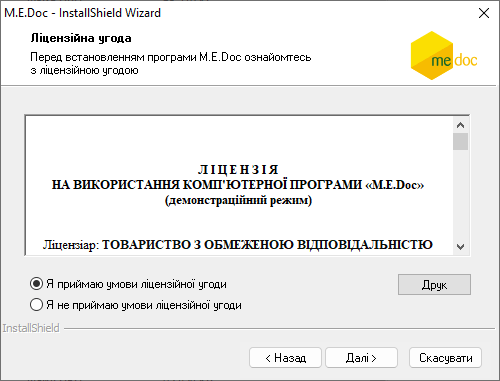

3. Виберіть тип встановлення «Локальний варіант». Натисніть Далі.

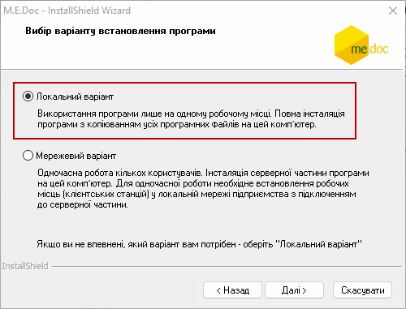

4. Наступним кроком є вибір каталогу, в який буде встановлена програма.

Програма запропонує каталог для інсталяції. Для зміни каталогу скористайтесь кнопкою Огляд. За замовчування пропонується встановити програму доступною для всіх користувачів операційної системи даного комп'ютера. Якщо ви бажаєте, щоб M.E.Doc був доступний лише для користувача, під яким здійснювалось встановлення програми, оберіть опцію Тільки для мене.

Для продовження натисніть Далі.

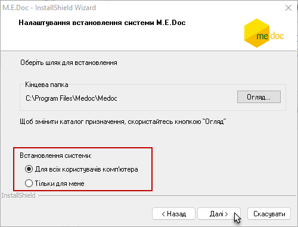

5. Почнеться безпосереднє встановлення програми, хід якої відображається індикатором виконання процесу.

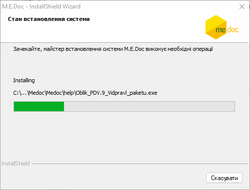

6. Майстер повідомить про закінчення процесу встановлення програми.

Натисніть Готово, щоб закрити програму - інсталятор.

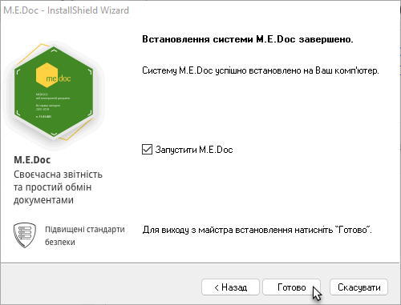

##### Мережевий варіант - встановлення серверної частини

_Шлях у довідці: Вступ › Встановлення, запуск та налаштування програми › Процедура встановлення програми › Мережевий варіант - встановлення серверної частини_

Для мережевого варіанту програми, на ПК із встановленою серверною частиною необхідно мати відкритий порт 9996 (за замовчуванням) служби ZvitGrp для з’єднання клієнтських станцій з серверною частиною, а також локально відкритий порт 3050 (за замовчуванням) служби Firebird server – ZvitGrp для зв’язку з БД.

Для початку процесу встановлення програми, подвійним кліком лівої клавіші миші запустіть на виконання файл дистрибутиву. Перші два кроки встановлення програми для мережевого і локального варіантів однакові: запуск програми-інсталятора і угода з умовами ліцензійної угоди.

Далі, для встановлення мережевого варіанту:

1. Виберіть тип установки Мережевий варіант. Натисніть Далі.

2. Наступним кроком є вибір каталогу, в який буде встановлена програма.

Програма запропонує каталог для інсталяції. Для зміни каталогу скористайтесь кнопкою Огляд.

Встановлення мережевої версії можливо лише для всіх користувачів операційної системи даного комп'ютера.

Для продовження натисніть Далі.

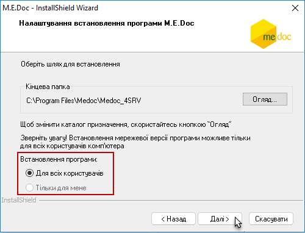

3. Введіть доменне ім'я і порт серверної частини, а також ім'я служби. Для продовження натисніть Далі.

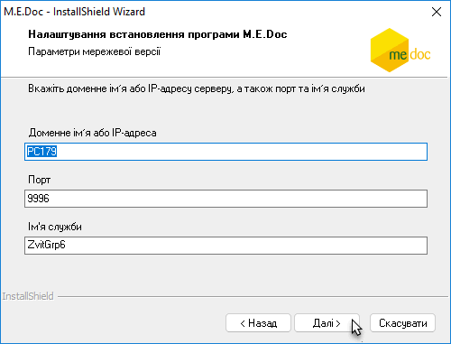

4. Інсталятор запропонує обрати систему керування базою даних (СКБД) для роботи у мережі.

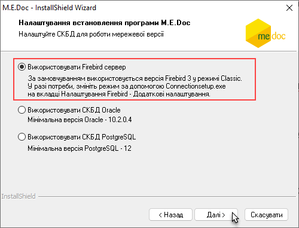

Зверніть увагу! За замовчуванням встановлюється версія Firebird 3 у режимі Classic. Цей режим рекомендується використовувати для мережевого підключення з кількістю клієнтських станцій більше 8 та об'ємом БД від 10 Гб.

Так як доцільність вибору того чи іншого типу СКБД Firebird визначається кількістю клієнтських станцій та об'ємом бази даних, які планується використовувати, ви можете обрати інший режим роботи СКБД після завершення встановлення програми. Для цього запустіть утиліту Connectionsetup.exe (знаходиться у кореневому каталозі встановленої програми) та оберіть потрібні налаштування, натиснувши Додаткові налаштування на вкладці [Налаштування Firebird](ConnectionSetup.html#connectionsetup-connectionsetup).

Оберіть потрібну СКБД та натисніть Далі.

5. Якщо ви обрали Використовувати FireBird сервер наступним кроком є встановлення порту для служби FireBird.

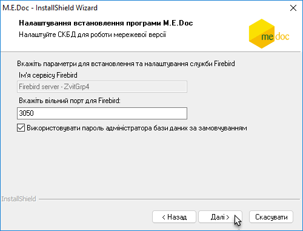

За замовчуванням встановлено опцію Використовувати пароль адміністратора бази даних за замовчуванням.

Ви можете змінити пароль на власний, видаливши цю опцію. У вікні з'явиться поле для введення власного пароля:

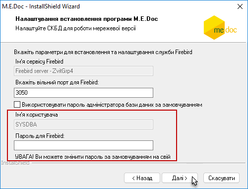

Для продовження натисніть Далі.

6. Почнеться встановлення компонентів програми, хід якого відображається індикатором виконання процесу.

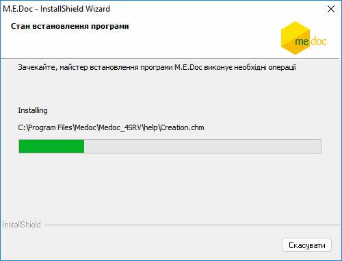

7. Майстер повідомить про закінчення процесу встановлення програми.

Натисніть Готово, щоб закрити програму-інсталятор.

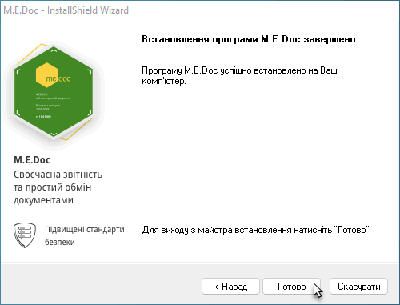

Про встановлення програми на базі СКБД Oracle дивіться у розділі [Встановлення програми на базі СКБД ORACLE](#help-setup_installation_program_oracle).

##### Мережевий варіант - встановлення клієнтського робочого місця;

_Шлях у довідці: Вступ › Встановлення, запуск та налаштування програми › Процедура встановлення програми › Мережевий варіант - встановлення клієнтського робочого місця;_

Після інсталяції серверної частини, каталог, в якому встановлена серверна частина програми, необхідно зробити загальнодоступним для користувачів мережі, тобто надати доступ до цього каталогу.

Для встановлення клієнтського робочого місця (робочої станції) на вибраному комп'ютері, відкрийте загальнодоступний мережевий каталог на серверному комп'ютері, в якому встановлена серверна частина програми. У каталозі Client запустіть на виконання файл Setup.exe.

1. У вікні Майстра пропонується встановити робочу станцію. Натисніть Далі для продовження.

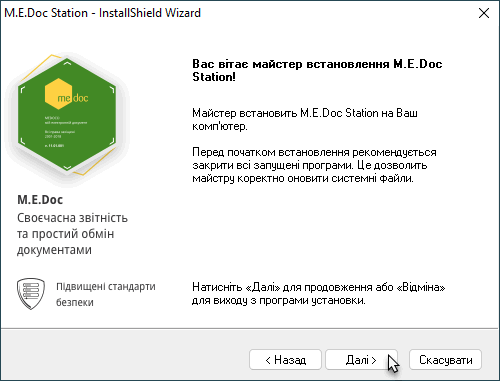

2. На наступному кроці оберіть одну із опцій:

- Встановити нову станцію – встановити новий екземпляр клієнтського робочого місця (обрано за замовчуванням);
- Оновити існуючу станцію – оновити існуючу робочу станцію.

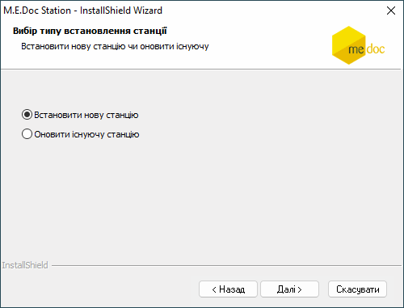

Для продовження натисніть Далі.

3. Програма запропонує каталог для інсталяції. Для зміни каталогу скористайтеся кнопкою Огляд.

Також у вікні відображено параметри (адреса і порт) знаходження встановленої раніше серверної частини. У разі потреби ви можете змінити ці дані.

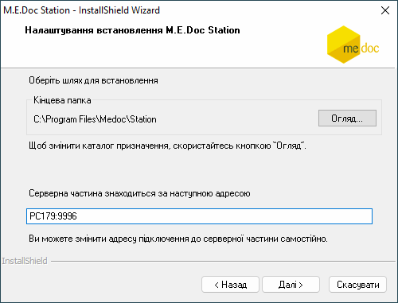

Для продовження натисніть Далі.

4. Розпочнеться безпосереднє встановлення програми, хід якого відображається індикатором виконання процесу.

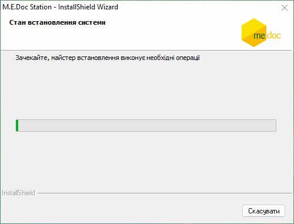

5. Майстер повідомить про закінчення процесу встановлення програми.

Натисніть Готово, щоб закрити програму - інсталятор.

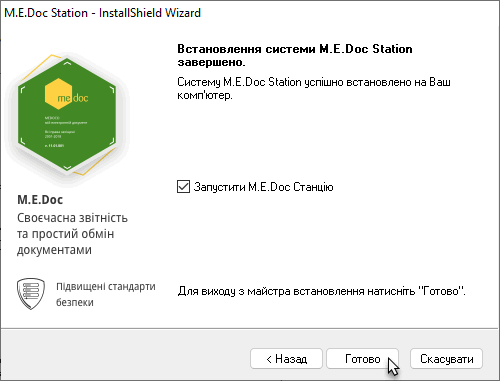

Таким чином, встановлюються всі інші робочі станції.

##### Термінальний режим

_Шлях у довідці: Вступ › Встановлення, запуск та налаштування програми › Процедура встановлення програми › Термінальний режим_

Термінальний режим роботи - організація мережевої роботи програмного комплексу, яка передбачає розміщення всіх даних користувача на центральному сервері без встановлення клієнтських робочих станцій на кожне окреме робоче місце.

1. [Встановіть серверну частину](#help-setup_installation_program_server) програмного комплексу.

2. Для каталогу, в якому встановлено програмний комплекс, потрібно відкрити доступ для читання користувачами файлів.

3. З робочого місця користувача відкрийте загальнодоступний мережевий каталог на серверному комп'ютері, в якому встановлена серверна частина програми.

4. На робочий стіл користувача створіть ярлик файлу ezvinet.exe

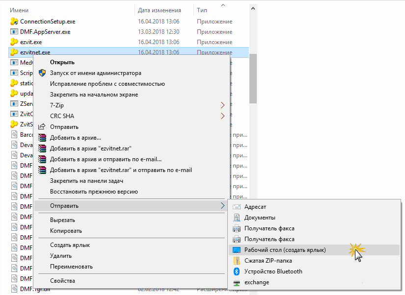

5. Для запуску програмного комплексу, натисніть двічі лівою клавішею миші по створеному ярлику.

##### Встановлення програми на базі СКБД ORACLE

_Шлях у довідці: Вступ › Встановлення, запуск та налаштування програми › Процедура встановлення програми › Встановлення програми на базі СКБД ORACLE_

Зверніть увагу!

1. Підключення до бази даних програми виконується за прямим з'єднанням.

Якщо планується використовувати клієнт Oracle - попередньо на сервер, де буде розміщено ПК M.E.Doc, встановіть клієнт Oracle тієї ж розрядності, що і ОС Windows.
Тип інсталяції (Installation Type) клієнта Oracle - Адміністратор (Administrator).

Важливо!

Оскільки у програмі підтримується версія Oracle 10, необхідно використовувати базу даних не контейнерного типу, та традиційний тип баз даних Oracle, багатокористувацькій.

2. Якщо клієнт Oracle не встановлений, в процесі інсталяції буде доступне лише налаштування на існуючу в БД схему (її потрібно створити попередньо). Тому, автоматично буде обрано спосіб з’єднання Direct та Налаштувати на існуючу схему.

Створення нового табличного простору та розгортання на існуючу схему для її очищення та заміни даних за допомогою прямого підключення до БД неможливе і потребує встановленого клієнта Oracle!

Встановлення системи виконується за допомогою Майстра встановлення M.E.Doc, покроково виконуйте всі настанови Майстра.

Для переходу до наступного вікна обирайте Далі, для повернення до попереднього - Назад. Кнопка Скасувати скасовує обрану дію.

1.  Подвійним кліком лівої клавіші миші запустіть на виконання файл дистрибутиву.

Запуститься Майстер встановлення, який проаналізує який проаналізує середовище ОС, і, у разі потреби, запропонує встановити відсутні компоненти - зокрема Microsoft.NET.Framework.

Для продовження натисніть Далі.

2. Відкриється вікно Ліцензійна угода. Уважно прочитайте угоду про використання програмного забезпечення і погодьтесь з умовами угоди, встановивши опцію Я приймаю умови ліцензійної угоди. Натисніть Далі для продовження.

3. Далі оберіть тип встановлення програми – мережевий варіант:

4. Наступним кроком є вибір каталогу, в який буде встановлена програма М.Е.Doc.

Програма запропонує каталог для інсталяції. Для зміни каталогу скористайтесь кнопкою Огляд.

Встановлення мережевої версії можливо лише для всіх користувачів операційної системи даного комп'ютера.

Якщо необхідно створити ярлик для зручного запуску утиліти [Моніторинг користувачів](UsersMonitor.html#usersmonitor-usersmonitor), встановіть опцію Створити на робочому столі ярлик "Моніторинг користувачів". Якщо опцію не встановлено, запуск Моніторингу користувачів можна буде здійснювати через меню Windows - Пуск - M.E.Doc Server  Моніторинг користувачів.

Для продовження натисніть Далі.

5. Далі вкажіть параметри серверу, де буде встановлено М.Е.Doc - доменне ім'я і порт серверної частини, а також ім'я служби. Для продовження натисніть Далі.

6. У наступному вікні оберіть тип СКБД, яка буде використовуватися у системі, встановивши Використовувати СКБД Oracle. Для продовження натисніть Далі.

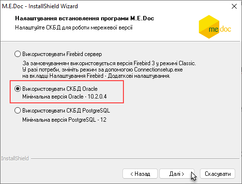

7. Далі інсталятор перевіряє наявність на комп’ютері встановлених клієнтів Oracle, і подальші налаштування залежать від результатів цієї перевірки.

[Якщо клієнт Oracle встановлений, інсталятор відображає вікно для вибору способу налаштування табличного простору (крок 9)](#help-setup_installation_program_oracle).

[Якщо клієнта Oracle не знайдено, відкриється інформаційне вікно, в якому повідомляється про доступні для такого випадку налаштування (крок 8)](#help-setup_installation_program_oracle).

8. Якщо жодного клієнта Oracle не знайдено, буде повідомлено про використання режиму підключення Direct та доступність тільки одного налаштування - на існуючу в БД схему.

Налаштувати на існуючу схему - систему M.E.Doc буде підключено до створеної раніше в БД Oracle схеми.

(Створення нового табличного простору та розгортання на існуючу схему для її очищення та заміни даних за допомогою прямого підключення до БД неможливе!)

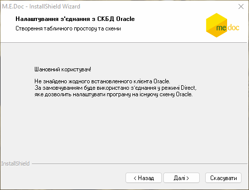

Після переходу до наступного кроку відкривається вікно налаштування доступу до існуючої схеми, в якому потрібно вказати:

- Ім’я або адреса сервера - введіть доменне ім’я або IP-адресу сервера, де встановлена база даних Oracle,
- Порт – номер порту, який використовує Oracle,
- Ідентифікатор бази (SID) - ідентифікатор БД Oracle,
- Ім’я користувача - ім’я користувача схеми,
- Пароль користувача – пароль користувача схеми.

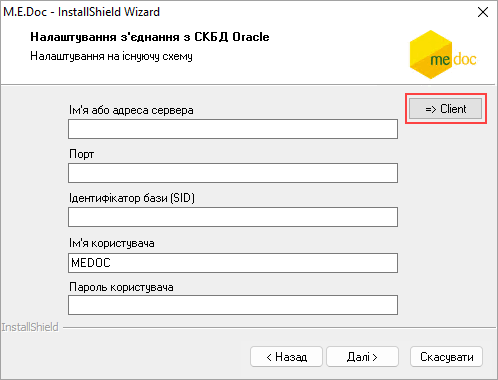

Після натискання кнопки Далі інсталятор спробує встановити з'єднання з існуючою схемою. Якщо з’єднання буде успішним, у наступному вікні Майстер повідомить про закінчення процесу встановлення системи. Натисніть Готово, щоб закрити програму-інсталятор.

У вікні є можливість перейти до налаштування доступу у режимі Client Oracle, для цього натисніть на кнопку Client. У вікні, що відкриється, вкажіть параметри доступу до схеми (за допомогою клієнта Oracle), як описано у розділі [Розгорнути на існуючу схему](#help-setup_installation_program_oracle):

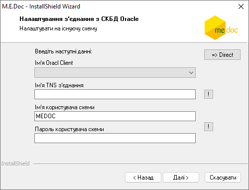

Щоб повернутися до налаштування режиму підключення Direct, натисніть на кнопку Direct.

9.  Якщо на комп’ютері є встановлений(і) клієнт(и) Oracle, відкривається вікно для вибору способу налаштування табличного простору.

- Налаштувати на існуючу схему - обирається в разі, якщо на сервері вже існує база Oracle з розгорнутою схемою. Систему M.E.Doc  буде підключено до вказаної існуючої схеми.
- Створити табличний простір та схему в СКБД ORACLE - обирається для створення нового табличного простору. В разі існування схеми в базі, вона видаляється.
- Розгорнути на існуючу схему - обирається для очищення існуючої схеми та заміни її даними нової схеми, не змінюючи при цьому глобальних налаштувань адміністратора.

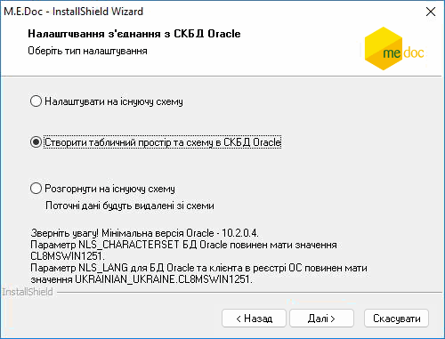

Оберіть потрібний варіант та натисніть кнопку Далі.

Подальші налаштування залежать від вибраного варіанту та способу підключення до БД системи.

- Налаштувати на існуючу схему

У наступному вікні вкажіть параметри доступу до існуючої схеми:

- Ім’я або адреса сервера - введіть доменне ім’я або IP адресу сервера, де встановлена база даних Oracle,
- Порт – номер порту, який використовує Oracle,
- Ідентифікатор бази (SID) - ідентифікатор БД Oracle,
- Ім’я користувача - ім’я користувача схеми,
- Пароль користувача – пароль користувача схеми.

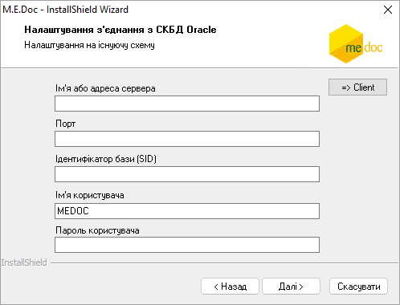

Після натискання кнопки Далі інсталятор спробує встановити з'єднання з існуючою схемою. Якщо з’єднання буде успішним, у наступному вікні Майстер повідомить про закінчення процесу встановлення системи.

- Створити табличний простір та схему в СКБД Oracle

Створення табличного простору та схеми в СКБД ORACLE можливе лише за допомогою клієнта Oracle.

1. У наступному вікні потрібно вказати параметри доступу до створюваної схеми (за допомогою клієнта Oracle):

- Ім'я Oracl Client - ім'я встановленого Oracle Client, можна обрати ім'я Oracle Client із доступних встановлених.
- Ім'я TNS з'єднання - глобальне ім’я бази даних. Вводиться власноруч.
- Пароль користувача SYS - пароль користувача з правами адміністратора бази даних, використовується для створення табличного простору.
- Ім’я користувача - ім'я користувача створюваної схеми. Заповнюється за замовчуванням, у разі потреби можна змінити власноруч після інсталяції.
- Пароль користувача - пароль користувача для підключення до створюваної схеми. У разі потреби можна змінити власноруч після інсталяції.
- Пароль користувача (повторно) - підтвердження пароля користувача для підключення до створюваної схеми.
- Ім'я файлу табличного простору - ім'я файлу табличного простору, генерується автоматично системою, за необхідності ім'я файлу можна змінити.

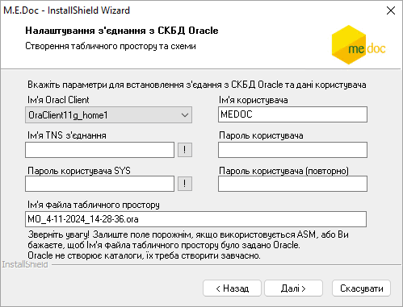

2.  Після натискання кнопки Далі програма повідомить про створення нового користувача та табличного простору:

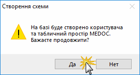

Після згоди розпочнеться створення та розгортання табличного простору в СКБД Oracle.

Після закінчення цього процесу у наступному вікні Майстер повідомить про завершення встановлення системи.

Зверніть увагу! За замовчуванням використовується ім'я файлу табличного простору MEDOC, тому перед встановленням додаткової копії в ту ж саму базу даних, на яку вже розгорнуто схему MEDOC, необхідно перейменувати вже існуючий табличний простір та при встановленні вказати нове і’мя користувача.

- Розгорнути на існуючу схему

Розгортання на існуючу схему для її очищення та заміни даними нової схеми без зміни глобальних налаштувань адміністратора можливе лише за допомогою клієнта Oracle.

1. У наступному вікні вкажіть параметри доступу до схеми (за допомогою клієнта Oracle):

- Ім'я Oracl Client - ім'я встановленого Oracle Client, можна обрати ім'я Oracle Client із доступних встановлених.
- Ім'я TNS з'єднання - глобальне ім’я бази даних. Вводиться власноруч.
- Ім'я користувача схеми - ім'я користувача, що підключається до схеми. Відображається в режимі читання.
- Пароль користувача схеми - пароль користувача для підключення до схеми. У разі потреби можна змінити власноруч, після інсталяції.

Для перевірки правильності введення імені TNS з'єднання та імені користувача скористайтеся кнопкою .

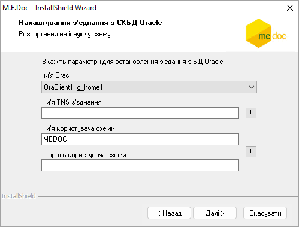

2. Після натискання кнопки Далі програма повідомить про видалення поточних даних із існуючою схеми:

_014.gif>)

3. Після згоди розпочнеться видалення поточних даних в існуючій схемі та розгортання нової схеми M.E.Doc. Якщо ці операції будуть успішними, у наступному вікні Майстер повідомить про завершення встановлення системи.

##### Встановлення програми на базі СКБД PostgreSQL

_Шлях у довідці: Вступ › Встановлення, запуск та налаштування програми › Процедура встановлення програми › Встановлення програми на базі СКБД PostgreSQL_

Зверніть увагу!

Попередньо на комп’ютері, де планується встановлення серверної частини M.E.Doc, повинна бути інстальована та налаштована БД PostgreSQL.

Дистрибутив PostgreSQL доступний для завантаження на офіційних ресурсах. Версія, що підтримується при роботі ПК M.E.Doc - PostgreSQL 12 або вище.

Встановлення системи виконується за допомогою Майстра встановлення M.E.Doc. Покроково виконуйте всі настанови Майстра.

Для переходу до наступного вікна обирайте Далі, для повернення до попереднього - Назад. Кнопка Скасувати відміняє обрану дію.

1.  Подвійним кліком лівої клавіші миші запустіть на виконання файл дистрибутиву.

Запуститься Майстер встановлення.

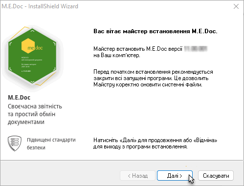

Для продовження натисніть Далі.

2. Відкриється вікно Ліцензійна угода. Уважно прочитайте угоду про використання програмного забезпечення і погодьтесь з умовами угоди, встановивши опцію Я приймаю умови ліцензійної угоди. Натисніть Далі для продовження.

3. Далі оберіть тип встановлення програми – мережевий варіант (наразі, підтримка PostgreSQL реалізована тільки в мережевому варіанті роботи):

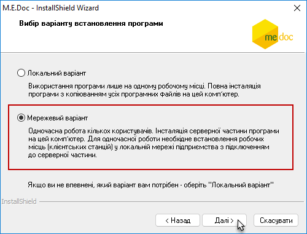

4. Наступним кроком є вибір каталогу, в який буде встановлена програма М.Е.Doc.

Програма запропонує каталог для інсталяції. Для зміни каталогу скористайтесь кнопкою Огляд.

Встановлення мережевої версії можливо лише для всіх користувачів операційної системи даного комп'ютера.

Якщо необхідно створити ярлик для зручного запуску утиліти [Моніторинг користувачів](UsersMonitor.html#usersmonitor-usersmonitor), встановіть опцію Створити на робочому столі ярлик "Моніторинг користувачів". Якщо опцію не встановлено, запуск Моніторингу користувачів можна буде здійснювати через меню Windows - Пуск - M.E.Doc Server  Моніторинг користувачів.

Для продовження натисніть Далі.

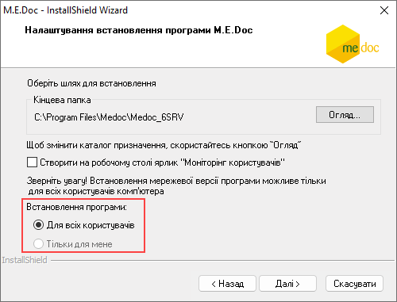

5. Далі вкажіть параметри серверу, де буде встановлено М.Е.Doc - доменне ім'я або IP-адреса, порт серверної частини, а також ім'я служби. Для продовження натисніть Далі.

6. У наступному вікні оберіть тип СКБД, яка буде використовуватися у системі, встановивши Використовувати СКБД PostgreSQL.

Необхідною умовою для успішного встановлення та подальшої роботи програми М.Е.Doc є наявність встановленої та відповідно налаштованої  БД PostgreSQL.

Для продовження підтвердіть наявність СКБД PostgreSQL, встановивши відмітку СКБД PostgreSQL відповідної версії встановлено та налаштовано. У налаштуваннях ОС, на яку встановлено СКБД, додано український мовний пакет:

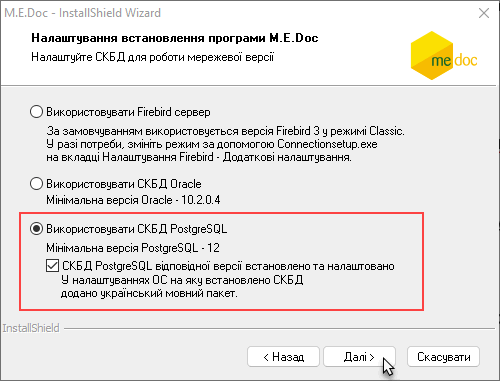

Важливо!

Переконайтеся, що у налаштуваннях ОС, на яку інстальовано СКБД PostgreSQL, встановлено українські регіональні та мовні налаштування. Ці налаштування необхідні для коректної роботи програми зі СКБД PostgreSQL.

Після встановлення відмітки стане доступною кнопка Далі. Для продовження встановлення натисніть Далі.

7. Відкриється вікно для вибору способу налаштування табличного простору.

- Налаштувати на існуючу схему - обирається в разі, якщо на сервері вже існує база PostgreSQL з розгорнутою схемою. Систему M.E.Doc буде підключено до вказаної існуючої схеми.
- Створити табличний простір та схему в СКБД - обирається для створення нового табличного простору.
- Розгорнути на існуючу схему - обирається для очищення існуючої схеми та заміни її даними нової схеми.

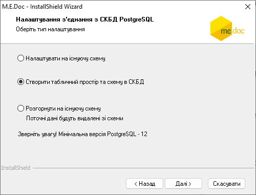

Оберіть потрібний варіант та натисніть кнопку Далі.

Подальші налаштування залежать від вибраного варіанту та способу підключення до БД системи.

Зверніть увагу, якщо при інсталяції PostgreSQL були виконані користувацькі налаштування, у вікні Майстра необхідно ввести значення, встановлені при налаштуванні PostgreSQL.

- Налаштувати на існуючу схему

У вікні вкажіть параметри доступу до існуючої схеми:

- Ім’я або адреса сервера - введіть доменне ім’я або IP адресу сервера, де встановлена база даних;
- Порт – номер порту, який використовує PostgreSQL;
- Найменування бази - ім'я бази даних PostgreSQL (за замовчуванням MEDOC);
- Ім’я користувача - ім’я користувача схеми (за замовчуванням MEDOC);
- Пароль користувача – пароль користувача схеми.

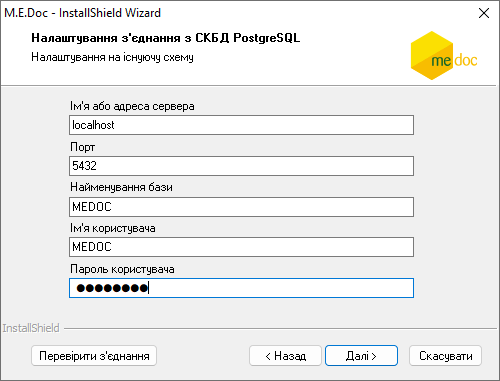

По кнопці Перевірити з’єднання можна перевірити коректність введених параметрів для з’єднання з СКБД PostgreSQL. Якщо перевірка з’єднання пройшла успішно, відкриється вікно повідомлення:

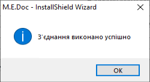

2.  Натисніть кнопку Далі.

Розпочнеться розпакування та встановлення програми.

Майстер спробує встановити з'єднання з існуючою схемою. Якщо з’єднання буде успішним, у наступному вікні Майстер повідомить про закінчення процесу встановлення системи.

- Створити табличний простір та схему в СКБД

1. У наступному вікні вкажіть параметри доступу до створюваної схеми:

- Ім'я або адреса сервера - ім'я або IP-адреса сервера PostgreSQL (за замовчуванням при встановленні PostgreSQL реєструється ім'я localhost);
- Порт - за замовчуванням PostgreSQL використовує порт 5432, може бути зміненим;
- Ім'я адміністратора БД (Superuser) - користувач, що має права адміністратора бази PostgreSQL (задається при інсталяції, за замовчуванням postgres);
- Пароль адміністратора БД - пароль адміністратора БД (задається користувачем при інсталяції PostgreSQL);
- Найменування нової бази - ім'я нової бази даних PostgreSQL, що буде використовуватися при роботі з програмою (за замовчуванням MEDOC, за потреби введіть власне значення);
- Ім'я нового користувача - ім'я користувача нового табличного простору та бази, що будуть створені (за замовчуванням MEDOC, за потреби введіть власне значення);
- Пароль нового користувача - пароль користувача бази, що створюється,  використовується для підключення до нової бази.

_165.gif>)

Кнопка  біля поля Ім'я нового користувача дозволяє перевірити можливість використання обраних значень Ім'я нового користувача та Найменування нової бази для створення:

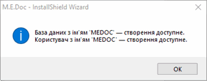

У разі наявності користувача та/або бази з обраним найменуванням буде виведено попередження, що користувач чи база з таким іменем вже використовуються. Для продовження необхідно змінити назву нової бази та/або нового користувача.

По кнопці Перевірити з’єднання можна перевірити коректність введених параметрів для з’єднання з СКБД PostgreSQL. Якщо перевірка з’єднання пройшла успішно, відкриється вікно повідомлення:

Також на цьому етапі можна обрати мовні та регіональні налаштування. uk\_UA.UTF-8 пропонується за замовчуванням.

2.  Натисніть кнопку Далі.

Розпочнеться розпакування та встановлення програми. Автоматично розпочнеться створення та розгортання табличного простору в СКБД.

У наступному вікні Майстер повідомить про закінчення процесу встановлення системи.

- Розгорнути на існуючу схему

При розгортанні на існуючу схему виконується видалення існуючих даних та збереження даних нової схеми без зміни глобальних налаштувань адміністратора.

У вікні вкажіть параметри доступу до існуючої схеми:

- Ім’я або адреса сервера - введіть доменне ім’я або IP адресу сервера, де встановлена база даних;
- Порт – номер порту, який використовує PostgreSQL;
- Найменування бази - ім'я бази даних PostgreSQL (за замовчуванням postgres);
- Ім’я користувача - ім’я користувача схеми;
- Пароль користувача – пароль користувача схеми.

По кнопці Перевірити з’єднання можна перевірити коректність введених параметрів для з’єднання з СКБД PostgreSQL. Якщо перевірка з’єднання пройшла успішно, відкриється вікно повідомлення:

2. Натисніть кнопку Далі.

Розпочнеться розпакування та встановлення програми.

Майстер видалить поточні дані в існуючій схемі та розгорне нову схему M.E.Doc. Якщо ці операції будуть успішними, у наступному вікні Майстер повідомить про завершення встановлення системи.

##### Перехід з БД Firebird або Oracle на БД PostgreSQL

_Шлях у довідці: Вступ › Встановлення, запуск та налаштування програми › Процедура встановлення програми › Перехід з БД Firebird або Oracle на БД PostgreSQL_

Перехід може бути виконаний за допомогою відновлення резервних копій програми, а також за допомогою функції перенесення даних із БД:

Можливість використання БД PostgreSQL реалізовано для мережевого варіанту роботи M.E.DOC.

1. Завантажте та встановіть БД PostgreSQL. Рекомендуємо завантажувати актуальну версію з офіційних джерел розробника БД. Версія, що підтримується при роботі з ПК M.E.Doc – PostgreSQL 12 та вище.

2. Оновіть існуючий екземпляр серверної частини програми M.E.Doc до версії не нижче 11.02.061.

3. Із дистрибутиву версії не нижче 11.02.061 встановіть новий серверний екземпляр програми. У Майстрі встановлення [оберіть та налаштуйте](#help-setup_installation_program_postgresql) БД PostgreSQL.

4. У новому екземплярі програми відкрийте Майстер заповнення даних про підприємство. Для перенесення існуючої бази даних до нової БД оберіть опцію, залежно від СУБД, що використовується:

- Перенесення даних з БД M.E.Doc на базі Firebird;
- Перенесення даних з БД M.E.Doc на базі Oracle.

Натисніть Далі.

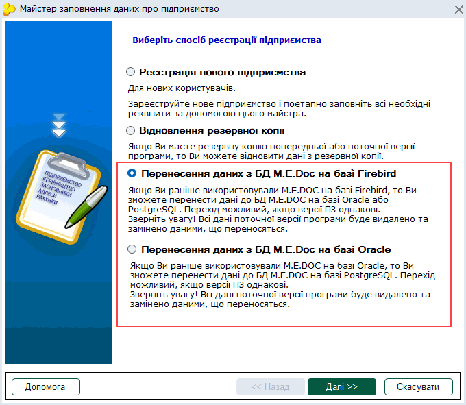

5. Вкажіть каталог, з якого необхідно виконати перенесення даних:

Для переходу з БД Firebird: вкажіть каталог, у якому знаходиться папка з файлом бази даних. Необхідно вказати шлях до каталогу, у якому розташовано папку DB. За замовчуванням це каталог C:\ProgramData\Medoc\Medoc (шлях може відрізнятися, якщо при встановленні програми користувачем був обраний інший каталог).

Для переходу з БД Oracle: вкажіть каталог встановлення екземпляру серверної частини M.E.Doc, з якої необхідно виконати перенесення даних. За замовчуванням це каталог C:\Program Files\Medoc\Medoc (може бути змінений користувачем при встановленні програми).

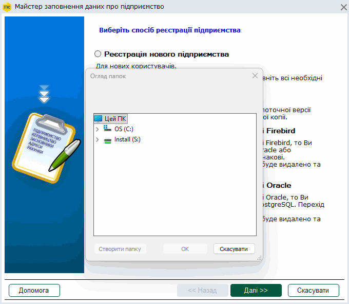

Для продовження натисніть Далі.

6. На наступному кроці вкажіть ім’я та пароль адміністратора (superuser) БД PostgreSQL.

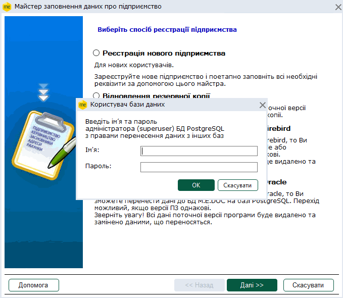

Натисніть Далі.

7. Буде виконано перенесення даних до БД PostgreSQL.

Перенесення даних до БД PostgreSQL у Майстрі заповнення даних про підприємство також можна виконати за допомогою відновлення резервних копій програми .zbk та .zbf (опція Відновлення резервної копії). Екземпляр серверної частини програми, у якому виконується відновлення даних, повинен бути встановлений з дистрибутиву версії не нижче 11.02.061.

Перенесення даних та робота з БД PostgreSQL можлива за умови, якщо версії екземплярів ПЗ однакові (не нижче 11.02.061).

#### Запуск  ПК M.E.Doc

_Шлях у довідці: Вступ › Встановлення, запуск та налаштування програми › Запуск  ПК M.E.Doc_

Програмний комплекс M.E.Doc запускається одним із способів:

- із меню Пуск;

У випадку мережевого функціонування запуск програми відбувається із папки клієнтської частини у меню Пуск

- подвійним натисканням лівою кнопкою миші на ярлику програми, який створюється на робочому столі комп'ютера по замовчуванню у процесі встановлення.

Відобразиться вікно авторизації користувача в системі.

В цьому вікні оберіть ім'я потрібного користувача, введіть пароль та натисніть кнопку ОК.

Натиснувши кнопку  у полі Пароль, можна переглянути введені символи.

Якщо у обраного користувача [налаштовані права доступу](UCManageRoles.html#ucmanageroles-ucmanageroles), то відобразиться [вікно вибору установи](Vybir_ustanovy.html#vybir_ustanovy-vybir_ustanovy).

Якщо у користувача не налаштовані права, то відобразиться повідомлення:

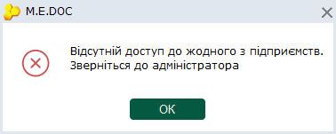

Користувач не зможе працювати з M.E.Doc.

- Для налаштування прав роботи з M.E.Doc потрібно звернутись до адміністратора.
- При першому запуску програми після встановлення виконується автоматична авторизація під обліковим записом адміністратора - користувач Admin.
- Також автоматична авторизація під користувачем Admin здійснюватиметься під час запуску програми при виконанні наступних умов:
- у базі програми наявний лише один користувач – Admin та для користувача Admin не зазначено пароль;
- не виконано налаштування авторизації через Active Directory у розділі Адміністрування – Параметри системи – Авторизація.

Увага! У випадку використання авторизації тільки через Active Directory адміністратору потрібно авторизуватись у налаштованому домені під логіном адміністратора, після чого налаштовувати доступи користувачам домена.

#### Завершення роботи з програмою

_Шлях у довідці: Вступ › Встановлення, запуск та налаштування програми › Завершення роботи з програмою_

Завершення роботи із програмою відбувається у наступній послідовності:

1. Закрийте всі відкриті документи та модулі програми.

2. Закрийте саму програму, натиснувши на кнопку Закрити () у верхньому правому куті головного вікна, або обравши команду головного меню Файл - Вихід.

3. У відкритому вікні Завершення роботи оберіть варіант Завершити роботу з програмою. Натисніть ОК.

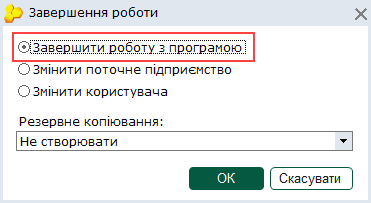

4. У вікні Завершення роботи надана можливість створення резервної копії баз даних. Для активації функції виберіть потрібний варіант із списку:

Можливо обрати:

- не створювати - резервна копія не зберігається;
- створюється копія всієї бази, що має розширення .ZBF.

Налаштування створення резервної копії під час виходу з програми, здійснюється у розділі [Адміністрування - Параметри системи - Резервне копіювання](FormCompanyParams.html#formcompanyparams-admcompanyparams_rk). Каталог для зберігання резервних копій задається у модулі Адміністрування - Параметри системи - [Резервне копіювання](FormCompanyParams.html#formcompanyparams-admcompanyparams_rk), у полі Розташування резервних копій.

Докладно про створення резервної копії дивіться у розділі [Адміністрування - Резервне копіювання](UCBackup.html#ucbackup-admbackup).

5. Після створення резервної копії програму буде закрито.

Рекомендується регулярно створювати резервну копію та обов'язково кожного разу перед встановленням оновлення програми.

Примітка:

Автоматично створювана резервна копія не замінюватиме попередню, оскільки за замовчанням містить в своїй назві змінні  параметри дати та часу - тобто кожна нова резервна копія матиме унікальну назву.

#### Зміна поточного підприємства

_Шлях у довідці: Вступ › Встановлення, запуск та налаштування програми › Зміна поточного підприємства_

Зміна поточного підприємства в програмі відбувається у наступній послідовності:

1. Закрийте всі відкриті документи та модулі програми.

2. Натисніть на  у верхньому правому куті головного вікна, або оберіть пункт головного меню Файл - Вихід.

3. У вікні Завершення роботи оберіть варіант Змінити поточне підприємство. Натисніть ОК.

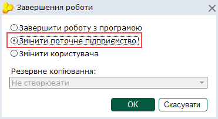

4. Відкриється вікно вибору установи. Оберіть потрібне підприємство та натисніть кнопку Далі.

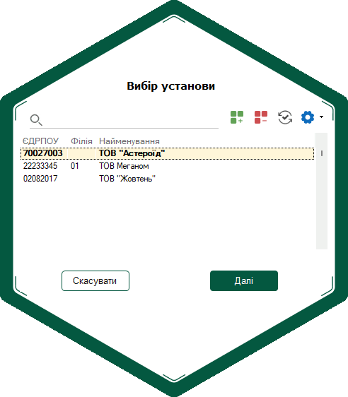

#### Зміна користувача

_Шлях у довідці: Вступ › Встановлення, запуск та налаштування програми › Зміна користувача_

Зміна користувача у програмі відбувається у наступній послідовності:

1. Закрийте всі відкриті документи та модулі програми.

2. Натисніть на  у верхньому правому куті головного вікна, або оберіть пункт головного меню Файл - Вихід.

3. У відкритому вікні Завершення роботи оберіть варіант Завершити роботу з програмою. Натисніть ОК.

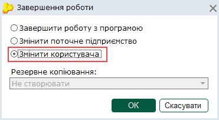

4. Відобразиться вікно авторизації користувача в системі. Оберіть ім'я потрібного користувача, введіть пароль та натисніть кнопку ОК.

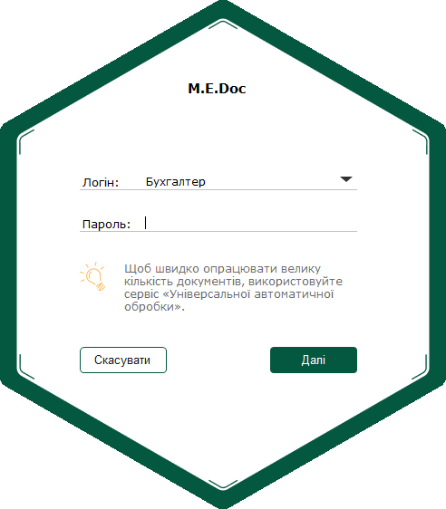

Якщо у обраного користувача [не налаштовані права доступу](UCManageRoles.html#ucmanageroles-ucmanageroles), то відобразиться порожнє вікно вибору установи.

Користувач не зможе працювати з M.E.Doc.

Для налаштування прав роботи з M.E.Doc потрібно звернутись до адміністратора.

### Призначення програми

_Шлях у довідці: Вступ › Призначення програми_

Програмний комплекс M.E.Doc призначений для:

- подання звітності у всі контролюючі органи України (ДПСУ, ДССУ, ФСС з ТВП, ДКСУ, міністерства та відомства тощо);
- подання та реєстрації документів з акцизного податку;
- подання звітності великих компаній, що мають розгалужену структуру підрозділів;
- роботи банків та фінансових установ;
- здійснення юридично значущого електронного документообігу між суб'єктами господарювання;
- нарахування зарплати та обліку робочого часу.

### Переваги ПК M.E.Doc

_Шлях у довідці: Вступ › Переваги ПК M.E.Doc_

Програмний комплекс M.E.Doc надає можливість здійснення повного циклу подання документів до звітних органів – від створення документа до відправлення та отримання квитанцій у відповідь, програмний комплекс містить всі актуальні форми звітності, які оновлюються відповідно до законодавства України. Працюючи з M.E.Doc, користувачі отримують переваги:

- Миттєвий та законний обмін будь-якими електронними документами з контрагентами.
- Збереження графічного відображення документів з печатками та підписами при здійсненні електронного документообороту.
- Багатосторонній обмін документами. За допомогою функції багатостороннього обміну документи можуть бути надіслані визначеній кількості отримувачів. Документи надсилатимуться отримувачам по черзі у визначеному порядку (за маршрутом документа).
- Інтеграцію з будь-якою обліковою системою або CRM, масове завантаження будь-яких документів, отримання статусів документів, вивантаження документів.
- Простий та надійний спосіб автоматизації бізнес-процесів. У програмі реалізовано можливість [формування власних шаблонів](UCRtfDocTemplate.html#ucrtfdoctemplate-pdocs_shablon_stvor) документів. А також, створення документів [на основі існуючих](Creat_doc_.html#creat_doc_-creat_doc_) з можливістю [налаштувати перенесення даних](UCRtfFromDocSettings.html#ucrtffromdocsettings-ucrtffromdocsettings) з вихідного документа у документ, що створюється.
- Легке опрацювання великої кількості документів за допомогою модуля [автоматична обробка документів](UCGlobalAutoProcJournal.html#ucglobalautoprocjournal-pdocs_avto) та сервісу [універсальної автоматичної обробки](AP.html#ap-uao_priznach). Для виконання таких завдань, як, наприклад, оновлення або резервне копіювання, користувачі можуть скористатися [планувальником завдань](UCPlanner.html#ucplanner-ucplanner), що виконує завдання за складеним графіком.
- Звірка наявних документів з зареєстрованими у ЄРПН та ЄРАН, звірку можливо виконувати за заданими датою або списком документів. Програма проаналізує наявні у базі даних документи та автоматично сформує і відправить необхідні запити до ЄРПН або ЄРАН.
- Полегшення заповнення документів та зменшення кількості відмов при реєстрації документів, у М.Е.Doc передбачена можливість перевірки реквізитів контрагентів за допомогою [Єдиного довідника контрагентів](ServisEDK.html#servisedk-servisedk).
- При використанні кількох екземплярів програми для роботи у одному підприємстві (під одним і тим самим кодом ЄДРПОУ) та здійснення документообігу через платформу ПТАХ можливо налаштувати [синхронізацію вхідних та вихідних первинних документів](UC_ECP.html#uc_ecp-ecp), ПН/РК, АН/РК та ТТН.
- Створення розгалуженої системи користувачів та їх ролей, передбачено взаємозв'язок між об'єктами системи [РОЛЬ](UCManageRoles.html#ucmanageroles-ucmanageroles) - [КОРИСТУВАЧ](UCAdminUsers.html#ucadminusers-admusr) - УСТАНОВА, користувачу неможливо призначити роль не призначивши доступ до установи (групи установ) в межах цієї ролі. Роль - сукупність прав доступу, необхідних для виконання користувачем певних функцій, застосовується для полегшення управління доступом, замість призначення окремих прав персонально кожному користувачу. Дії користувачів, які вони виконують у програмі, фіксуються у [журналі подій](UCLogs.html#uclogs-admlogs).
- Спеціально для бюджетних установ та організацій у програмі реалізовані всі форми та формати експорту (xls/xlsx, .pdf, .dbf, .xml тощо) для подачі в Державну Казначейську службу, а також міністерства та відомства.
- У демонстраційному режимі користувачі мають змогу безкоштовно відправляти контрагентам 5 документів на місяць, а також отримувати всю вхідну кореспонденцію;
- M.E.Doc отримав схвальний експертний висновок у сфері технічного захисту інформації, що свідчить про високий рівень безпеки та захищеності програми.

## Початок роботи в системі

_Шлях у довідці: Початок роботи в системі_

У даному розділі розглянуті такі теми:

- [Короткий опис послідовності роботи при першому запуску програми](#help-connect_)
- [Додавання нового підприємства](Connect_org.html#connect_org-connect_org).
- [Порядок подання звітів у контролюючі органи](UCAgreement.html#ucagreement-ucagreement)

### Послідовність роботи

_Шлях у довідці: Початок роботи в системі › Послідовність роботи_

Вся послідовність дій задається програмою!

При першому запуску програмного комплексу послідовність роботи є такою:

1. [Додати нове підприємство](Connect_org.html#connect_org-connect_org).

2. Обрати комплект бланків для установи.

3. [Заповнити картку підприємства](UCOrg.html#ucorg-sprorg). Рекомендується заповнити поля всіх закладок картки.

4. У відкритому вікні модуля Управління ліцензіями [внести реєстраційний код програми](FormLicInfo.html#formlicinfo-admlic) для переведення її із демонстраційної версії до робочої (у демоверсії не потрібно).

5. Заповнити довідник співробітників установи. Рекомендується заповнювати всі поля картки Фізична особа.

Примітка:

При імпорті у програму звітність для Пенсійного фонду із інших бухгалтерських систем дані про співробітників автоматично заносяться до довідника Співробітники, і немає потреби їх створювати.

6. Встановити [основні параметри системи](FormCompanyParams.html#formcompanyparams-admcompanyparams) згідно своїх потреб.

7. Після цього у програмі можна створювати, редагувати, друкувати, зберігати на електронних носіях та відсилати електронною поштою всі звітні документи.

Демонстраційна версія програми повністю функціональна за винятком деяких функцій.

- Більш докладно про можливості демоверсії.

Якщо програма функціонує у демонстраційному режимі, у заголовку вікна програми після назви підприємства присутнє повідомлення Демонстраційний режим:

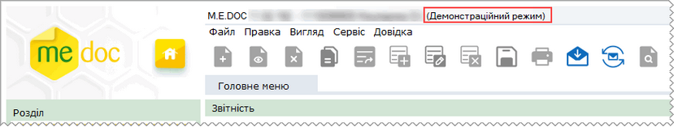

Послідовність та методи роботи, у деморежимі не відрізняється від роботи з ліцензійною версією програми.

У демонстраційній версії у режимі перегляду користувачеві доступні усі модулі системи. У повній версії системи, ті модулі, на які не поширюється дія ліцензії, відсутні у меню програми.

Обмеження по терміну використання для демонстраційної версії не існує.

Демоверсія надає можливість:

- створити, розрахувати і сформувати будь-який вид звітності в електронному вигляді;
- імпортувати в програму податкові звіти, створені в інших бухгалтерських системах;
- імпортувати в програму звіти до ФСС з ТВП, створені в інших програмах у форматі xml;
- встановлювати оновлення тим самим способом, що і для повної версії програми.

Демоверсія програми має певні обмеження у функціональних можливостях. Ви не зможете:

- експортувати документи (зберегти документи на диску комп'ютера або зовнішньому носії у електронному вигляді);
- роздрукувати документи для подальшої подачі їх до контролюючих органів (на друкованих аркушах міститься напис Демонстраційний режим);
- виконувати друк у PDF (експортувати документи у форматі .pdf на зовнішні носії або диск комп'ютера);
- відправити електронною поштою звіти та документи, створені або відредаговані безпосередньо у програмі;
- відправити документи контрагентам.

При спробі виконати операцію, заборонену у демонстраційному режимі, виводиться вікно повідомлення:

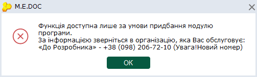

Особливості роботи в демонстраційному режими у розділах комплексу M.E.Doc:

Реєстр звітів

У деморежимі дозволено:

- імпортувати звіти, що були створені у інших бухгалтерських системах, якщо імпорт відбувався у визначеному контролюючим органом форматі, документ автоматично отримує статус "На підпис";
- виконувати операції Відправити та Зашифрувати та зберегти для документів, що були імпортовані у форматі, визначеному контролюючим органом.

Операції недоступні, якщо документ було створено або відредаговано безпосередньо у системі M.E.Doc, або якщо документ було імпортовано у внутрішньому форматі;

Єдиний внесок

У деморежимі на роботу з розділом не накладається жодних обмежень. У розділі доступні ті самі функції, що й у ліцензійній версії програми.

Об'єднана звітність ПДФО та ЄСВ

У деморежимі на роботу з розділом не накладається жодних обмежень. У розділі доступні ті самі функції, що й у ліцензійній версії програми.

Реєстр податкових документів

У деморежимі дозволено:

- імпортувати документи, що були створені у інших бухгалтерських системах;
- реєструвати документи у ЄРПН;
- надсилати запит про стан реєстрації документів у ЄРПН.

У випадку, якщо документ було відредаговано або створено безпосередньо у системі M.E.Doc, або якщо документ було імпортовано у внутрішньому форматі, функції реєстрації та надсилання запиту недоступні.

Реєстр електронних документів

У деморежимі дозволено:

- імпортувати та експортувати документи;
- відправляти контрагентам 5 документів на місяць.

Довільне підписання

У деморежимі дозволено:

- користувачам КНЕДП "Україна" дозволено підписати, зашифрувати та зберегти імпортовані документи Податкова накладна та Додаток 2.

У деморежимі заборонено:

- імпортувати групу документів, операція імпорту виконується окремо для кожного документа;
- відправляти документи.

Для того, щоб перевести програму з демонстраційної версії на повну, необхідно отримати [ліцензійний код](FormLicInfo.html#formlicinfo-admlic) до програми.

## Основні робочі процедури

_Шлях у довідці: Основні робочі процедури_

В цьому розділі описується основні робочі процедури, якими Ви будете користуватись при роботі у програмному комплексі M.E.Doc.

- [Робота з документами](#help-basic_procedures_doc)
- [Правила заповнення та редагування документів](UCPravila.html#ucpravila-pravyla)
- [Вбудовані програми](UCProgramy.html#ucprogramy-programy)
- [Підписання документів ЕП та відправлення їх електронною поштою](UC_ECP.html#uc_ecp-ecp)

### Робота з документами

_Шлях у довідці: Основні робочі процедури › Робота з документами_

У даному розділі розглянуті такі теми:

- [Правила заповнення та редагування документів](UCPravila.html#ucpravila-pravyla)
- [Вбудовані програми](UCProgramy.html#ucprogramy-programy)
- [Довідка щодо заповнення бланка та полів бланка](UCHintBl.html#uchintbl-uchintbl)

## Розділи програми

_Шлях у довідці: Розділи програми_

У довідці надано керівництво користувача по кожному розділу програмного комплексу M.E.Doc.

Описані функціональні можливості та основні робочі процедури програмного комплексу та найбільш поширені завдання. Керівництво призначено для отримання самих мінімально-необхідні знань щодо системи, що дозволяє відразу приступити до роботи із програмою.

Розглянуті такі розділи:

- [Звітність](#help-ca3oi3noue)
- [Облік ПДВ](#help-vat)
- [Первинні документи](UCRtfRstMain.html#ucrtfrstmain-ucrtfrstmain)
- [Податкові довідки](UCGovQry.html#ucgovqry-ucgovqry)
- [Облік акцизу](AkcizMain.html#akcizmain-akcizmain)
- [Реєстр документів РРО та ПРРО](UCRRORst.html#ucrrorst-ucrrorst)
- [Корпорація](UCIncRst.html#ucincrst-m_e_doc-corp)
- [Банківський модуль](UCAccOpenClose.html#ucaccopenclose-ucaccopenclose)
- [Зарплата](Zarplata.html#zarplata-reestrstatement_zp)
- [Довідники](#help-spr)
- [Адміністрування](#help-adm)

### Звітність

_Шлях у довідці: Розділи програми › Звітність_

Кожна організація зобов'язана періодично формувати та подавати у державні контролюючі органи різноманітну фінансову та статистичну звітність, порядок заповнення якої встановлюється затвердженими специфікаціями та форматами. Розділ Звітність призначений максимально полегшити вирішення цього завдання.

В розділі представлені численні сервіси для зручності роботи зі звітами: календар бухгалтера, перевірка коректного заповнення основних реквізитів документів, виконання логічних та арифметичних перевірок звітів та ін.

Передбачена можливість подання звітності в електронному вигляді до Міністерства доходів і зборів України, Державної служби статистики України, Держказначейства України тощо.

Система містить повну базу бланків регламентованої звітності. Всі бланки повністю відповідають форматам і специфікаціям, що затвердили та надали державні контролюючі органи. Завдяки постійному моніторингу законодавчої бази, документи своєчасно оновлюються відповідно до чинного законодавства.

Розділ містить такі модулі:

- [Реєстр звітів](UCDocRstByPer5.html#ucdocrstbyper5-rdocs). Дозволяє створити, підготувати бухгалтерські та фінансові звітні документи з метою подачі їх до контролюючих органів електронними каналами зв'язку. Документи впорядковані у вигляді таблиці - реєстру, що забезпечує швидкий пошук як створених у програмному комплексі документів, так і імпортовані з інших бухгалтерських систем.
- [Єдиний внесок.](UCContribution.html#uccontribution-contribution) Призначений для формування звітів щодо сум нарахованого єдиного внеску на загальнообов'язкове державне соціальне страхування.
- [Об'єднана звітність ПДФО та ЄСВ](UCEsv1DfRST.html#ucesv1dfrst-ucesv1dfrst). Призначений для формування та подання пакету звітів, що включає в себе суми ПДФО, військового збору та ЄСВ.
- [Фінансова звітність за МСФЗ (формат iXBRL)](UCIFRSTgrRst.html#ucifrstgrrst-ucifrstgrrst). Призначений для підприємств, які складають фінансову звітність за міжнародними стандартами фінансової звітності (МСФЗ).
- [Додаток 7 "Звіт про настання нещасного випадку на виробництві або професійного захворювання"](UCAppPFU7.html#ucapppfu7-ucapppfu7). Призначений для формування Додатку 7, що створюється у разі настання нещасного випадку на виробництві чи професійного захворювання із застрахованою особою.
- [Річна персоніфікація](UCPersonification.html#ucpersonification-personification_2). Призначений для обліку документів персоніфікованої звітності до ПФУ. Річна персоніфікація формується тільки за 2009 рік.
- [Щомісячна персоніфікація](UCMonthPers.html#ucmonthpers-ucmonthpers). Призначений для створення та підготовки до подання в ПФУ щомісячної персоніфікованої звітності. Щомісячна персоніфікація подається тільки за 2010 р. З 1 січня 2011 р. страхувальники формують та подають звіт по єдиному соціальному внеску.
- [Додатки ПФУ](UCAppPFU.html#ucapppfu-ucapppfu). Формуються додатки до персоніфікованої звітності за 2010 р.
- [Звітність до НБУ для небанківських установ](NBU.html#nbu-nbu). Подання звітності до НБУ небанківських фінансових установ (НФУ) через спеціальний ресурс Національного банку.
- [Універсальний імпорт](FormUniImpParams.html#formuniimpparams-uniimp). Універсальний імпорт являє собою сервіс, який дозволяє настроювати та зберігати шаблони завантаження документів довільних структур.
- [Звітність філій](UCDeptReps.html#ucdeptreps-ucdeptreps). Призначений для обміну документами між філіями та Головною установою.

### Облік ПДВ

_Шлях у довідці: Розділи програми › Облік ПДВ_

Розділ дозволяє обмінюватися податковою звітністю з контрагентами за допомогою електронної пошти.

На підставі первинної документації автоматично формується реєстр податкових накладних. При відкритті реєстру кожного разу система пропонує завантажити ті документи, які відсутні в реєстрі. Після закінчення роботи з реєстром податкових накладних, можна сформувати відразу весь пакет ПДВ і додатків до нього.

Для належної перевірки податкової декларації, створений функціонал розшифровки показників документа. Встановивши курсор на будь-який рядок, і натиснувши на відповідну кнопку, відкриється вікно реєстру, яке містить тільки ті рядки, на підставі яких сформувалася дана сума. Після перевірки документів, є можливість відправити до контролюючих органів всі сформовані документи одним пакетом.

Розділ містить такі модулі:

- [Реєстр податкових документів](UCDFDocsRst.html#ucdfdocsrst-pdocs_reestr). Дозволяє створювати, імпортувати, експортувати та зберігати податкові накладні та розрахунки коригування з метою обміну даними документами з контрагентами та контролюючими органами.
- [Звірка документів з ЄРПН](UCComparisonERPN.html#uccomparisonerpn-uccomparisonerpn). Дозволяє порівнювати кількість документів, які зареєстровані на дану установу в ЄРПН та кількості таких документів у програмі.
- [Звірка з реєстраційним лімітом ДПС](UCRegNdsLimit.html#ucregndslimit-ucregndslimit). Модуль призначений для контролю реєстраційного ліміту платниками ПДВ.
- [Реєстр виданих та отриманих податкових накладних](UCDocNaklRstMain5.html#ucdocnaklrstmain5-docnaklrst). У модулі формуються та зберігаються Реєстри податкових накладних.
- [Податкова декларація з ПДВ](UCVAT.html#ucvat-ucvat). Містить декларацію ПДВ та додатки до неї, згруповані за видом платника податків, з метою перевірки звітних податкових документів.
- [Створення податкових накладних на основі чеків](UCTaxBasedOnCheckRst.html#uctaxbasedoncheckrst-uctaxbasedoncheckrst). За допомогою модуля можна завантажити чеки з СОД РРО та на основі завантажених чеків створити Податкові накладні.

### Довідники

_Шлях у довідці: Розділи програми › Довідники_

Вбудовані довідники є невід'ємною частиною, без якої неможлива робота системи в цілому.
Головне їх призначення - зберігання систематизованої інформації для використання в основних функціях системи. Для зручності довідники згруповані за видами зібраної в них інформації. Ця інформація застосовується при формуванні всіх видів документів системи, в які заносяться стандартизовані та класифіковані дані.
Наявність довідників значно полегшує, прискорює роботу користувача, до того ж виключає вірогідність помилок внаслідок монотонності роботи, стомлюваності та інших людських факторів.

Розділ містить такі модулі:

- [Картка підприємства](UCOrg.html#ucorg-sprorg). Містить реєстраційні та інформаційні дані організації. Цими даними автоматично заповнюються "шапки" та інші стандартні поля створюваних користувачем звітних документів.
- [Підрозділи](UCDepartments.html#ucdepartments-sprdepartment). Містить опис організаційної структури підприємства у вигляді ієрархічного списку, який показує склад, підпорядкованість і зв'язок структурних одиниць організації.
- Співробітники. Містить інформацію про працівників підприємства. Даними із цього довідника автоматично заповнюються деяких звітні форм.
- [Відповідальні особи](VidpovPersonSpr.html#vidpovpersonspr-vidpovpersonspr). Містить інформацію про працівників підприємства, якім делеговано право підписувати звіти.
- [Контрагенти](UCPartnerRst.html#ucpartnerrst-sprpartner). Містить інформацію про фізичних та юридичних осіб, з якими співпрацює установа. Ця інформація необхідна для здійснення документообігу між підприємствами і використовується, наприклад, для автоматичного заповнення при створенні первинних документів та звітів, які мають містити реєстраційні дані контрагентів.
- [Адресна книга](UCAddrBook.html#ucaddrbook-spraddrbook). База даних E-mail адрес. Призначено для зручності обміну документами за допомогою електронної пошти.
- [Загальні довідники](UCRefBookList.html#ucrefbooklist-sprrefbook). Містить перелік вбудованих довідників системи.
- [Номенклатура товарів та послуг](UCGoodsRst.html#ucgoodsrst-sprgoods). Містить перелік товарів та послуг, які підприємство надає або споживає. Ця інформація необхідна для заповнення первинних документів, а також для ведення аналітичного обліку.
- [Довідник класифікацій](UCClassif.html#ucclassif-sprclassif). Системний довідник, містить стандартні бюджетні типи класифікацій.
- [Реєстр бланків](UCSelectReport.html#ucselectreport-sprtmpl). Містить шаблони всіх форм звітних документів, що використовуються у програмному комплексі.

### Адміністрування

_Шлях у довідці: Розділи програми › Адміністрування_

В розділі Адміністрування здійснюються основні налагодження, необхідні для коректної роботи системи, а також міститься інформація про її роботу.

Розділ доступний лише для користувача, що зайшов у програму під обліковим записом Адміністратор.

Розділ містить такі модулі:

- [Параметри системи](FormCompanyParams.html#formcompanyparams-admcompanyparams). Налаштовуються основні параметри програми, пов'язані із початком експлуатації, підписом документів ЕП, налаштуванням комплекту підписів, настроюванням електронної пошти.
- [Налаштування комплектності бланків](FormSheetMain.html#formsheetmain-admcmpl). Редагується склад комплекту бланків підприємства.
- [Налаштування звітності філій](UCDeptTermSet.html#ucdepttermset-coprdeptset). Налаштовуються параметри подання звітів структурними підрозділами у головну установу. Даний розділ доступний для налаштування тільки для Головної установи підприємства.
- [Cертифікати](UCAsignCert.html#ucasigncert-admcert). Керування сертифікатами відкритих ключів підприємства, в тому числі формування заявок на отримання сертифікатів ЕП.
- [Керування кодом доступу](FormLicInfo.html#formlicinfo-admlic). Ліцензування програмного комплексу.
- [Журнал подій](UCLogs.html#uclogs-admlogs). Збереження історії подій в системі з метою контролю дій користувачів.
- [Менеджер архіву програми](BackupManager.html#backupmanager-backupmanager). Створення архівів програми.
- [Резервне копіювання](UCBackup.html#ucbackup-admbackup). Створення резервної копії баз даних програми з метою її відновлення у випадку втрати.
- [Архівування документів](UCArchiveMngr.html#ucarchivemngr-ucarchivemngr). Створення архівів документів.
- [Планувальник завдань](UCPlanner.html#ucplanner-ucplanner). Планування автоматичного виконання повного резервного копіювання та оновлення програмного комплексу.
- [Управління користувачами](UCAdminUsers.html#ucadminusers-admusr). Облік користувачів системи.
- [Управління ролями](UCManageRoles.html#ucmanageroles-ucmanageroles). Розподіл за ролями та розмежування прав доступу користувачів до окремих модулів та функцій програми.
- [Перенесення організації у веб-сервіс СОТА](FormTransferToSota.html#formtransfertosota-formtransfertosota). Перенесення документів підприємства з програми M.E.Doc у веб-сервіс СОТА.
- [Консоль адміністратора](UcAdmConsole.html#ucadmconsole-ucadmconsole). Інструменти для налаштування моніторингу і діагностики роботи програми.

## Допоміжні сервіси

_Шлях у довідці: Допоміжні сервіси_

На додаток до основних розділів M.E.Doc також включає сервіси, які спрощують роботу користувачів, роблять деякі операції простіше й ефективніше.
Деякі з цих інструментів - окремі програми, а деякі інтегровані в M.E.Doc безпосередньо:

- [Звітність філій](UCDeptReps.html#ucdeptreps-ucdeptreps)
- [Реєстрація ПН та Дод.2 філіями](UCDeptNN.html#ucdeptnn-ucdeptreps)
- [Автоматична обробка кореспонденції](UCAutoJrn.html#ucautojrn-ucautojrn)
- [Моніторинг користувачів](UsersMonitor.html#usersmonitor-usersmonitor)

[Налаштування підключень до служби серверу](ConnectionSetup.html#connectionsetup-connectionsetup)

- [Корзина](UCTrash.html#uctrash-uctrash)
- [Система відображення квитанцій](Kvit_system.html#kvit_system-kvitsystem)
- [Обмін документами з COTA](DataMedocOnline.html#datamedoconline-dataflow)
- [Звірка довідника контрагентів програми із ЄДК на сервері документообігу](ServisEDK.html#servisedk-servisedk)
- [Універсальна автоматична обробка](AP.html#ap-uao_priznach)


