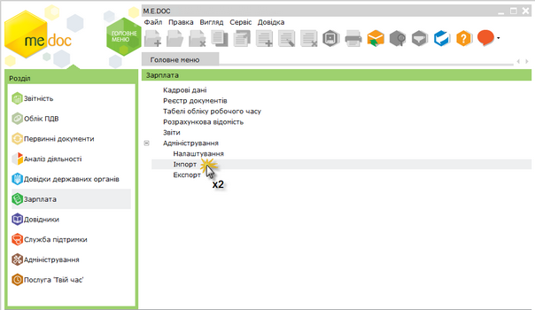
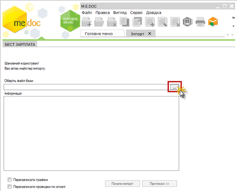
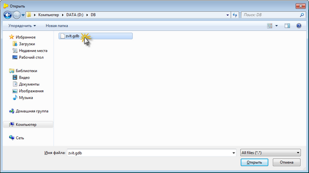
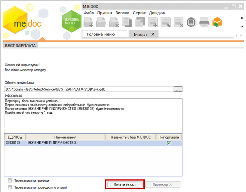
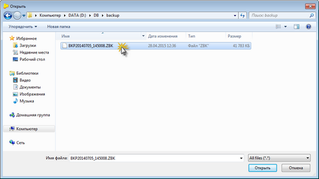
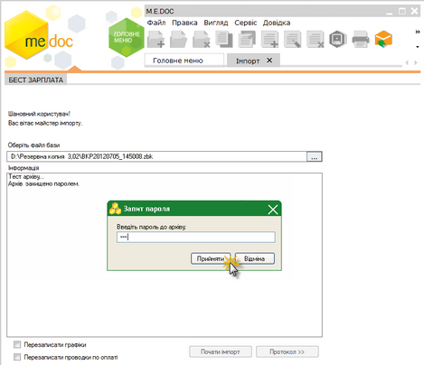
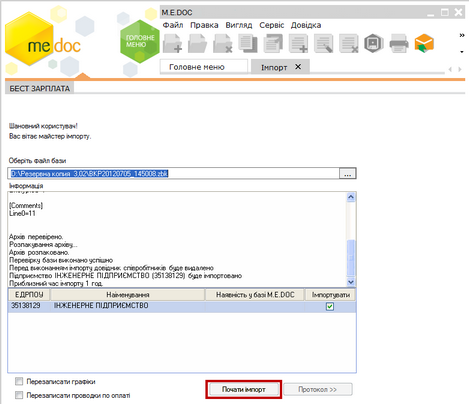

[← Зміст довідки](../)


# Імпорт бази даних з БЕСТ ЗАРПЛАТА

## Імпорт бази даних з БЕСТ ЗАРПЛАТА

_Шлях у довідці: Додатково: Imports › Імпорт бази даних з БЕСТ ЗАРПЛАТА_

Реалізована можливість переносити дані як з бази даних, так і з резервної копії ПК БЕСТ ЗАРПЛАТА.

1. У модулі Зарплата і далі подвійним кліком правої клавіші миші відкрийте розділ Імпорт.

Натисніть, щоб збільшити малюнок

2. Натисніть кнопку переходу в полі Оберіть файл бази та вкажіть шлях до розташування файлу бази даних або резервної копії

Натисніть, щоб збільшити малюнок

- Імпорт даних з бази даних

Файл бази даних zvit.gbd за замовчанням розташований за шляхом C:\Program Files\Intellect-Service\BEST ZARPLATA-3\DB.

Натисніть, щоб збільшити малюнок

Оберіть файл бази даних та натисніть кнопку Открыть.

Система проаналізує вміст бази даних та повідомить про можливість розпочати імпорт.

Натисніть кнопку Почати імпорт.

Натисніть, щоб збільшити малюнок

Розпочнеться процедура імпорту. По закінченню система виведе протокол імпорту, який містить перелік бібліотек, що були проімпортовані та загальний час імпорту.

- Імпорт даних з резервної копії

Файли резервних копій мають розширення \*.zbk та за замовчанням розташований за шляхом
C:\Program Files\Intellect-Service\BEST ZARPLATA-3\bakup.

Натисніть, щоб збільшити малюнок

Оберіть файл резервної копії та натисніть кнопку Открыть.

У випадку, якщо при створенні резервної копії у ПК БЕСТ ЗАРПЛАТА був встановлений пароль, аналізуючи, система запитає цей пароль.

Введіть пароль до архіву та натисніть кнопку Прийняти.

Натисніть, щоб збільшити малюнок

Система проаналізує вміст резервної копії та повідомить про можливість розпочати імпорт.

Натисніть кнопку Почати імпорт.

Натисніть, щоб збільшити малюнок

Розпочнеться процедура імпорту. По закінченню система виведе протокол імпорту, який містить перелік бібліотек, що були проімпортовані та загальний час імпорту.


