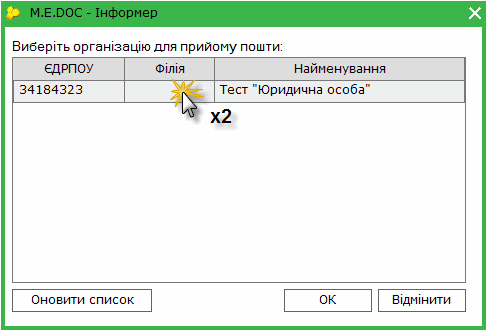
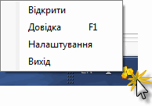
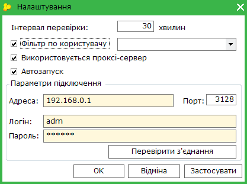

[← Зміст довідки](../)


# Медок-Інформер

## Медок-Інформер

_Шлях у довідці: Додатково: Informer › Медок-Інформер_

Медок-інформер - утиліта, яка призначена для інформування користувачів про наявність нових повідомлень, в момент, коли програмний комплекс закритий.

Інформер запускається разом із операційною системою (програмним комплексом) та розміщується в системному треї.

Примітка:

В налаштуваннях інформеру автозапуск можна вимкнути. В такому випадку запустити інформер можна з модулю [Первинні документи](UCRtfRstMain.html#ucrtfrstmain-ucrtfrstmain)

З усіх встановлених на комп’ютері екземплярів програми "M.E.Doc" (в т.ч. станцій) інформер формує список підприємств (ЄДРПОУ + код філії). На підставі даних цих підприємств із встановленою в налаштуваннях періодичністю інформер перевіряє наявність нових повідомлень .

Рекомендується створити окрему електронну скриньку на одному з надійних УКРАЇНСЬКИХ поштових серверів, яка використовуватиметься лише для відправлення звітності та отримання електронних квитанцій.

Якщо у програмі ведеться звітність декількох установ для кожної з них потрібно налаштувати поштове з'єднання.

Увага! Для кожного підприємства необхідно налаштувати окрему поштову скриньку з унікальною адресою. Ця скринька повинна використовуватись виключно для відправлення звітності та отримання електронних квитанцій в програмі "M.E.Doc".

Якщо присутні нові повідомлення, інформер повідомляє про це користувача мерехтінням піктограми

При натисненні на іконку інформера лівою кнопкою миші, відкривається вікно, що містить перелік підприємств, для яких надійшли нові повідомлення.

Копка Оновити список призначена для оновлення переліку організацій, для яких надійшли нові повідомлення.

Подвійний клік по назві організації запускає програмний комплекс "M.E.Doc" саме для обраної установи з метою прийому пошти.

Налаштування інформеру

Для виклику вікна налаштувань натисніть правою кнопкою миші на іконку інформера та оберіть опцію Налаштування.

Відкриється вікно Налаштування.

- Інтервал перевірки
Дозволяє задавати проміжок часу в хвилинах, через який сервіс буде циклічно виконувати перевірку наявності нових повідомлень .

- Фільтр по користувачу
Якщо встановлена галочка в даному полі, стає доступним для вибору перелік користувачів всіх встановлених екземплярів програмного комплексу на поточному комп'ютері. Оберіть логін потрібного користувача. Після застосування пошта перевірятиметься лише для тих підприємств, до яких надано доступ згідно з налаштуванням ролей цього користувача.

- Автозапуск
Встановлена галочка вмикає функцію автоматичного запуску інформеру разом із операційною системою або, у випадку примусового вимкнення інформеру, разом із програмним комплексом.
Якщо функцію автозапуску вимкнено (галочка не встановлена), інформер можна запустити з модуля [Первинні документи](UCRtfRstMain.html#ucrtfrstmain-ucrtfrstmain).

- Використовується проксі-сервер
В разі відсутності прямого підключення до Інтернету, необхідно налаштувати параметри підключення до проксі-сервера:
- введіть доменне ім'я або IP-адресу комп’ютера у поле Адреса.
- введіть номер порту, логін та пароль у відповідні поля.
- для перевірки правильності введених даних натисніть на кнопку Перевірити з'єднання. Система повідомить про успішне з'єднання або помилку.

Після внесення всіх необхідних налаштувань натисніть на кнопку ОК, вікно закриється та внесені дані збережуться автоматично.


