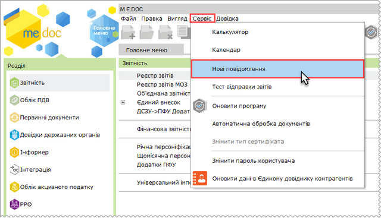
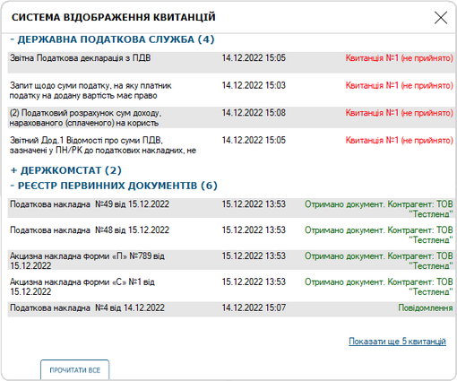

[← Зміст довідки](../)


# Система відображення квитанцій

## Система відображення квитанцій

_Шлях у довідці: Допоміжні сервіси › Система відображення квитанцій_

Система відображення квитанцій призначена для інформування користувачів про наявність непрочитаних квитанцій, та їх швидкого перегляду.

Увага! У вікні Сервісу не відображаються Квитанції, що були прийняті за допомогою сервісу Автоматичної обробки кореспонденції.

Для коректного відображення прийнятих квитанцій для різних користувачів, крім налаштування доступу до модуля, для користувача повинні бути виконані налаштування доступу до бланків. Налаштування доступу до бланків виконуються у модулі [Адміністрування – Управління ролями](UCManageRoles.html#ucmanageroles-ucmanageroles).

Система відображення квитанцій доступна, якщо у налаштуваннях ролі користувача встановлено опцію Адміністрування – Система відображення квитанцій.

Запуск Системи відображення квитанцій здійснюється по виконання команди головного меню Сервіс - натисканню кнопки панелі інструментів:

Натисніть, щоб збільшити малюнок

Вікно Сервісу містить перелік непрочитаних квитанцій:

Натисніть, щоб збільшити малюнок

Квитанції розподілені по групам, що відповідають одержувачу документа з адресної книги (наприклад, Державна податкова служба, Реєстр первинних документів тощо). Назва одержувача зазначається у заголовку групи, у дужках вказується кількість непрочитаних квитанцій у групі.

Повідомлення та Квитанції від підзвітних організацій наводяться у розділі ІНШІ АДРЕСИ.

Якщо у якійсь з груп відсутні повідомлення, ця група не відображається у вікні сервісу.

Для кожної квитанції наводиться інформація:

- назва документа, для якого отримано квитанцію;
- дата та час останньої модифікації документа;
- вид отриманого повідомлення, для Первинних документів вказується назва Контрагента.

По замовчуванню, у групі відображається 5 останніх Квитанцій. Для перегляду наступної порції натисніть Показати ще 5 квитанцій.

Якщо, для документа існують декілька квитанцій, у списку відображаються квитанції, що мають більший пріоритет, наприклад, якщо отримана Квитанція 1 та Квитанція 2 у вікні буде відображена лише Квитанція 2.

Неприйняті квитанції відображаються червоним кольором.

Квитанція, отримана останньою, у списку вікна відображаються першою.

Можливо змінити відображення груп у вікні Сервісу. Натисніть два рази лівою кнопкою миші на заголовку групи. Групу буде "згорнуто". Зліва від назви групи з'явиться символ . Щоб "розгорнути" список квитанцій у групі, натисніть два рази лівою кнопкою миші на заголовку групи ще раз. Біля заголовку розгорнутої  групи буде відображено символ .

У вікні Сервісу запам'ятовуються налаштування відображення, виконані користувачем.

Натискання кнопки Прочитати все позначає всі Квитанції як прочитані, при цьому, інформація про Квитанції видаляється з вікна Сервісу, та у відповідних розділах програми знімаються маркери, що позначають наявність непрочитаних повідомлень. Доступ до команди Прочитати все налаштовується у модулі програми [Адміністрування – Управління ролями](UCManageRoles.html#ucmanageroles-ucmanageroles). Кнопка Прочитати все доступна, якщо у налаштуваннях ролі користувача встановлено опцію Адміністрування – Система відображення квитанцій – Відмітити всі повідомлення як прочитані. Якщо опцію не встановлено, повідомлення у вікні Сервісу доступні тільки для перегляду.

При подвійному натисканні лівої кнопки миші на квитанції у списку, відкривається документ, для якого надійшла обрана квитанція. У вікні відкритого документа автоматично відкривається вкладка Квитанції. Обрана квитанція набуває статусу прочитаної. Прочитані квитанції не відображаються у вікні Сервісу.

Інформація про Квитанції оновлюється при прийманні пошти.


