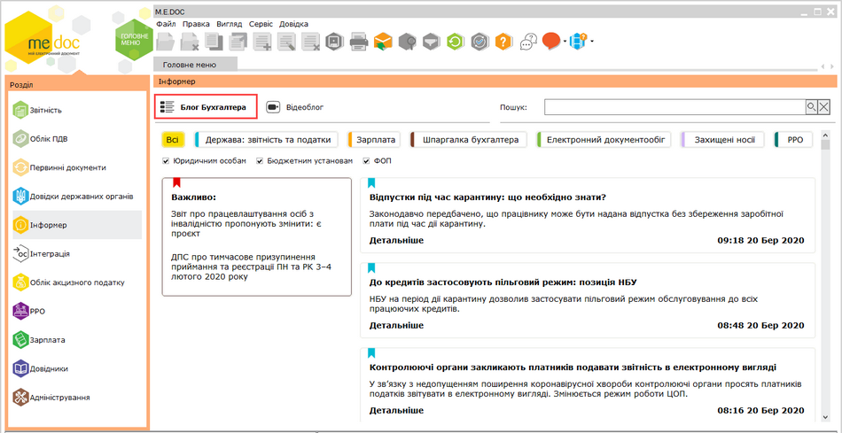
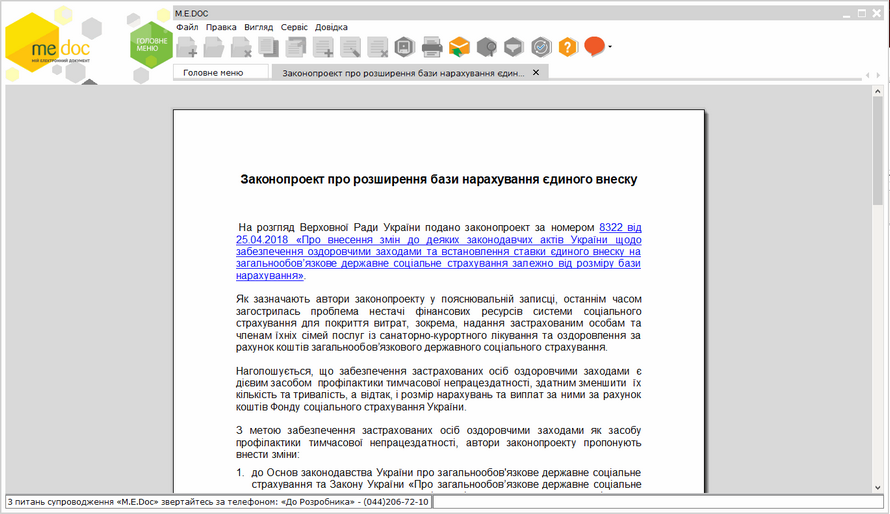
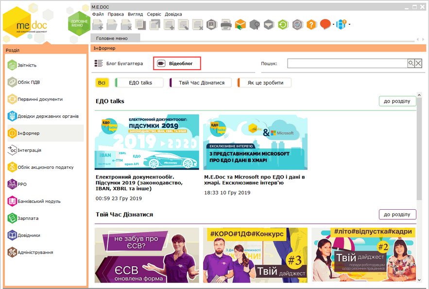

[← Зміст довідки](../)


# Інформер

## Інформер

_Шлях у довідці: Допоміжні сервіси › Інформер_

У модулі Інформер користувачі можуть дізнатися про актуальні новини у сфері бухгалтерського обліку, отримати корисні поради, слідкувати за останніми змінами у законодавстві тощо.

Щоб обрати актуальні новини, встановіть фільтри відображення новин, обравши категорію, у верхній частині вікна модуля:

Натисніть, щоб збільшити малюнок

- Всі – всі новини, наявні у модулі;
- Держава: звітність та податки – новини щодо подання звітності та сплати податків;
- Зарплата – новини, пов’язані з обліком заробітної плати, лікарняних тощо;
- Шпаргалка бухгалтера – корисні поради щодо бухгалтерського обліку;
- Електронний документообіг - інформація цього розділу допоможе впровадити ефективний електронний документообіг на вашому підприємстві, тут ви можете дізнатися про переваги та особливості провадження електронного документообігу, особливості оформлення електронних документів, вимоги і правила використання та зберігання електронних документів тощо, розділ допоможе вам бути в курсі останніх новин та змін у законодавстві, а також вдосконалювати процеси документообігу вашого підприємства;
- Захищені носії - інформація щодо використання захищених носіїв (токенів), придбання, зберігання та особливості використання особистих ключів електронного підпису у захищених носіях інформації.
- РРО - корисна інформація щодо правил реєстрації, особливостей застосування та специфіки роботи з реєстраторами розрахункових операцій.

Також можливо обрати новини за сферою, у якій здійснюється бухгалтерський облік, встановивши відповідні опції – Юридичним особам, Бюджетним установам, ФОП.

Передбачено можливість пошуку новин. Для пошуку введіть ключові слова у полі Пошук, що розташоване у верхній частині вікна, та натисніть . У вікні модуля будуть відображені новини, що містять введені слова. Щоб очистити поле пошуку та повернутись до перегляду повного списку новин, натисніть .

Кожна новина позначається прапорцем, колір якого відповідає категорії, до якої належить новина.

У вікні відображається короткий зміст новин. Щоб переглянути новину повністю, натисніть на відповідній закладці. Докладна інформація відкриється у окремій вкладці.

Натисніть, щоб збільшити малюнок

Крім текстових новин у модулі можливо переглядати відеоролики з новинами та корисною інформацією з каналу M.E.Doc на YouTube. Для цього натисніть посилання Відеоблог у верхній частині вікна.

Натисніть, щоб збільшити малюнок

Відеоролики також розподілені за рубриками. Щоб обрати потрібну рубрику, натисніть кнопку фільтра у верхній частині вікна модуля:

- Всі – вся відеоінформація, наявна у модулі;
- ЕДО talks – YouTube–канал, присвячений електронному документообігу, експерти в галузі е-обміну документами порадять як обрати рішення, що найкраще підійде для вашого бізнесу;
- Твій час дізнатися – навчальні матеріали та випуски передачі "Твій час дізнатися", що висвітлюють останні новини та актуальні питання;
- Як це зробити – корисні поради щодо ефективного використання програми.

Також, обрати певний розділ можливо, натиснувши кнопку до розділу. Пошук потрібних відеороликів здійснюється за допомогою поля Пошук.

Щоб повернутися до текстових новин, натисніть посилання Блог Бухгалтера.


