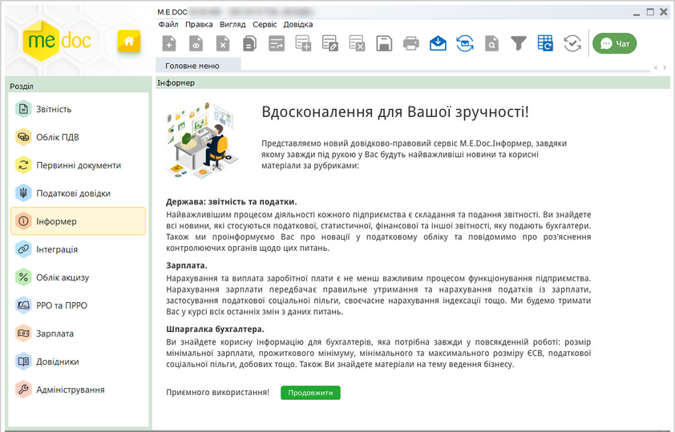
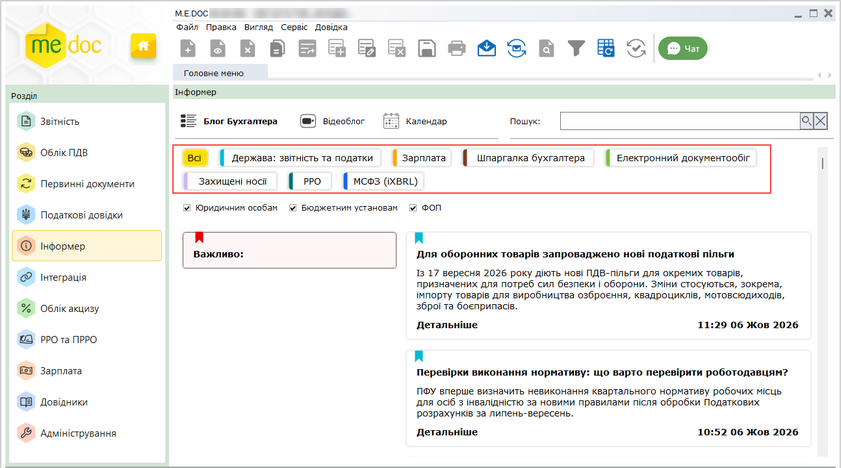

[← Зміст довідки](../)


# Інформер

## Інформер

_Шлях у довідці: Допоміжні сервіси › Інформер_

У модулі Інформер користувачі можуть дізнатися про актуальні новини у сфері бухгалтерського обліку, отримати корисні поради, слідкувати за останніми змінами у законодавстві тощо. Під час першого відкриття модуля, щоб розпочати роботу натисніть кнопку Продовжити:

Натисніть, щоб збільшити малюнок

Щоб обрати актуальні новини, встановіть фільтри відображення новин, обравши категорію, у верхній частині вікна модуля:

Натисніть, щоб збільшити малюнок

- Всі – усі новини, доступні в модулі;
- Держава: звітність та податки –новини щодо подання звітності та сплати податків;
- Зарплата – новини, пов’язані з обліком заробітної плати, лікарняних тощо;
- Шпаргалка бухгалтера – корисні поради щодо бухгалтерського обліку;
- Електронний документообіг - інформація про переваги та особливості впровадження електронного документообігу, оформлення, використання та зберігання електронних документів, а також останні новини та зміни в законодавстві;
- Захищені носії -  інформація щодо використання захищених носіїв (токенів), придбання, зберігання та особливостей використання особистих ключів електронного підпису на захищених носіях;
- РРО - корисна інформація про правила реєстрації, особливості застосування та роботи з реєстраторами розрахункових операцій;
- МСФЗ - інформація щодо застосування Міжнародних стандартів фінансової звітності, особливостей ведення обліку та складання фінансової звітності за МСФЗ.

Також можна обрати новини за сферою, у якій здійснюється бухгалтерський облік, встановивши відповідні опції – Юридичним особам, Бюджетним установам, ФОП.

Передбачено можливість пошуку новин. Для пошуку введіть ключові слова у полі Пошук, що розташоване у верхній частині вікна, та натисніть . У вікні модуля будуть відображені новини, що містять введені слова. Щоб очистити поле пошуку та повернутись до перегляду повного списку новин, натисніть .

Кожна новина позначається прапорцем, колір якого відповідає категорії, до якої належить новина.

У вікні відображається короткий зміст новин. Щоб переглянути новину повністю, натисніть на відповідній закладці. Докладна інформація відкриється у окремій вкладці.

Крім текстових новин у модулі можна переглядати відеоролики з новинами та корисною інформацією з каналу M.E.Doc на YouTube. Для цього натисніть посилання Відеоблог у верхній частині вікна.

Відеоролики також розподілені за рубриками. Щоб обрати потрібну рубрику, натисніть кнопку фільтра у верхній частині вікна модуля:

- Всі – вся відеоінформація, наявна у модулі;
- ЕДО talks – YouTube–канал, присвячений електронному документообігу, експерти в галузі е-обміну документами порадять як обрати рішення, що найкраще підійде для вашого бізнесу;
- Твій час дізнатися – навчальні матеріали та випуски передачі "Твій час дізнатися", що висвітлюють останні новини та актуальні питання;
- Як це зробити – корисні поради щодо ефективного використання програми.

Також, обрати певний розділ можливо, натиснувши кнопку до розділу. Пошук потрібних відеороликів здійснюється за допомогою поля Пошук.

Натиснувши посилання Календар, ви можете переглядати календар бухгалтера, у якому відображаються важливі дати та строки подання звітності, сплати податків та інших обов’язкових платежів. За допомогою календаря можна переглянути перелік запланованих на певну дату подій та завчасно відстежувати наближення граничних строків.


