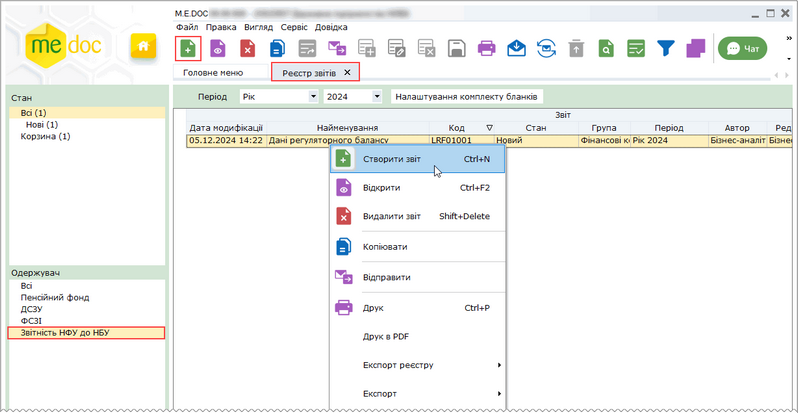
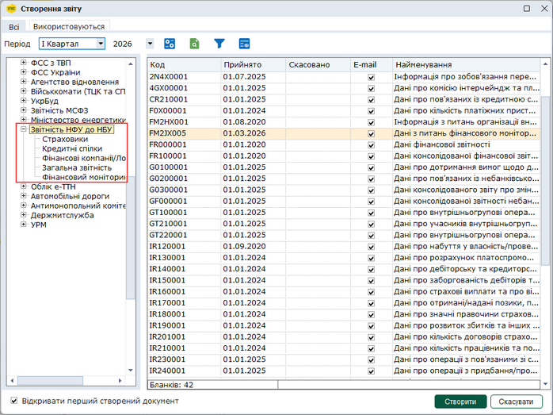
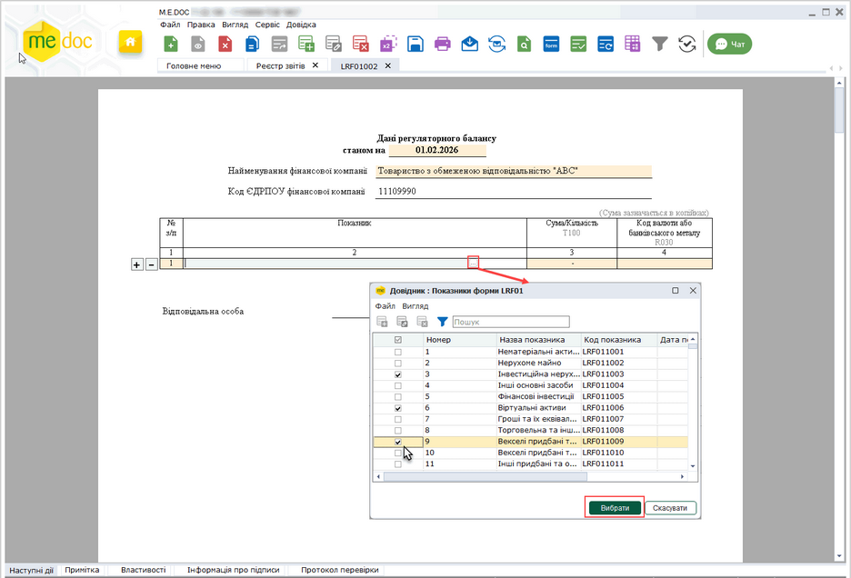

[← Зміст довідки](../)


# Звітність до НБУ для небанківських установ

## Звітність до НБУ для небанківських установ

_Шлях у довідці: Розділи програми › Звітність › Звітність до НБУ для небанківських установ_

В цьому розділі:

[Створення звітності до НБУ для небанківських установ](#nbu-nbu)

[Експорт звітності до НБУ для небанківських установ](#nbu-nbu)

[Імпорт звітності до НБУ для небанківських установ](#nbu-nbu)

[Підписання ЕП та відправка  звітності до НБУ](#nbu-nbu)

У модулі Реєстр звітів можливо створювати звіти до НБУ небанківських фінансових установ (НФУ), підписувати їх ЕП та відправляти на спеціальний ресурс Національного банку України.

М.E.Doc підтримує [НБУ Portal REST API](https://portal.bank.gov.ua/documents/20147/66030/rest_api.pdf) – інтерфейс прикладного програмування порталу автоматизованих сервісів НБУ, який надає можливість звітувати перед Національним банком України та отримувати різноманітну довідкову інформацію.

Подання звітності через спеціальний ресурс Національного банку потребує попередньої реєстрації користувача на цьому ресурсі. Також, кожній НФУ до початку подання звітності необхідно поштою надіслати листа на адресу Департаменту статистики та звітності Національного банку з інформацією про юридичну особу відповідно до шаблону, доступного на сайті Національного банку, детально дивіться інструкції на ресурсах НБУ.

Щоб скористатися можливістю створювати та відправляти звіти небанківських фінансових установ, у програмі M.E.Doc необхідно виконати підготовчі дії:

- виконати підключення до спеціального ресурсу НБУ за допомогою розділу: [Адміністрування – Параметри системи – Налаштування API НБУ](FormCompanyParams.html#formcompanyparams-admcompanyparams_api_nbu). У розділі, у відповідних полях, необхідно вказати логін та пароль від кабінету користувача на порталі НБУ;
- налаштувати комплект підписання звітності небанківських фінансових установ до НБУ Звітність до НБУ у розділі [Адміністрування – Параметри системи – Підпис](FormCompanyParams.html#formcompanyparams-admcomanyparams_pen);
- придбати та встановити ліцензію Звітність до НБУ для небанківських установ.

Для створення звіту виконайте дії в наступній послідовності:

1. Оберіть період в якому потрібно створити звіт.

2. Скористайтесь одним із способів:

- на панелі інструментів натисніть кнопку Створити;
- виберіть команду Файл - Створити;
- у контекстному меню оберіть команду Створити;
- натисніть комбінацію клавіш Ctrl+N.

Натисніть, щоб збільшити малюнок

Для відбору звітів НФУ у таблиці реєстру на панелі Одержувач оберіть значення Звітність НФУ до НБУ (доступно за наявності відповідних звітів

3. Відкриється вікно Створення звіту, у якому оберіть потрібний звіт та натисніть кнопку Створити. Бланки звітів небанківських установ доступні у розділі Звітність НФУ до НБУ:

Натисніть, щоб збільшити малюнок

4. У окремому вікні відкриється бланк документа, який потрібно заповнити.

Поля, що підсвічені жовтим кольором, обов'язкові для заповнення.

Натисніть, щоб збільшити малюнок

5. Внесіть дані в поля, які потребують заповнення із клавіатури, або оберіть з довідника (якщо такий підключений до графи форми).

У звітах з великою кількістю показників можна одночасно обрати кілька значень у вікні довідника, для цього встановіть позначки у відповідних рядках. Кожне з обраних значень розміщується у окремому рядку таблиці звіту.

Для додавання рядка в таблицю звіту скористайтеся кнопкою  ліворуч від таблиці. Відповідно, натискання кнопки  видаляє рядок з таблиці.

6. Перевірте звіт одним із способів:

- оберіть команду меню Правка - Перевірити документ;
- оберіть команду Перевірити документ на вкладці Наступні дії;
- натисніть клавішу F4.

Перевіряється правильність заповнення полів і у випадку помилок, система підсвітить червоним кольором поля, що необхідно виправити. Виправте помилки та знову виконайте перевірку.

Зверніть увагу! Якщо певне поле не повинно містити значень, для уникнення помилок під час перевірки форми введіть у такому полі значення "0" (нуль).

7. Збережіть документ, натиснувши кнопку  або комбінацію клавіш Ctrl+S.

[До початку](#nbu-nbu)

Експорт звітності до НБУ для небанківських установ

Для збереження даних на електронному носії чи у обраному каталозі:

1. Оберіть у таблиці Реєстру звіт, якій потрібно експортувати.

2. Оберіть команду головного меню Файл – Експорт – Експорт або команду контекстного меню Експорт.

3. У вікні Експорт оберіть формат експорту, встановивши відповідну опцію: для подачі у контролюючий орган, для обміну звітністю або експорт документа з квитанціями:

У полі Каталог призначення оберіть каталог для збереження даних. Ім'я файлу звіту формується автоматично.

При експорті у форматі для подачі у контролюючий орган назва та розширення файлу звіту відповідають правилами подання звіту до контролюючого органу.

При експорті у форматі для обміну звітністю або експорт документа з квитанціями ім'я файлу містить дату та час виконання операції, ЄДРПОУ підприємства та код звіту. Остання цифра у назві файлу - порядковий номер документа з певним кодом, що експортується на поточну дату.

4. Натисніть кнопку ОК.

5. Система повідомить про результати експорту даних. Файл буде збережено у обраному каталозі.

Можливо здійснювати експорт звітів у форматі Excel. Експорт виконується у вікні відкритого документа по команді Виконати додаткову програму обробки – Експорт в Excel на вкладці Наступні дії.

[До початку](#nbu-nbu)

Імпорт звітності до НБУ для небанківських установ

Для імпорту звіту:

1. У меню оберіть команду Файл - Імпорт - Імпорт звітів.

2. Вкажіть шлях до каталогу розміщення файлів. Оберіть файл (або декілька файлів) та натисніть Відкрити для початку процесу імпорту.

3. По закінченні процедури система виведе протокол імпорту даних.

[До початку](#nbu-nbu)

Існує декілька способів відправки документів:

1. Із вкладки "Наступні дії"

Даний спосіб дозволяє відправити лише один документ - відкритий або виділений в Реєстрі звітів.

В доступних діях з документом передбачено декілька варіантів для зручності користувача:

Передати звіт на підпис

На виконання цієї команди документ блокується від редагування. В Наступних діях стає доступною команда [Підписати звіт](UC_ECP.html#uc_ecp-ecp).
Після накладення підписів стає доступною функція Відправити документ. Програма повторно запропонує підписати файл сертифікатом печатки установи, таким чином підписується "конверт", в який поміщається файл для відправки.

Підписати звіт

На виконання команди відразу розпочнеться стандартний процес [підписання документа](UC_ECP.html#uc_ecp-ecp) ЕП.
Після накладення підписів та печатки установи, стає доступною функція Відправити. Програма повторно запропонує підписати файл сертифікатом печатки установи, таким чином підписується "конверт", в який поміщається файл для відправки.

2. Безпосередньо з Реєстру звітів

Даний спосіб дозволяє відправляти як один документ, так и групу документів одночасно.

У реєстрі виділіть потрібний звіт або групу звітів та оберіть один із варіантів:

- на панелі інструментів натисніть кнопку Відправити - ;
- виберіть команду Файл - Відправити;
- у контекстному меню оберіть команду Відправити.

На виконання команди розпочнеться [підписання документа](UC_ECP.html#uc_ecp-ecp) ЕП та одразу відправка звіту на спеціальний ресурс Національного банку. По закінченню процедури, система виведе протокол відправки звітів.

Повідомлення про результати обробки звітів відображається на вкладці Повідомлення.

[До початку](#nbu-nbu)


