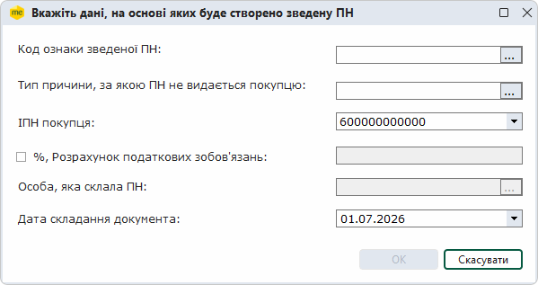
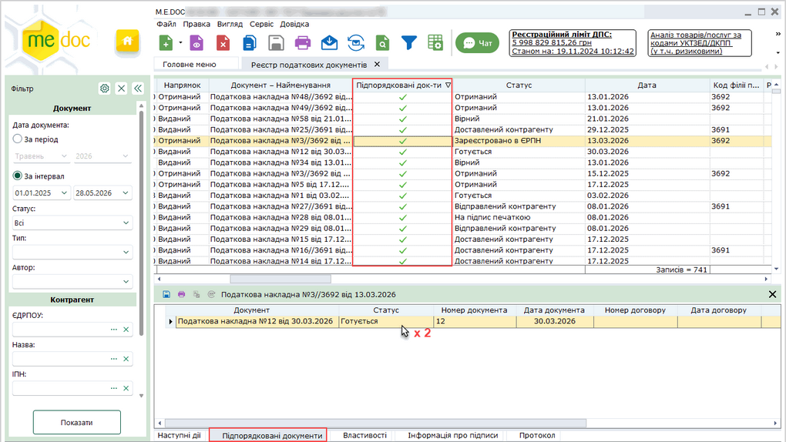

[← Зміст довідки](../)


# Створення зведеної виданої ПН на основі отриманої

## Створення зведеної виданої ПН на основі отриманої

_Шлях у довідці: Розділи програми › Первинні документи › Реєстр податкових документів › Створення зведеної виданої ПН на основі отриманої_

В цьому розділі:

[Створення зведеної виданої ПН на основі отриманої](#pdocs_creat_vyhid-pdocs_creat_vyhid)

[Відображення підпорядкованих документів](#pdocs_creat_vyhid-pdocs_creat_vyhid)

Створення зведеної виданої ПН на основі отриманої

Для створення зведеної виданої ПН на основі отриманої:

1. У вікні Реєстру податкових документів оберіть одну або декілька отриманих ПН.

Створення виданої ПН на основі отриманої, яка знаходиться в архівній базі, недоступне.

2. У головному меню оберіть команду Файл - Створити на основі - Створити зведену видану ПН або у контекстному меню оберіть команду Створити на основі - Створити зведену видану ПН.

Відкриється вікно зазначення даних для формування ПН.

3. У вікні потрібно вказати такі дані:

- Код ознаки зведеної ПН - обирається зі списку;
- Тип причини, за якою ПН не видається покупцю - обирається зі списку;
- ІПН покупця - обирається одне зі значень умовного податкового номера (ІПН), обране значення "600000000000" означає, що зведена податкова накладна оформлюється на податкові зобов’язання з товарів/послуг і необоротних активів (п.п. 198.5 та 199.1 ПКУ), котрі повністю або частково використовуються в неоподатковуваних операціях і/або в негоспдіяльності;
- позначка %, Розрахунок податкових зобов'язань - якщо позначку встановлено, то в поле обов'язково вводиться відсоток використання податкових зобов'язань з отриманої ПН;
- Особа, яка склала ПН - якщо у [комплекті підписів](FormCompanyParams.html#formcompanyparams-admcomanyparams_pen) зазначена лише одна відповідальна особа, поле недоступне для заповнення, у документі інформація про відповідальну особу автоматично заповнюється даними з комплекту підписів, якщо відповідальних осіб у комплекті більше однієї, у полі з довідника можна обрати потрібну відповідальну особу, що склала ПН;
- Дата складання документа - за замовчуванням, встановлено поточну дату. Дату можна змінити.

4. Натиснути на кнопку ОК.

Створену зведену видану ПН буде одразу відкрито у окремій вкладці.

Особливості заповнення табличної частини:

- для кожної отриманої ПН створюється окремий рядок таблиці по кожному коду ставки, вказаному в ПН;
- в полі 2 Опис (номенклатура) товарів/послуг продавця зазначаються номери та дати отриманих ПН, на основі яких створено зведену видану ПН;
- в полі 4 умовне позначення вказується "грн";
- поля 3 Код товару згідно з УКТ ЗЕД,  5 код, 6 Кількість (об'єм, обсяг), 7 Ціна постачання одиниці товару/послуги ...,  8 Код ставки, 9 Код пільги не заповнюються;
- в полі 10 Обсяги постачання вказується сума без ПДВ для окремого коду ставки з ПН;
- в полях Розділу А вказуються суми по всім рядкам таблиці за відповідними кодами ставок.

[До початку](#pdocs_creat_vyhid-pdocs_creat_vyhid)

Відображення підпорядкованих документів

Для отриманих ПН, на основі яких створено видані, та створених виданих ПН відображаються підпорядковані документи, як в реєстрі, так і у вікні відкритого документа.

Натисніть, щоб збільшити малюнок

Підпорядкований документ відкривається подвійним натисканням на ньому.

Відображення колонки Підпорядковані документи в реєстрі налаштовується за допомогою конфігуратора таблиці (кнопка  на панелі інструментів або пункт головного меню Вигляд - Конфігуратор таблиці).

[До початку](#pdocs_creat_vyhid-pdocs_creat_vyhid)


