[← Зміст довідки](../)


# Робота з первинними документами

## Робота з первинними документами

_Шлях у довідці: Розділи програми › Первинні документи › Робота з первинними документами_

Робота з первинними документами здійснюється у двох модулях:

- Реєстр електронних документів - призначений для створення, редагування, збереження та обміну з контрагентами актами виконаних робіт, рахунками, платіжними дорученнями тощо, а також Універсальними документами із вкладеннями різних форматів.
- Реєстр податкових документів - для створення, редагування та збереження податкових документів: Податкових накладних та Розрахунків коригування з метою обміну даними документами з контрагентами та контролюючими органами.

У даному розділі довідки розглянуто наступне:

- [Опис основних функціональних елементів інтерфейсу](#pdocs_reestr_funkc-pdocs_reestr_int)
- [Фільтр - початок роботи з реєстром документів](#pdocs_reestr_funkc-pdocs_reestr_filtr)
- [Архів документів](#pdocs_reestr_funkc-pdocs_reestr_arhiv)
- [Як створити електронний первинний документ](UCDFDocsRstNew.html#ucdfdocsrstnew-pdocs_reestr_funkc_stvor)
- [Як створити податковий документ (Податкову накладну / Розрахунок коригування)](UCNaklExchangeRst.html#ucnaklexchangerst-ucnaklexchangerst_)
- [Копіювання документа](#pdocs_reestr_funkc-doccopy)
- [Підписання ЕП та відправлення первинних документів електронним каналом зв'язку](#pdocs_reestr_funkc-pdocs_reestr_funkc_vidp)
- [Отримання, погодження та відхилення первинних документів](#pdocs_reestr_funkc-pdocs_reestr_funkc_pryyom)
- [Експорт первинних документів](UCDFDocsRstNew.html#ucdfdocsrstnew-exp_perv_el)
- [Експорт податкових документів](Exp_perv.html#exp_perv-exp_perv)
- [Імпорт первинних документів](#pdocs_reestr_funkc-imp_perv)
- Друк податкових документів у PDF
- [Зв'язані документи](Conn_doc.html#conn_doc-conn_doc)
- [Як створити документ на основі існуючого](Creat_doc_.html#creat_doc_-creat_doc_)

### Опис основних функціональних елементів інтерфейсу

_Шлях у довідці: Розділи програми › Первинні документи › Робота з первинними документами › Опис основних функціональних елементів інтерфейсу_

Реєстр податкових документів та Реєстр електронних документів мають аналогічний інтерфейс, що складається з 4 основних функціональних частин (на прикладі Реєстру електронних документів):

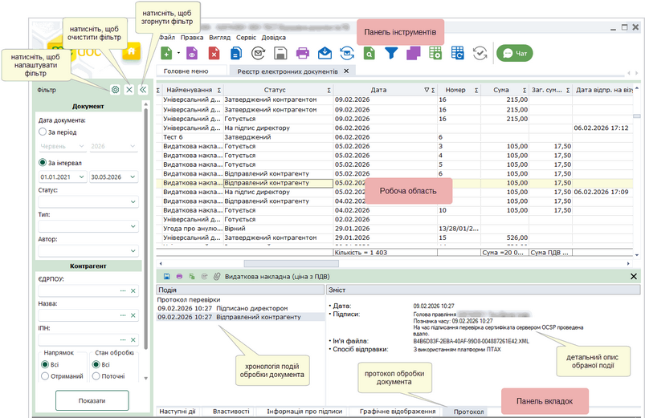

Натисніть, щоб збільшити малюнок

Фільтр

Робота з реєстром документів розпочинається з Фільтру - зручного і потужного інструменту відбору потрібних документів.

У Фільтрі максимально зібрані атрибути документів, за якими здійснюється пошук та сортування. Фільтрація відбувається по будь-якому відомому параметру.

Передбачена можливість самостійно задавати відображення параметрів відбору в реєстрі. Натисніть на кнопку , в окремому вікні, що відкрилось встановіть/зніміть галочки напроти потрібного реквізиту.

Після встановлення параметрів фільтрації натисніть на кнопку Відобразити документи. В робочій області відобразиться перелік документів згідно заданих параметрів пошуку.

Для того, щоб очистити Фільтр від даних натисніть на кнопку Очистити.

Якщо Фільтр не потрібен та/або заважає, його можна згорнути. Для цього натисніть на кнопку . Щоб розгорнути Фільтр, натисніть на згорнуту панель.

Детальний опис Фільтру та роботи з ним описано в розділі даної довідки [Фільтр - початок роботи з реєстром документів](#pdocs_reestr_funkc-pdocs_reestr_filtr).

Робоча область

Містить безпосередньо записи реєстру документів: відображає записи, що відповідають заданим умовам фільтрації та сортування.

Набором колонок у таблиці реєстру та порядком їх розміщення можна керувати. Для цього натисніть на кнопку  на панелі інструментів.
Відкриється вікно Конфігуратор таблиці. Встановіть відповідні галочки для відображення колонок.

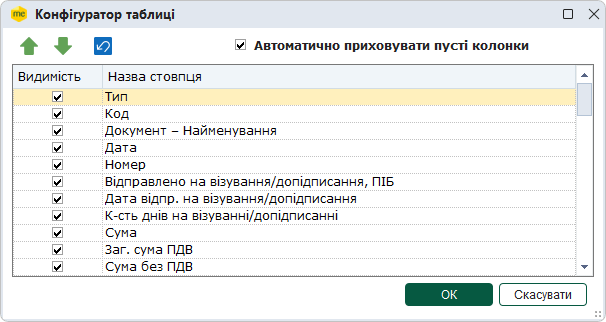

Скористайтесь кнопками  для встановлення довільного порядку за власним бажанням, або  для встановлення порядку колонок за замовчанням.

Якщо встановлено опцію Автоматично приховувати пусті колонки, колонки, що не містять даних, не відображаються у Робочій області.

Для збереження змін натисніть кнопку ОК.

Для зручності роботи у реєстрі, можливо групувати записи реєстру по колонкам таблиці реєстру.
Для активації цієї функції необхідно вибрати в меню Вигляд - Групування даних або натиснути на кнопку  на панелі інструментів.
Над реєстром з'явиться додаткова панель. Перетягніть на цю панель потрібні колонки.

У колонці Реєстрація в ЄРПН відображено статус документа у ДПС: символ  означає, що документ зареєстровано,  - документ відхилено,  - реєстрація документа зупинена, якщо колонка пуста – документ у ДПС не оброблено.

Колонка Зв'язані документи містить позначку , якщо для документа існують [зв'язані документи](Conn_doc.html#conn_doc-conn_doc).

Щоб відкрити документ, оберіть його у списку та скористайтеся одним із способів:

- натисніть 2 рази лівою кнопкою миші на документі у списку;
- виконайте команду меню Файл - Відкрити;
- оберіть команду Відкрити у контекстному меню;
- натисніть кнопку Відкрити  на панелі інструментів.

Можливо відкрити декілька документів одночасно, для цього виділіть потрібні документи у списку та скористайтеся одним із способів, що вказані вище. При спробі відкрити більше 20 документів, виводиться повідомлення про можливе уповільнення роботи програми, через велику кількість відкритих документів.

У реєстрах реалізовано відображення підсумкового значення колонок Сума, Загальна сума ПДВ та Сума без ПДВ по всім документам, що відображені у таблиці.

Також можна переглядати суми по колонкам Сума, Загальна сума ПДВ та Сума без ПДВ для обраних документів. Для цього:

- у Реєстрі електронних документів у головному меню встановіть опцію Вигляд – Відображати суму по обраним документам. Виділіть рядки потрібних документів за допомогою миші, утримуючи кнопку <Shift>, щоб обрати рядки, розташовані послідовно, або <Ctrl>, щоб обрати окремі рядки реєстру. Наведіть курсор миші на виділені рядки - підсумкові значення відобразяться у вікні підказки.
- У Реєстрі податкових документів реалізовано автоматичне відображення підсумкового значення колонок Сума, Загальна сума ПДВ та Сума без ПДВ для виділених документів. Щоб переглянути підсумкове значення колонок, виділіть рядки потрібних документів за допомогою миші, утримуючи кнопку <Shift> або <Ctrl>, та наведіть курсор миші на виділені рядки:

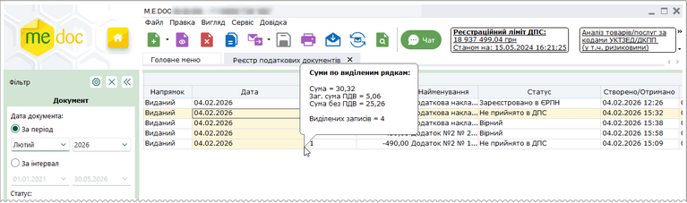

Натисніть, щоб збільшити малюнок

Панель вкладок звіту

Містить службову інформацію щодо обраного документа. Панель доступна як у відкритому документі, так і з реєстру документів (за умови виділення потрібного документа).

- Наступні дії – містить інформацію щодо поточного стану документа, а також перелік можливих дій з документом у цьому стані. Слугує підказкою користувачу про доступні дії, які можна виконати з документом у поточному стані;
- Властивості – у режимі читання містить всю службову інформацію про документ, таку як: стан, період створення, дата та час останньої модифікації, інформація про сертифікати, якими підписано документ тощо. Інформація на цій вкладці постійно оновлюється та доповнюється при будь-яких змінах документа;
- Протокол – містить перелік подій, що відбулись з документом під час його обробки в хронологічному порядку. При виборі події справа на панелі відображається її детальний опис.

Панель інструментів

Містить кнопки, що надають швидкий доступ до найбільш часто використовуваних функцій. Наведіть покажчик миші на інструмент і чекайте протягом секунди, для відображення короткої підказки, що описує, для чого він призначений.

### Фільтр - початок роботи з реєстром документів

_Шлях у довідці: Розділи програми › Первинні документи › Робота з первинними документами › Фільтр - початок роботи з реєстром документів_

Фільтр - це зручний і потужний інструмент відбору потрібних документів в реєстрі документів.

1. Задайте відображення параметрів відбору в реєстрі. Натисніть на кнопку . Відкриється вікно Налаштування фільтра. Зніміть (або встановіть для відновлення відображення параметру) галочки напроти потрібного реквізиту та натисніть ОК.

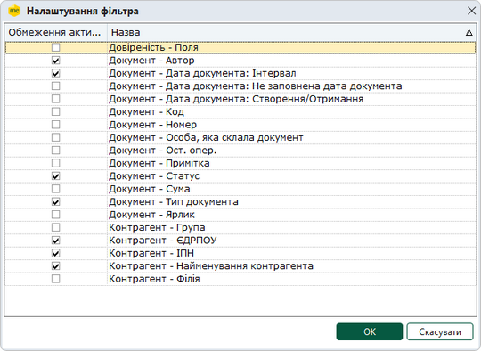

Натисніть, щоб збільшити малюнок
Налаштування Фільтру у Реєстрі електронних докумениів

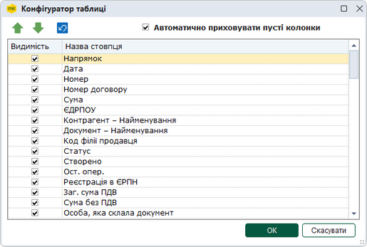

Натисніть, щоб збільшити малюнок
Налаштування Фільтру у Реєстрі податкових докумениів

2. Встановіть необхідні параметри відбору первинних документів в реєстрі:

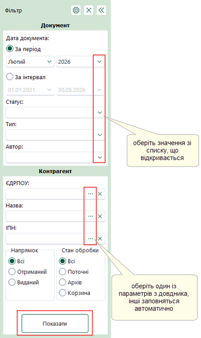

У деяких елементах фільтра можна обрати кілька значень. Наведіть курсор миші на таке поле на панелі Фільтр, щоб побачити перелік обраних значень:

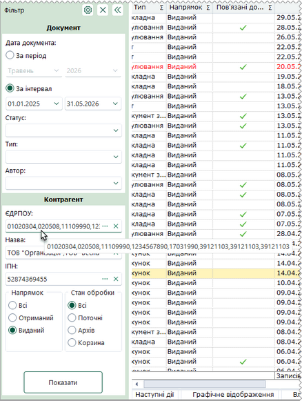

Документ

Дата документа:

- Дата - встановіть позначку для вибору певного періоду або довільного періоду:
- За період - вкажіть місяць та рік, в межах якого були створені потрібні первинні документи;
- Інтервал - вкажіть дату початку та закінчення довільного інтервалу, в межах якого були виписані потрібні первинні документи;
- Створення/Отримання - вкажіть дату початку та закінчення довільного інтервалу, в межах якого були створенні або отриманні потрібні первинні документи;
- Не заповнена дата документа - у вибірку за цим параметром потрапляють документи, у яких не вказана дата створення. Увага! У вибірки за іншими періодами ці документи не потрапляють.

Параметри розділу Дата документа відображаються на панелі фільтра при встановлені позначки Документ - Дата документа у вікні Налаштування фільтра.

- Дата та час реєстрації - (для Реєстру податкових документів) вкажіть дату початку та закінчення довільного інтервалу, в межах якого були зареєстровані первинні документи;
- Код - Використовується для пошуку документів за кодом бланка (значення колонки Код);
- Номер - використовується для пошуку документів за номером.
Якщо відома тільки частина номеру, можна використовувати символи узагальнення для пошуку серед документів, що містять цю частину номеру. Наприклад, за запитом "\*123\*" будуть знайдені документи з номером "1234567", "654123987".
Є можливість здійснювати пошук документів за декількома номерами, або їх частинами. Для цього у полі Номер вкажіть значення номерів через кому. У вікні буде відображено документи, номери яких містять вказані значення. Наприклад, за запитом "1,2,3" будуть знайдені документи з номером "1234567", "6521987", "Вер-13";

- Сума - параметр містить додатковий фільтр рівності, який обирається зі списку, що випадає. Таким чином, дозволяє знаходити документи за підсумковою сумою, що дорівнює вказаній, більше/менше вказаної або більше/менше чи дорівнює;
- Статус - оберіть із списку, що випадає, назву статусу, що відповідає етапу обробки документа. За замовчанням встановлено значення "Всі", тобто пошук відбувається за заданими параметрами серед усіх первинних документів;
- Остання операція - вкажіть дату початку та закінчення періоду, в межах якого були виконані останні операції (наприклад, підписання директором, відправка контрагенту) з первинними документами;
- Тип - якщо потрібно відобразити документи певного типу, наприклад, податкові накладні або рахунок-фактура, оберіть тип у списку, що випадає. За замовчанням встановлено значення "Всі", тобто пошук відбувається за заданими параметрами серед усіх первинних документів;
- Автор - якщо потрібно переглянути видані документи, що створені певним користувачем, оберіть ім'я користувача у списку, що випадає. За замовчанням встановлено значення "Всі", тобто пошук відбувається для усіх користувачів, програмного комплексу;
- Особа, яка склала документ - прізвище особи, що склала документ можна ввести як з клавіатури (через кому без пробілів), так і вибрати із довідника (встановивши позначку у відповідних рядках), у таблиці будуть відображені документи, складені обраними особами;
- Ярлик - (для Реєстру електронних документів) - введіть значення [ярлика](UCDFDocsRstNew.html#ucdfdocsrstnew-doc_label), за яким потрібно відібрати документи;
- Не заповнена дата документа - встановіть відмітку для відображення документів, у яких не заповнена дата;
- Реєстрація прострочена - (для Реєстру податкових документів) встановіть відмітку для відображення документів, для яких прострочено термін реєстрації;
- Код УКТ ЗЕД - (для Реєстру податкових документів) оберіть значення з довідника для відбору ПН/РК, які містять заданий код УКТЗЕД;
- Код ДКПП - (для Реєстру податкових документів) оберіть значення з довідника для відбору ПН/РК, які містять заданий код ДКПП.

Контрагент

- ЄДРПОУ - дозволяє знайти документи контрагента, що були відправлені/прийняті, якщо відомо його код установи за Єдиним державним реєстром підприємств та організацій України. Вводиться з клавіатури, обирається з підключеного довідника (кнопку вибору ) або заповнюється автоматично при виборі інших даних контрагента з довідника;
- Філія - дозволяє знайти документи контрагента, що були відправлені/прийняті, якщо відомий код філії. Вводиться з клавіатури, обирається з підключеного довідника (кнопку вибору ) або заповнюється автоматично при виборі інших даних контрагента з довідника;
- Назва - дозволяє знайти документи, які були виписані на ім'я або отримані від певного контрагента. Назва контрагента можна ввести як з клавіатури, так і вибрати із довідника "Контрагенти", який відкривається після натиснення на кнопку вибору . При виборі контрагента із довідника, автоматично заповнюються поля ЄДРПОУ, Філія та ІПН;
- ІПН - дозволяє знайти документи контрагента, що були відправлені/прийняті, якщо відомо його індивідуальний податковий номер. Вводиться з клавіатури, обирається з підключеного довідника (кнопка вибору ) або заповнюється автоматично при виборі інших даних контрагента з довідника;
- Група - дозволяє знайти документи, які були виписані на ім'я або отримані від контрагентів певної групи. При виборі групи блокується фільтрування за полями Найменування, ЄДРПОУ, ІПН;
- Платник ПДВ - (для Реєстру податкових документів) оберіть значення із списку:
- Платники ПДВ - документи контрагентів, що є платниками ПДВ;
- Не платники ПДВ - документи контрагентів, що не є платниками ПДВ;
- Всі - відображати документи як платників так і не платників ПДВ.

Напрямок

Містить перемикач між напрямками первинних документів. Передбачені наступні варіанти:

- Всі - всі документи реєстру незалежно від напрямку;
- Отриманий - отримані документи електронним каналом зв'язку від контрагентів;
- Виданий - створені документи, призначені для відправлення контрагентам електронним каналом зв'язку.

Стан обробки

Містить перемикач між призначеннями первинних документів. Передбачені наступні варіанти:

- Всі - всі документи реєстру, окрім видалених;
- На опрацюванні - документи, які знаходяться безпосередньо в роботі;
- Архів - документи, які досягли кінцевого стану обробки, тобто були затверджені або відхилені. Детальніше про Архів описано в розділі даної довідки [Архів документів](#pdocs_reestr_funkc-pdocs_reestr_arhiv).
- Корзина - документи, які були видалені з реєстру.

В режимі M.E.Doc.Корпорація доступні також параметри:

Відображати документи філій

Містить перемикач, який дозволяє ввімкнути відображення документів підзвітних організацій.
Якщо параметр встановлено, то стає доступним поле вибору Філії.

Філії

Оберіть із списку, що випадає, потрібні організації - головну та/або підзвітні.

Для того, щоб очистити Фільтр від даних натисніть на кнопку .

Якщо Фільтр не потрібен та/або заважає, його можна згорнути. Для цього натисніть на кнопку . Щоб розгорнути Фільтр, натисніть на згорнуту панель.

### Архів документів

_Шлях у довідці: Розділи програми › Первинні документи › Робота з первинними документами › Архів документів_

Архів призначений для зберігання документів, які пройшли повний цикл обробки, тобто були затверджені або відхилені контрагентом. Також передбачено примусове переміщення в архів документів, які не досягли кінцевого циклу обробки, але втратили свою актуальність, або документи внутрішнього використання на підприємстві.

Архівні документи доступні лише для перегляду, їх не можна змінювати та редагувати.

Для відображення архівних документів необхідно у [Фільтрі](#pdocs_reestr_funkc-pdocs_reestr_filtr) обрати напрямок Архів.

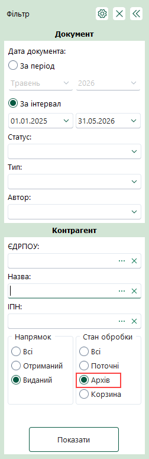

У робочій області відобразяться документи в режимі Для перегляду.

Архівні документи можна відправляти електронним каналом зв'язку:

- Для архівних документів в статусі Зареєстровано ЄРПН на вкладці Наступні дії доступна команда Відправити контрагенту.
- Для архівних документів в статусі Затверджено контрагентом та Відхилено контрагентом на вкладці Наступні дії доступна команда Відправити в ДПС.

### Копіювання документа

_Шлях у довідці: Розділи програми › Первинні документи › Робота з первинними документами › Копіювання документа_

В цьому розділі:

[Копіювання первинного документа](#pdocs_reestr_funkc-doccopy)

[Копіювання вихідного документа у вхідний](#pdocs_reestr_funkc-doccopy)

Копіювання первинного документа

Для копіювання первинного документа виконайте дії в наступній послідовності:

1. Виділіть документ, копію якого потрібно створити. Для копіювання групи документів виділіть потрібне курсором миші, використовуючи стандартні методи виділення декількох записів ОС Windows.

2. Оберіть один із способів виклику функції копіювання:

- на панелі інструментів натисніть кнопку Копіювати - ;
- із контекстного меню команда Копіювати;
- команда Файл - Копіювати.

Також функція копіювання документа доступна і у відкритому вікні документа: на панелі інструментів кнопка Копіювати -  та у меню Файл - Копіювати.

Із вікна відкритого документа копіюється тільки поточний документ.

3. На виконання функції копіювання відкривається модальне вікно Дата виписки, де запропоновано обрати дату виписки копії документа.

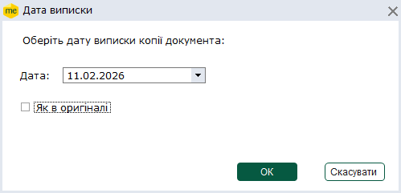

По замовчуванню встановлюється дата виписки документа, що копіюється.

Для того, щоб обрати іншу дату виписки, натисніть кнопку  у полі Дата. Відкриється вікно календаря, у якому оберіть потрібну довільну дату.

Якщо у копії необхідно зберегти дату виписки первинного документа, встановіть позначку Як в оригіналі.

4. Після того, як дату обрано, натисніть кнопку ОК. Відкриється вікно копії документа.

Скопійовані документи можна редагувати.

[До початку](#pdocs_reestr_funkc-doccopy)

Копіювання вихідного документа у вхідний

Існує можливість копіювання зареєстрованих ПН/РК, складених отримувачем послуг від нерезидента, з Виданих в Отримані для відображення податкового кредиту.

Для цього виконайте дії в наступній послідовності:

1. Виділіть документ, копію якого потрібно створити.

2. В контекстному меню оберіть команду Скопіювати зареєстровані вихідні ПН/РК у вхідні.

Відкриється вікно скопійованого документа. На вкладці Наступні дії буде відображено стан документа:

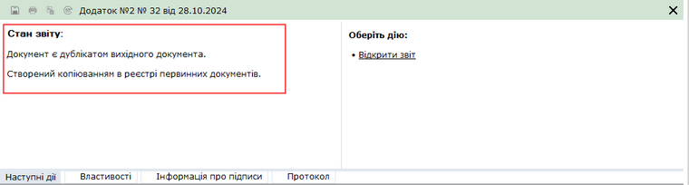

Натисніть, щоб збільшити малюнок

Скопійовані ПН/РК мають напрямок Отриманий та статус Дублікат.

[До початку](#pdocs_reestr_funkc-doccopy)

### Підписання ЕП та відправлення первинних документів електронним каналом зв'язку

_Шлях у довідці: Розділи програми › Первинні документи › Робота з первинними документами › Підписання ЕП та відправлення первинних документів електронним каналом зв'язку_

Вихідні первинні документи відправляються контрагентам електронним каналом зв'язку. Для відправки документ повинен бути заповненим, перевіреним та збереженим.

Існує декілька способів відправки первинних документів:

Із вкладки "Наступні дії"

Даний спосіб дозволяє відправити лише один документ - відкритий або виділений в реєстрі документів.

В доступних діях з документом передбачено декілька варіантів для зручності користувача:

Передати документ на підпис

На виконання цієї команди документ блокується від редагування та набуває статусу На підпис директору/бухгалтеру (статус залежить від [обраного комплекту підписів](FormCompanyParams.html#formcompanyparams-admcomanyparams_pen) для первинних документів). Документ знаходиться в стані очікування.
В Наступних діях стає доступним можливість [Підписати документ](UC_ECP.html#uc_ecp-ecp).
Після накладення підписів директора/бухгалтера та печатки установи документ набуває статусу Готовий до відправки, стає доступною функція Відправити документ. Програма повторно запропонує підписати файл сертифікатом печатки установи, таким чином підписується "конверт", в який поміщається файл для відправки.

Підписати документ

На виконання команди відразу розпочнеться стандартний процес [підписання документа](UC_ECP.html#uc_ecp-ecp) ЕП.
Після накладення підписів директора/бухгалтера та печатки установи документ набуває статусу Готовий до відправки, стає доступною функція Відправити документ. Програма повторно запропонує підписати файл сертифікатом печатки установи, таким чином підписується "конверт", в який поміщається файл для відправки.

Відправити документ

На виконання команди розпочнеться [підписання документа](UC_ECP.html#uc_ecp-ecp) ЕП та відправка документа адресату.

Безпосередньо з реєстру документів

Даний спосіб дозволяє відправляти як один документ, так і групу документів одночасно.

У реєстрі виберіть потрібний первинний документ або групу первинних документів та оберіть один із варіантів:

- на панелі інструментів натисніть кнопку Відправити - ;
- виберіть команду Файл/Відправити;
- у контекстному меню оберіть команду Відправити.

На виконання команди розпочнеться [підписання документа](UC_ECP.html#uc_ecp-ecp) ЕП та відправка документа адресату. Після закінчення процедури, система виведе протокол відправки документів.

Групове підписання електронних документів

Щоб одночасно підписати кілька електронних документів (групу документів):

1. Виділіть документи, які потрібно підписати, у Реєстрі електронних документів. (Обрати кілька документів у реєстрі можна за допомогою лівої кнопки миші, утримуючі клавіші <Ctrl> або <Shift>.) Скористайтеся одним із способів:

- виконайте команду головного меню Файл – Підписати документи;
- виконайте команду контекстного меню Підписати документи.

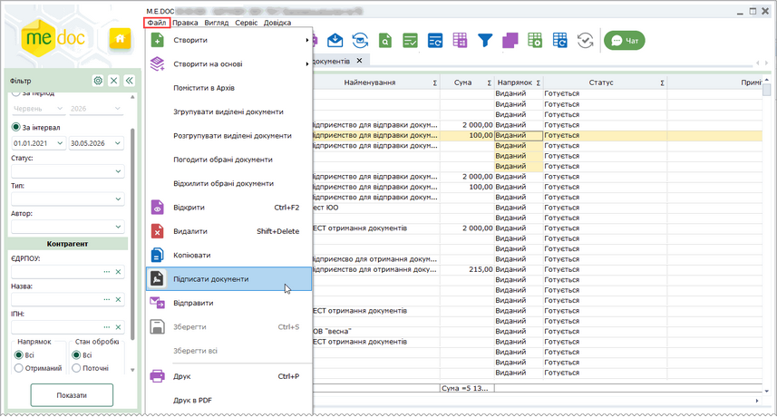

Натисніть, щоб збільшити малюнок

2. Відкриється вікно Підпис:

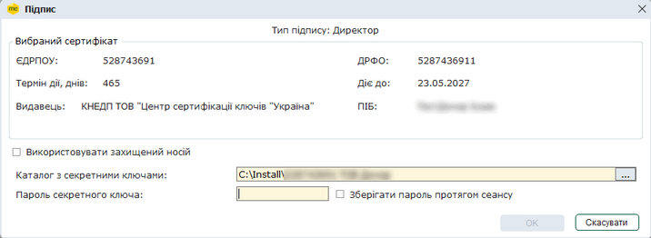

Натисніть, щоб збільшити малюнок

Оберіть каталог з секретними ключами, введіть пароль секретного ключа, натисніть кнопку ОК.

3. Після успішного підписання статус документів зміниться на Готовий до відправки.

Якщо [налаштовано підписання документів за посиланням](UCPDocSignSettings.html#ucpdocsignsettings-ucpdocsignsettings), на виконання команди Підписати документи буде відкрито вікно повідомлення з пропозицією відправити посилання на документ для підписання.

Якщо для підписання обрано лише один документ, команда має назву Підписати документ.

Повторна відправка ПН/РК, що не мають фінальної квитанції

Для повторної відправки ПН/РК, які не мають фінальної квитанції, у ЄРПН:

1. У меню Сервіс оберіть функцію Повторна відправка ПН/РК без фінальної квитанції.

2. Відкриється вікно Інтервал виписки документів:

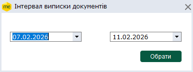

3. Оберіть інтервал відправки за датою виписки документів. За замовчуванням встановлено: кінець інтервалу – поточна дата, початок – за 4 дні до поточної дати. Дати можна обрати у вікні календаря, що відкриється по натисканню на полі з датою, або ввести вручну.

4. Для відбору ПН/РК натисніть Обрати.

5. Відкриється вікно повідомлення "Обрані документи будуть відправлені повторно. Продовжити?".

Для відправки ПН/РК натисніть ОК.

6. Відкриється вікно Вибір адресата. Оберіть адресу контролюючого органу (ДПС) та натисніть на кнопку ОК. Розпочнеться процес відправки документів.

7. Після завершення відправки документів система повідомить про результати виконання операції.

Повторна відправка ПН/РК, які не мають фінальної квитанції, може виконуватись автоматично за допомогою сервісу [Автоматичної обробки документів](UCGlobalAutoProcJournalFunc.html#ucglobalautoprocjournalfunc-pdocs_avto_func) або сервісу [Універсальної автоматичної обробки](AP.html#ap-uao_vidpravka_dfs).

Також зверніть увагу:

1. Після підписання документів комплектом електронних підписів, у відповідних місцях бланка документів встановлюється позначка ЕП, що свідчить про накладений підпис/печатку. Якщо в Картці підприємства [налаштовані зразки підписів](UCOrg.html#ucorg-sprorg_podp) директора/бухгалтера та печатки підприємства, то після підписання документа у відповідних місцях бланка відображаються завантажені у програму сканкопії зразків для більшої наочності.
Контрагент, що отримав документ, також бачить зображення підпису та печатки установи.

Для того, щоб документ роздруковувався разом із зображеннями підпису та печатки, необхідно встановити позначку в полі "Накладати графічні зображення підписів та печатки під час друку" в [Параметрах системи](FormCompanyParams.html#formcompanyparams-admcompanyparams_zv).

2. В первинному документі обов'язково заповнюється ЄДРПОУ контрагента, та, якщо є, - код філії. Виходячи з цих реквізитів безпосередньо перед відправленням первинного документа відбувається перевірка актуальності та наявність сертифікатів ЕП контрагентів. За умови наявності застарілих сертифікатів або їх відсутності система автоматично завантажує нові актуальні сертифікати із сайту КНЕДП. Якщо з будь-якої причини завантаження сертифікату неможливе, система повідомить про це користувача.

3. Якщо відправляється документ новому контрагенту, який відсутній в адресній книзі та/або в довіднику Контрагенти, його дані будуть збережені автоматично. У довіднику дані таких контрагентів зберігаються у групі Створені автоматично, дані контрагентів, що були збережені у довіднику при відправці документів також будуть автоматично оновлені з ЄДК. У разі якщо контрагент не є користувачем наших рішень з електронного документообігу, програма запропонує відправити [посилання на документ](UCDFDocsRstNew.html#ucdfdocsrstnew-obmin_link_sota). Аналогічно при отриманні документа від нового контрагента, автоматично створюється запис в адресній книзі та картка в довіднику Контрагенти.

4. Можливо налаштувати перевірку чи відповідає ім'я особи, що зазначена у документі, сертифікату, яким підписується документ. Для цього у модулі Адміністрування - Параметри системи на вкладці [Документообіг](FormCompanyParams.html#formcompanyparams-admcompanyparams_sdo)  у області налаштувань Перевіряти ПІБ відповідальної особи у документі з ПІБ сертифікату потрібно встановити опцію (опції):

- ПН та Дод.2, АН та РК – якщо опція встановлена, виконується перевірка відповідності імен для документів Податкова накладна, Додаток 2 до податкової накладної, Акцизна накладна та Розрахунок коригування акцизної накладної;
- Первинні документи – виконувати перевірку для первинних документів  (за умови, що у шаблоні первинного документа у властивостях поля, яке містить ПІБ відповідальної особи, встановлено опцію [ПІБ підписанта](UCRtfDocTemplate.html#ucrtfdoctemplate-pdocs_shablon_constructor_func_2));

Якщо опцію (опції) встановлено та сертифікат не належить вказаній особі, підписання документа не виконуватиметься. На вкладці Протокол перевірки після перевірки документа буде відображено повідомлення: Для вказаної відповідальної особи відсутній відповідний за іменем власника сертифікат підписання.

5. Документи, які були відправлені, неможливо видалити з реєстру документів, функція видалення заблокована. Такі документи можливо лише перемістити в [Архів](#pdocs_reestr_funkc-pdocs_reestr_arhiv).

6. Після отримання контрагентом документів надійде повідомлення про доставку.

Для режиму M.E.Doc.Корпорація передбачена можливість підписання головною організацією документів підзвітних організацій.

Функція доступна, якщо в [Параметрах системи](UCIncRst.html#ucincrst-m_e_doc-corp_nalasht) встановлено параметр Дозволити редагування ПН/РК філій. В цьому випадку будуть доступними для підписання документи підзвітних організацій у будь-яких статусах.

Якщо параметр відключено, то доступними для підпису головною організацією будуть тільки документи в статусах "На підпис" або "Готовий до подачі".

### Отримання, погодження та відхилення первинних документів

_Шлях у довідці: Розділи програми › Первинні документи › Робота з первинними документами › Отримання, погодження та відхилення первинних документів_

Зверніть увагу! Для документів, прийнятих електронною поштою, функція видалення заблокована.

Відправлені контрагентом електронною поштою первинні документи надходять як звичайна вхідна кореспонденція.

Отримати повідомлення (перевірити наявність вхідних повідомлень) можливо, скориставшись одним із способів:

- на панелі інструментів кнопкою
- із меню Файл - Отримати повідомлення;
- за допомогою клавіші F9.

Отримані первинні документи розміщуються у групі Вхідні, стан Отримані. Як тільки документи отримано, відправнику надійде повідомлення про доставку.

Користувач повинен переглянути отримані документи та прийняти рішення: погодити документ, відхилити або відредагувати його.

Для цього на панелі стану документа, виберіть закладку Наступні дії і натисніть Погодити документ, Відхилити або Відредагувати документ.

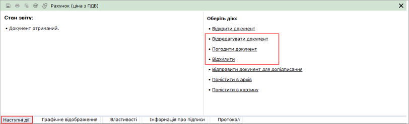

Натисніть, щоб збільшити малюнок

- Погодити документ - обирається за умови, що отриманий документ не містить помилок та повністю влаштовує отримувача.
Відправнику документа буде автоматично надіслано повідомлення про погодження документа.

- Відхилити - обирається за умови наявності в документі помилок та/або небажання співпрацювати.
В цьому випадку необхідно вказати причину відхилення документа.

Якщо натиснути на кнопку Можливі відповіді, відкривається перелік можливих стандартних відповідей. Передбачено можливість самостійно додавати стандартні відповіді. Для цього введіть в текстове поле необхідний текст причини відхилення та натисніть Запам’ятати поточну.

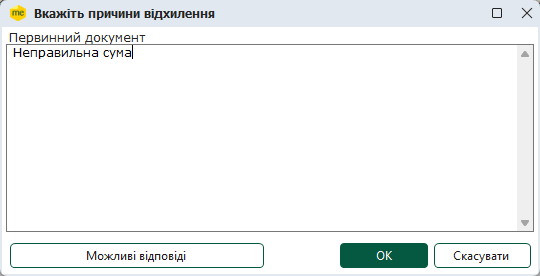

Автору документа буде автоматично надіслано повідомлення про відхилення документа із зазначенням причини відмови.

- Відредагувати документ - обирається за умови, що первинний документ містить помилки або неточності та отримувач має намір виправити їх.
Користувач вносить в документ бажані зміни (див. розділ [Версії документа](UCDFDocsRstNew.html#ucdfdocsrstnew-pdocs_reestr_funkc_vesii)).

### Імпорт первинних документів

_Шлях у довідці: Розділи програми › Первинні документи › Робота з первинними документами › Імпорт первинних документів_

В цьому розділі:

[Імпорт документів](#pdocs_reestr_funkc-imp_perv)

[Зміна назви платника з умовним ІПН](#pdocs_reestr_funkc-imp_perv)

Імпорт документів

Дана функція призначена для імпорту Податкових накладних та Додатків 2, створених в інших бухгалтерських системах або Електронних первинних документів, отриманих від контрагентів у вигляді зовнішніх файлів.

Функція імпорту запускається із меню Файл - Імпорт наступними командами:

- Імпорт звітів - для XML-формату;
- Імпорт ПН/Дод2 з DBF - для формату DBF.

1. У меню оберіть команду Файл - Імпорт та далі потрібний формат.

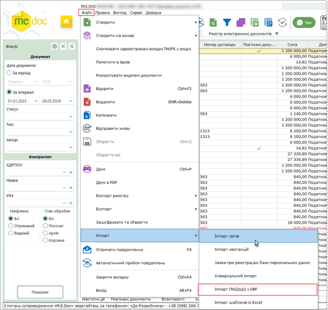

Натисніть, щоб збільшити малюнок

2. На виконання команди відкриється вікно вибору файлів вказаного формату, які імпортуються.

3. Вкажіть шлях до каталогу розміщення файлів. Оберіть файли та натисніть Відкрити для початку процесу імпорту.

4. Після закінчення імпорту система виведе протокол імпорту даних.

[До початку](#pdocs_reestr_funkc-imp_perv)

Зміна назви платника з умовним ІПН

Для імпортованих документів з умовним ІПН 100000000000 виконується заміна значення поля Особа (платник податку)-покупець на «Неплатник». Для цього виконайте наступні дії:

1. Виділіть в реєстрі імпортовані документи.

2. Оберіть пункт меню Сервіс - Умовний ІПН в ПН та Дод.2.

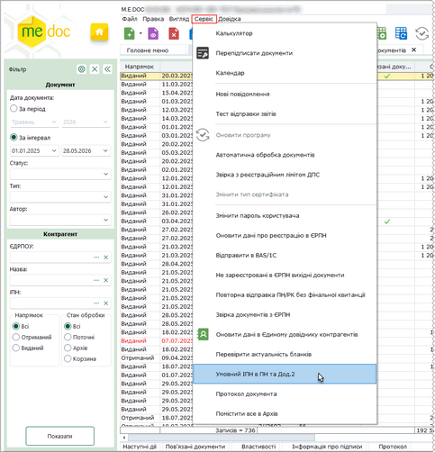

Натисніть, щоб збільшити малюнок

Відкриється вікно запиту на підтвердження дії.

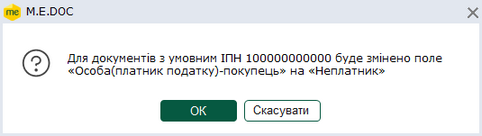

3. У вікні запиту натисніть на кнопку Ок для виконання заміни.

Після виконання заміни з'явиться вікно повідомлення про оновлення документів.

[До початку](#pdocs_reestr_funkc-imp_perv)

### Друк документів у PDF

_Шлях у довідці: Розділи програми › Первинні документи › Робота з первинними документами › Друк документів у PDF_

Дана функція дозволяє зберегти обрані документи на диску комп’ютера у файлах формату .pdf.

Для друку документів у PDF необхідно виділити потрібні документи.
У реєстрі документів реалізована можливість друку як одного файлу, так і групи файлів одночасно. Для групового друку документів виділіть потрібне курсором миші, утримуючі клавіші <Ctrl> або <Shift>.

Для друку документів у PDF виконайте дії у наступній послідовності:

1. Оберіть один із способів:

- із контекстного меню команда Друк в PDF;
- команда меню Файл - Друк в PDF.

2. Відкриється вікно Друк.

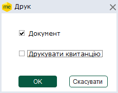

Встановіть позначки, що відповідають документам, які необхідно зберегти:

- Документ - друкувати у PDF документ;
- Друкувати квитанцію - друкувати у PDF квитанції до документа (за наявності).

Для продовження виконання операції натисніть кнопку ОК.

2. У вікні Огляд папок вкажіть каталог, у якому потрібно зберегти файли .pdf.

3. Система повідомить про закінчення операції друку.

У обраному каталозі буде створено папку, назва якої відповідає назві збереженого документа. Всі вкладення до документа (якщо такі додані до документа) та сам документ зберігаються у окремих файлах формату PDF.

У файлах PDF відображається факсиміле підписів, що накладені на документ та вкладення (за наявності), та інформація про підписантів (за наявності відмітки у розділі [Адміністрування – Параметри системи – Документообіг](FormCompanyParams.html#formcompanyparams-admcompanyparams_sdo) – Накладати інформацію про підписантів).

Також функція друку документа  у PDF доступна і у відкритому вікні документа:

- команда меню Файл - Друк в PDF.

Із вікна відкритого документа у форматі PDF зберігається тільки поточний документ.


