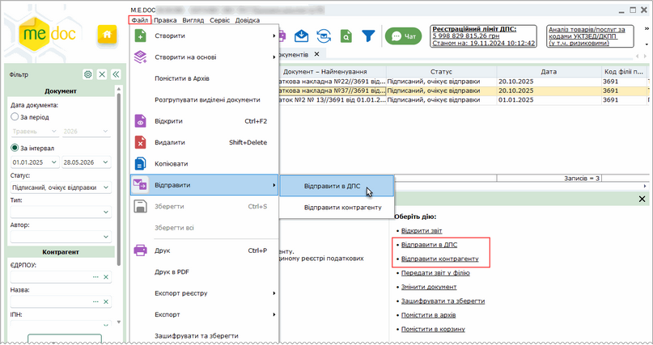
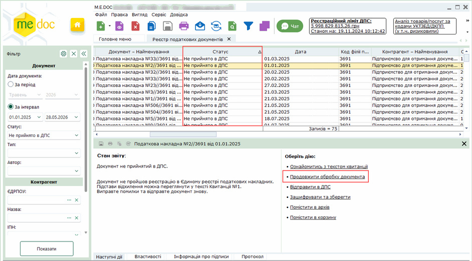
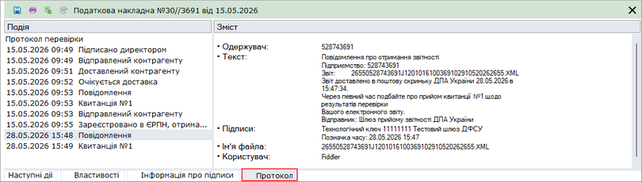
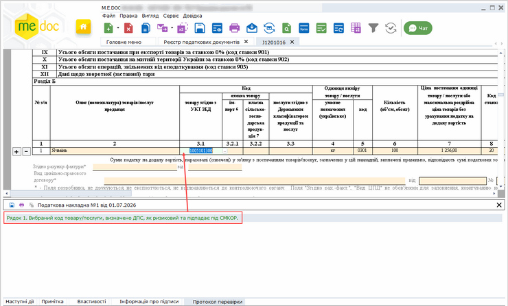
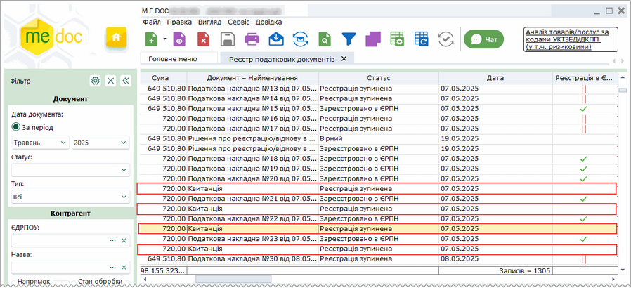
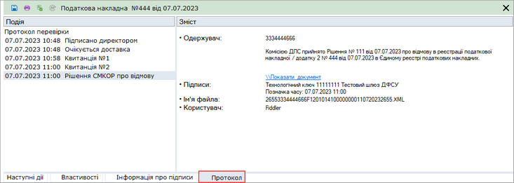
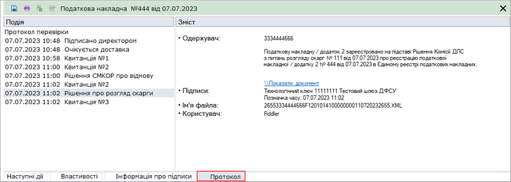

[← Зміст довідки](../)


# Обробка податкових накладних

## Обробка податкових накладних

_Шлях у довідці: Розділи програми › Первинні документи › Реєстр податкових документів › Обробка податкових накладних_

В цьому розділі:

[Відправка документів вручну](#pdocs_reestr_marshrut-pdocs_reestr_marshrut)

[Відправка документів за допомогою Автоматичної обробки документів](#pdocs_reestr_marshrut-pdocs_reestr_marshrut)

[Відправка Додатків 2 контрагентам через сервіс ДПС](#pdocs_reestr_marshrut-pdocs_reestr_marshrut)

[Призупинення реєстрації Податкових накладних та Додатків 2 з причини наявності Критеріїв оцінки ризиків](#pdocs_reestr_marshrut-pdocs_reestr_marshrut)

Зверніть увагу!

З метою полегшення роботи з первинними документами, для Податкових накладних та Додатків 2 передбачені спеціальні сценарії, за якими вони обробляються, - маршрути. Маршрути діють для документів, які відправляються через Автоматичну обробку документів.

Маршрут обробки задається в [налаштуваннях обміну документами](FormDocParams.html#formdocparams-formdocparams). За необхідності в будь-який момент маршрут можна змінити. Однак для документів, які були відправлені, маршрут запам'ятовується, документи проходять по попередньо заданому циклу незмінно.

При відправленні ПН/РК вручну користувачу дозволено самостійно обирати адресата (із Наступних дій – Відправити в ДПС чи Відправити контрагенту).

Але, дозвіл не поширюється на:

- ПН/РК з умовними ІПН 100000000000, 200000000000, 300000000000, 400000000000, 500000000000 та 600000000000 - такі документи відправляються тільки на реєстрацію в ДПС;
- РК з від’ємними сумами та ІПН контрагента - ці документи відправляються тільки контрагенту.

Відправка документів вручну

Створений, перевірений, підписаний документ (Податкова накладна/Дод. 2) можливо відправити контрагенту або на реєстрацію в ЄРПН.

Щоб відправити документ вручну, виділіть документ або декілька документів у таблиці реєстру та оберіть один із способів:

- на вкладці Наступні дії оберіть команду Відправити в ДПС або Відправити контрагенту;
- у меню оберіть пункт Файл - Відправити;
- у контекстному меню оберіть пункт Відправити.

Натисніть, щоб збільшити малюнок

Відправка документів на реєстрацію у ДПС

1. Оберіть необхідний документ (документи) у таблиці реєстру та виконайте команду Відправити в ДПС.

2. Дочекайтесь квитанції про результати обробки документа. Зареєстрованому документу присвоюється реєстраційний номер, він набуває статусу Зареєстровано в ЄРПН. Якщо документ не прийнято він набуває статусу Не прийнято в ДПС.

У правому верхньому кутку відкритого документа відображається штамп-резолюція (зареєстровано або відхилено ДПС).

3. Документ, зареєстрований у ЄРПН, можливо відправити контрагенту, обравши команду Відправити контрагенту.

Відправка документів контрагенту

Можливо відправляти як не зареєстровані у ЄРПН документи (для попереднього узгодження з контрагентом), так і документи, що вже пройшли реєстрацію у ЄРПН. Проводити узгодження документа з контрагентом необхідно перед реєстрацією документа у ДПС.

1. Оберіть необхідний документ (документи) у таблиці реєстру та виконайте команду Відправити контрагенту.

2. Якщо документ був відправлений на узгодження контрагенту, дочекайтесь квитанції з відповіддю контрагента. Затверджений документ набуває статусу Затверджений контрагентом, не затверджений - Відхилений контрагентом.

У правому верхньому кутку відкритого документа в залежності від статусу відображаються штампи про обробку контрагентом: Документ доставлений контрагенту, Документ прийнятий контрагентом, Документ не прийнятий контрагентом.

Затверджений (або відхилений) контрагентом документ можливо відправити на реєстрацію у ЄРПН, обравши команду Відправити у ДПС.

3. Якщо відправляється зареєстрований у ЄРПН документ, у контрагента-отримувача попередньо узгоджений документ (якщо такий існує) буде автоматично замінений зареєстрованим документом.

Зверніть увагу! Документ не потрібно копіювати! В ДПС та контрагенту відправляється той самий документ! У правому верхньому кутку відкритого документа, разом із штампом-резолюцією про обробку документа в ДПС, в залежності від статусу також відображаються штампи про обробку контрагентом.

Якщо документ набув статусу Не прийнято в ДПС, подальша відправка такого документа блокується. Однак, передбачена можливість цей неприйнятий документ відправити контрагенту.

Для цього в Наступних діях оберіть опцію Продовжити обробку документу. Тепер документ можна відправити контрагенту, натиснувши Відправити контрагенту.

Натисніть, щоб збільшити малюнок

Переглянути шлях, який пройшов документ під час обробки, можна на вкладці Протокол. Щоб переглянути детальну інформацію, оберіть операцію у розділі Подія. У правій частині вкладки відобразиться детальна інформація про виконану операцію або вміст отриманих квитанцій:

Натисніть, щоб збільшити малюнок

На будь-якому етапі документ може бути переміщений у Архів. Переміщення в архів, виконується командою Перемістити в Архів, яка доступна у меню Файл, контекстному меню та на вкладці Наступні дії.

[До початку](#pdocs_reestr_marshrut-pdocs_reestr_marshrut)

Відправка документів за допомогою Автоматичної обробки документів

За допомогою [Автоматичної обробки документів](UCGlobalAutoProcJournalFunc.html#ucglobalautoprocjournalfunc-pdocs_avto_func) або [Універсальної автоматичної обробки](AP.html#ap-uao_priznach) Податкові накладні та Додатки 2 обробляються за певним сценарієм, які в програмному комплексі названі маршрутами.

Маршрут представляє собою задану послідовність етапів обробки документа та виражений доступними діями, які можуть бути виконані з цим документом, в залежності від статусу (етапу обробки).

Маршрут обробки задається в [налаштуваннях обміну документами](FormDocParams.html#formdocparams-formdocparams).

За необхідності в будь-який момент маршрут можна змінити. Однак для документів, які були відправлені, маршрут запам'ятовується, документи проходять по попередньо заданому циклу незмінно.

Передбачено 3 маршрути обробки документів:

- включає в себе послідовно: реєстрацію в ЄРПН - відправку зареєстрованих ПН контрагенту;
- включає в себе послідовно: попереднє узгодження з контрагентом вмісту ПН - реєстрацію в ЄРПН - відправку зареєстрованих ПН контрагенту;
- включає в себе тільки реєстрацію в ЄРПН.

Рух документів, що здійснюватиметься за допомогою автоматичної обробки, відбуватиметься виключно згідно обраного маршруту. Наприклад, при виборі повного циклу, готова підписана накладна буде відправлятися контрагенту на узгодження, тільки після затвердження контрагентом вона відправлятиметься у ДПС на реєстрацію і, відповідно, лише зареєстрована накладна відправиться контрагенту.

[До початку](#pdocs_reestr_marshrut-pdocs_reestr_marshrut)

Відправка Додатків 2 контрагентам через сервіс ДПС

Відповідно до рекомендацій ДПС з використання електронного сервісу ДПС Single Window of Electronic Documents (сервіс SWinED) для обміну податковими документами між контрагентами у програмі реалізовано автоматичну відправку Податкових накладних, Розрахунків коригування до ПН, Акцизних накладних та Розрахунків коригування до АН через сервіс обміну ДПС.

Сервіс ДПС передбачає підтвердження отримання електронного документа – фіксує дату отримання документів отримувачем (покупцем) від постачальника.

Якщо сервіс SWinED тимчасово недоступний, відправка документів автоматично виконуватиметься через платформу ПТАХ.

[До початку](#pdocs_reestr_marshrut-pdocs_reestr_marshrut)

Призупинення реєстрації Податкових накладних та Додатків 2 з причини наявності Критеріїв оцінки ризиків

Постановою Кабінета Міністрів України від 11 грудня 2019 р. № 1165 "Про затвердження порядків з питань зупинення реєстрації податкової накладної/розрахунку коригування в Єдиному реєстрі податкових накладних" затверджено:

- [Порядок зупинення реєстрації податкової накладної/розрахунку коригування в Єдиному реєстрі податкових накладних](https://zakon.rada.gov.ua/laws/show/1165-2019-%D0%BF#n12);
- [Порядок розгляду скарги щодо рішення про відмову в реєстрації податкової накладної/розрахунку коригування в Єдиному реєстрі податкових накладних](https://zakon.rada.gov.ua/laws/show/1165-2019-%D0%BF#n199).

Податковим кодексом впроваджено механізм зупинення органами ДПСУ реєстрації «ризикових» податкових накладних у ЄРПН та відновлення реєстрації за умови надання платником відповідних пояснень та доказів (пункт 201.16 ст. 201 ПКУ).

У програмі реалізовано відображення попередження про наявність у ПН/РК кодів УКТ ЗЕД, що підпадають під критерії оцінки ризиків СМКОР. Попередження виводиться на вкладці Протокол перевірки під час виконання перевірки заповнення ПН/РК:

Натисніть, щоб збільшити малюнок

Призначення попередження - інформувати платника ПДВ про вірогідність блокування ПН/РК, оскільки, використані коди належать до "Переліку кодів товарів згідно з УКТ ЗЕД, кодів продукції та послуг згідно з ДКПП, які застосовуються для визначення відповідності ПН/РК, які подано на реєстрацію до ЄРПН критеріям ризиковості здійснення операції при здійсненні моніторингу", цей перелік [визначено ДПС](https://tax.gov.ua/zakonodavstvo/podatkove-zakonodavstvo/nakazi/74373.html).

Поява попередження не впливає на відправку та подальшу обробку ПН/РК.

У разі призупинення реєстрації Податкової накладної/Розрахунку коригування з причини наявності критеріїв ризиковості платника податку або критеріїв ризиковості здійснення операцій виконуються наступні операції:

1. Продавець та Покупець отримують Квитанцію про зупинення реєстрації ПН/РК. Для Продавця квитанція відображається на вкладці Протокол відповідного документа (ПН/РК). У квитанції зазначаються підстави, на яких зупинено реєстрацію.

Для Покупця квитанція відображається у Реєстрі первинних документів як окремий документ:

Натисніть, щоб збільшити малюнок

2. Продавець (Покупець) заповнює та відправляє у ДПС пакет документів, що є достатнім для прийняття Комісією остаточного рішення про прийняття або відхилення ПН/РК. Платник має можливість подавати документи за формами:

- Повідомлення про подання пояснень та копій документів щодо податкових накладних/розрахунків коригування, реєстрацію яких зупинено, що містить номер ПН/РК, по якій відмовлено у реєстрації в ЄРПН, та надаються пояснення і, при необхідності, вказується кількість документів, які підтверджують операції, зазначені у призупиненій ПН/РК (кількість додатків). Документ створюється в Реєстрі звітів як головний документ пакету.

Повідомлення про подання пояснень та копій документів ... можна створити у розділі Первинні документи, для цього оберіть ПН/РК, що маються статус Реєстрація зупинена, та виконайте команду [Створити на основі -  Повідомлення про подання пояснень та копій документів СМКОР](Creat_doc_.html#creat_doc_-creat_doc_). Створений таким чином документ також буде збережений у модулі Реєстр звітів.

- Документ довільного формату (для подання сканкопій), у якому кріпляться сканкопії, які підтверджують операції, зазначені у призупинених ПН/РК. Для кожної сканкопії створюється окремий документ. Документ створюється в Реєстрі звітів як підпорядкований документ пакету до Повідомлення про подання пояснень ...
- У разі наявності критеріїв ризиковості здійснення операцій платник має можливість подавати Додаток 5 до Порядку зупинення реєстрації податкової накладної/розрахунку коригування (Таблиця даних платника податку на додану вартість), що створюється в Реєстрі звітів  як окремий документ.

У документі заповнюється Таблиця даних платника податку, у яку вноситься Код згідно з КВЕД, та заповнюється одна з колонок Код згідно УКТ ЗЕД/ДКПП (придбання (отримання), ввезення на митну територію України товарів/послуг або Код згідно УКТ ЗЕД/ДКПП (постачання/надання) товарів/послуг. Заповнення обох колонок одночасно не допускається!

- За наявності критеріїв ризиковості платника податку платником подається ПОВІДОМЛЕННЯ про подання інформації та копій документів щодо невідповідності платника податку критеріям ризиковості платника податку.

Детально про створення пакету документів, що необхідний для розгляду Комісією ДПС, дивіться у розділі [Реєстр звітів](UCDocRstByPer5.html#ucdocrstbyper5-rdoc_robota_stvor).

3. Комісія ДПС розглядає наданий пакет документів, приймає та надсилає РІШЕННЯ про реєстрацію/відмова в реєстрації податкових накладних/розрахунків коригування в Єдиному реєстрі податкових накладних. Якщо ПН/РК зареєстровані, у РІШЕННІ робляться відмітки у полі, що містить інформацію про прийняте рішення. Якщо у реєстрації відмовлено, у РІШЕННІ проставляється відмітка у відповідному полі та зазначається причина відмови.

Як для Покупця, так і для Продавця, РІШЕННЯ відображається окремим документом у Реєстрі податкових документів.

Інформація про отримані Рішення відображатиметься на вкладці Протокол у розділах Рішення про розгляд скарги або Рішення СМКОР про реєстрацію, Рішення СМКОР про відмову тих ПН/РК, щодо яких вони були отримані:

Натисніть, щоб збільшити малюнок

4. Якщо платник податку на додану вартість не згідний з рішенням Комісії ДПС щодо відмови у реєстрації ПН/РК, він має право подати скаргу на рішення комісій.

Скарга на рішення про відмову у реєстрації ПН/РК подається платником податку в електронній формі, детально про створення пакету документів, що необхідний для оскарження рішення Комісії ДПС, дивіться у модулі [Реєстр звітів](UCDocRstByPer5.html#ucdocrstbyper5-rdoc_robota_stvor).

За результатами розгляду скарги Комісія ДПС з питань розгляду скарг приймає РІШЕННЯ за результатами розгляду скарги на рішення про відмову у реєстрації ПН/РК в Єдиному реєстрі податкових накладних, та надсилає його платнику податку. У РІШЕННІ робляться відмітки у полі, що містить інформацію про прийняте рішення. Документ доступний у модулі Реєстр звітів.

Інформація про отримані Рішення про розгляд скарги відображатиметься на вкладці Протокол тих ПН/РК, щодо яких вони були отримані:

Натисніть, щоб збільшити малюнок

Якщо платник податку на додану вартість не згідний з будь-яким з рішенням Комісії ДПС, яка приймає рішення про реєстрацію ПН/РК, та/або з рішенням Комісії ДПС з питань розгляду скарг щодо відмови у реєстрації ПН/РК, він має право оскаржити рішення Комісії у суді.

[До початку](#pdocs_reestr_marshrut-pdocs_reestr_marshrut)


