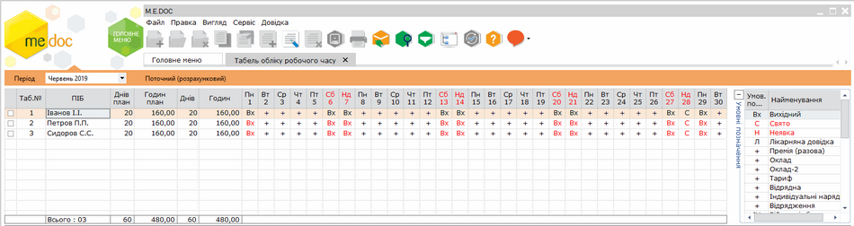
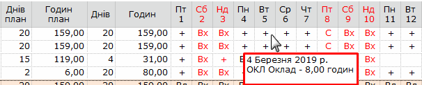
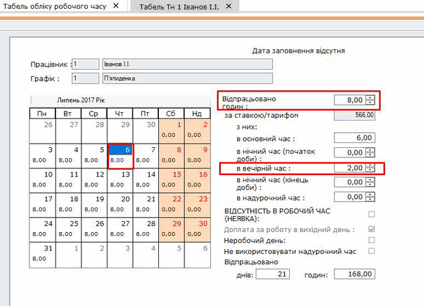
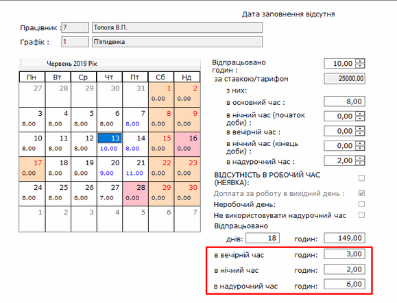
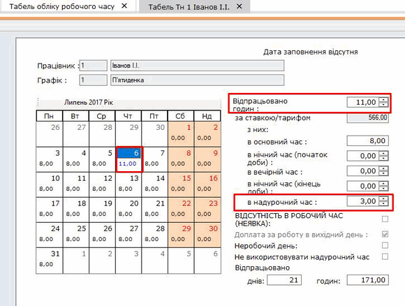
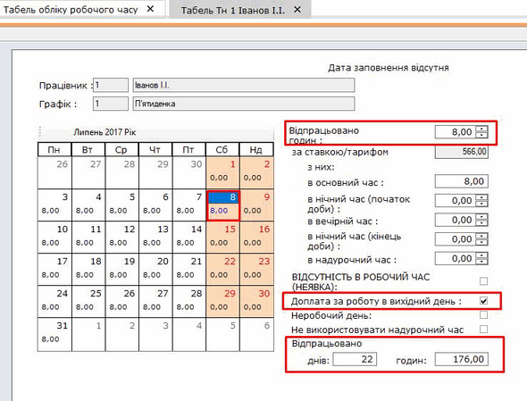
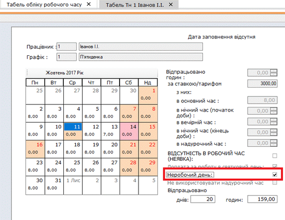
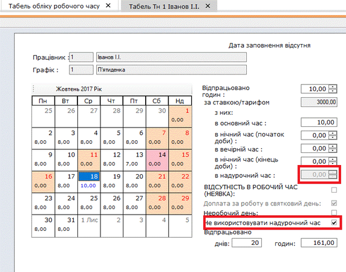
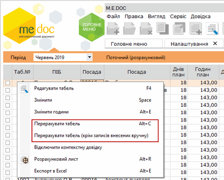

[← Зміст довідки](../)


# Табель обліку робочого часу

## Табель обліку робочого часу

_Шлях у довідці: Розділи програми › Зарплата › Табель обліку робочого часу_

Табель застосовується для обліку використання робочого часу всіх категорій працівників для:

- контролю виконання працівниками встановленого режиму робочого часу;
- отримання даних, про відпрацьований час;
- розрахунку заробітної плати;
- складання статистичної звітності.

Натисніть, щоб збільшити малюнок

Табель заповнюється автоматично і залежить від графіка роботи працівника.

Якщо є відхилення від норми: відсутність працівника, неявка без поважних причин - це необхідно внести в табель.

Для того, щоб відмітити неявку працівника в табелі, встановіть курсор в необхідну клітинку та натисніть Пробіл.

Лікарняні, відпустка, відпустка без збереження, відрядження, навчальна відпустка відображаються в табелі автоматично, вони підтягуються з [розрахункового листа](CalcPaperMng.html#calcpapermng-reestrstatement_calcpapermng) або [реєстру документів](PayDoc.html#paydoc-reestrstatement_paydoc).

У табелі також можливо відобразити роботу в надурочний час, нічний та вечірній час, святкові, вихідні дні, оплата яких буде розраховуватися автоматично і відображатися в розрахунковому листі та розрахунковій відомості.

Для того, щоб змінити кількість годин, відпрацьованих у основний час, встановіть курсор в необхідну клітинку та натисніть комбінацію клавіш Alt+E, або оберіть команду контекстного меню Змінити години. Відкриється вікно Створення запису. У полі Кількість годин встановіть необхідну кількість годин та натисніть кнопку Зберегти.

Користувач може виконати персональні налаштування зовнішнього вигляду табелю. Можливо змінити набір даних, що відображено у вікні табелю, змінити скорочені назви колонок даних тощо. Налаштування відображення табелю виконуються у розділі [Адміністрування - Налаштування - Вигляд - Табель  (умовні позначення)](PayToolsVyd.html#paytoolsvyd-reestrstatement_paytoolsvyd).

При наведені курсору на позначки у табелі за замовчуванням виводить вікно з контекстною підказкою:

Ця функція увімкнена за замовчуванням. Щоб відключити/включити відображення вікна з підказкою, натисніть праву кнопку миші, та у контекстному меню оберіть Відключити контекстну довідку або Включити контекстну довідку.

---

Для того, щоб проставити Нічні та вечірні години:

1. Виділіть робочий день потрібного працівника, де потрібно встановити нічні та вечірні години. Подвійним натисканням лівої клавіші миші відкрийте табель працівника.

2. У полях в нічний час (початок доби), в вечірній час, в нічний час (кінець доби) встановіть кількість годин роботи, які припадають на ніч або вечір.

Поле в основний час відображає та регулює суму нічних, вечірніх годин для запобігання перевищення загального часу по графіку.

Натисніть, щоб збільшити малюнок

В нижній частині табелю відображається інформація по загальній кількості годин відпрацьованих у вечірній, нічний і надурочний час.

Натисніть, щоб збільшити малюнок

3. Збережіть внесені дані за допомогою кнопки .

Розрахунок доплати відбудеться автоматично і відобразиться в розрахунковому листі.

Нагадаємо, роз'яснення розрахунку можливо переглянути, натиснувши F3.

---

Для того, щоб проставити Надурочний час:

1. Виділіть робочий день потрібного працівника, де потрібно встановити надурочний час. Подвійним натисканням лівої клавіші миші відкрийте табель працівника.

2. В полі в надурочний час встановіть кількість відпрацьованих годин надурочно. При цьому в полі Відпрацьовано годин збільшується кількість години загального відпрацьованого часу.

Натисніть, щоб збільшити малюнок

3. Збережіть внесені дані за допомогою кнопки .

Розрахунок доплати відбудеться автоматично і відобразиться в розрахунковому листі.

Нагадаємо, роз'яснення розрахунку можливо переглянути, натиснувши F3.

---

Для того, щоб проставити Відсутність на роботі без поважних причин (прогул):

1. Виділіть робочий день потрібного працівника, коли треба проставити прогул.

2. Оберіть один із наступних варіантів:

- натисніть праву кнопку миші та у контекстному меню оберіть пункт Змінити;
- натисніть клавішу Пробіл.

---

Для того, щоб проставити роботу у вихідний та/або святковий день:

1. Виділіть вихідний день працівника. Подвійним натисканням лівої клавіші миші відкрийте табель працівника.

2. В полі Відпрацьовано годин встановіть кількість відпрацьованих годин у вихідний день. При цьому в полі Відпрацьовано всього автоматично збільшується кількість години загального відпрацьованого часу та на день.

Натисніть, щоб збільшити малюнок

3. Збережіть внесені дані за допомогою кнопки .

Розрахунок доплати відбудеться автоматично і відобразиться в розрахунковому листі: збільшується виплата за додатковий робочий день в розмірі 100%, та доплата за вихідний або святковий день в розмірі 100 %.

Змінити відсотки ми можемо в [Налаштуваннях - Види оплат - Доплата за вихідні, святкові - закладка Додаткові показники](PayToolsOplat.html#paytoolsoplat-reestrstatement_paytoolsoplat).

---

Відмітка Неробочий день може використовуватись для працівників у яких немає чіткого графіку роботи.

1. Виділіть робочий день потрібного працівника, де потрібно встановити Неробочий день. Подвійним натисканням лівої клавіші миші відкрийте табель працівника.

    2. В полі Неробочий день встановіть відмітку.  Цей день для працівника вважається вихідним.

Натисніть, щоб збільшити малюнок

Відмітка Не використовувати надурочний час:

1. Виділіть робочий день потрібного працівника, де потрібно встановити Не використовувати надурочний час. Подвійним натисканням лівої клавіші миші відкрийте табель працівника.

    2. В полі Не використовувати надурочний час встановіть відмітку. При встановленні кількості відпрацьованих годин понад норму, в полі в надурочний час автоматично не будуть проставлятися години.

Натисніть, щоб збільшити малюнок

---

Перерахунок табелю можна здійснити двома способами:

- Оберіть необхідного працівника, натисніть праву кнопку миші та оберіть Перерахунок табелю.

Після даного виду перерахунку в табелі обліку робочого часу буде видалено інформацію введену вручну (робота в нічний час, вечірній час, вихідний день, святковий день, надурочний час та неявка);

- Оберіть необхідного працівника, натисніть праву кнопку миші та оберіть Перерахунок табелю (крім записів внесених вручну).

Після даного виду перерахунку інформація внесена в "ручному" режимі видалена не буде. Інформація в табелі робочого часу буде оновлена відповідно до інформації в розрахунковому листі.

Натисніть, щоб збільшити малюнок

---

Для вивантаження Табелю обліку робочого часу в Excel  скористайтесь одним із наступних способів:

- В меню Файл  оберіть пункт Експорт – Експорт. У вікні, що відкриється, вкажіть шлях для збереження файлу та назву документу.
- Натисніть праву кнопку миші та оберіть пункт Експорт в Excel. У вікні, що відкриється, вкажіть шлях для збереження файлу та назву документу.


