[← Зміст довідки](../)


# Реєстр документів

## Реєстр документів

_Шлях у довідці: Розділи програми › Зарплата › Реєстр документів_

В цьому розділі:

[Як здійснити нарахування різних видів оплат](#paydoc-reestrstatement_paydoc)

[Формування платіжок на виплату нарахування](#paydoc-reestrstatement_paydoc)

[Відправка розрахункових листів](#paydoc-reestrstatement_paydoc)

[Швидкий доступ до налаштувань шаблонів документів](#paydoc-reestrstatement_paydoc)

Розділ Реєстр документів призначений для одночасного групового нарахування та виплати обраним (або всім) співробітникам:

- премії;
- тарифної або учбової відпустки;
- лікарняного за рахунок підприємства та за рахунок ФСС;
- лікарняного по догляду за дитиною;
- лікарняного по вагітності.

Також передбачена можливість здійснити виплату лікарняного за рахунок ФСС та [відправити розрахункові листі працівникам по e-mail](#paydoc-reestrstatement_paydoc).

Після додавання та розрахунку видів оплат, вони будуть автоматично відображатись у розрахунковому листі працівника та розрахунковій відомості.

1. На панелі інструментів оберіть вид документа із списку, що відкривається.

В залежності від обраного виду документа, у робочому полі модуля буде змінюватись кількість та набір колонок у таблиці.

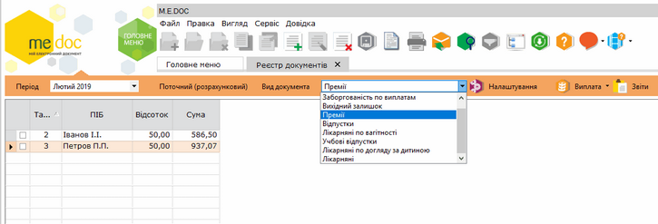

Натисніть, щоб збільшити

2. Необхідно вказати для яких саме співробітників здійснювати нарахування. Для цього на панелі інструментів натисніть кнопку Створити запис.

3. Відкриється окреме вікно Довідник співробітників. Встановіть відмітки напроти співробітників, яким потрібно здійснити нарахування та натисніть кнопку Вибрати.

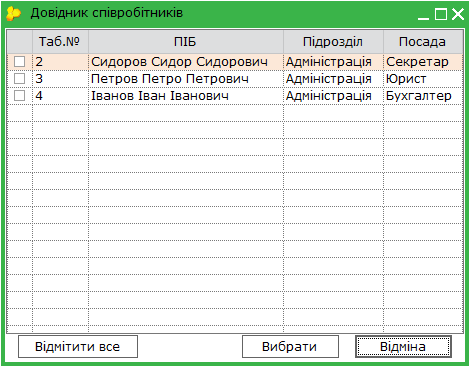

Нарахування виконуються автоматично, на підставі відсотків, вказаних в налаштуваннях програмного комплексу (Адміністрування - Налаштування - Вигляд - Шаблони документів. Перейти до налаштувань також можна за допомогою [швидкого доступу до налаштувань шаблонів документів](#paydoc-reestrstatement_paydoc).

4. У таблиці робочої області встановіть відмітки для тих співробітників, яким потрібно виконати виплату.

Для того, щоб відмітити всіх співробітників у переліку, натисніть правою клавішею миші у довільному місці робочої області та у контекстному меню оберіть команду Відмітити все.

Відповідно, щоб зняти відмітки з усіх співробітників, оберіть команду Зняти відмітки.

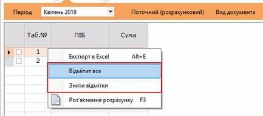

Натисніть, щоб збільшити

Можливо переглядати списки працівників по підрозділам підприємства. Для цього скористайтеся кнопкою панелі інструментів По підрозділам , або натисніть комбінацію клавіш Ctrl+L, дізнатися більше.

Якщо фільтр По підрозділам увімкнено, вікно розділу Реєстр документів має вигляд:

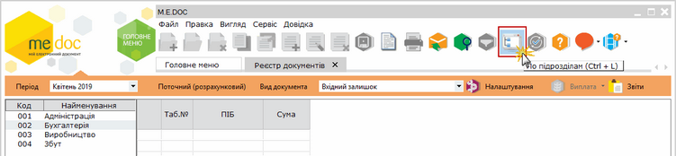

Натисніть, щоб збільшити

Для того щоб переглянути список співробітників певного підрозділу, оберіть найменування підрозділу у лівій частині вікна. У правій частині вікна буде відображено список співробітників, що належать до обраного підрозділу.

На панелі інструментів оберіть команду Виплата - Виконати. Праворуч від таблиці з'явиться додаткова колонка Виплата, що містить суми нарахувань.

За необхідності відмінити нарахування, оберіть команду Виплата - Відмінити.

Роз'яснення розрахунку можливо переглянути, натиснувши F3 в розрахунковому листі.

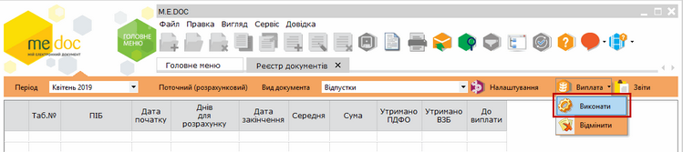

Натисніть, щоб збільшити

При виборі виду документа Лікарняні у обраних працівників вказується дата початку, дата закінчення та номер лікарняного листа. Інші колонки заповнюються автоматично.

Зверніть увагу! Нараховані лікарняні відображаються у заробітній платі, розрахунковому листі та розрахунковій відомості як нараховані, але не виплачені. Для здійснення виплати по лікарняному скористайтесь документом Заборгованість по виплатам.

У документі Заборгованість по виплатам відображається дані про невиплачені лікарняні. Він формується автоматично, на підставі нарахованих лікарняних.

Після виплати лікарняного є можливість сформувати та заповнити автоматично Повідомлення про виплату коштів.

Натисніть кнопку Звіти. У вікні, що відкриється, натисніть 2 рази лівою кнопкою миші на рядку Повідомлення про виплату коштів. У наступному вікні оберіть спосіб створення звіту та натисніть Сформувати:

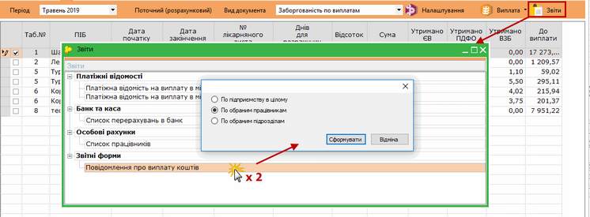

Натисніть, щоб збільшити

Документ буде відкрито у окремій вкладці.

[До початку](#paydoc-reestrstatement_paydoc)

Передбачено можливість формування бухгалтерських звітів на підставі нарахованих видів оплат.

1. Для формування звітів на панелі інструментів натисніть на кнопку Звіти.

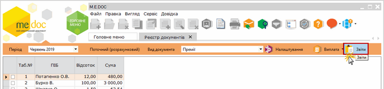

Натисніть, щоб збільшити

2. Відкриється вікно Звіти.

Оберіть серед запропонованих потрібний звіт та натисніть двічі лівою клавішею миші.

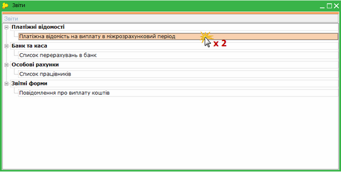

Натисніть, щоб збільшити

3. Відкриється вікно попередніх налаштувань звіту.

Для кожного звіту параметри налаштувань індивідуальні. На малюнку представлений типовий набір параметрів для формування звіту.

У блоці атрибутів Підприємство встановіть позначку біля варіанту, на підставі яких саме даних формувати звіт:
- по всьому підприємству;
- по обраним працівникам;
- по обраним підрозділам.

За умови вибору варіанту По обраним працівникам обов'язково попередньо потрібно відмітити у робочій області тих працівників, для яких сформується звіт.

За умови вибору варіанту По обраним підрозділам у блоці Лист підрозділів, що розташований нижче відобразиться перелік підрозділів підприємства. Встановіть галочки напроти тих підрозділів, на підставі даних яких потрібно сформувати звіт. Для того, щоб виділити всі підрозділи одночасно, натисніть кнопку Вибрати всі, для того, щоб знати виділення з усіх записів, натисніть кнопку Зняти всі.

- У полі Друк оберіть тип виводу звіту на друк: кольоровий чи чорно-білий.

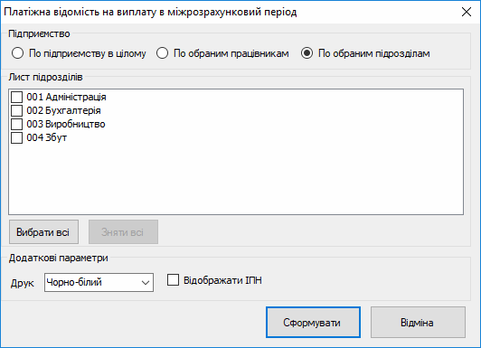

4. Після встановлення необхідних параметрів натисніть кнопку Сформувати.

5. Сформований звіт відкриється в окремому вікні спеціального редактору. Всі сформовані звіти відображаються тільки в режимі перегляду, їх не можна редагувати.

У вікні редактору доступні такі функції:

- Друк - дозволяє надрукувати сформований звіт;
- Зберегти - дозволяє зберегти звіт в одному із найуживаніших форматів.

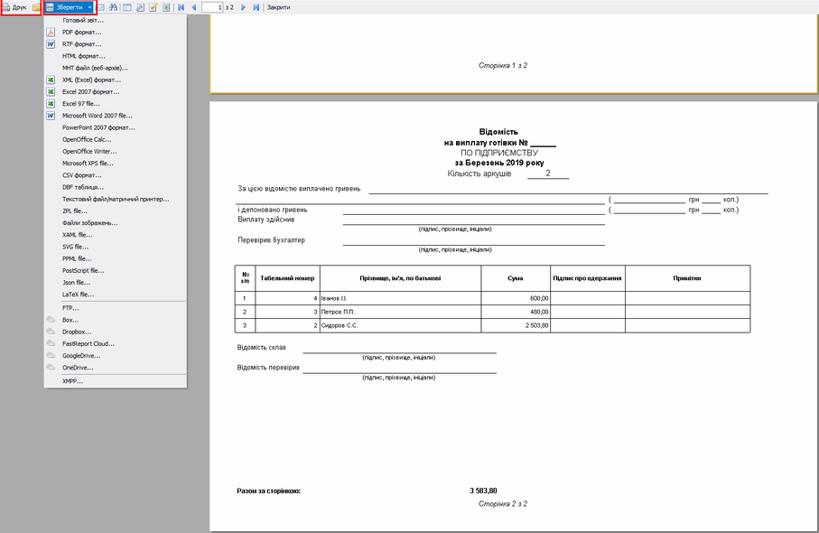

Натисніть, щоб збільшити

[До початку](#paydoc-reestrstatement_paydoc)

Розділ призначений для формування PDF файлу розрахункового листа та відправки сформованого документа на електронну пошту працівника.

Зверніть увагу! Відправка документів відбувається на e-mail працівника, який вказано у особовій картці Кадрові дані - Особова картка працівника - Додаткові дані - E-mail.

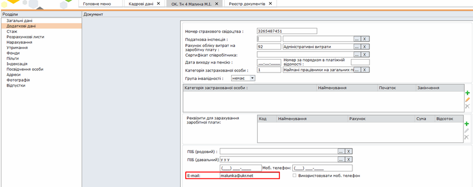

Натисніть, щоб збільшити

Для відправки розрахункових листів оберіть період, за який потрібно відправити документи, та натисніть кнопку Створити запис.

У довіднику, що відкриється, встановіть відмітки біля працівників, яким необхідно відправити розрахунковий лист, та натисніть кнопку Вибрати. Для зручності можете скористатися кнопками Відмітити все або Зняти відмітки.

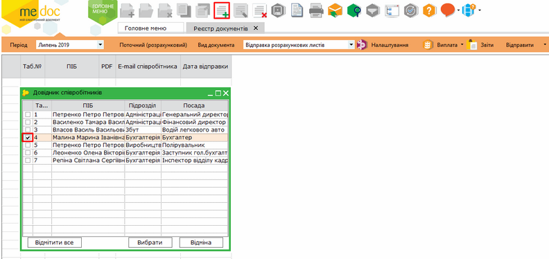

Натисніть, щоб збільшити

Обрані працівники будуть додані у розділ Відправка розрахункових листів.

Перед відправкою розрахункового листа необхідно сформувати PDF файл. Для цього встановіть відмітки біля необхідних працівників, натисніть кнопку Відправити та оберіть функцію Сформувати PDF.

Щоб  переглянути сформований файл, встановіть курсор миші на потрібному працівнику та натисніть 2 рази лівою клавішею миші.

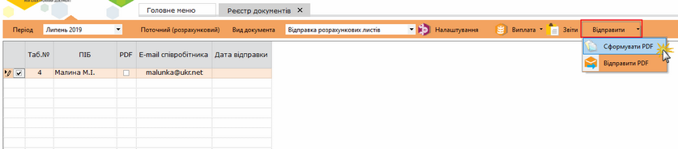

Натисніть, щоб збільшити

Для відправки розрахункових листів встановіть відмітки біля необхідних працівників, натисніть кнопку Відправити та оберіть функцію Відправити PDF.

У разі, якщо відбулися зміни у розрахунковому листі працівника, по якому вже була відправлена інформація на поштову скриньку, необхідно додати новий запис та сформувати новий PDF для відправки.

Для повторної відправки документа оберіть запис з файлом, який вже було відправлено, та оберіть команду Відправити - Відправити PDF.

Важливо! Відправка документів відбувається з поштової скриньки, яка налаштована в програмному комплексі. Для перевірки налаштувань поштової адреси перейдіть у розділ [Адміністрування  - Параметри системи - Електронна пошта](FormCompanyParams.html#formcompanyparams-admcompanyparams_emaile).

[До початку](#paydoc-reestrstatement_paydoc)

Натисніть кнопку швидкого доступу до налаштувань шаблонів документів .

Відкривається вікно Налаштування шаблонів. У вікні можливо налаштовувати відображення полів документів у вікні модуля (схему відображення). Відобразити або приховати поле можна перемістивши його у відповідну область за допомогою стрілок.

Також можливо налаштувати відсоток розрахунку, що застосовується за замовчуванням. Для цього натисніть кнопку Встановити значення за замовчуванням.

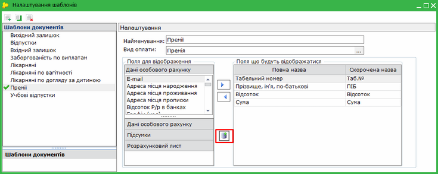

Натисніть, щоб збільшити

У вікні, що відкриється, встановіть потрібне значення:

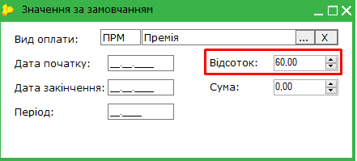

У розділі ви можете створювати власну схему відображення. Для стврення власного шаблону скористайтеся одним із способів:

-  на панелі інструментів натисніть кнопку Створити запис -  - створити новий шаблон;
- на панелі інструментів натисніть кнопку Скопіювати  - створити шаблон на основі існуючого.

Введіть найменування нової схеми відображення у полі Найменування. Під цим іменем схема буде доступна для вибору у полі . Назва створеної схеми буде відображена у області Шаблони документів.

Оберіть шаблон виду оплати, на основі якого буде виконуватись розрахунок, значення обирається з Довідника систем оплати.

Зверніть увагу! Поле Вид оплати обов’язкове для заповнення.

У розділ Поля, що будуть відображатися  за допомогою стрілки  перенесіть поля, які необхідно відображати для даного документа.

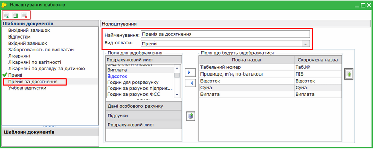

Натисніть, щоб збільшити

Щоб видалити схему відображення, оберіть її назву у області Шаблони документів та натисніть кнопку  на панелі інструментів.

[До початку](#paydoc-reestrstatement_paydoc)


