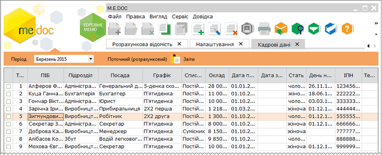

[← Зміст довідки](../)


# Кадрові дані

## Кадрові дані

_Шлях у довідці: Розділи програми › Зарплата › Кадрові дані_

В цьому розділі:

[Створення особової картки працівника ОК.Тн\_\_(Новий)](PayLicSchetsStvor.html#paylicschetsstvor-reestrstatement_paylicschetsstvor)

[Заповнення особової картки працівника  ОК.Тн\_\_(Новий)](PayLicSchetsZap.html#paylicschetszap-paylicschetszap)

Автоматичний розрахунок  заробітної плати  співробітників  базується  на  інформації кадрових даних кожного працівника.

Модуль Кадрові дані представляє собою реєстр співробітників, окремий рядок якого відображає коротку інформацію особових даних про кожного працівника. Переглянути більш повні особові дані кожного працівника можна у окремій картці, яка відкривається подвійним кліком по потрібному запису. Інформація, що зберігається в особових картках використовується для розрахунку заробітної плати та заповнення звітності.

Натисніть, щоб збільшити малюнок

Особові картки автоматично заповнюються на підставі даних із довідника Співробітники програмного комплексу M.E.Doc. Довідник співробітників може бути як імпортований з інших бухгалтерських систем, так і заповнений вручну безпосередньо в модулі. В особових картках потрібно лише вручну заповнити пусті поля, які стосуються безпосередньо розрахунку заробітної плати та заповнення звітності.

В реєстрі Кадрові дані доступні такі можливості:

|  |  |  |  |
| --- | --- | --- | --- |
|  | Створити | Ctrl+I | Створення особової картки працівника ОК.Тн\_\_(Новий), з призначенням табельного номеру автоматично .  Передбачає заповнення даних нового працівника. |
|  | Видалити | Ctrl+Y | Дозволяє безповоротно вилучити запис.  Здійснюється за чітким наміром користувача, оскільки видалений особовий рахунок відновленню не підлягає. |
|  | Редагувати | F2 | Редагування даних в особовій картці працівника.  Виконується у разі зміни або поповнення даних існуючого працівника |
|  | Копіювати |  | Копіювати особову картку працівника.  Передбачає створення копії існуючої особової картки працівника у разі повторення більшості даних для подальшого їх редагування. |

Зверніть увагу! Після коригування всі дані відображаються в розрахунковій відомості та розрахунковому листі.


