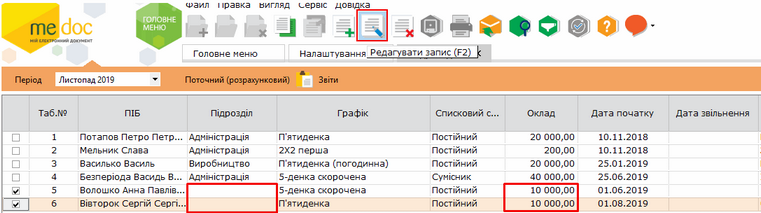
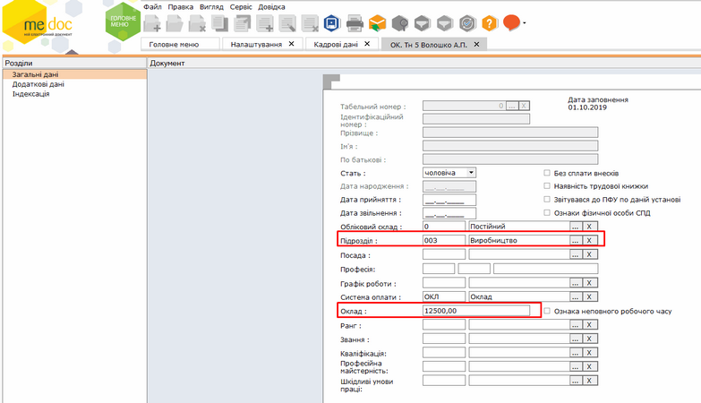
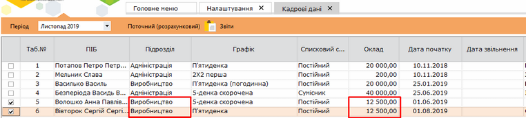

[← Зміст довідки](../)


# Групова заміна даних

## Групова заміна даних

_Шлях у довідці: Додатково: PayLicSchetsGrupZam › Групова заміна даних_

Для одночасного заповнення або заміни даних у деяких полях, наприклад, підрозділ, оклад, встановіть відмітки біля необхідних працівників та натисніть кнопку Редагувати запис:

Натисніть, щоб збільшити малюнок

   У вікні, що відкриється, вкажіть необхідне значення та натисніть кнопку Зберегти:

Натисніть, щоб збільшити малюнок

Після заповнення необхідної інформації натисніть кнопку Зберегти.

Натисніть, щоб збільшити малюнок


