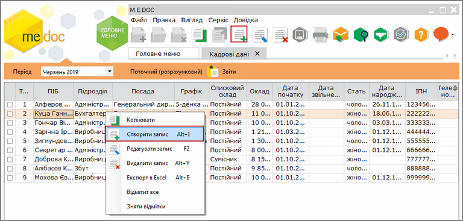

[← Зміст довідки](../)


# Створення особової картки працівника ОК.Тн__(Новий)

## Створення особової картки працівника ОК.Тн__(Новий)

_Шлях у довідці: Розділи програми › Зарплата › Кадрові дані › Створення особової картки працівника ОК.Тн__(Новий)_

1. Для створення нової особової картки співробітника скористайтесь одним із наступних способів:

- на панелі інструментів натисніть кнопку Створити запис;
- у контекстному меню оберіть команду Створити запис;
- натисніть комбінацію клавіш Ctrl+I.

Натисніть, щоб збільшити малюнок

2. Відкриється вікно ОК.Тн\_\_(Новий). [Заповніть запропоновані поля форми](PayLicSchetsZap.html#paylicschetszap-paylicschetszap).

[До початку](PayLicSchets.html#paylicschets-reestrstatement_paylicschets)


