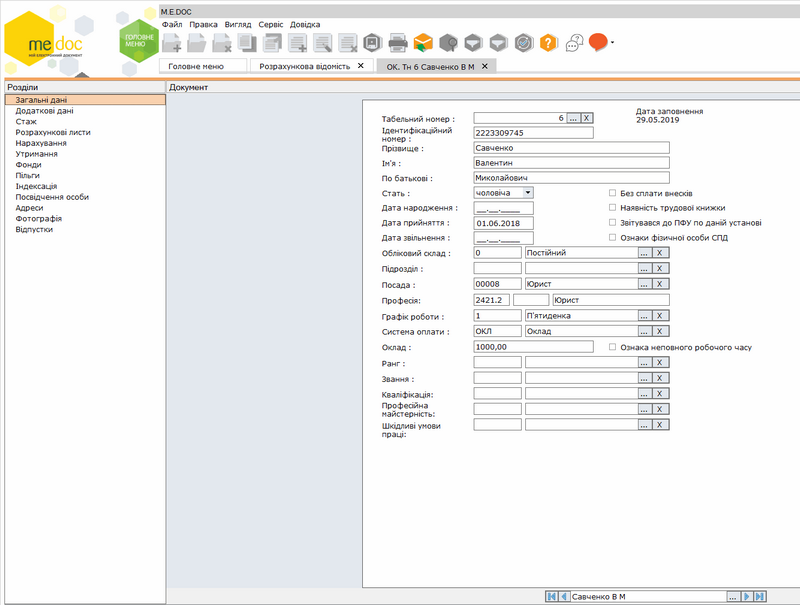

[← Зміст довідки](../)


# Заповнення особової картки працівника  ОК.Тн__(Новий)

## Заповнення особової картки працівника  ОК.Тн__(Новий)

_Шлях у довідці: Розділи програми › Зарплата › Кадрові дані › Заповнення особової картки працівника  ОК.Тн__(Новий)_

В цьому розділі:

[Загальні дані](PayLicSchetsZapZagal.html#paylicschetszapzagal-paylicschetszapzagal)

[Додаткові дані](PayLicSchetsZapZagal.html#paylicschetszapzagal-paylicschetszapzagal)

[Стаж](PayLicSchetsZapZagal.html#paylicschetszapzagal-paylicschetszapzagal)

[Розрахункові листи](PayLicSchetsZapNarah.html#paylicschetszapnarah-paylicschetsnarah)

[Нарахування](PayLicSchetsZapNarah.html#paylicschetszapnarah-paylicschetsnarah)

[Утримання](PayLicSchetsZapNarah.html#paylicschetszapnarah-paylicschetsnarah)

[Фонди](PayLicSchetsZapFondy.html#paylicschetszapfondy-paylicschetszapfondy)

[Пільги](PayLicSchetsZapFondy.html#paylicschetszapfondy-paylicschetszapfondy)

[Індексація](PayLicSchetsZapFondy.html#paylicschetszapfondy-paylicschetszapfondy)

[Посвідчення особи](PayLicSchetsZapPosvid.html#paylicschetszapposvid-paylicschetszapposvid)

[Адреси](PayLicSchetsZapPosvid.html#paylicschetszapposvid-paylicschetszapposvid)

[Фотографія](PayLicSchetsZapPosvid.html#paylicschetszapposvid-paylicschetszapposvid)

[Відпустки](PayLicSchetsZapPosvid.html#paylicschetszapposvid-paylicschetszapposvid)

[Групова заміна даних](PayLicSchetsGrupZam.html#paylicschetsgrupzam-paylicschetsgrupzam)

Особова картка працівника умовно розділена на 2 частини. Зліва розташовані розділи: Загальні дані, Додаткові дані, Стаж, Розрахункові листи, Нарахування, Утримання, Фонди, Пільги, Індексація, Посвідчення особи, Адреси, Фотографія, Відпустки, справа - відповідні поля для заповнення.

Натисніть, щоб збільшити малюнок

Поетапно заповніть запропоновані поля форми.

Після внесення всіх необхідних даних у особову картку працівника збережіть дані, натиснувши на кнопку .

[До початку](PayLicSchets.html#paylicschets-reestrstatement_paylicschets)


