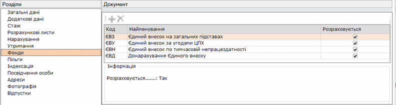
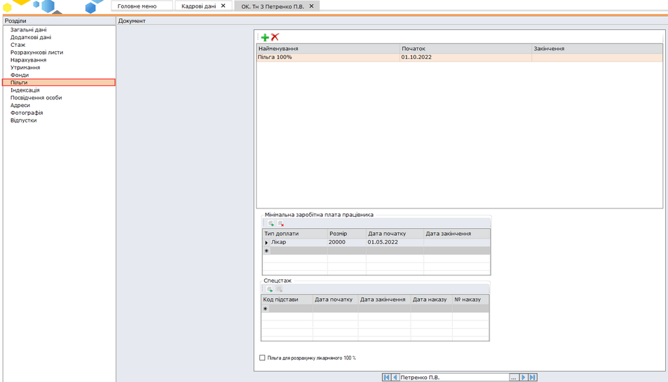
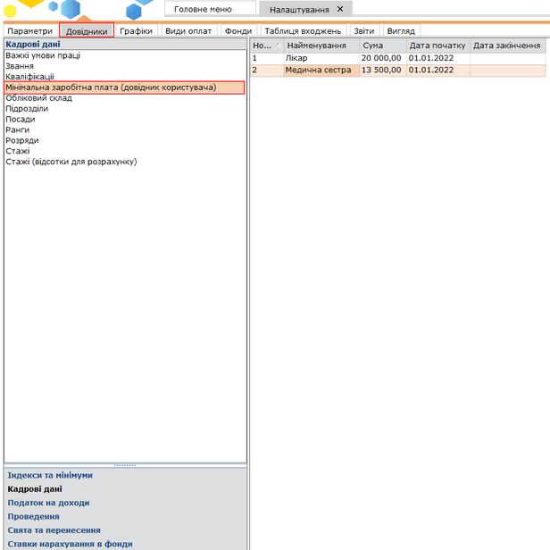
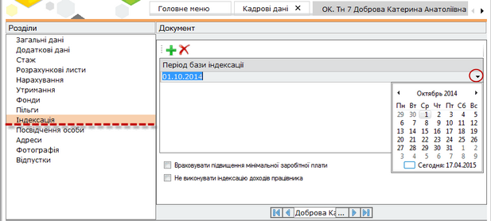

[← Зміст довідки](../)


# Фонди, пільги, індексація

## Фонди, пільги, індексація

_Шлях у довідці: Додатково: PayLicSchetsZapFondy › Фонди, пільги, індексація_

- 7. Фонди

Натисніть, щоб збільшити малюнок

Ця вкладка містить перелік фондів, у які здійснюються відрахування із заробітної плати працівника.

Даний перелік не редагується та не доповнюється.

[До початку](PayLicSchetsZap.html#paylicschetszap-paylicschetszap)

       8. Пільги

Натисніть, щоб збільшити малюнок

Ця вкладка містить перелік додаткових пільг працівника.

За замовчуванням, працівнику автоматично нараховується податкова соціальна пільга, якщо розмір доходу працівника не перевищує граничної суми для застосування податкової соціальної пільги, встановленої законодавством на 1 січня звітного податкового року. В особовій картці працівника дана пільга не відображається. Якщо пільгу не потрібно застосовувати необхідно додати пільгу Відміна пільги.

До того, щоб додати додаткову пільгу, натисніть на кнопку . Відкриється довідник Пільги фізичних осіб. Оберіть потрібне значення та натисніть кнопку Вибрати.

Дата початку дії пільги може бути порожня, це означає, що дана пільга була завжди.
Дата кінця дії пільги може бути порожня, це означає, що дана пільга не закінчиться ніколи.

Передбачена можливість вводу декількох пільг. В цьому випадку заповнюються дати початку і кінця дії пільги. Якщо раніше яка-небудь пільга була введена без заповнених дат, спочатку вказується дата кінця (поточний або попередній період) діючої пільги, після чого додається нова пільга.

Також у цій вкладці обирається спецстаж для працівника, який дає право на пільги.

При внесенні декількох пільг при розрахунку заробітної платні відповідно до Законодавства дотримується правило обліку однієї пільги.

Параметр «Пільга для розрахунку лікарняного 100%» встановлюється для пільгових категорій співробітників (в тому числі для учасників АТО/ постраждалих внаслідок Чорнобильської катастрофи), яким встановлена 100% виплата по листу непрацездатності незалежно від стажу.

Розділ Мінімальна заробітна плата працівника призначений для внесення інформації про розмір мінімальної заробітної плати окремо по кожному працівнику. Даний розділ заповнюється тільки у тому випадку, якщо розмір мінімальної заробітної плати відрізняється від розміру затвердженого відповідно до Закону "Про Державний бюджет України" на відповідний рік.

Для заповнення таблиці необхідно попередньо заповнити довідник Мінімальна заробітна плата (довідник користувача) загальною інформацією, яка буде використовуватись для усіх працівників:

Натисніть, щоб збільшити малюнок

При розрахунку доплати до мінімальної заробітної плати відбувається перевірка наявних актуальних записів у таблиці, якщо записи у таблиці відсутні, розрахунок відбувається на основі даних довідника Мінімальна заробітна плата розділу Налаштування – Довідники - Індекси та мінімуми.

[До початку](PayLicSchetsZap.html#paylicschetszap-paylicschetszap)

- 9. Індексація

Натисніть, щоб збільшити малюнок

Дана вкладка містить перелік дат (періодів), починаючи з яких проводиться індексація заробітної плати.

Для того, щоб додати базовий період індексації, натисніть на кнопку . Додасться рядок, у якому за допомогою вбудованого календаря потрібно вибрати дату.

[До початку](PayLicSchetsZap.html#paylicschetszap-paylicschetszap)


