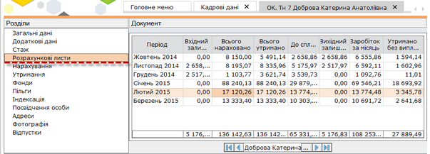
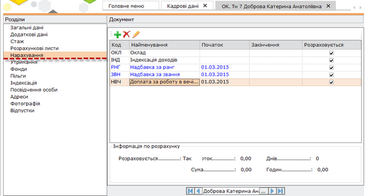
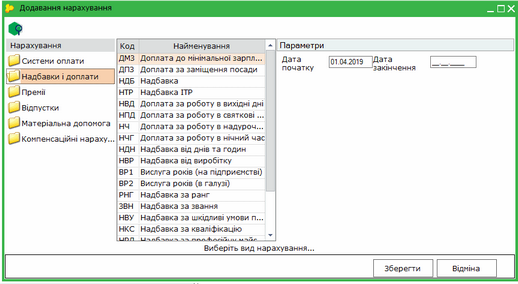
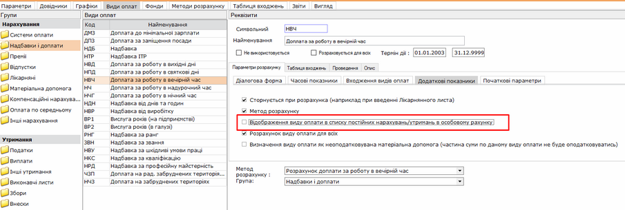
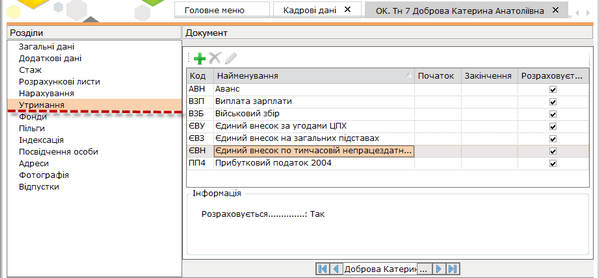
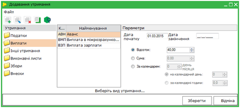

[← Зміст довідки](../)


# Розрахункові листи, нарахування, утримання

## Розрахункові листи, нарахування, утримання

_Шлях у довідці: Додатково: PayLicSchetsZapNarah › Розрахункові листи, нарахування, утримання_

- 4. Розрахункові листи

Натисніть, щоб збільшити малюнок

Дана вкладка містить помісячний архів загальних сум по нарахуванню, утриманню, суми до сплати та вихідного залишку працівника згідно даних розрахункових листів.

Всі дані представлені виключно для перегляду!

[До початку](PayLicSchetsZap.html#paylicschetszap-paylicschetszap)

       5. Нарахування

Натисніть, щоб збільшити малюнок

Дана вкладка містить перелік постійних нарахувань, які нараховуються працівникові щомісяця. До таких нарахувань можуть належати премії, надбавки, доплати.

Список постійних нарахувань за потребою налагоджується. Для того, щоб додати в перелік постійне нарахування, натисніть на кнопку .

Натисніть, щоб збільшити малюнок

Відкриється вікно Додавання нарахування. Оберіть зліва у вікні групу нарахувань, лівіше (по центру вікна) відобразиться перелік доступних нарахувань, що входять в групу. Оберіть потрібне значення та налаштуйте відповідні параметри.

Наприклад, для додання Надбавки за роботу і вечірній час оберіть групу Надбавки і доплати, а далі НВЧ Надбавка за роботу у вечірній час.

Введіть вручну з клавіатури дату, починаючи з якої потрібно нараховувати дану надбавку. Оберіть параметр нарахування: відсоток чи сума, та встановіть відповідне значення.

Натисніть кнопку Зберегти.

Для редагування існуючих нарахувань скористайтесь кнопкою .

Для видалення нарахувань скористайтесь кнопкою .

При вимкненому параметрі Відображення виду оплати в списку постійних нарахувань/утримань в особовому рахунку у розділі Зарплата - Адміністрування - Налаштування - Види оплат, даний вид буде відсутній у списку для додавання постійних нарахувань/утримань:

Натисніть, щоб збільшити малюнок

[До початку](PayLicSchetsZap.html#paylicschetszap-paylicschetszap)

       6. Утримання

Натисніть, щоб збільшити малюнок

Дана вкладка містить постійні утримання, які нараховуються щомісяця. Такі обов’язкові утримання, як прибутковий податок, утримання у фонди (пенсійний фонд,), розраховуються автоматично, вони присутні у переліку утримань за замовчуванням, тому додавати їх в список постійних утримань не потрібно. За потреби, можна вказати такі постійні утримання, як аванс, профспілковий збір, виконавчий лист і т.п.

Список постійних утримань може налагоджуватися за потреби. Для того, щоб додати постійне утримання в перелік, натисніть на кнопку .

Натисніть, щоб збільшити малюнок

Відкриється вікно Додавання утримання.

Оберіть зліва у вікні групу утримань, лівіше (по центру вікна) відобразиться перелік доступних утримань, що входять в групу. Оберіть потрібне значення та налаштуйте відповідні параметри.

Наприклад, для додання Авансу оберіть групу "Виплати, а далі АВН Аванс.

Введіть вручну дату, починаючи з якої потрібно нараховувати аванс. Оберіть параметр нарахування: відсоток, сума або кількість відпрацьованих днів/годин та встановіть відповідне значення.

Нагадаємо, якщо система оплати оклад - розрахунок проводиться за робочі дні ("на календарний день"), якщо система оплати тариф - розрахунок проводиться за робочі дні в годинах ("за календарні години").

Натисніть кнопку Зберегти.

Для редагування існуючих утримань скористайтесь кнопкою .

Для видалення утримань скористайтесь кнопкою .

[До початку](PayLicSchetsZap.html#paylicschetszap-paylicschetszap)


