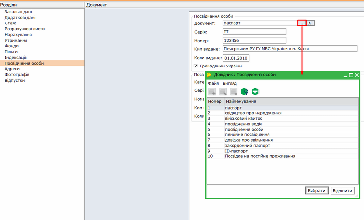
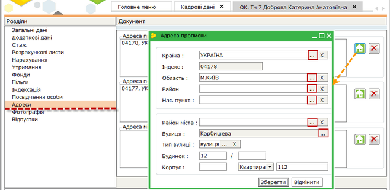
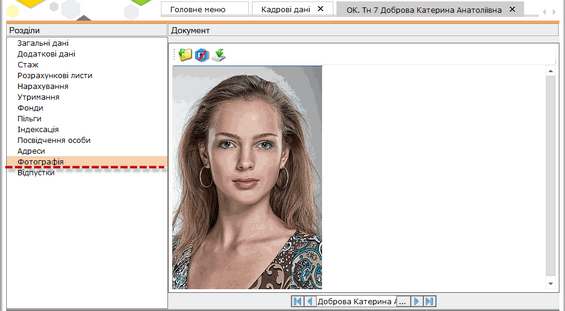
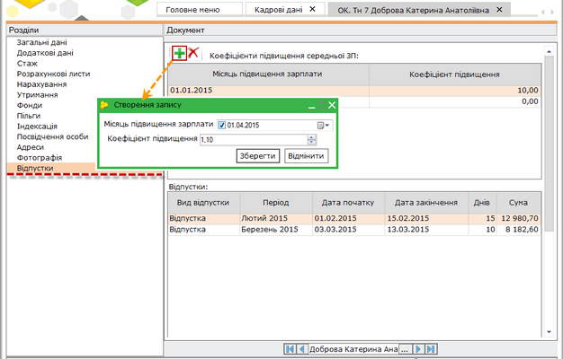
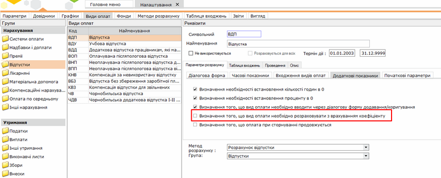

[← Зміст довідки](../)


# Посвідчення особи, адреси, фотографія, відпустки

## Посвідчення особи, адреси, фотографія, відпустки

_Шлях у довідці: Додатково: PayLicSchetsZapPosvid › Посвідчення особи, адреси, фотографія, відпустки_

- 10. Посвідчення особи

Натисніть, щоб збільшити малюнок

Вкладка містить паспортні дані робітників для заповнення звітних форм. Заповнюються реквізити: серія, номер, ким виданий, дата видачі та наявність відмітки громадянина України.

Якщо співробітник має "чорнобильське" посвідчення, також заповнюються його реквізити.

[До початку](PayLicSchetsZap.html#paylicschetszap-paylicschetszap)

- 11. Адреси

Натисніть, щоб збільшити малюнок

Дана вкладка містить три адреси: прописки, постійного місця проживання та місця народження.

Для додання адреси натисніть на кнопку . Відкриється вікно "Адреса". Використовуючи вбудовані довідники, заповніть картку адреси.

Поля, що підсвічені жовтим кольором, є обов'язковими для заповнення.

[До початку](PayLicSchetsZap.html#paylicschetszap-paylicschetszap)

       12. Фотографія

Натисніть, щоб збільшити малюнок

Дана вкладка зберігає фотографію робітника, з якою друкуються звітні форми.

Для завантаження фотографії натисніть на кнопку . Вкажіть шлях до розміщення файлу фотографії на жорсткому диску вашого комп'ютера.

Для видалення фотографії працівника натисніть на кнопку .

Для збереження фотографії на жорсткий диск натисніть на кнопку .

[До початку](PayLicSchetsZap.html#paylicschetszap-paylicschetszap)

- 13. Відпустки

Натисніть, щоб збільшити малюнок

Дана вкладка містить 2 розділи:

- Коефіцієнти підвищення середньої ЗП - записи про підвищення заробітної плати працівнику на вказаний коефіцієнт (з переліком дат, починаючи з яких проводиться підвищення);
- Відпустки - архів даних про відпустки співробітника.

Розділ Відпустки призначений виключно для перегляду інформації. Редагування та доповнення даних у розділі не виконується.

Для того, щоб переглянути інформацію для певних видів відпусток, встановіть відповідні позначки у нижній частині вкладки:

- Відпустка
- Учбова відпустка
- Відпустка без збереження заробітної плати
- Чорнобильська відпустка
- Коефіцієнт підвищення середньої ЗП розраховується автоматично при підвищенні окладу. За необхідності розрахований коефіцієнт можна відкоригувати або видалити.

Для того, щоб додати місяць та коефіцієнт підвищення, натисніть на кнопку .

Відкриється картка Створення запису.

За допомогою кнопки  оберіть із календаря дату, місяць та рік підвищення.

У полі "Коефіцієнт підвищення" внесіть вручну або оберіть за допомогою стрілочок потрібний коефіцієнт.

У таблицю додасться рядок, у якому вказано дату, з якої проводити перерахунок заробітної плати.

Для застосування коефіцієнту підвищення при розрахунку відпустки, необхідно перейти до розділу Зарплата - Адміністрування - Налаштування – Види оплат – Відпустка – Додаткові показники та встановити відмітку у параметрі Визначення того, що вид оплати необхідно розраховувати з врахуванням коефіцієнту:

Натисніть, щоб збільшити малюнок

[До початку](PayLicSchetsZap.html#paylicschetszap-paylicschetszap)


