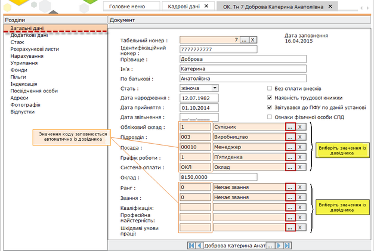
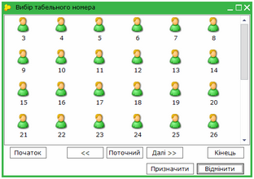
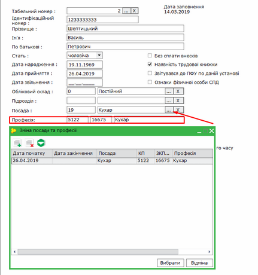
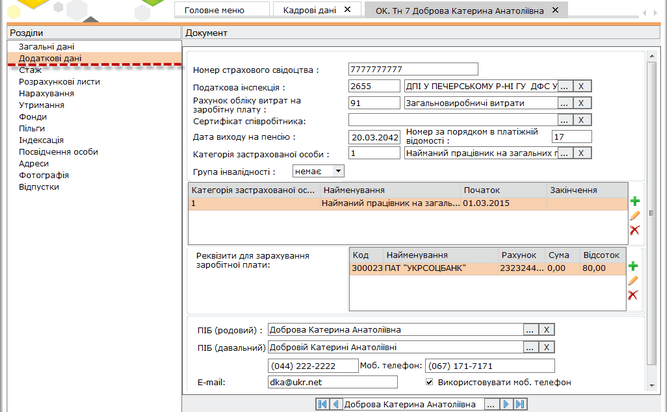
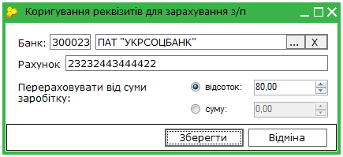
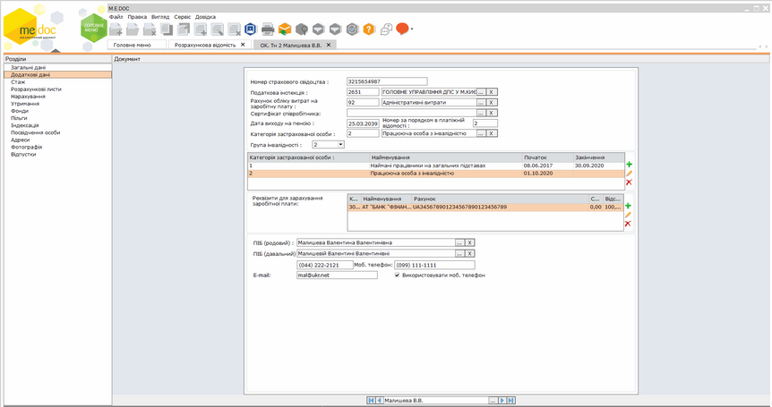
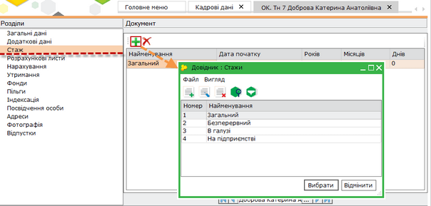
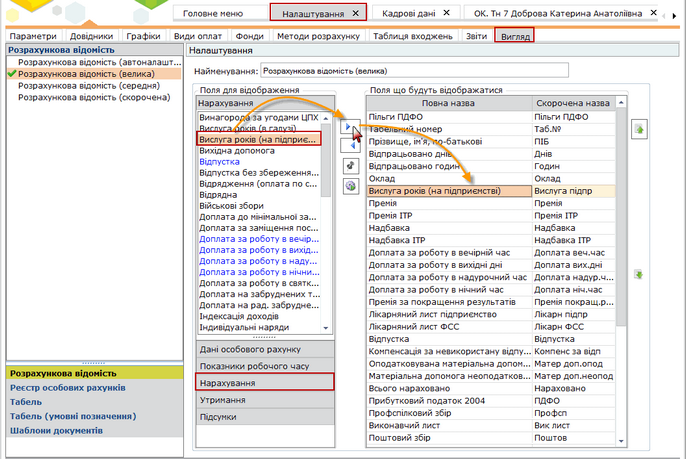
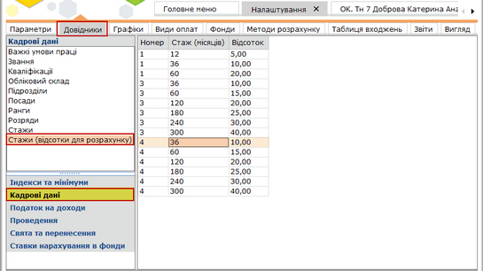
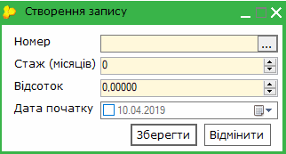

[← Зміст довідки](../)


# Загальні дані, додаткові дані, стаж

## Загальні дані, додаткові дані, стаж

_Шлях у довідці: Додатково: PayLicSchetsZapZagal › Загальні дані, додаткові дані, стаж_

- 1. Загальні дані

Натисніть, щоб збільшити малюнок

- Табельний номер - унікальний номер працівника підприємства, під яким працівник фігурує у внутрішніх документах і документах на виплату заробітної плати.
При створенні особової картки значення табельного номеру призначається автоматично. Проте, за потреби, його можна змінити. Для цього натисніть на кнопку вибору .

Натисніть, щоб збільшити малюнок

Відкриється картка Вибір табельного номеру.

У картці представлений перелік "вільних" табельних номерів.

Для полегшення навігації серед доступних номерів передбачено такі кнопки:

- Початок - перехід на початок переліку номерів;
- << - перехід на сторінку назад;
- Поточний - перехід до поточного номеру за порядком.
- Далі >> - перехід на сторінку вперед;
- Кінець - перехід в кінець переліку номерів.

Оберіть потрібний табельний номер та натисніть кнопку Призначити.

- Поля Ідентифікаційний номер, Прізвище, Ім'я, По-батькові, Оклад/Тариф, Дата народження, Дата прийняття, Дата звільнення заповнюються вручну із клавіатури.
- Поля Обліковий склад, Підрозділ, Посада, Графік роботи, Система оплати, Ранг, Звання оберіть із підключених довідників, скориставшись кнопкою .
- Для заповнення поля Професія необхідно заповнити довідник Зміна посади та професії, який підключений до поля Посада:

Натисніть, щоб збільшити малюнок

- Поле Стать обирається із списку, що випадає.
- У полях Без сплати внесків, Наявність трудової книжки, Ознака фізичної особи СПД проставляється галочка при наявності даних ознак у співробітника.
- Ознака Звітувався до ПФУ використовується при формуванні звіту Річна персоніфікація, позначка встановлюється для тих співробітників, дані яких подавались у ПФУ у попередньому звітному періоді. Ця позначка призначена для того, щоб форма (СП) Список осіб системи персоніфікованого обліку містила лише записи нових співробітників підприємства та тих, у яких змінились дані у поточному звітному періоді.

[До початку](PayLicSchetsZap.html#paylicschetszap-paylicschetszap)

- 2. Додаткові дані

Натисніть, щоб збільшити малюнок

- Поля Номер страхового свідоцтва, Дата виходу на пенсію, Номер за порядком в платіжній відомості, E-mail, Телефон, Моб. телефон заповнюються вручну із клавіатури.
- Поля Податкова інспекція, Категорія застрахованої особи, Рахунок обліку витрат на заробітну плату оберіть із підключених довідників, скориставшись кнопкою . Також оберіть сертифікат співробітника (за наявності) у полі Сертифікат співробітника.
- Значення поля Група інвалідності обирається із списку, що випадає.
- Позначка у полі Використовувати моб. телефон проставляється за умови, що у звітні документи потрібно підтягувати саме мобільний телефон даної особи.
- Реквізити для зарахування заробітної плати - містить номер банківського рахунку, на який перераховується заробітна плата працівника та суму або відсоток, що відраховується на цей рахунок. Передбачена можливість введення декількох банківських рахунків, в т.ч. в різних банках.

Для того, щоб додати реквізити для зарахування заробітної плати натисніть кнопку .

Відкриється картка "Коригування реквізитів для зарахування з/п". Оберіть із довідника банк, в якому відкрито рахунок та введіть номер рахунку у відповідні поля. Обов'язково введіть суму або відсоток від заробітної плати для перерахування на даний банківський рахунок.

Натисніть кнопку "Зберегти".

Для редагування існуючих реквізитів скористайтесь кнопкою .

Для видалення реквізитів скористайтесь кнопкою .

- Для заповнення полів ПІБ (родовий), ПІБ (давальний) в називному відмінку натисніть на кнопку   та виправте (за необхідності) відміну.

Зверніть Увагу!

При заповненні в ОК.Тн\_\_(Новий) розділу Додаткові дані відображається два поля Категорія застрахованої особи. Друге поле (розташоване нижче) надає додаткові функції для формування звітності з єдиного внеску. Поле заповнюється, якщо відбулась зміна категорії застрахованої особи платника єдиного внеску на загальнообов'язкове державне соціальне страхування за підставою, наприклад, отримання працівником посвідчення про інвалідність, довідки МСЕК про визнання особи інвалідом чи зняття інвалідності. Для зміни категорії необхідно в табличній частині додати рядок з категорією, яка діяла раніше, вказати дату початку та закінчення дії такої категорії. Також необхідно додати нову категорію окремим рядком, вказавши дату початку дії. Для додавання та редагування інформації у полі використовуються опції:

-  - Додати категорію ЗО;
-  - Редагувати категорію ЗО;
-  - Видалити категорію ЗО.

За допомогою опції Додати категорію ЗО викликається Довідник: Єдиний внесок (категорії застрахованих осіб), де необхідно обрати потрібну категорію, наприклад, Працююча особа з інвалідністю, після чого натиснути кнопку Вибрати.

Натисніть, щоб збільшити малюнок

[До початку](PayLicSchetsZap.html#paylicschetszap-paylicschetszap)

- 3. Стаж

Для того, щоб додати інформацію про стаж працівника, натисніть на кнопку .

Зверніть увагу! При заповненні Дати початку кількість років, місяців, днів, розраховуються автоматично!

Для видалення помилкових даних натисніть кнопку .

Натисніть, щоб збільшити малюнок

Вкладка містить інформацію про стаж працівника, за  класифікацією по призначенню:

- Загальний - трудовий стаж працівника, інформація, що надає можливість автоматично виконувати розрахунки, в тому числі, визначати термін відпустки та призначати допомогу у зв'язку з втратою працездатності;
- Безперервний - трудовий стаж, що є показником не тільки тривалості, а й характеру трудової діяльності (тяжкість, шкідливість умов праці, тощо);
- В галузі;
- На підприємстві.

Стаж В галузі та На підприємстві призначені для відображення інформації про спеціальний стаж працівника, що надає можливість автоматичного розрахунку оплати Надбавка за вислугу років.

Для налаштування оплати "Надбавка за вислугу років":

1. Перейдіть у розділ Адміністрування - Налаштування.

2. Оберіть вкладку Вигляд - Розрахункова відомість.

3. У розділі Поля для відображення виберіть підрозділ Нарахування, у списку полів виділіть потрібну оплату - Вислуга років (в галузі) або Вислуга років (на підприємстві), та перемістить її у розділ Поля що будуть відображатися.

Натисніть, щоб збільшити малюнок

4.  Збережіть виконані зміни за допомогою клавіш Ctrl + S. Для перерахунку скористуйтесь командою Виконати.

Зверніть увагу!  В програмі можливо самостійно встановити кількісний та відсотковий вимір стажу (в галузі ) і стажу (на підприємстві):

1. Зайдіть у розділ Адміністрування - Налаштування.

2. Відкрийте вкладку Довідники. Оберіть розділ Кадрові дані - Стажи (відсотки для розрахунку).

Натисніть, щоб збільшити малюнок

3. Додайте новий запис одним із способів:

- на панелі інструментів натисніть кнопку Створити запис - ;
- у контекстному меню оберіть команду  Створити запис;
- натисніть комбінацію клавіш Ctrl+I.

4. У вікні Створення запису заповніть поля Номер, Стаж (місяців), Відсоток. При заповненні полів зменшення та збільшення значень можливо виконувати за допомогою стрілочок.

У полі Номер оберіть необхідний стаж з довідника за допомогою кнопки .

5. Збережіть внесені зміни, натиснувши кнопку Зберегти.

6. Для редагування існуючого запису скористайтеся одним із способів:

- на панелі інструментів натисніть кнопку Редагувати запис - ;
- у контекстному меню оберіть команду  Редагувати запис;
- натисніть клавішу F2.

[До початку](PayLicSchetsZap.html#paylicschetszap-paylicschetszap)


